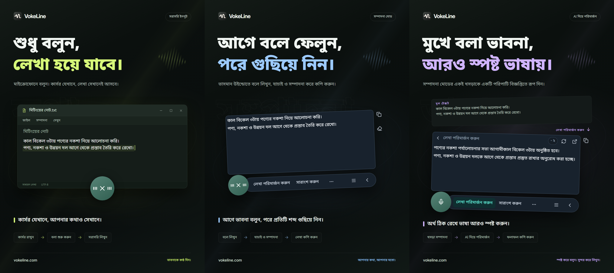

# VokeLine | ডেস্কটপ ভয়েস ইনপুট ও AI টেক্সট সহকারী

[English](README.md) | [Español](README.es.md) | [Português (Brasil)](README.pt-BR.md) | [Português (Portugal)](README.pt-PT.md) | [Français](README.fr.md) | [Deutsch](README.de.md) | [Italiano](README.it.md) | [Nederlands](README.nl.md)

[Русский](README.ru.md) | [Polski](README.pl.md) | [Türkçe](README.tr.md) | [Українська](README.uk.md) | [日本語](README.ja.md) | [한국어](README.ko.md) | [Bahasa Indonesia](README.id.md) | [Tiếng Việt](README.vi.md)

[ไทย](README.th.md) | [Bahasa Melayu](README.ms.md) | [हिन्दी](README.hi.md) | [বাংলা](README.bn.md) | [简体中文](README.zh-CN.md) | [繁體中文](README.zh-TW.md) | [Svenska](README.sv.md) | [Čeština](README.cs.md)

[Norsk bokmål](README.nb.md) | [Dansk](README.da.md) | [Suomi](README.fi.md) | [Română](README.ro.md) | [Ελληνικά](README.el.md) | [Magyar](README.hu.md)

[অফিশিয়াল ওয়েবসাইট](https://vokeline.com/) · [ডাউনলোড করুন](https://vokeline.com/bn/download) · [নির্দেশিকা ও হালনাগাদ](https://vokeline.com/bn/docs/start)

## VokeLine সম্পর্কে

VokeLine ডেস্কটপে ভয়েস ইনপুট ও AI দিয়ে লেখার কাজে সাহায্য করে। লাইভ কথা বা অডিও ফাইল থেকে এমন লেখা তৈরি করে যা বদলানো যায়। তারপর AI কাজ, কপি, অনুসন্ধান বা রেকর্ড সাজানোর সিদ্ধান্ত আপনি নেন।

সবসময় দেখানো বাটন ও ভাসমান টুলবার লাইভ ভয়েস ইনপুট এবং তাৎক্ষণিক কাজের জন্য। প্রধান উইন্ডোতে অডিও ফাইল, AI কাজ, ইতিহাস, ক্লাউড নোট, মডেল, ব্যবহার ও সেটিংস পরিচালনা করা যায়।

সবসময় দেখানো বাটন পুরো স্ক্রিন না ঢেকেই ভয়েস ইনপুট হাতের কাছে রাখে। লেখা কখন নিশ্চিত করবেন এবং এরপর কী করবেন, তা আপনি ঠিক করেন।

**কথা বলা শুরু করুন → কার্সারের জায়গায় লেখা পরীক্ষা করুন → পরবর্তী কাজ বেছে নিন**

_ইন্টারফেসের নমুনা, বাঁ থেকে ডানে: সরাসরি ইনপুট মোড, এডিটর মোড ও AI দিয়ে লেখা পরিমার্জন। লেখা ও ক্রেডিটের সংখ্যা উদাহরণ। ফলাফল যাচাই করুন। প্রকৃত ক্রেডিট খরচের জন্য অ্যাপের তথ্য দেখুন।_

## কাদের জন্য উপযোগী

- **কাজের বার্তার উত্তর দেন যারা**: ওয়েব পৃষ্ঠা বা ডকুমেন্ট পড়তে পড়তে উত্তর বলুন। লেখা বদলে বর্তমান অ্যাপে কপি করুন; বারবার অ্যাপ বদলাতে হবে না।
- **শিক্ষার্থী ও গবেষক**: পড়ার সময় নিজের পর্যবেক্ষণ ও সিদ্ধান্ত বলুন। তারপর AI কাজ দিয়ে মূল লেখার সারাংশ করুন বা নতুন করে সাজান।
- **লেখক ও কনটেন্ট নির্মাতা**: প্রথম খসড়া মুখে বলে লিখুন। কার্সার সরিয়ে আরও তথ্য যোগ করুন, তারপর চূড়ান্ত লেখার ভাষা উন্নত করুন।
- **সাক্ষাৎকার বা অন্য অডিও নিয়ে কাজ করেন যারা**: সমর্থিত অডিও ফাইল একসঙ্গে যোগ করুন এবং অগ্রগতি দেখুন। তৈরি হওয়া লেখা ইতিহাসেও রাখতে চাইলে “ডিভাইসের ইতিহাস সংরক্ষণ করুন” চালু করুন।

## মূল সুবিধা

- **সম্পাদনা করা যায় এমন মূল লেখা**: কার্সার সরান, লেখা বদলান বা একটু থেমে আবার কথা বলুন। তারপর ঠিক করুন কপি করবেন, লেখা ঢোকাবেন, অনুসন্ধান করবেন, নাকি AI ব্যবহার করবেন।
- **অডিও ফাইল ট্রান্সক্রিপশন**: সমর্থিত অডিও ফাইল একসঙ্গে যোগ করুন এবং অগ্রগতি দেখুন। তৈরি হওয়া লেখা ইতিহাসেও রাখতে চাইলে “ডিভাইসের ইতিহাস সংরক্ষণ করুন” চালু করুন।
- **লোকাল স্পিচ রিকগনিশন মডেল**: মডেল ডাউনলোড করুন। লাইভ ভয়েস ইনপুট ও অডিও ফাইল ট্রান্সক্রিপশনের জন্য আলাদা ডিফল্ট মডেল বেছে নিন।
- **AI দিয়ে ব্যাখ্যা, লেখার পরিমার্জন ও নিজের তৈরি কাজ**: বর্তমান মূল লেখা থেকে ধারণা ব্যাখ্যা করুন, মূল বিষয় বের করুন, ভাষা উন্নত করুন বা নিজের সংরক্ষিত নির্দেশ চালান। বারবার ব্যবহার করা যায় এমন নির্দেশ তৈরি করুন, তাদের ক্রম সাজান এবং কোন কাজ ভাসমান টুলবারে দেখাবেন তা বেছে নিন।
- **সার্চ বা কপি করুন**: চূড়ান্ত লেখা সরাসরি কপি করুন অথবা বেছে নেওয়া সার্চ ইঞ্জিনে পাঠিয়ে সিস্টেমের ব্রাউজারে খোঁজ চালিয়ে যান।
- **ডিভাইসের ইতিহাস ও ক্লাউড নোট**: এই ডিভাইসে অতিথি ও প্রতিটি অ্যাকাউন্টের ইতিহাস আলাদা রাখা হয়। কোনো রেকর্ডের জন্য “ক্লাউডে সংরক্ষণ করুন” ক্লিক করলে তবেই সেটি আপলোড হয়।
- **সাজানো প্রধান উইন্ডো**: ব্যবহার দেখুন, অডিও ফাইলের ট্রান্সক্রিপশন করুন, AI কাজ পরিচালনা করুন, ডিভাইসের ইতিহাস ও ক্লাউড নোট দেখুন এবং লোকাল মডেল সেট করুন।

AI কাজ আগে কনফিগার করা সেবা, নেটওয়ার্ক, বাকি ক্রেডিট ও বর্তমান প্রকাশের অবস্থার ওপর নির্ভর করে।

## ব্যবহার নির্দেশিকা

### 1. ডাউনলোড ও ইনস্টল

[ডাউনলোড করুন](https://vokeline.com/bn/download)

অফিশিয়াল ডাউনলোড পেজ খুলে আপনার অপারেটিং সিস্টেম ও প্রসেসরের জন্য সঠিক ইনস্টলার বেছে নিন। নির্দেশনা মেনে ইনস্টল করে VokeLine খুলুন। প্রথম লোকাল স্পিচ মডেল ডাউনলোড করতে ইন্টারনেট সংযোগ রাখুন।

VokeLine Windows ও macOS-এর জন্য তৈরি। Linux সংস্করণটি উন্নয়নাধীন। উপলব্ধ সংস্করণ, আর্কিটেকচার ও সিস্টেমের প্রয়োজনীয়তা ডাউনলোড পৃষ্ঠায় দেখুন।

### 2. প্রথম মডেল প্রস্তুত

**কোথায় ও কী লাগবে:** মডেল → স্থানীয় মডেল। ইন্টারনেট ও ডিস্কে জায়গা দরকার। কার্ডে আকার, আনুমানিক মেমরি এবং সমর্থিত কাজ দেখা যায়।

1. লাইভ ট্রান্সক্রিপশন সমর্থিত মডেল নিন এবং ভাষা ও ডিভাইসের শর্ত দেখুন। শুধু ফাইলের মডেল লাইভ রেকর্ডিংয়ে চলে না।
2. ডাউনলোড চাপুন এবং ডাউনলোড, পরীক্ষা ও ইনস্টল শেষ হওয়া পর্যন্ত অপেক্ষা করুন। প্রয়োজনে বিরতি দিয়ে সংযোগ ফিরলে চালিয়ে যান।
3. ব্যবহার বেছে রেকর্ডিং, ফাইল বা উভয়ের ডিফল্ট করুন, যেমন সমর্থন আছে।
4. রেকর্ডিংয়ে ব্যবহারের চিহ্ন দেখে হোমে ফিরুন।

**ফল:** নতুন রেকর্ডিং নির্বাচিত মডেল ব্যবহার করবে। ডাউনলোড নিজে ডিফল্ট ঠিক করে না; ব্যবহারও নির্বাচন করতে হবে। [মডেলের সমস্যা](https://vokeline.com/bn/docs/help#guide-model-downloads) দেখুন।

#### মাইক্রোফোন পরীক্ষা

**কোথায়:** সেটিংস → ভয়েস ও শর্টকাট → ইনপুট ডিভাইস। মাইক সংযুক্ত থাকতে হবে, মিউট বন্ধ এবং সিস্টেমের অনুমতি থাকতে হবে।

1. সিস্টেমের ডিফল্ট বা নির্দিষ্ট মাইক নিন। বাইরের মাইক খুলে ফেললে উপলভ্য ডিভাইস আবার নির্বাচন করুন।
2. মাইকের পরীক্ষা চালিয়ে কিছু বলুন। 10 সেকেন্ডের মধ্যে শেষ হবে এবং পরীক্ষার রেকর্ডিং রাখা হবে না।
3. শব্দ শনাক্ত হলে এগোন। না হলে মিউট, ইনপুট ভলিউম ও দূরত্ব দেখে আবার পরীক্ষা করুন।
4. লিংক থেকে মাইকের অনুমতি খুলুন; না খুললে নিজে সিস্টেম সেটিংসে যান।

**ফল:** পরীক্ষায় শব্দ শনাক্ত হবে এবং ডিভাইস উপলভ্য থাকবে। [ফাইল ট্রান্সক্রিপশনে](https://vokeline.com/bn/docs/features#guide-audio-files) মাইক লাগে না।

### 3. লাইভ ভয়েস

দুই মোডেই রেকর্ডিং মডেল, মাইক ও অনুমতি দরকার। স্থানীয় কাজের জন্য অ্যাকাউন্ট বা AI ক্রেডিট লাগে না। আগে [মাইক পরীক্ষা করুন](https://vokeline.com/bn/docs/start#guide-microphone)।

| মোড    | খোলা                        | লেখা         | কাজ                 |
| ------ | --------------------------- | ------------ | ------------------- |
| এডিটর  | নিজ শর্টকাট বা ডিফল্টে মাইক | ভাসমান এডিটর | পরীক্ষা, AI, খোঁজা। |
| সরাসরি | নিজ শর্টকাট বা ডিফল্টে মাইক | বাছা ঘর      | লক্ষ্য অ্যাপে লেখা। |

#### এডিটর

1. এডিটরের শর্টকাট নিন বা ডিফল্ট করে মাইক চাপুন।
2. কথা বলুন, নিয়ন্ত্রণ দিয়ে থামান এবং শেষ হওয়ার অপেক্ষা করুন।
3. মূল লেখা ঠিক করে কপি করুন বা AI অপারেশন বা অনুসন্ধান চালান।

**ফল:** মূল লেখা এডিটরে থাকে। AI ফল আলাদাভাবে দেখা ও কপি করা যায়। ট্রান্সক্রিপশন নিজে AI অনুরোধ পাঠায় না।

#### সরাসরি ইনপুট

**আরও যা লাগবে:** লক্ষ্য অ্যাপে সম্পাদনাযোগ্য লেখার ঘর। ভয়েস সেটিংসে সরাসরি ইনপুটের অনুমতি ঠিক করুন; macOS-এ চাইলে Accessibility-ও দিন।

1. লক্ষ্য ঘরে ক্লিক করে কার্সর রাখুন এবং সরাসরি মোডের শর্টকাট নিন।
2. চাইলে ঘর নির্বাচন করে রেকর্ডিংয়ের অপেক্ষা করুন।
3. কথার সময় একই ঘরে থাকুন; উইন্ডো বা লেখার স্থান বদলাবেন না।
4. নিয়ন্ত্রণ বা সংশ্লিষ্ট শর্টকাটে শেষ করে লেখা পরীক্ষা করুন।

**ফল:** নির্দিষ্ট ঘরে লেখা ঢোকে। ব্যর্থ হলে ঘর ও অনুমতি দেখুন বা এডিটর থেকে কপি করুন। লক্ষ্য ঠিক না করে বারবার চেষ্টা করবেন না।

### 4. অডিও ফাইল ট্রান্সক্রিপশন

**কোথায় ও কী লাগবে:** পাশের মেনুর ফাইল ট্রান্সক্রিপশন এবং উপযুক্ত স্থানীয় মডেল। মাইক, লগইন বা AI ক্রেডিট লাগে না।

| সীমা        | শর্ত                                                     |
| ----------- | -------------------------------------------------------- |
| ধরন         | WAV, MP3, FLAC, OGG, M4A, MP4।                           |
| আকার        | খালি নয়, প্রতি 2 GB পর্যন্ত।                            |
| নির্বাচন    | একসঙ্গে 100।                                             |
| বক্তা আলাদা | এখন সমর্থিত নয়; শুধু বক্তাদের আলাদা না করার বিকল্প আছে। |

1. ফাইল বেছে বা টেনে আনুন এবং প্রয়োজনে আরও যোগ করুন।
2. তালিকায় অবৈধ বা পড়া যায় না এমন ফাইল সরান। বাইরে বদলালে আবার বেছে নিন।
3. স্থানীয় মডেল বেছে নিন। অডিওর ভাষা নির্দিষ্ট করার সুবিধা থাকলে উপলভ্য বিকল্প থেকে জানা ভাষা বাছুন। শুধু স্বয়ংক্রিয় শনাক্তকরণ সমর্থনকারী মডেল নিজেই ভাষা ঠিক করে; দুই ক্ষেত্রেই তৈরি লেখা পরীক্ষা করুন।
4. ট্রান্সক্রিপশন চালিয়ে সারি, পড়া, রূপান্তর ও শেষ হওয়ার অবস্থা দেখুন।
5. শেষ ফল খুলে পরীক্ষা করুন এবং লেখা কপি করুন।

**ফল:** প্রতি ফাইলে আলাদা কাজ হয়। স্থানীয় সংরক্ষণ চালু থাকলে বর্তমান অতিথি বা অ্যাকাউন্টে লেখা থাকে, নিজে ক্লাউডে নয়।

### 5. AI লেখা কাজ

**কোথায় ও কী লাগবে:** AI পেজে সেটিং করে এডিটর থেকে চালান। লগইন, ইন্টারনেট, উপলভ্য মডেল ও পর্যাপ্ত ক্রেডিট দরকার। আগে মডেল, ভাষা ও ক্রেডিটের তথ্য দেখুন।

| কাজ                    | উদ্দেশ্য        | ভাষা  |
| ---------------------- | --------------- | ----- |
| ব্যাখ্যা করুন          | অর্থ পরিষ্কার   | বাছা। |
| লেখা পরিমার্জন করুন    | অভিব্যক্তি ভালো | মূল।  |
| সারাংশ করুন            | ছোট করা         | বাছা। |
| মূল বিষয়গুলো বের করুন | গুরুত্বপূর্ণ    | বাছা। |
| ভুল সংশোধন করুন        | যাচাই/ঠিক       | মূল।  |

1. ডিফল্ট AI মডেল ও ফলের ভাষা বেছে সংরক্ষণ করুন।
2. লেখা প্রস্তুত করে ইনপুট সীমা দেখুন।
3. কাজ বেছে ক্রেডিটের তথ্য দেখে ফলের অপেক্ষা করুন।
4. ফল পরীক্ষা ও কপি করুন অথবা বদলাতে মূলে ফিরুন।

**ফল:** ফল আলাদা জায়গায় দেখা যায়। আপনি কাজ চালালেই লেখা অনলাইন সেবায় যায়। AI মডেল ও ভয়েস মডেল আলাদা নির্বাচন।

“মূল লেখার ভাষা অনুসরণ করুন” বেছে নিলে মূল লেখার ভাষা ব্যবহার করা হয়। “লেখা পরিমার্জন করুন” ও “ভুল সংশোধন করুন” কাজ সব সময় মূল ভাষা বজায় রাখে।

“আবার চেষ্টা করুন” একই কাজ পুনরুদ্ধারের চেষ্টা করে। “আবার চালান” নতুন কাজ শুরু করে এবং আবার ক্রেডিট খরচ হতে পারে। প্রক্রিয়াকরণ বা ফল যাচাই চললে নতুন কাজ শুরু করার আগে অবস্থার পরিবর্তনের জন্য অপেক্ষা করুন।

#### নিজের তৈরি কাজ

1. নাম ও নির্দেশ দিয়ে নতুন কাজ তৈরি করুন, যেমন সিদ্ধান্ত ও করণীয়সহ সভার নোট।
2. মডেল, ভাষা ও দেখানোর সেটিং রেখে সংরক্ষণ করুন। নির্দেশে পাসওয়ার্ড, চাবি বা গোপন তথ্য দেবেন না।
3. ছোট লেখায় পরীক্ষা ও নির্দেশ সংশোধন করুন। সর্বোচ্চ 20 নিজের কাজ তৈরি করা যায়।

### 6. ডিভাইসের ইতিহাস ও ক্লাউড নোট

#### স্থানীয় ইতিহাস ও পরিসংখ্যান

**কোথায় ও কী লাগবে:** ইতিহাস বা হোমের সাম্প্রতিক লেখা। এই ডিভাইসের বর্তমান অতিথি বা অ্যাকাউন্ট দেখবেন, ইন্টারনেট ছাড়াই।

1. সব, ভয়েস বা AI ফিল্টারে লেখা খুঁজে খুলুন।
2. ভয়েসের মূল বা AI-এর মূল ও ফল পড়ে প্রয়োজনীয় অংশ কপি করুন।

#### ক্লাউডে রাখুন

**কোথায় ও কী লাগবে:** লগইন করে ইতিহাস → রেকর্ড → ক্লাউডে রাখুন। ইন্টারনেট ও বর্তমান সীমার মধ্যে জায়গা দরকার।

1. লেখাটি যে অ্যাকাউন্টে রাখবেন তাতে লগইন করে স্থানীয় ইতিহাস খুলুন।
2. মূল বা AI ফলে না পাঠানোর মতো কিছু আছে কি না দেখে ক্লাউডে রাখুন।
3. রেকর্ড সংরক্ষিত হয়েছে বা আগে থেকেই আছে—এমন নিশ্চিতকরণ বার্তার জন্য অপেক্ষা করুন। ভুলে মূল রাখুন, নেট ও সীমা দেখে আবার চেষ্টা করুন।
4. ক্লাউড খুলে রিফ্রেশ করে লেখা পরীক্ষা করুন।

**ফল:** একই অ্যাকাউন্টের অন্য ডিভাইসে লেখা পাবেন। স্থানীয় মূল থাকবে; সেটি মুছলে ক্লাউড মুছে না।

## সাধারণ প্রশ্ন

### VokeLine ব্যবহার করতে কি অ্যাকাউন্ট লাগে?

ডিভাইসে ভয়েস ইনপুট, লোকাল মডেল, ডিভাইসের ইতিহাস ও কপি লগইন ছাড়াই ব্যবহার করা যায়। AI সুবিধা, ক্লাউড নোট ও অ্যাকাউন্টের কাজের জন্য লগইন দরকার।

[মূল্য](https://vokeline.com/bn/pricing)

### লেখা নেই বা ভুল হচ্ছে

মডেল কথার ভাষা সমর্থন করে কি না এবং নির্বাচিত মাইক্রোফোন কাজ করছে কি না দেখুন। আশপাশের শব্দ কমিয়ে আবার চেষ্টা করুন। রেকর্ডিংয়ের ভাষা স্বয়ংক্রিয়ভাবে শনাক্ত হয়; ফাইলের ভাষা শুধু মডেল সমর্থন করলে বেছে নেওয়া যায়। ইন্টারফেসের ভাষা বদলালে শনাক্তকরণের ভাষা বদলায় না। অন্য ভাষায় ব্যাখ্যা, সারাংশ বা মূল বিষয় পেতে সংশ্লিষ্ট AI কাজ ও আউটপুট ভাষা বেছে নিন। অডিওর ভাষা মডেলকে বলে দেয় কোন ভাষার কথা শনাক্ত করতে হবে।

### সরাসরি ইনপুট ব্যর্থ বা লেখার ঘর চাইছে

সম্পাদনাযোগ্য ঘরে ক্লিক করে কার্সর রেখে সরাসরি মোড চালান। চাইলে লক্ষ্য বাছুন; বলার সময় উইন্ডো বা ঘর বদলাবেন না।

অনুমতি ও macOS Accessibility দেখুন। লেখা ঢুকতে না পারলে আগে [এডিটর](https://vokeline.com/bn/docs/features#guide-editor) থেকে কপি করে পেস্ট করুন, পরে সমস্যা দেখুন।

### ফাইল যোগ বা ট্রান্সক্রিপশন শুরু করা যাচ্ছে না

WAV, MP3, FLAC, OGG, M4A বা MP4 হতে হবে, খালি নয়, প্রতি ফাইল সর্বোচ্চ 2 GB এবং একবারে 100। অবৈধগুলো সরিয়ে মডেল ও ভাষা দেখুন।

সরানো, নাম বদল, বাইরে পরিবর্তন বা নির্বাচনের মেয়াদ শেষে আবার নিন। ডিকোড ভুলে প্লেব্যাক, অডিও ট্র্যাক ও নষ্ট কি না দেখুন।

## ডেটা ও গোপনীয়তা

মাইক্রোফোনের অডিও শুধু এই ডিভাইসে ট্রান্সক্রিপশনের কাজে লাগে; ক্লাউড নোট হিসেবে রাখা হয় না। আপনি AI কাজ বেছে নিলেই সংশ্লিষ্ট AI অনুরোধ ইন্টারনেটে পাঠানো হয়।

| কাজ      | গন্তব্য                                                                          |
| -------- | -------------------------------------------------------------------------------- |
| স্থানীয় | ডিভাইস মডেল, নিজে আপলোড নয়।                                                     |
| ইতিহাস   | অ্যাকাউন্ট/অতিথি এলাকা, অতিরিক্ত এনক্রিপশন নয়; ডিভাইস/সিস্টেম অ্যাকাউন্ট রক্ষা। |
| AI       | দরকারি লেখা সেবায়।                                                              |
| খোঁজা    | প্রশ্ন সার্চে।                                                                   |
| ক্লাউড   | বাছা লেখা নেট দিয়ে।                                                             |

সেটিংস → ডেটা এবং গোপনীয়তা থেকে “ডিভাইসের ইতিহাস সংরক্ষণ করুন” বন্ধ করলে শুধু নতুন লেখা সংরক্ষণ বন্ধ হয়; আগের রেকর্ড মুছে যায় না। হোম পেজে রেকর্ডিং ও ফাইল থেকে লেখা তৈরির সংখ্যা, অডিওর সময় এবং তৈরি হওয়া অক্ষরের সংখ্যা জমতে থাকে। এই পরিসংখ্যানে ট্রান্সক্রিপ্টের লেখা থাকে না।

এই সেটিং ইতিহাস পেজে নতুন রেকর্ড সংরক্ষণ নিয়ন্ত্রণ করে। ফাইল ট্রান্সক্রিপশনের কাজ ও ফল এই ডিভাইসে আলাদাভাবে রাখা হয়। কাজটি আর দরকার না হলে ফাইল ট্রান্সক্রিপশন থেকে “কাজ তালিকা থেকে সরান” বেছে নিন; ইতিহাস বা ক্লাউডে আগে থেকে সংরক্ষিত লেখা মুছবে না।

ডিভাইসের ইতিহাস অতিথি ও প্রতিটি অ্যাকাউন্টের জন্য আলাদা। আপনি নিজে সংরক্ষণ করতে বেছে নেওয়া রেকর্ডই শুধু অ্যাকাউন্টের ক্লাউড নোটে কপি হয়।

[অ্যাকাউন্ট ও ডেটা](https://vokeline.com/bn/docs/account)

## অফিশিয়াল ওয়েবসাইট ও সহায়তা

- [অফিশিয়াল ওয়েবসাইট: vokeline.com](https://vokeline.com/)
- [শুরু করুন](https://vokeline.com/bn/docs/start)
- [ফিচার](https://vokeline.com/bn/docs/features)
- [সমস্যার সমাধান](https://vokeline.com/bn/docs/help)

**কোথায়:** ডেস্কটপ অ্যাপের “অ্যাকাউন্ট” মেনু থেকে “অ্যাকাউন্ট” খুলুন, তারপর ওয়েবসাইটে “সহায়তা ও মতামত” বেছে নিন। প্রয়োজনে লগইন করুন।

1. সংস্করণ, সিস্টেম, ফিচার, ধাপ এবং আশা ও আসল ফল লিখুন।
2. সঠিক বার্তা, মডেল, ফাইলের ধরন ও আকার বা অর্ডার ও ক্রেডিটের সময় দিন।
