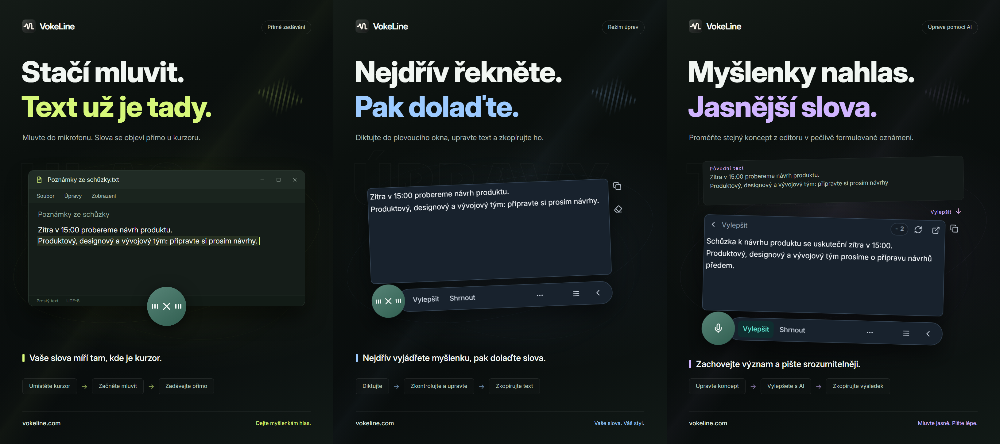

# VokeLine | Hlasové zadávání a textový asistent AI pro počítač

[English](README.md) | [Español](README.es.md) | [Português (Brasil)](README.pt-BR.md) | [Português (Portugal)](README.pt-PT.md) | [Français](README.fr.md) | [Deutsch](README.de.md) | [Italiano](README.it.md) | [Nederlands](README.nl.md)

[Русский](README.ru.md) | [Polski](README.pl.md) | [Türkçe](README.tr.md) | [Українська](README.uk.md) | [日本語](README.ja.md) | [한국어](README.ko.md) | [Bahasa Indonesia](README.id.md) | [Tiếng Việt](README.vi.md)

[ไทย](README.th.md) | [Bahasa Melayu](README.ms.md) | [हिन्दी](README.hi.md) | [বাংলা](README.bn.md) | [简体中文](README.zh-CN.md) | [繁體中文](README.zh-TW.md) | [Svenska](README.sv.md) | [Čeština](README.cs.md)

[Norsk bokmål](README.nb.md) | [Dansk](README.da.md) | [Suomi](README.fi.md) | [Română](README.ro.md) | [Ελληνικά](README.el.md) | [Magyar](README.hu.md)

[Oficiální web](https://vokeline.com/) · [Stáhnout](https://vokeline.com/cs/download) · [Návody k použití](https://vokeline.com/cs/docs/start)

## Co je VokeLine

VokeLine je počítačová aplikace pro hlasové zadávání a práci s textem pomocí AI. Převádí řeč v reálném čase nebo zvukové soubory na upravitelný text. Pak rozhodujete, zda použijete akce AI, kopírování, vyhledávání nebo uspořádání záznamů.

Trvale zobrazený ovládací prvek a plovoucí panel slouží k diktování v reálném čase a rychlým akcím. V hlavním okně spravujete zvukové soubory, akce AI, historii, poznámky v cloudu, modely, používání a nastavení.

Trvale zobrazený ovládací prvek drží hlasové zadávání po ruce a nezabírá celou obrazovku. Vy rozhodujete, kdy text potvrdíte a co s ním uděláte dál.

**Začněte mluvit → Zkontrolujte u kurzoru → Vyberte další akci**

_Ukázka rozhraní, zleva doprava: přímý režim, režim úprav a úprava textu pomocí AI. Text a počty kreditů jsou příklady. Zkontrolujte výsledek; skutečná spotřeba kreditů se řídí údaji v aplikaci._

## Pro koho je určen

- **Lidé odpovídající na pracovní zprávy**: Při čtení webové stránky nebo dokumentu nadiktujte odpověď. Upravte text a zkopírujte ho do aktuální aplikace bez neustálého přepínání.
- **Studenti a výzkumníci**: Při čtení nadiktujte pozorování a závěry. Pak pomocí akce AI původní text shrňte nebo nově uspořádejte.
- **Autoři a tvůrci obsahu**: Nadiktujte první koncept, přesuňte kurzor pro doplnění podrobností a vylepšete konečné znění.
- **Lidé zpracovávající rozhovory nebo jiné zvukové soubory**: Přidejte více podporovaných zvukových souborů a sledujte průběh. Chcete-li hotový text uchovat i v historii, zapněte „Ukládat místní historii“.

## Hlavní funkce

- **Upravitelný původní text**: Přesuňte kurzor, upravte text nebo se odmlčte a pokračujte. Pak zvolte kopírování, vložení, vyhledávání nebo akci AI.
- **Audio soubory**: Přidejte více podporovaných zvukových souborů a sledujte průběh. Chcete-li hotový text uchovat i v historii, zapněte „Ukládat místní historii“.
- **Místní model rozpoznávání řeči**: Stáhněte a vyberte samostatné výchozí modely pro diktát v reálném čase a přepis zvukových souborů.
- **Vysvětlení AI, vylepšení a vlastní akce**: Z aktuálního původního textu vysvětlete pojmy, vyberte hlavní body, vylepšete formulace nebo spusťte uložený vlastní pokyn. Vytvářejte a řaďte opakovaně použitelné instrukce a vyberte, které akce se zobrazí na plovoucím panelu nástrojů.
- **Vyhledat nebo zkopírovat**: Hotový text rovnou zkopírujte nebo ho předejte vybranému vyhledávači a pokračujte v systémovém prohlížeči.
- **Místní historie a poznámky v cloudu**: Historie se na tomto zařízení ukládá odděleně pro hosta a jednotlivé účty. Záznam se nahraje až po kliknutí na „Uložit do cloudu“.
- **Přehledné hlavní okno**: Prohlížejte statistiky používání, přepisujte zvukové soubory, spravujte akce AI, místní historii a poznámky v cloudu a nastavujte místní modely.

Akce AI závisejí na nastavených službách, síťovém připojení, dostupných kreditech a aktuální dostupnosti funkcí v této verzi.

## Jak začít

### 1. Stažení a instalace

[Stáhnout](https://vokeline.com/cs/download)

Otevřete oficiální stránku ke stažení a vyberte instalační soubor pro svůj systém a procesor. Postupujte podle pokynů a spusťte VokeLine. Pro stažení prvního místního modelu rozpoznávání řeči potřebujete připojení k internetu.

VokeLine je určen pro Windows a macOS. Verze pro Linux je ve vývoji. Dostupné verze, architektury a systémové požadavky najdete na stránce ke stažení.

### 2. Příprava prvního modelu

**Kde a za jakých podmínek:** Modely → Místní modely. Potřebujete internet a místo na disku. Karta uvádí velikost, odhad paměti a podporované úlohy.

1. Vyberte model pro živý přepis a ověřte jazyky i požadavky zařízení. Model pouze pro soubory nelze použít pro živé nahrávání.
2. Zvolte Stáhnout a vyčkejte na stažení, kontrolu a instalaci. Podle potřeby pozastavte a po připojení pokračujte.
3. Zvolte Použít a nastavte model pro nahrávání, soubory nebo obojí podle podpory.
4. Ověřte označení použití pro nahrávání a vraťte se na úvodní stránku.

**Výsledek:** Nové nahrávky používají vybraný model. Stažení samo výchozí model nenastaví; zvolte také Použít. Viz [Potíže s modely](https://vokeline.com/cs/docs/help#guide-model-downloads).

#### Kontrola mikrofonu

**Kde:** Nastavení → Hlas a klávesové zkratky → Vstupní zařízení. Mikrofon musí být připojený, neztlumený a povolený systémem.

1. Vyberte výchozí mikrofon systému nebo konkrétní zařízení. Po odpojení externího mikrofonu vyberte znovu dostupný.
2. Spusťte test a řekněte pár slov. Skončí do 10 sekund a testovací nahrávku neuloží.
3. Pokračujte po zjištění zvuku. Jinak ověřte ztlumení, vstupní hlasitost a vzdálenost a test zopakujte.
4. Otevřete oprávnění mikrofonu odkazem, nebo ručně v systému, pokud odkaz nefunguje.

**Výsledek:** Test zjistí zvuk a zařízení je dostupné. [Přepis souborů](https://vokeline.com/cs/docs/features#guide-audio-files) mikrofon nepotřebuje.

### 3. Hlasový vstup v reálném čase

Oba režimy potřebují model pro nahrávání, mikrofon a oprávnění. Místní přepis nevyžaduje účet ani kredity AI. Nejprve [ověřte mikrofon](https://vokeline.com/cs/docs/start#guide-microphone).

| Režim  | Otevřít                                                              | Text            | Použití                  |
| ------ | -------------------------------------------------------------------- | --------------- | ------------------------ |
| Editor | Zkratka režimu, nebo tlačítko mikrofonu, když je tento režim výchozí | Plovoucí editor | Ověřit, AI, hledat.      |
| Přímý  | Zkratka režimu, nebo tlačítko mikrofonu, když je tento režim výchozí | Vybrané pole    | Psát do cílové aplikace. |

#### Editor

1. Použijte zkratku editoru nebo jej nastavte jako výchozí a stiskněte mikrofon.
2. Mluvte, zastavte ovladačem a vyčkejte na dokončení.
3. Upravte a zkopírujte originál nebo spusťte akci AI či hledání.

**Výsledek:** Originál zůstává v editoru. Výsledek AI se zobrazuje a kopíruje samostatně. Přepis automaticky neodesílá požadavek AI.

#### Přímý vstup

**Navíc:** Cílová aplikace potřebuje upravitelné pole. Oprávnění přímého režimu spravujte v hlasovém nastavení; na macOS povolte také Zpřístupnění, pokud je vyžadováno.

1. Klikněte do cílového pole, umístěte kurzor a použijte přímou zkratku.
2. Na výzvu vyberte pole a počkejte na spuštění nahrávání.
3. Při mluvení zachovejte pole; neměňte okno ani místo vstupu.
4. Zastavte ovladačem nebo odpovídající zkratkou a zkontrolujte text.

**Výsledek:** Text se vloží do uzamčeného cíle. Při chybě ověřte pole a oprávnění nebo zkopírujte text z editoru. Neopakujte pokus bez jasného cíle.

### 4. Přepis zvukových souborů

**Kde a za jakých podmínek:** Přepis souborů v bočním menu s kompatibilním místním modelem. Mikrofon, přihlášení ani kredity AI nejsou třeba.

| Limit              | Podmínka                       |
| ------------------ | ------------------------------ |
| Formáty            | WAV, MP3, FLAC, OGG, M4A, MP4. |
| Velikost           | Neprázdné do 2 GB každý.       |
| Výběr              | 100 najednou.                  |
| Rozdělení mluvčích | Nyní ne, pouze bez rozdělení.  |

1. Vyberte nebo přetáhněte soubory a přidejte další podle potřeby.
2. Ověřte seznam a odstraňte neplatné či nečitelné soubory. Po vnější změně vyberte soubor znovu.
3. Vyberte místní model. Pokud umožňuje volbu jazyka zvuku, zvolte známý jazyk z dostupných možností. Modely pouze s automatickým rozpoznáním jej určí samy; v obou případech zkontrolujte text.
4. Spusťte přepis a sledujte čekání, čtení, přepis a dokončení.
5. Otevřete hotový výsledek, zkontrolujte text a zkopírujte jej.

**Výsledek:** Každý soubor má vlastní úlohu. Při místním ukládání se text uloží aktuálnímu hostovi nebo účtu, nikoli automaticky do cloudu.

### 5. AI textové akce

**Kde a za jakých podmínek:** Nastavte na stránce akcí AI a spusťte z editoru. Potřebujete přihlášení, internet, dostupný model a dost kreditů. Před spuštěním ověřte model, jazyk a kreditové údaje.

| Akce               | Účel              | Jazyk     |
| ------------------ | ----------------- | --------- |
| Vysvětlit          | Objasnit význam   | Vybraný.  |
| Vylepšit           | Upravit vyjádření | Originál. |
| Shrnout            | Zkrátit           | Vybraný.  |
| Vypsat hlavní body | Důležité          | Vybraný.  |
| Zkontrolovat       | Opravit           | Originál. |

1. Vyberte výchozí model AI a jazyk výstupu a uložte.
2. Připravte text a ověřte vstupní limit.
3. Vyberte akci, ověřte kredity a vyčkejte na výsledek.
4. Zkontrolujte a zkopírujte výsledek nebo se vraťte k originálu pro úpravy.

**Výsledek:** Výstup je samostatný. Text se odešle až při spuštění akce. Model AI a model pro řeč jsou různé volby.

„Stejný jazyk jako původní text“ používá jazyk původního textu. Akce „Vylepšit“ a „Zkontrolovat“ tento jazyk vždy zachovávají.

„Zkusit znovu“ se pokouší obnovit stejnou operaci. „Spustit znovu“ spouští novou a může znovu spotřebovat kredity. Pokud zpracování nebo kontrola výsledku stále běží, počkejte na změnu stavu, než spustíte další operaci.

#### Vlastní akce

1. Vytvořte akci s názvem a instrukcí, například zápis schůzky s rozhodnutími a úkoly.
2. Nastavte model, jazyk a zobrazení a uložte. Nedávejte do instrukce hesla, klíče ani citlivé údaje.
3. Vyzkoušejte krátký text a upřesněte instrukci. Lze vytvořit až 20 vlastních akcí.

### 6. Místní historie a poznámky v cloudu

#### Místní historie a statistiky

**Kde a za jakých podmínek:** Historie nebo poslední záznamy úvodní stránky. Vidíte aktuálního hosta či účet na tomto zařízení, bez internetu.

1. Najděte a otevřete záznam pomocí filtrů Vše, Hlas nebo AI.
2. Přečtěte hlasový originál nebo originál a výsledek AI a zkopírujte potřebnou část.

#### Uložení do cloudu

**Kde a za jakých podmínek:** Přihlaste se a zvolte Historie → záznam → Uložit do cloudu. Potřebujete internet a prostor v aktuálním limitu.

1. Přihlaste se k účtu, kterému má text patřit, a otevřete jeho místní historii.
2. Zkontrolujte originál či výsledek na obsah, který nechcete odeslat, a zvolte cloudové uložení.
3. Vyčkejte na uložení nebo zprávu o existujícím záznamu. Při chybě zachovejte originál, ověřte síť a limit a zopakujte.
4. Otevřete cloud, obnovte a ověřte text.

**Výsledek:** Text uvidíte na dalších zařízeních stejného účtu. Místní originál zůstane; jeho smazání cloudovou kopii neodstraní.

## Časté dotazy

### Musím se pro používání VokeLine přihlásit?

Místní diktování, modely, místní historii i kopírování lze používat bez přihlášení. Funkce AI, poznámky v cloudu a funkce účtu vyžadují přihlášení.

[Ceny](https://vokeline.com/cs/pricing)

### Text chybí nebo obsahuje chyby

Ověřte, že model podporuje jazyk řeči a vybraný mikrofon funguje. Omezte hluk v okolí a zkuste to znovu. Při nahrávání se jazyk rozpoznává automaticky; u souborů jej lze zvolit, pokud to model podporuje. Jazyk rozhraní nemění rozpoznávání řeči. Chcete-li vysvětlení, shrnutí nebo hlavní body v jiném jazyce, zvolte odpovídající akci AI a jazyk výstupu. Jazyk zvuku určuje, jakou řeč má model rozpoznat.

### Přímý vstup selže nebo vyžaduje pole

Klikněte do upravitelného pole, umístěte kurzor a spusťte přímý režim. Na výzvu vyberte cíl. Během mluvení neměňte okno ani pole.

Ověřte oprávnění a Zpřístupnění na macOS. Při odmítnutí vložení nejprve zkopírujte z [Editoru](https://vokeline.com/cs/docs/features#guide-editor) a vložte ručně, poté řešte chybu.

### Nelze přidat soubor nebo spustit přepis

Ověřte WAV, MP3, FLAC, OGG, M4A nebo MP4, neprázdný soubor do 2 GB a až 100 na výběr. Odstraňte neplatné a ověřte model souborů a jazyk.

Vyberte znovu po přesunu, přejmenování, vnější změně nebo vypršení výběru. Při dekódovací chybě ověřte přehrávání, zvukovou stopu a poškození.

## Data a soukromí

Zvuk z mikrofonu se používá pouze k místnímu přepisu a neukládá se jako poznámka v cloudu. Příslušný požadavek AI se odešle přes internet až po výběru akce AI.

| Akce                                 | Kam obsah putuje                                                                                                           |
| ------------------------------------ | -------------------------------------------------------------------------------------------------------------------------- |
| Místní diktování nebo přepis souborů | Zpracování probíhá pomocí místního modelu v tomto zařízení. Obsah se automaticky nenahrává do cloudu.                      |
| Uložení místní historie              | Text zůstává v zařízení, odděleně pro hosta a jednotlivé účty. Není dodatečně šifrován. Chraňte zařízení a systémový účet. |
| Textové akce AI                      | Text potřebný pro danou akci se odešle vybrané online službě.                                                              |
| Webové hledání                       | Hledané výrazy se odešlou zvolenému vyhledávači.                                                                           |
| Uložení do cloudu                    | Vybraný textový záznam se přes síť uloží do cloudových záznamů účtu.                                                       |

Vypnutí „Ukládat místní historii“ v Nastavení → Data a soukromí zastaví ukládání nových textů do historie, ale existující záznamy nesmaže. Úvodní stránka dál sbírá statistiky nahrávání a přepisu souborů: počet relací, délku zvuku a počet vytvořených znaků. Tyto statistiky neobsahují text přepisu.

Tento přepínač řídí nové záznamy na stránce Historie. Úlohy přepisu souborů a jejich výsledky se ukládají na zařízení samostatně. Nepotřebnou úlohu odstraňte pomocí „Odebrat úlohu ze seznamu“ v Přepis souborů; text již uložený v historii nebo cloudu zůstane.

Místní historie je oddělená pro hosta a jednotlivé účty. Do poznámek v cloudu daného účtu se kopírují jen záznamy, které sami uložíte.

[Účet a data](https://vokeline.com/cs/docs/account)

## Oficiální web a podpora

- [Oficiální web: vokeline.com](https://vokeline.com/)
- [První kroky](https://vokeline.com/cs/docs/start)
- [Funkce](https://vokeline.com/cs/docs/features)
- [Řešení potíží](https://vokeline.com/cs/docs/help)

**Kde:** Otevřete „Účet“ z nabídky „Účet“ počítačové aplikace a pak na webu vyberte „Nápověda a zpětná vazba“. Podle potřeby se přihlaste.

1. Uveďte verzi, systém, funkci, kroky a očekávaný i skutečný výsledek.
2. Přidejte přesnou zprávu a model, formát a velikost souboru nebo čas objednávky a kreditů podle potřeby.
