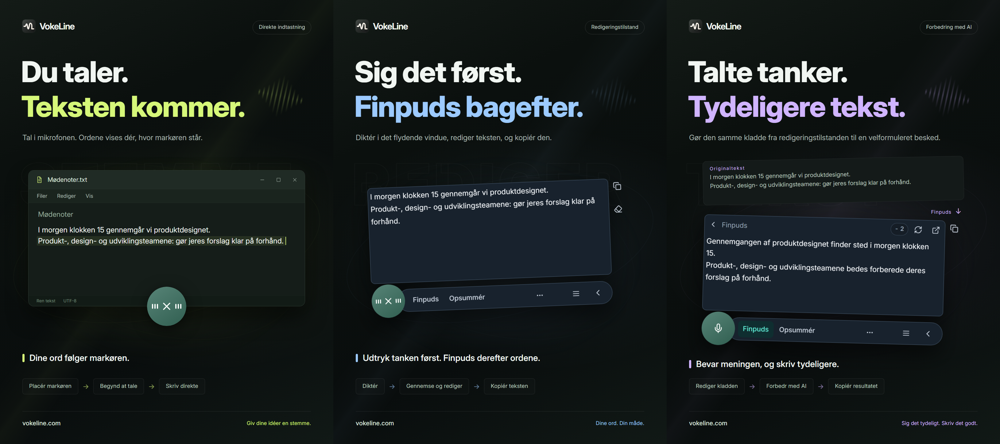

# VokeLine | Diktering og AI-tekstassistent til computeren

[English](README.md) | [Español](README.es.md) | [Português (Brasil)](README.pt-BR.md) | [Português (Portugal)](README.pt-PT.md) | [Français](README.fr.md) | [Deutsch](README.de.md) | [Italiano](README.it.md) | [Nederlands](README.nl.md)

[Русский](README.ru.md) | [Polski](README.pl.md) | [Türkçe](README.tr.md) | [Українська](README.uk.md) | [日本語](README.ja.md) | [한국어](README.ko.md) | [Bahasa Indonesia](README.id.md) | [Tiếng Việt](README.vi.md)

[ไทย](README.th.md) | [Bahasa Melayu](README.ms.md) | [हिन्दी](README.hi.md) | [বাংলা](README.bn.md) | [简体中文](README.zh-CN.md) | [繁體中文](README.zh-TW.md) | [Svenska](README.sv.md) | [Čeština](README.cs.md)

[Norsk bokmål](README.nb.md) | [Dansk](README.da.md) | [Suomi](README.fi.md) | [Română](README.ro.md) | [Ελληνικά](README.el.md) | [Magyar](README.hu.md)

[Officielt websted](https://vokeline.com/) · [Download](https://vokeline.com/da/download) · [Brugervejledninger](https://vokeline.com/da/docs/start)

## Om VokeLine

VokeLine er en computerapp til diktering og tekstbehandling med AI. Den omdanner tale i realtid eller lydfiler til redigerbar tekst. Derefter vælger du AI-handlinger, kopiering, søgning eller organisering af poster.

Den faste knap og den flydende værktøjslinje bruges til diktering i realtid og hurtige handlinger. I hovedvinduet administrerer du lydfiler, AI-handlinger, historik, noter i skyen, modeller, brug og indstillinger.

Knappen, der altid vises, holder diktering ved hånden uden at fylde skærmen. Du bestemmer, hvornår teksten skal bekræftes, og hvad der skal ske derefter.

**Begynd at tale → Gennemgå ved markøren → Vælg næste handling**

_Illustration af brugerfladen, fra venstre mod højre: direkte input, redigeringstilstand og tekstforbedring med AI. Tekst og kreditværdier er eksempler. Kontrollér resultatet; det faktiske kreditforbrug følger oplysningerne i appen._

## Hvem er det til

- **Personer, der besvarer beskeder på arbejdet**: Diktér et svar, mens du læser en webside eller et dokument. Redigér teksten, og kopiér den til den aktuelle app uden at skifte frem og tilbage.
- **Studerende og forskere**: Diktér observationer og konklusioner, mens du læser. Brug derefter en AI-handling til at opsummere eller omorganisere originalteksten.
- **Skribenter og indholdsskabere**: Diktér et første udkast, flyt markøren for at tilføje detaljer, og finpuds den endelige ordlyd.
- **Personer, der arbejder med interviews eller andre lydfiler**: Tilføj flere understøttede lydfiler, og følg forløbet. Slå “Gem lokal historik” til for også at gemme den færdige tekst i historikken.

## Vigtigste funktioner

- **Redigerbar originaltekst**: Flyt markøren, ret ordlyden, hold pause, og fortsæt med at tale, før du kopierer, indsætter, søger eller bruger AI.
- **Lydfiler**: Tilføj flere understøttede lydfiler, og følg forløbet. Slå “Gem lokal historik” til for også at gemme den færdige tekst i historikken.
- **Lokal talegenkendelsesmodel**: Download og vælg separate standardmodeller for realtidsdiktat og lydfiltransskription.
- **AI-forklaring, finpudsning og brugerdefinerede handlinger**: Brug den aktuelle transskription til at forklare en idé, udtrække nøglepunkter, forbedre ordlyden eller køre en gemt instruktion. Opret og sorter genanvendelige instruktioner, og vælg derefter, hvilke handlinger der vises på den flydende værktøjslinje.
- **Søg eller kopiér**: Kopiér den færdige tekst direkte, eller send den til den valgte søgemaskine og fortsæt i systembrowseren.
- **Lokal historik og noter i skyen**: Historikken gemmes separat for gæsten og hver konto på denne enhed. En post uploades først, når du klikker på “Gem i skyen”.
- **Organiseret hovedvindue**: Se brugen, transskribér lydfiler, administrer AI-handlinger, læs lokal historik og noter i skyen, og indstil lokale modeller.

AI-handlinger afhænger af de konfigurerede tjenester, netværket, tilgængelige kreditter og funktionernes aktuelle udgivelsesstatus.

## Sådan bruger du VokeLine

### 1. Download og installation

[Download](https://vokeline.com/da/download)

Åbn den officielle downloadside, og vælg en installationsfil til dit operativsystem og din processor. Følg installationstrinnene, og åbn VokeLine. Behold internetforbindelsen, så du kan hente den første lokale talemodel.

VokeLine er udviklet til Windows og macOS. Linux-versionen er under udvikling. Se downloadsiden for tilgængelige versioner, arkitekturer og systemkrav.

### 2. Klargør den første model

**Hvor og hvad du skal bruge:** Modeller → Lokale modeller. Download kræver internet og diskplads. Kortet viser størrelse, forventet hukommelsesforbrug og understøttede opgaver.

1. Vælg en model til transskription i realtid og tjek sprog og hardwarekrav. En model kun til filer kan ikke bruges til liveoptagelse.
2. Tryk Hent og vent på download, kontrol og installation. Sæt på pause og fortsæt efter genforbindelse, hvis nødvendigt.
3. Tryk Brug og vælg standardmodel til optagelser, filer eller begge, når det understøttes.
4. Kontrollér markeringen for optagelsesbrug, og vend tilbage til startsiden.

**Resultat:** Nye optagelser bruger modellen. Download vælger den ikke automatisk; tryk også Brug. Se [Modelproblemer](https://vokeline.com/da/docs/help#guide-model-downloads).

#### Tjek mikrofonen

**Hvor:** Indstillinger → Tale og genveje → Inputenhed. Mikrofonen skal være tilsluttet, ikke slået fra og have systemets tilladelse.

1. Vælg systemets standardmikrofon eller en bestemt enhed. Vælg en tilgængelig igen, hvis en ekstern mikrofon frakobles.
2. Start testen og sig et par ord. Den slutter inden for 10 sekunder og gemmer ikke testoptagelsen.
3. Fortsæt, når lyden registreres. Ellers tjek lyd fra/til, inputstyrke og afstand, og test igen.
4. Åbn mikrofontilladelser via linket eller manuelt i systemindstillingerne, hvis linket ikke virker.

**Resultat:** Testen registrerer lyd, og enheden er tilgængelig. [Filtransskription](https://vokeline.com/da/docs/features#guide-audio-files) kræver ingen mikrofon.

### 3. Tale i realtid

Begge tilstande kræver optagelsesmodel, mikrofon og tilladelser. Lokal transskription kræver ikke konto eller AI-kreditter. [Tjek mikrofonen](https://vokeline.com/da/docs/start#guide-microphone) først.

| Tilstand   | Åbn                                     | Tekst           | Brug                  |
| ---------- | --------------------------------------- | --------------- | --------------------- |
| Redigering | Egen genvej eller mikrofon som standard | Flydende editor | Kontrol, AI, søgning. |
| Direkte    | Egen genvej eller mikrofon som standard | Valgt felt      | Målapp.               |

#### Redigering

1. Brug editorens genvej, eller vælg den som standard og tryk mikrofonen.
2. Tal, stop med kontrollen og vent på færdiggørelse.
3. Ret og kopiér originalen eller vælg AI-handling eller søgning.

**Resultat:** Originalen bliver i editoren. AI-resultatet vises og kopieres separat. Transskriptionen sender ikke automatisk en AI-anmodning.

#### Direkte

**Derudover:** Målappen skal have et redigerbart felt. Administrér direkte tilladelser i taleindstillingerne, og tillad også Tilgængelighed på macOS, når du bliver bedt om det.

1. Klik i målfeltet, placér markøren og brug direkte genvej.
2. Vælg felt, hvis du bliver bedt om det, og vent på optagelsesstart.
3. Bliv i samme felt under talen; skift ikke vindue eller indsættelsessted.
4. Stop med kontrollen eller den tilsvarende genvej og tjek teksten.

**Resultat:** Teksten indsættes i det låste målfelt. Ved fejl tjek felt og tilladelser eller kopiér fra editoren. Gentag ikke uden et tydeligt mål.

### 4. Transskriber lydfiler

**Hvor og hvad du skal bruge:** Filtransskription i sidemenuen med en egnet lokal model. Mikrofon, login og AI-kreditter er ikke nødvendige.

| Grænse           | Krav                           |
| ---------------- | ------------------------------ |
| Formater         | WAV, MP3, FLAC, OGG, M4A, MP4. |
| Størrelse        | Ikke tom, 2 GB hver max.       |
| Valg             | 100 ad gangen.                 |
| Taleradskillelse | Ikke støttet, kun uden.        |

1. Vælg eller træk filer ind, og tilføj flere efter behov.
2. Tjek listen og fjern ugyldige eller ulæselige filer. Vælg en fil igen efter ekstern ændring.
3. Vælg en lokal model. Hvis den tillader valg af lydsprog, vælg det kendte sprog blandt mulighederne. Modeller med kun automatisk registrering vælger selv; kontrollér teksten i begge tilfælde.
4. Start transskriptionen og følg kø, læsning, transskription og færdiggørelse.
5. Åbn færdigt resultat, kontrollér teksten og kopiér den.

**Resultat:** Hver fil får sin egen opgave. Med lokal lagring aktiveret gemmes teksten under den aktuelle gæst eller konto, ikke automatisk i skyen.

### 5. AI-teksthandlinger

**Hvor og hvad du skal bruge:** Konfigurér på AI-siden, og kør fra editoren. Login, internet, tilgængelig model og nok kreditter kræves. Tjek model, sprog og kreditter før kørsel.

| Handling            | Formål       | Sprog     |
| ------------------- | ------------ | --------- |
| Forklar             | Tydeliggør   | Valgt.    |
| Finpuds             | Udtryk bedre | Original. |
| Opsummér            | Kort indhold | Valgt.    |
| Udtræk hovedpunkter | Vigtigt      | Valgt.    |
| Korrekturlæs        | Ret          | Original. |

1. Vælg standard AI-model og outputsprog, og gem.
2. Forbered teksten og tjek inputgrænsen.
3. Vælg handling, tjek kreditter og vent på resultatet.
4. Kontrollér og kopiér resultatet eller gå tilbage til originalen for rettelser.

**Resultat:** Resultatet vises separat. Teksten sendes først, når du aktivt kører handlingen. AI- og talemodel er forskellige valg.

”Samme sprog som originalteksten” bruger originaltekstens sprog. Handlingerne ”Finpuds” og ”Korrekturlæs” bevarer altid dette sprog.

”Prøv igen” forsøger at gendanne samme handling. ”Kør igen” starter en ny og kan bruge kreditter igen. Vent på en statusopdatering, hvis behandlingen eller resultatkontrollen stadig er i gang, før du starter en anden handling.

#### Brugerdefinerede handlinger

1. Opret en handling med navn og instruktion, eksempelvis et mødereferat med beslutninger og opgaver.
2. Vælg model, sprog og visning og gem. Medtag ikke adgangskoder, nøgler eller følsomme oplysninger i instruktionen.
3. Test med kort tekst og justér. Du kan oprette højst 20 egne handlinger.

### 6. Lokal historik og noter i skyen

#### Lokal historik og brugsstatistik

**Hvor og hvad du skal bruge:** Historik eller seneste optegnelser på startsiden. Du ser den aktuelle gæst eller konto på enheden uden internet.

1. Find og åbn optegnelsen med Alle, Tale eller AI-filter.
2. Læs taleoriginalen eller AI-original og resultat, og kopiér det nødvendige.

#### Gem i skyen

**Hvor og hvad du skal bruge:** Log ind og vælg Historik → optegnelse → Gem i skyen. Internet og plads inden for den aktuelle grænse kræves.

1. Log ind på kontoen, der skal eje teksten, og åbn dens lokale historik.
2. Tjek original eller AI-resultat for indhold, du ikke vil uploade, og vælg skylagring.
3. Vent på bekræftelsen om, at posten er gemt eller allerede findes. Ved fejl behold originalen, tjek internet og grænse og prøv igen.
4. Åbn skyoptegnelser, opdatér og kontrollér teksten.

**Resultat:** Teksten kan læses på andre enheder med samme konto. Lokal original bliver; sletning af den fjerner ikke skykopien.

## Ofte stillede spørgsmål

### Skal jeg logge ind for at bruge VokeLine?

Lokal diktering, lokale modeller, lokal historik og kopiering kan bruges uden login. AI-funktioner, noter i skyen og kontofunktioner kræver login.

[Priser](https://vokeline.com/da/pricing)

### Teksten mangler eller er forkert

Kontrollér, at modellen understøtter det talte sprog, og at den valgte mikrofon virker. Reducér baggrundsstøj og prøv igen. Sproget registreres automatisk ved optagelse; for filer kan du vælge det, hvis modellen understøtter det. Grænsefladesproget ændrer ikke talegenkendelsen. Vælg den relevante AI-handling og outputsprog, hvis du vil have en forklaring, et resumé eller hovedpunkter på et andet sprog. Lydsproget angiver, hvilket sprog modellen skal genkende.

### Direkte input fejler eller beder om et tekstfelt

Klik i et redigerbart felt, placér markøren og start direkte input. Vælg mål ved spørgsmål; skift ikke vindue eller felt under talen.

Tjek direkte tilladelser og Tilgængelighed på macOS. Hvis indsættelse afvises, kopiér først fra [Editor](https://vokeline.com/da/docs/features#guide-editor) og indsæt manuelt, før du undersøger fejlen.

### Filen kan ikke tilføjes eller transskriptionen starter ikke

Tjek WAV, MP3, FLAC, OGG, M4A eller MP4, ikke tom fil på højst 2 GB og højst 100 pr. valg. Fjern ugyldige og tjek filmodel og sprog.

Vælg igen efter flytning, navneskift, ekstern ændring eller udløbet valg. Ved dekodningsfejl tjek afspilning, lydspor og beskadigelse.

## Data og privatliv

Mikrofonens lyd bruges kun til lokal transskription og gemmes ikke som noter i skyen. En AI-anmodning sendes først over internettet, når du vælger den tilsvarende AI-handling.

| Handling                                | Hvor indholdet sendes eller gemmes                                                                                                  |
| --------------------------------------- | ----------------------------------------------------------------------------------------------------------------------------------- |
| Lokal diktering eller filtransskription | Behandles med en lokal model på denne enhed. Indholdet uploades ikke automatisk til skyen.                                          |
| Gem lokal historik                      | Teksten bliver på enheden, adskilt for gæsten og hver konto. Posterne har ingen ekstra kryptering. Beskyt enheden og systemkontoen. |
| AI-teksthandlinger                      | Teksten, som handlingen kræver, sendes til den valgte onlinetjeneste.                                                               |
| Websøgning                              | Søgeordene sendes til den valgte søgemaskine.                                                                                       |
| Gem i skyen                             | Den valgte tekstpost sendes over nettet til kontoens cloudposter.                                                                   |

Hvis du slår ”Gem lokal historik” fra under Indstillinger → Data og privatliv, gemmes nye tekster ikke i historikken, men eksisterende poster bevares. Startsiden samler stadig statistik for optagelser og filtransskription: antal sessioner, lydvarighed og antal producerede tegn. Statistikken indeholder ikke selve transskriptionsteksten.

Denne indstilling styrer nye poster på siden Historik. Filtransskriptionsopgaver og deres resultater gemmes separat på enheden. Brug ”Fjern opgaven fra listen” under Filtransskription, når opgaven ikke er nødvendig; tekst, der allerede er gemt i historikken eller skyen, bevares.

Lokal historik gemmes separat for gæsten og hver konto. Kun poster, du selv vælger at gemme, kopieres til kontoens noter i skyen.

[Konto og data](https://vokeline.com/da/docs/account)

## Officielt websted og hjælp

- [Officielt websted: vokeline.com](https://vokeline.com/)
- [Kom i gang](https://vokeline.com/da/docs/start)
- [Funktioner](https://vokeline.com/da/docs/features)
- [Fejlfinding](https://vokeline.com/da/docs/help)

**Hvor:** Åbn ”Konto” fra skrivebordsappens menu ”Konto”, og vælg derefter ”Hjælp og feedback” på webstedet. Log ind ved behov.

1. Oplys version, system, funktion, trin samt forventet og faktisk resultat.
2. Tilføj præcis besked og model, filformat og størrelse eller ordre- og kredittidspunkt efter behov.
