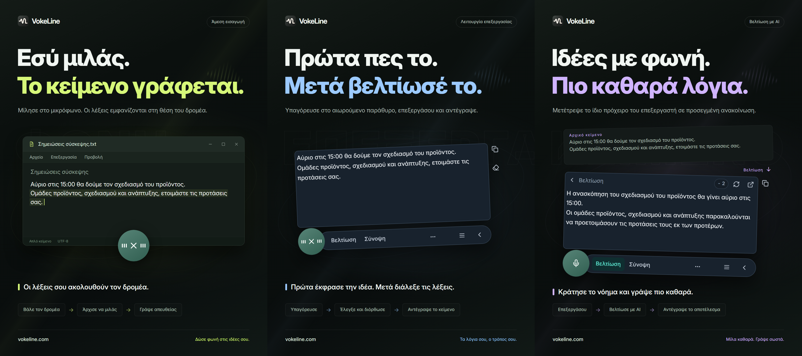

# VokeLine | Υπαγόρευση και βοηθός κειμένου AI για υπολογιστή

[English](README.md) | [Español](README.es.md) | [Português (Brasil)](README.pt-BR.md) | [Português (Portugal)](README.pt-PT.md) | [Français](README.fr.md) | [Deutsch](README.de.md) | [Italiano](README.it.md) | [Nederlands](README.nl.md)

[Русский](README.ru.md) | [Polski](README.pl.md) | [Türkçe](README.tr.md) | [Українська](README.uk.md) | [日本語](README.ja.md) | [한국어](README.ko.md) | [Bahasa Indonesia](README.id.md) | [Tiếng Việt](README.vi.md)

[ไทย](README.th.md) | [Bahasa Melayu](README.ms.md) | [हिन्दी](README.hi.md) | [বাংলা](README.bn.md) | [简体中文](README.zh-CN.md) | [繁體中文](README.zh-TW.md) | [Svenska](README.sv.md) | [Čeština](README.cs.md)

[Norsk bokmål](README.nb.md) | [Dansk](README.da.md) | [Suomi](README.fi.md) | [Română](README.ro.md) | [Ελληνικά](README.el.md) | [Magyar](README.hu.md)

[Επίσημος ιστότοπος](https://vokeline.com/) · [Λήψη](https://vokeline.com/el/download) · [Οδηγός χρήσης](https://vokeline.com/el/docs/start)

## Τι είναι το VokeLine

Το VokeLine είναι εφαρμογή υπαγόρευσης και βοηθός κειμένου AI για υπολογιστή. Μετατρέπει την ομιλία σε πραγματικό χρόνο και τα αρχεία ήχου σε επεξεργάσιμο κείμενο. Έπειτα επιλέγετε επεξεργασία με AI, αντιγραφή, αναζήτηση ή οργάνωση των καταχωρίσεων.

Το μόνιμο κουμπί και η αιωρούμενη γραμμή εργαλείων εξυπηρετούν την υπαγόρευση σε πραγματικό χρόνο και τις άμεσες ενέργειες. Στο κύριο παράθυρο διαχειρίζεστε αρχεία ήχου, ενέργειες AI, ιστορικό, σημειώσεις στο cloud, μοντέλα, στατιστικά χρήσης και ρυθμίσεις.

Το μόνιμο κουμπί κάνει την υπαγόρευση άμεσα διαθέσιμη χωρίς να γεμίζει την οθόνη. Εσείς αποφασίζετε πότε θα οριστικοποιήσετε το κείμενο και ποιο θα είναι το επόμενο βήμα.

**Ξεκινήστε να μιλάτε → Ελέγξτε το κείμενο στη θέση του δρομέα → Επιλέξτε την επόμενη ενέργεια**

_Απεικόνιση της διεπαφής, από αριστερά προς τα δεξιά: άμεση εισαγωγή, λειτουργία επεξεργασίας και βελτίωση κειμένου με AI. Το κείμενο και οι τιμές μονάδων είναι παραδείγματα. Ελέγξτε το αποτέλεσμα· η πραγματική χρήση μονάδων ακολουθεί τις πληροφορίες της εφαρμογής._

## Σε ποιους απευθύνεται

- **Άτομα που απαντούν σε μηνύματα εργασίας**: Υπαγορεύστε μια απάντηση ενώ διαβάζετε μια σελίδα ή ένα έγγραφο, επεξεργαστείτε την και αντιγράψτε την στην τρέχουσα εφαρμογή.
- **Φοιτητές και ερευνητές**: Υπαγορεύστε παρατηρήσεις και συμπεράσματα ενώ διαβάζετε και χρησιμοποιήστε μια ενέργεια AI για να συνοψίσετε ή να οργανώσετε ξανά το αρχικό κείμενο.
- **Συγγραφείς και δημιουργοί περιεχομένου**: Υπαγορεύστε ένα πρώτο προσχέδιο, μετακινήστε τον δρομέα για να προσθέσετε λεπτομέρειες και βελτιώστε την τελική διατύπωση.
- **Άτομα που επεξεργάζονται συνεντεύξεις ή άλλα αρχεία ήχου**: Προσθέστε πολλά υποστηριζόμενα αρχεία ήχου και παρακολουθήστε την πρόοδο. Ενεργοποιήστε την «Αποθήκευση στο τοπικό ιστορικό» για να διατηρείται το τελικό κείμενο και στο ιστορικό.

## Βασικές λειτουργίες

- **Επεξεργάσιμο αρχικό κείμενο**: Μετακινήστε τον δρομέα, διορθώστε τη διατύπωση, κάντε παύση και συνεχίστε να μιλάτε πριν αντιγράψετε, εισαγάγετε, αναζητήσετε ή χρησιμοποιήσετε AI.
- **Αρχεία ήχου**: Προσθέστε πολλά υποστηριζόμενα αρχεία ήχου και παρακολουθήστε την πρόοδο. Ενεργοποιήστε την «Αποθήκευση στο τοπικό ιστορικό» για να διατηρείται το τελικό κείμενο και στο ιστορικό.
- **Τοπικό μοντέλο αναγνώρισης ομιλίας**: Κατεβάστε μοντέλα και ορίστε ξεχωριστό προεπιλεγμένο μοντέλο για υπαγόρευση σε πραγματικό χρόνο και για μεταγραφή αρχείων ήχου.
- **Επεξήγηση, βελτίωση και προσαρμοσμένες ενέργειες AI**: Χρησιμοποιήστε το τρέχον κείμενο για να εξηγήσετε έννοιες, να εξαγάγετε βασικά σημεία, να βελτιώσετε τη διατύπωση ή να εκτελέσετε αποθηκευμένες προσαρμοσμένες οδηγίες. Δημιουργήστε και ταξινομήστε επαναχρησιμοποιήσιμες οδηγίες και επιλέξτε ποιες ενέργειες εμφανίζονται στην αιωρούμενη γραμμή εργαλείων.
- **Αναζήτηση και αντιγραφή**: Αντιγράψτε το τελικό κείμενο ή στείλτε το στη μηχανή αναζήτησης που επιλέξατε και συνεχίστε στο προεπιλεγμένο πρόγραμμα περιήγησης του συστήματος.
- **Τοπικό ιστορικό και σημειώσεις στο cloud**: Το ιστορικό αποθηκεύεται στη συσκευή, χωριστά για κάθε επισκέπτη ή λογαριασμό. Μια καταχώριση ανεβαίνει στο cloud μόνο αν επιλέξετε να την αποθηκεύσετε εκεί.
- **Οργανωμένο κύριο παράθυρο**: Δείτε τα στατιστικά χρήσης, μεταγράψτε αρχεία ήχου, διαχειριστείτε ενέργειες AI, περιηγηθείτε στο τοπικό ιστορικό και τις σημειώσεις στο cloud και ρυθμίστε τα τοπικά μοντέλα.

Οι ενέργειες AI εξαρτώνται από τη ρυθμισμένη υπηρεσία, τη σύνδεση στο δίκτυο, τις διαθέσιμες μονάδες και την τρέχουσα κατάσταση διάθεσης.

## Οδηγός χρήσης

### 1. Λήψη και εγκατάσταση

[Λήψη](https://vokeline.com/el/download)

Ανοίξτε την επίσημη σελίδα λήψεων και επιλέξτε το αρχείο εγκατάστασης για το λειτουργικό σύστημα και τον επεξεργαστή σας. Ακολουθήστε τα βήματα εγκατάστασης και ανοίξτε το VokeLine. Διατηρήστε τη σύνδεση στο διαδίκτυο για να κατεβάσετε το πρώτο τοπικό μοντέλο ομιλίας.

Το VokeLine έχει σχεδιαστεί για Windows και macOS. Η έκδοση Linux βρίσκεται υπό ανάπτυξη. Δείτε στη σελίδα λήψης τις διαθέσιμες εκδόσεις, αρχιτεκτονικές και απαιτήσεις συστήματος.

### 2. Προετοιμασία του πρώτου μοντέλου

**Πού και τι χρειάζεται:** Μοντέλα → Τοπικά μοντέλα. Χρειάζεστε διαδίκτυο και χώρο στον δίσκο. Οι κάρτες δείχνουν μέγεθος, εκτιμώμενη μνήμη και υποστηριζόμενες εργασίες.

1. Επιλέξτε μοντέλο για ζωντανή μεταγραφή και ελέγξτε γλώσσες και απαιτήσεις. Μοντέλο μόνο για αρχεία δεν λειτουργεί σε ζωντανή εγγραφή.
2. Πατήστε Λήψη και περιμένετε λήψη, έλεγχο και εγκατάσταση. Μπορείτε να κάνετε παύση και να συνεχίσετε μετά την επανασύνδεση.
3. Πατήστε Χρήση και ορίστε προεπιλογή για εγγραφή, αρχεία ή και τα δύο, ανάλογα με την υποστήριξη.
4. Ελέγξτε την ένδειξη χρήσης για εγγραφή και επιστρέψτε στην αρχική σελίδα.

**Αποτέλεσμα:** Οι νέες εγγραφές χρησιμοποιούν το επιλεγμένο μοντέλο. Η λήψη δεν το ορίζει αυτόματα ως προεπιλογή· πατήστε Χρήση. Για προβλήματα, δείτε [Μοντέλα και λήψεις](https://vokeline.com/el/docs/help#guide-model-downloads).

#### Έλεγχος μικροφώνου

**Πού:** Ρυθμίσεις → Φωνή και συντομεύσεις → Συσκευή εισόδου. Το μικρόφωνο πρέπει να είναι συνδεδεμένο, χωρίς σίγαση και με άδεια χρήσης από το σύστημα.

1. Επιλέξτε το προεπιλεγμένο μικρόφωνο ή συγκεκριμένη συσκευή. Αν αποσυνδεθεί εξωτερικό μικρόφωνο, επιλέξτε διαθέσιμο ξανά.
2. Εκτελέστε τη δοκιμή και μιλήστε λίγο. Τελειώνει σε 10 δευτερόλεπτα χωρίς αποθήκευση της δοκιμαστικής εγγραφής.
3. Συνεχίστε μόλις ανιχνευτεί ήχος. Αλλιώς ελέγξτε σίγαση, ένταση εισόδου και απόσταση, και δοκιμάστε ξανά.
4. Ανοίξτε τις άδειες μικροφώνου από τον σύνδεσμο ή χειροκίνητα στις ρυθμίσεις συστήματος.

**Αποτέλεσμα:** Η δοκιμή ανιχνεύει ήχο και η συσκευή είναι διαθέσιμη. Η [μεταγραφή αρχείων](https://vokeline.com/el/docs/features#guide-audio-files) δεν χρειάζεται μικρόφωνο.

### 3. Φωνητική εισαγωγή σε πραγματικό χρόνο

Και οι δύο λειτουργίες χρειάζονται μοντέλο εγγραφής, μικρόφωνο και άδειες. Η τοπική μεταγραφή δεν απαιτεί λογαριασμό ή μονάδες AI. [Ελέγξτε το μικρόφωνο](https://vokeline.com/el/docs/start#guide-microphone) πρώτα.

| Λειτουργία  | Άνοιγμα                                                                                    | Κείμενο          | Χρήση                 |
| ----------- | ------------------------------------------------------------------------------------------ | ---------------- | --------------------- |
| Επεξεργασία | Συντόμευση της λειτουργίας, ή κουμπί μικροφώνου όταν αυτή είναι η προεπιλεγμένη λειτουργία | Αιωρούμενο πεδίο | Έλεγχος/AI/αναζήτηση. |
| Άμεση       | Συντόμευση της λειτουργίας, ή κουμπί μικροφώνου όταν αυτή είναι η προεπιλεγμένη λειτουργία | Επιλεγμένο πεδίο | Εφαρμογή στόχος.      |

#### Επεξεργασία

1. Χρησιμοποιήστε τη συντόμευση επεξεργασίας ή ορίστε την ως προεπιλογή και πατήστε το μικρόφωνο.
2. Μιλήστε, σταματήστε από το χειριστήριο και περιμένετε την οριστικοποίηση.
3. Διορθώστε και αντιγράψτε το πρωτότυπο ή επιλέξτε ενέργεια AI ή αναζήτηση.

**Αποτέλεσμα:** Το πρωτότυπο μένει στον επεξεργαστή. Η έξοδος AI εμφανίζεται και αντιγράφεται ξεχωριστά. Η μεταγραφή δεν στέλνει μόνη της αίτημα AI.

#### Άμεση εισαγωγή

**Επιπλέον:** Χρειάζεται επεξεργάσιμο πεδίο στην εφαρμογή προορισμού. Διαχειριστείτε τις άδειες άμεσης εισαγωγής στις ρυθμίσεις φωνής· στο macOS επιτρέψτε και την Προσβασιμότητα όταν ζητηθεί.

1. Πατήστε στο πεδίο προορισμού, βάλτε τον δρομέα και χρησιμοποιήστε τη συντόμευση άμεσης εισαγωγής.
2. Επιλέξτε πεδίο όταν ζητηθεί και περιμένετε να αρχίσει η εγγραφή.
3. Κρατήστε την ίδια θέση όσο μιλάτε· μη μετακινηθείτε σε άλλο παράθυρο ή πεδίο.
4. Σταματήστε από το χειριστήριο ή τη σωστή συντόμευση και ελέγξτε το κείμενο.

**Αποτέλεσμα:** Το κείμενο εισάγεται στον σταθερό προορισμό. Σε αποτυχία, ελέγξτε πεδίο και άδειες ή αντιγράψτε από την επεξεργασία. Μην επαναλαμβάνετε χωρίς σαφή προορισμό.

### 4. Μεταγραφή αρχείων ήχου

**Πού και τι χρειάζεται:** Μεταγραφή αρχείων στο πλευρικό μενού, με συμβατό τοπικό μοντέλο. Δεν χρειάζεται μικρόφωνο, σύνδεση λογαριασμού ή μονάδες AI.

| Όριο                 | Απαίτηση                       |
| -------------------- | ------------------------------ |
| Μορφές               | WAV, MP3, FLAC, OGG, M4A, MP4. |
| Μέγεθος              | Όχι κενό, 2 GB ανά αρχείο.     |
| Επιλογή              | 100 ταυτόχρονα.                |
| Διαχωρισμός ομιλητών | Δεν υποστηρίζεται, μόνο χωρίς. |

1. Επιλέξτε ή σύρετε αρχεία στη σελίδα και προσθέστε περισσότερα όταν χρειάζεται.
2. Ελέγξτε τη λίστα και αφαιρέστε μη έγκυρα ή μη αναγνώσιμα αρχεία. Επιλέξτε ξανά όσα άλλαξαν εξωτερικά.
3. Επιλέξτε τοπικό μοντέλο. Αν επιτρέπει επιλογή γλώσσας ήχου, επιλέξτε τη γνωστή γλώσσα από τις διαθέσιμες επιλογές. Μοντέλα με μόνο αυτόματο εντοπισμό την καθορίζουν μόνα τους· ελέγξτε το κείμενο και στις δύο περιπτώσεις.
4. Ξεκινήστε και παρακολουθήστε αναμονή, ανάγνωση, μεταγραφή και οριστικοποίηση.
5. Ανοίξτε το έτοιμο αποτέλεσμα, ελέγξτε το και αντιγράψτε το κείμενο.

**Αποτέλεσμα:** Κάθε αρχείο γίνεται ξεχωριστή εργασία. Με ενεργή τοπική αποθήκευση, το κείμενο μπαίνει στο ιστορικό του τρέχοντος χρήστη, όχι αυτόματα στο cloud.

### 5. AI ενέργειες κειμένου

**Πού και τι χρειάζεται:** Ρυθμίστε στη σελίδα AI και εκτελέστε από τον επεξεργαστή. Χρειάζεστε λογαριασμό, διαδίκτυο, διαθέσιμο μοντέλο και επαρκείς μονάδες. Ελέγξτε μοντέλο, γλώσσα και χρέωση πριν εκτελέσετε.

| Ενέργεια      | Σκοπός      | Γλώσσα   |
| ------------- | ----------- | -------- |
| Επεξήγηση     | Διευκρίνιση | Επιλογή. |
| Βελτίωση      | Έκφραση     | Αρχική.  |
| Σύνοψη        | Συντομεύει  | Επιλογή. |
| Βασικά σημεία | Σημαντικό   | Επιλογή. |
| Διόρθωση      | Έλεγχος     | Αρχική.  |

1. Επιλέξτε προεπιλεγμένο μοντέλο AI και γλώσσα εξόδου και αποθηκεύστε.
2. Ετοιμάστε το κείμενο και ελέγξτε το όριο εισόδου.
3. Επιλέξτε ενέργεια, ελέγξτε τις μονάδες και περιμένετε.
4. Ελέγξτε και αντιγράψτε το αποτέλεσμα ή επιστρέψτε στο πρωτότυπο για αλλαγές.

**Αποτέλεσμα:** Η έξοδος εμφανίζεται ξεχωριστά. Το κείμενο αποστέλλεται μόνο όταν εκτελείτε την ενέργεια. Το μοντέλο AI είναι διαφορετική επιλογή από το μοντέλο φωνής.

Η επιλογή «Ίδια γλώσσα με το αρχικό κείμενο» χρησιμοποιεί τη γλώσσα του αρχικού κειμένου. Οι ενέργειες «Βελτίωση» και «Διόρθωση» διατηρούν πάντα αυτή τη γλώσσα.

Το «Δοκιμάστε ξανά» προσπαθεί να ανακτήσει την ίδια λειτουργία. Το «Εκτέλεση ξανά» ξεκινά νέα και μπορεί να καταναλώσει ξανά μονάδες. Αν η επεξεργασία ή ο έλεγχος αποτελέσματος συνεχίζεται, περιμένετε να ενημερωθεί η κατάσταση πριν ξεκινήσετε άλλη λειτουργία.

#### Προσαρμοσμένες ενέργειες

1. Δημιουργήστε ενέργεια με όνομα και οδηγία, όπως πρακτικά συνάντησης με αποφάσεις και εργασίες.
2. Ορίστε μοντέλο, γλώσσα και εμφάνιση και αποθηκεύστε. Μην περιλάβετε κωδικούς, κλειδιά ή ευαίσθητα δεδομένα στην οδηγία.
3. Δοκιμάστε με σύντομο κείμενο και βελτιώστε την οδηγία. Το όριο είναι 20 προσαρμοσμένες ενέργειες.

### 6. Τοπικό ιστορικό και σημειώσεις στο cloud

#### Τοπικό ιστορικό και στατιστικά

**Πού και τι χρειάζεται:** Ιστορικό ή πρόσφατες εγγραφές της αρχικής σελίδας. Βλέπετε μόνο τον τρέχοντα επισκέπτη ή λογαριασμό στη συσκευή, χωρίς διαδίκτυο.

1. Βρείτε εγγραφή με Όλα, Φωνή ή AI και ανοίξτε την.
2. Διαβάστε πρωτότυπο φωνής ή πρωτότυπο και αποτέλεσμα AI και αντιγράψτε το απαραίτητο.

#### Αποθήκευση στο cloud

**Πού και τι χρειάζεται:** Συνδεθείτε και ανοίξτε Ιστορικό → εγγραφή → Αποθήκευση στο cloud. Χρειάζεται διαδίκτυο και διαθέσιμο όριο εγγραφών.

1. Συνδεθείτε στον λογαριασμό προορισμού και ανοίξτε το τοπικό του ιστορικό.
2. Ελέγξτε το κείμενο για ανεπιθύμητο περιεχόμενο και επιλέξτε αποθήκευση στο cloud.
3. Περιμένετε επιτυχία ή ένδειξη ότι υπάρχει ήδη. Σε σφάλμα κρατήστε το πρωτότυπο, ελέγξτε δίκτυο και όριο και επαναλάβετε.
4. Ανοίξτε το cloud, ανανεώστε και ελέγξτε το αποθηκευμένο κείμενο.

**Αποτέλεσμα:** Το κείμενο εμφανίζεται και σε άλλες συσκευές του ίδιου λογαριασμού. Το τοπικό πρωτότυπο μένει· η διαγραφή του δεν σβήνει το cloud.

## Συχνές ερωτήσεις

### Χρειάζομαι λογαριασμό για να χρησιμοποιήσω το VokeLine;

Μπορείτε να χρησιμοποιείτε τοπική υπαγόρευση, τοπικά μοντέλα, τοπικό ιστορικό και αντιγραφή χωρίς να συνδεθείτε. Για τις παροχές AI, τις σημειώσεις στο cloud και τις λειτουργίες λογαριασμού απαιτείται σύνδεση.

[Τιμολόγηση](https://vokeline.com/el/pricing)

### Το κείμενο λείπει ή έχει λάθη

Ελέγξτε ότι το μοντέλο υποστηρίζει τη γλώσσα που μιλάτε και ότι το επιλεγμένο μικρόφωνο λειτουργεί. Μειώστε τον θόρυβο και δοκιμάστε ξανά. Στην εγγραφή η γλώσσα εντοπίζεται αυτόματα· στα αρχεία μπορείτε να την επιλέξετε μόνο αν το μοντέλο το υποστηρίζει. Η γλώσσα της διεπαφής δεν αλλάζει την αναγνώριση. Για επεξήγηση, σύνοψη ή βασικά σημεία σε άλλη γλώσσα, επιλέξτε την αντίστοιχη ενέργεια AI και τη γλώσσα αποτελέσματος. Η γλώσσα ήχου δηλώνει ποια γλώσσα πρέπει να αναγνωρίσει το μοντέλο.

### Η άμεση εισαγωγή αποτυγχάνει ή ζητά πεδίο

Πατήστε σε επεξεργάσιμο πεδίο, τοποθετήστε δρομέα και εκκινήστε άμεση εισαγωγή. Επιλέξτε προορισμό αν ζητηθεί και μην αλλάξετε παράθυρο ή θέση όσο μιλάτε.

Ελέγξτε άδειες και Προσβασιμότητα στο macOS. Αν ο προορισμός απορρίπτει εισαγωγή, αντιγράψτε πρώτα από [Επεξεργασία](https://vokeline.com/el/docs/features#guide-editor), επικολλήστε και μετά διερευνήστε.

### Δεν προστίθεται αρχείο ή δεν ξεκινά η εργασία

Υποστηρίζονται WAV, MP3, FLAC, OGG, M4A και MP4: μη κενά, έως 2 GB το καθένα και έως 100 ανά επιλογή. Αφαιρέστε άκυρα και επιβεβαιώστε μοντέλο αρχείων και γλώσσα.

Επιλέξτε ξανά μετά από μετακίνηση, μετονομασία, εξωτερική αλλαγή ή λήξη επιλογής. Σε αποτυχία αποκωδικοποίησης ελέγξτε αναπαραγωγή, κανάλι ήχου και φθορά.

## Δεδομένα και ιδιωτικότητα

Ο ήχος του μικροφώνου χρησιμοποιείται μόνο για τοπική μεταγραφή και δεν αποθηκεύεται ως σημείωση στο cloud. Το αντίστοιχο αίτημα προς την υπηρεσία AI αποστέλλεται μόνο όταν επιλέξετε μια ενέργεια AI.

| Ενέργεια                              | Πού πηγαίνει το περιεχόμενο                                                                                                                                                       |
| ------------------------------------- | --------------------------------------------------------------------------------------------------------------------------------------------------------------------------------- |
| Τοπική υπαγόρευση ή μεταγραφή αρχείων | Η επεξεργασία γίνεται με τοπικό μοντέλο σε αυτή τη συσκευή. Το περιεχόμενο δεν αποστέλλεται αυτόματα στο cloud.                                                                   |
| Αποθήκευση τοπικού ιστορικού          | Το κείμενο παραμένει στη συσκευή, χωριστά για κάθε επισκέπτη και λογαριασμό. Οι εγγραφές δεν έχουν πρόσθετη κρυπτογράφηση. Προστατεύστε τη συσκευή και τον λογαριασμό συστήματος. |
| Ενέργειες κειμένου με AI              | Το κείμενο που χρειάζεται για την ενέργεια αποστέλλεται στην επιλεγμένη διαδικτυακή υπηρεσία.                                                                                     |
| Αναζήτηση στο διαδίκτυο               | Οι όροι αναζήτησης αποστέλλονται στην επιλεγμένη μηχανή αναζήτησης.                                                                                                               |
| Αποθήκευση στο cloud                  | Η επιλεγμένη εγγραφή κειμένου αποθηκεύεται μέσω δικτύου στις εγγραφές cloud του λογαριασμού.                                                                                      |

Η απενεργοποίηση του «Αποθήκευση στο τοπικό ιστορικό» στις Ρυθμίσεις → «Δεδομένα και απόρρητο» σταματά την αποθήκευση νέων κειμένων στο ιστορικό, χωρίς να διαγράφει τις υπάρχουσες καταχωρίσεις. Η αρχική σελίδα συνεχίζει να συλλέγει στατιστικά για ηχογραφήσεις και μεταγραφές αρχείων: αριθμό συνεδριών, διάρκεια ήχου και πλήθος παραγόμενων χαρακτήρων. Τα στατιστικά δεν περιέχουν το κείμενο της μεταγραφής.

Αυτή η ρύθμιση ελέγχει νέες καταχωρίσεις στη σελίδα Ιστορικό. Οι εργασίες μεταγραφής αρχείων και τα αποτελέσματά τους αποθηκεύονται ξεχωριστά στη συσκευή. Όταν μια εργασία δεν χρειάζεται, χρησιμοποιήστε «Αφαίρεση εργασίας από τη λίστα» στη Μεταγραφή αρχείων· κείμενο ήδη αποθηκευμένο στο ιστορικό ή στο cloud παραμένει.

Το τοπικό ιστορικό αποθηκεύεται χωριστά για κάθε επισκέπτη ή λογαριασμό. Μόνο οι καταχωρίσεις που αποθηκεύετε ρητά στο cloud αντιγράφονται στις σημειώσεις του λογαριασμού σας.

[Λογαριασμός και δεδομένα](https://vokeline.com/el/docs/account)

## Επίσημος ιστότοπος και βοήθεια

- [Επίσημος ιστότοπος: vokeline.com](https://vokeline.com/)
- [Πρώτα βήματα](https://vokeline.com/el/docs/start)
- [Λειτουργίες](https://vokeline.com/el/docs/features)
- [Επίλυση προβλημάτων](https://vokeline.com/el/docs/help)

**Πού:** Ανοίξτε «Λογαριασμός» από το μενού «Λογαριασμός» της εφαρμογής υπολογιστή και επιλέξτε «Βοήθεια και σχόλια» στον ιστότοπο. Συνδεθείτε αν χρειάζεται.

1. Δώστε έκδοση, σύστημα, λειτουργία, βήματα, αναμενόμενο και πραγματικό αποτέλεσμα.
2. Προσθέστε το ακριβές μήνυμα και μοντέλο, μορφή και μέγεθος αρχείου ή χρόνο παραγγελίας και μονάδων.
