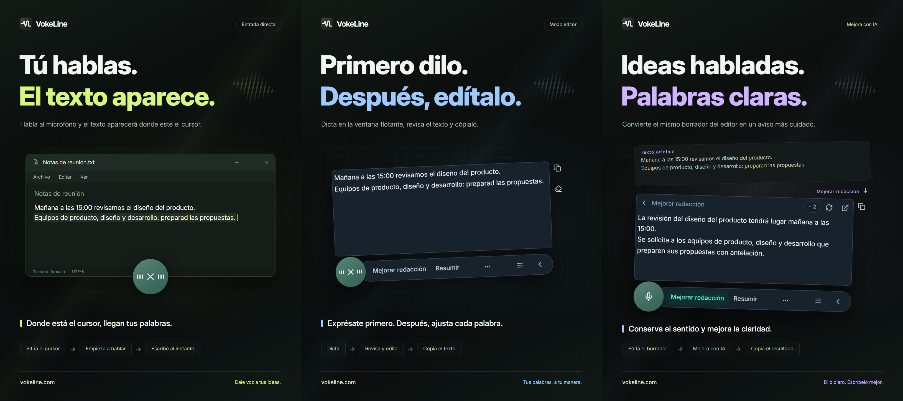

# VokeLine | Entrada por voz y asistente de texto con IA

[English](README.md) | [Español](README.es.md) | [Português (Brasil)](README.pt-BR.md) | [Português (Portugal)](README.pt-PT.md) | [Français](README.fr.md) | [Deutsch](README.de.md) | [Italiano](README.it.md) | [Nederlands](README.nl.md)

[Русский](README.ru.md) | [Polski](README.pl.md) | [Türkçe](README.tr.md) | [Українська](README.uk.md) | [日本語](README.ja.md) | [한국어](README.ko.md) | [Bahasa Indonesia](README.id.md) | [Tiếng Việt](README.vi.md)

[ไทย](README.th.md) | [Bahasa Melayu](README.ms.md) | [हिन्दी](README.hi.md) | [বাংলা](README.bn.md) | [简体中文](README.zh-CN.md) | [繁體中文](README.zh-TW.md) | [Svenska](README.sv.md) | [Čeština](README.cs.md)

[Norsk bokmål](README.nb.md) | [Dansk](README.da.md) | [Suomi](README.fi.md) | [Română](README.ro.md) | [Ελληνικά](README.el.md) | [Magyar](README.hu.md)

[Sitio web oficial](https://vokeline.com/) · [Descargar](https://vokeline.com/es/download) · [Guías y novedades](https://vokeline.com/es/docs/start)

## Qué es VokeLine

VokeLine es un asistente de entrada por voz y texto con IA para escritorio. Convierte la voz o los archivos de audio en texto editable y te deja elegir el procesamiento de IA, la copia, las búsquedas o la organización de notas.

El botón y la barra flotantes sirven para dictar y actuar sobre el texto al momento. La ventana principal permite gestionar archivos de audio, acciones de IA, historial, notas en la nube, modelos, estadísticas y ajustes.

El botón flotante te permite dictar cuando quieras sin ocupar toda la pantalla. Tú decides cuándo confirmar el texto y qué hacer después.

**Empezar a hablar → Revisar desde el cursor → Elige el siguiente paso**

_Ilustración de la interfaz, de izquierda a derecha: modo directo, modo de edición y mejora con IA. El texto y los créditos mostrados son ejemplos. Revisa el resultado; el consumo real de créditos se indica en la aplicación._

## Para quién es

- **Personas que responden mensajes de trabajo**: Dicta una respuesta mientras lees una página o un documento, corrígela y cópiala en la aplicación que estés usando.
- **Estudiantes e investigadores**: Dicta tus observaciones y conclusiones mientras lees y usa la IA para resumirlas o reorganizar el texto.
- **Escritores y creadores de contenido**: Dicta un primer borrador, añade detalles desde el cursor y pule la redacción final.
- **Personas que trabajan con entrevistas u otros audios**: Añade varios archivos de audio compatibles y sigue su progreso. Activa «Guardar historial local» para conservar también el texto terminado en el historial.

## Funciones principales

- **Texto de origen editable**: Mueve el cursor, corrige el texto y continúa dictando; después decide si copiar, insertar, buscar o usar la IA.
- **Transcribir archivos de audio**: Añade varios archivos de audio compatibles y sigue su progreso. Activa «Guardar historial local» para conservar también el texto terminado en el historial.
- **Modelos de voz locales**: Descarga modelos y elige por separado los predeterminados para dictado y archivos de audio.
- **Explicaciones, mejoras y acciones de IA personalizadas**: Explica conceptos, extrae ideas, mejora la redacción o aplica instrucciones guardadas al texto actual. Crea y ordena instrucciones reutilizables y elige cuáles mostrar en la barra flotante.
- **Busca o copia**: Copia el texto final o envíalo al buscador que prefieras para seguir explorando en el navegador.
- **Historial local y notas en la nube**: El historial se guarda en este dispositivo y se separa por identidad. Una nota solo se sube cuando eliges guardarla en la nube.
- **Una ventana principal organizada**: Consulta el uso, transcribe archivos, gestiona las acciones de IA, revisa el historial y las notas en la nube y configura los modelos locales.

Las acciones de IA dependen del servicio configurado, la conexión, los créditos disponibles y las funciones habilitadas en la versión actual.

## Guía de uso

### 1. Descargar e instalar

[Descargar](https://vokeline.com/es/download)

Abre la página oficial de descarga y elige el instalador para tu sistema operativo y procesador. Sigue las instrucciones de instalación y abre VokeLine. Mantén la conexión para descargar el primer modelo de voz local.

VokeLine está diseñado para Windows y macOS. La versión para Linux está en desarrollo. Consulta las versiones disponibles, las arquitecturas y los requisitos del sistema en la página de descargas.

### 2. Preparar el primer modelo

**Dónde y qué necesitas:** Modelos → Modelos locales. Necesitas conexión y espacio suficiente. Cada tarjeta indica tamaño de descarga, memoria estimada y tareas compatibles.

1. Elige un modelo para transcripción en vivo y comprueba idioma y requisitos. Uno exclusivo para archivos no sirve para grabar en tiempo real.
2. Descarga y espera a que terminen la comprobación y la instalación. Puedes pausar si debes desconectarte y reanudar cuando vuelvas a estar en línea.
3. Pulsa Usar en el modelo instalado. Si admite ambas tareas, establécelo como predeterminado de grabación, de archivos o de ambos.
4. Comprueba el indicador de uso para grabación y vuelve a Inicio.

**Al terminar:** Las nuevas grabaciones usarán ese modelo. Descargarlo no lo selecciona: también debes pulsar Usar. Para daños, falta de memoria o errores, consulta [Problemas con modelos](https://vokeline.com/es/docs/help#guide-model-downloads).

#### Comprobar el micrófono

**Dónde:** Ajustes → Voz y atajos → Dispositivo de entrada. Necesitas un micrófono conectado, sin silenciar y con permiso del sistema.

1. Elige el predeterminado del sistema o el micrófono concreto. Si desconectas uno externo, selecciona una entrada disponible.
2. Pulsa Probar micrófono y di unas palabras. Finaliza en un máximo de 10 segundos y no guarda esa grabación de prueba.
3. Continúa cuando detecte sonido. Si no, comprueba si el micrófono está silenciado, el volumen de entrada y la distancia antes de repetir.
4. Si faltan permisos, abre la configuración de permisos del micrófono; entra manualmente en los ajustes del sistema si no se abre.

**Al terminar:** La prueba detecta sonido y el dispositivo no aparece como no disponible. Para archivos no hace falta micrófono; puedes ir a [Transcribir audio](https://vokeline.com/es/docs/features#guide-audio-files).

### 3. Entrada de voz en tiempo real

Ambos modos requieren modelo de grabación, micrófono y permisos. La transcripción local no exige sesión ni créditos. [Comprueba el micrófono](https://vokeline.com/es/docs/start#guide-microphone) primero.

| Modo    | Acceso                                                | Dónde aparece el texto              | Uso                                            |
| ------- | ----------------------------------------------------- | ----------------------------------- | ---------------------------------------------- |
| Edición | Su atajo, o el micrófono si es el modo predeterminado | Editor flotante editable y copiable | Revisar, usar IA o buscar antes de utilizarlo. |
| Directo | Su atajo, o el micrófono si es el predeterminado      | Campo de destino seleccionado       | Escribir directamente en otra app.             |

#### Modo Edición

1. Usa su atajo o establécelo como predeterminado y pulsa el micrófono.
2. Habla, finaliza con el control de grabación y espera al procesamiento final.
3. Corrige y copia el original o elige una acción de IA o búsqueda.

**Resultado:** El original queda en el editor. La salida de IA se muestra aparte y se copia por separado. Transcribir no envía por sí solo una petición de IA.

#### Modo Directo

**Además:** El destino debe ser un campo editable. Usa la gestión de permisos del modo Directo en Ajustes → Voz y atajos; en macOS permite también Accesibilidad cuando se solicite.

1. Haz clic en el campo, coloca el cursor y usa el atajo Directo.
2. Si se solicita seleccionar un campo, elígelo y espera al inicio.
3. Mantén ese destino mientras hablas; no cambies de ventana ni de campo.
4. Finaliza con el control o el atajo correspondiente y revisa el texto insertado.

**Resultado:** Se escribe en el destino fijado. Si falla, revisa campo y permisos o copia y pega desde Edición. No repitas sin un destino claro.

### 4. Transcribir archivos de audio

**Dónde y requisitos:** Transcribir archivos en el lateral. Instala un modelo local compatible. No requiere micrófono, sesión ni créditos de IA.

| Límite                  | Condición actual                         |
| ----------------------- | ---------------------------------------- |
| Formatos                | WAV, MP3, FLAC, OGG, M4A, MP4.           |
| Tamaño                  | Archivos no vacíos, hasta 2 GB cada uno. |
| Selección               | Hasta 100 archivos a la vez.             |
| Separación de hablantes | No disponible; solo sin separación.      |

1. Selecciona archivos o arrástralos a la página; añade más si los necesitas.
2. Revisa la preparación y retira los que tengan formato, tamaño, nombre o lectura inválidos. Vuelve a elegirlos si cambiaron externamente.
3. Elige un modelo local. Si permite configurar el idioma del audio, selecciona el conocido entre las opciones disponibles. Los modelos que solo admiten detección automática lo identifican por sí mismos; revisa el texto en ambos casos.
4. Inicia y consulta las fases de espera, lectura, transcripción y finalización.
5. Abre el resultado al terminar, revísalo y copia el texto.

**Resultado:** Cada archivo crea una tarea. Guardar historial local conserva el texto terminado en el historial de la identidad actual; no lo sube automáticamente a la nube.

### 5. Acciones de IA

**Dónde y requisitos:** Configura en Acciones de IA y ejecuta desde el editor flotante. Necesitas sesión, conexión, modelo disponible y créditos suficientes. Revisa modelo, idioma y créditos antes de ejecutarlo.

| Acción               | Para qué sirve        | Idioma de salida |
| -------------------- | --------------------- | ---------------- |
| Explicar             | Aclarar el sentido    | El elegido.      |
| Mejorar redacción    | Mejorar la expresión  | El del original. |
| Resumir              | Condensar contenido   | El elegido.      |
| Extraer puntos clave | Extraer lo importante | El elegido.      |
| Corregir             | Revisar y corregir    | El del original. |

1. Elige modelo e idioma predeterminados y guarda.
2. Prepara el texto en el editor y comprueba el límite de entrada.
3. Selecciona la acción, revisa los créditos y espera.
4. Comprueba y copia el resultado; vuelve al original para editarlo.

**Resultado:** La salida aparece aparte. Solo una ejecución voluntaria envía el texto al servicio en línea. El modelo de IA y el de voz se seleccionan por separado.

«Seguir el idioma del texto original» conserva el idioma del texto original. Las acciones «Mejorar redacción» y «Corregir» siempre mantienen ese idioma.

«Reintentar» intenta recuperar la misma operación. «Ejecutar de nuevo» inicia una nueva y puede consumir créditos de nuevo. Si el procesamiento o la comprobación del resultado siguen pendientes, consulta el estado y espera antes de iniciar otra operación.

#### Acciones personalizadas

1. Crea una acción y escribe nombre e instrucciones; por ejemplo, convertir el original en acta con decisiones y tareas pendientes.
2. Guarda modelo, idioma y visibilidad. No incluyas contraseñas, claves ni información sensible en las instrucciones.
3. Prueba con un texto breve y ajusta. El máximo es 20 acciones personalizadas.

### 6. Historial local y notas en la nube

#### Historial local y estadísticas

**Dónde y requisitos:** Historial en el lateral o registros recientes de Inicio. Muestra los de la cuenta o invitado actual en este dispositivo; no requiere conexión.

1. Busca con Todos, Voz o IA y selecciona la entrada.
2. Consulta el original en voz, o original y resultado en IA, y copia lo necesario.

#### Guardar en la nube

**Dónde y requisitos:** Con sesión iniciada, selecciona una entrada del Historial y Guardar en la nube. Requiere conexión y espacio dentro del límite actual.

1. Accede a la cuenta que debe recibirla y abre su historial local.
2. Revisa original o salida de IA para evitar contenido no deseado y guarda.
3. Espera el aviso de guardado o de que ya existe. Si falla, conserva el original, revisa red y límite y reintenta.
4. Actualiza Notas en la nube y verifica el contenido.

**Resultado:** Esa cuenta puede ver el texto desde otros equipos. El original local queda; borrarlo después no borra la copia en la nube.

## Preguntas frecuentes

### ¿Necesito una cuenta para usar VokeLine?

Puedes usar el dictado, los modelos y el historial locales, y copiar texto, sin iniciar sesión. La IA, las notas en la nube y las funciones de la cuenta requieren iniciar sesión.

[Precios](https://vokeline.com/es/pricing)

### No aparece texto o es incorrecto

Comprueba que el modelo admita el idioma hablado y que el micrófono seleccionado funcione; reduce el ruido de fondo y vuelve a probar. En la grabación en directo, el idioma se detecta automáticamente; al transcribir archivos puedes seleccionarlo si el modelo lo permite. Cambiar el idioma de la interfaz no cambia el reconocimiento. Para explicar, resumir o extraer puntos clave en otro idioma, elige la acción de IA correspondiente y configura su idioma de salida. El idioma del audio indica al modelo qué idioma debe reconocer.

### Directo no escribe o pide un campo

Haz clic en un campo editable, coloca el cursor y usa el atajo. Si espera la selección, elige el destino y mantén ventana y posición durante la grabación.

Configura los permisos necesarios y Accesibilidad en macOS. Si la app rechaza la entrada, conserva primero el texto con [Edición](https://vokeline.com/es/docs/features#guide-editor) y copia y pega antes de investigar.

### No se añaden archivos o no empieza

Comprueba WAV, MP3, FLAC, OGG, M4A o MP4, archivos no vacíos de hasta 2 GB y hasta 100 por selección. Retira inválidos y elige modelo de archivos e idioma.

Selecciona de nuevo tras movimientos, cambios o caducidad de la selección. Una extensión correcta aún puede tener daños, no tener pista de audio o no reproducirse.

## Datos y privacidad

El audio del micrófono solo se usa para transcribir localmente y no se guarda en la nube. Solo se envía una solicitud de IA en línea cuando eliges una acción de IA.

| Operación                       | Destino                                                                                       |
| ------------------------------- | --------------------------------------------------------------------------------------------- |
| Grabar o transcribir localmente | Modelo del dispositivo; no se sube automáticamente como registro.                             |
| Guardar historial local         | Partición de la identidad actual; sin cifrado adicional. Protege equipo y cuenta del sistema. |
| Acciones de IA                  | Texto necesario enviado al servicio elegido.                                                  |
| Búsqueda web                    | Consulta enviada al buscador elegido.                                                         |
| Guardar en la nube              | Texto seleccionado enviado a los registros de la cuenta por red.                              |

Desactivar «Guardar historial local» en Ajustes → Datos y privacidad impide guardar nuevos registros de texto, pero conserva los existentes. Inicio sigue acumulando estadísticas de grabación y transcripción de archivos: número de sesiones, duración del audio y caracteres generados. Estas estadísticas no contienen el texto transcrito.

Este interruptor controla las nuevas entradas de Historial. Las tareas de transcripción de archivos y sus resultados se guardan por separado en este dispositivo. Si ya no necesitas una tarea, usa «Quitar tarea» en Transcribir archivos; quitarla no borra una transcripción ya guardada en el historial o la nube.

El historial distingue entre invitados y cuentas. Solo las notas que guardas expresamente se copian a las notas en la nube de tu cuenta.

[Cuenta y datos](https://vokeline.com/es/docs/account)

## Sitio oficial y ayuda

- [Sitio web oficial: vokeline.com](https://vokeline.com/)
- [Primeros pasos](https://vokeline.com/es/docs/start)
- [Funciones](https://vokeline.com/es/docs/features)
- [Solución de problemas](https://vokeline.com/es/docs/help)

**Dónde:** Abre «Mi cuenta» desde el menú «Cuenta» de la aplicación y entra en «Ayuda y comentarios» en la web. Inicia sesión si hace falta.

1. Indica versión, sistema, función, lo que hiciste, lo esperado y lo ocurrido.
2. Añade el mensaje exacto y, según el problema, modelo, formato y tamaño o fecha de la operación de pago/créditos.
