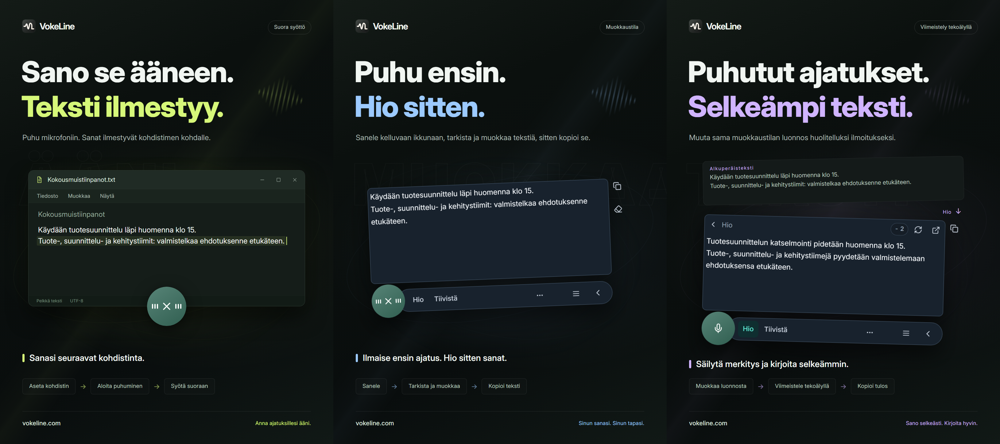

# VokeLine | Sanelu ja tekoälyavusteinen tekstinkäsittely tietokoneella

[English](README.md) | [Español](README.es.md) | [Português (Brasil)](README.pt-BR.md) | [Português (Portugal)](README.pt-PT.md) | [Français](README.fr.md) | [Deutsch](README.de.md) | [Italiano](README.it.md) | [Nederlands](README.nl.md)

[Русский](README.ru.md) | [Polski](README.pl.md) | [Türkçe](README.tr.md) | [Українська](README.uk.md) | [日本語](README.ja.md) | [한국어](README.ko.md) | [Bahasa Indonesia](README.id.md) | [Tiếng Việt](README.vi.md)

[ไทย](README.th.md) | [Bahasa Melayu](README.ms.md) | [हिन्दी](README.hi.md) | [বাংলা](README.bn.md) | [简体中文](README.zh-CN.md) | [繁體中文](README.zh-TW.md) | [Svenska](README.sv.md) | [Čeština](README.cs.md)

[Norsk bokmål](README.nb.md) | [Dansk](README.da.md) | [Suomi](README.fi.md) | [Română](README.ro.md) | [Ελληνικά](README.el.md) | [Magyar](README.hu.md)

[Virallinen sivusto](https://vokeline.com/) · [Lataa](https://vokeline.com/fi/download) · [Käyttöoppaat](https://vokeline.com/fi/docs/start)

## Tietoa VokeLinesta

VokeLine on tietokonesovellus saneluun ja tekoälyavusteiseen tekstinkäsittelyyn. Se muuntaa reaaliaikaisen puheen tai äänitiedostot muokattavaksi tekstiksi. Valitset sitten tekoälytoiminnon, kopioinnin, haun tai merkintöjen järjestelyn.

Jatkuvasti näkyvä painike ja kelluva työkalupalkki palvelevat reaaliaikaista sanelua ja pikatoimintoja. Pääikkunassa hallitset äänitiedostoja, tekoälytoimintoja, historiaa, pilvimuistiinpanoja, malleja, käyttöä ja asetuksia.

Jatkuvasti näkyvä painike pitää sanelun käden ulottuvilla täyttämättä näyttöä. Sinä päätät, milloin vahvistat tekstin ja mitä teet seuraavaksi.

**Aloita puhuminen → Tarkista kohdistimen kohdalla → Valitse seuraava toiminto**

_Käyttöliittymän havainnekuva, vasemmalta oikealle: suora syöttö, muokkaustila ja tekstin parantaminen tekoälyllä. Teksti ja krediittimäärät ovat esimerkkejä. Tarkista tulos. Todellinen krediittien kulutus määräytyy sovelluksen tietojen mukaan._

## Kenelle se sopii

- **Työviesteihin vastaavat käyttäjät**: Sanele vastaus lukiessasi verkkosivua tai asiakirjaa. Muokkaa tekstiä ja kopioi se nykyiseen sovellukseen ilman jatkuvaa vaihtamista.
- **Opiskelijat ja tutkijat**: Sanele havaintosi ja johtopäätöksesi lukiessasi. Tiivistä tai järjestä alkuperäisteksti sitten uudelleen tekoälytoiminnolla.
- **Kirjoittajat ja sisällöntuottajat**: Sanele ensin luonnos, siirrä kohdistinta lisätäksesi yksityiskohtia ja hio lopullista ilmaisua.
- **Haastatteluja tai muita äänitiedostoja käsittelevät käyttäjät**: Lisää useita tuettuja äänitiedostoja ja seuraa edistymistä. Ota ”Tallenna paikallinen historia” käyttöön, jos haluat säilyttää valmiin tekstin myös historiassa.

## Tärkeimmät ominaisuudet

- **Muokattava alkuperäisteksti**: Siirrä kohdistinta, korjaa sanamuotoa, pidä tauko ja jatka puhumista ennen kopiointia, lisäämistä, hakua tai tekoälyn käyttöä.
- **Äänitiedostot**: Lisää useita tuettuja äänitiedostoja ja seuraa edistymistä. Ota ”Tallenna paikallinen historia” käyttöön, jos haluat säilyttää valmiin tekstin myös historiassa.
- **Paikallinen puheentunnistusmalli**: Lataa mallit ja valitse erikseen oletusmallit reaaliaikaiseen saneluun ja äänitiedostojen litterointiin.
- **Tekoälyselitys, parantelu ja mukautetut toiminnot**: Käytä nykyistä litterointia idean selittämiseen, keskeisten kohtien poimimiseen, sanamuodon parantamiseen tai tallennetun ohjeen suorittamiseen. Luo ja järjestä uudelleenkäytettäviä ohjeita ja valitse, mitkä toiminnot näkyvät kelluvassa työkalupalkissa.
- **Hae tai kopioi**: Kopioi valmis teksti suoraan tai lähetä se valitsemaasi hakukoneeseen ja jatka järjestelmän selaimessa.
- **Paikallinen historia ja pilvimuistiinpanot**: Historia tallennetaan tällä laitteella erikseen vieraalle ja jokaiselle tilille. Yksittäinen merkintä lähetetään pilveen vasta, kun napsautat ”Tallenna pilveen”.
- **Järjestetty pääikkuna**: Tarkastele käyttöä, litteroi äänitiedostoja, hallitse tekoälytoimintoja, selaa paikallista historiaa ja pilvimuistiinpanoja sekä määritä paikalliset mallit.

Tekoälytoiminnot riippuvat määritetyistä palveluista, verkkoyhteydestä, käytettävissä olevista krediiteistä ja toimintojen nykyisestä julkaisutilasta.

## Näin käytät VokeLinea

### 1. Lataa ja asenna

[Lataa](https://vokeline.com/fi/download)

Avaa virallinen lataussivu ja valitse käyttöjärjestelmällesi ja suorittimellesi sopiva asennustiedosto. Seuraa asennusohjeita ja avaa VokeLine. Ensimmäisen paikallisen puhemallin lataamiseen tarvitaan internetyhteys.

VokeLine on suunniteltu Windowsille ja macOS:lle. Linux-versio on kehitteillä. Saatavilla olevat versiot, arkkitehtuurit ja järjestelmävaatimukset löytyvät lataussivulta.

### 2. Valmistele ensimmäinen malli

**Paikka ja edellytykset:** Mallit → Paikalliset mallit. Tarvitset internetyhteyden ja riittävästi levytilaa. Mallikortti kertoo latauskoon, arvioidun muistitarpeen ja tuetut tehtävät.

1. Valitse reaaliaikaista litterointia tukeva malli ja tarkista kieli- sekä laitevaatimukset. Pelkkä tiedostomalli ei sovi livepuheeseen.
2. Valitse Lataa ja odota latauksen, tiedostojen tarkistuksen ja asennuksen valmistumista. Voit keskeyttää latauksen ja jatkaa yhteyden palattua.
3. Valitse Käytä ja aseta malli oletukseksi puheen, tiedostojen tai molempien litterointiin sen tuen mukaan.
4. Varmista, että kortti näyttää mallin olevan käytössä puheelle, ja palaa aloitussivulle.

**Tulos:** Uudet tallennukset käyttävät valittua mallia. Lataaminen ei yksin valitse oletusmallia: paina vielä Käytä. Lataus- ja muistivirheisiin saat apua [mallien vianmäärityksestä](https://vokeline.com/fi/docs/help#guide-model-downloads).

#### Mikrofonin tarkistus

**Paikka:** Asetukset → Puhe ja pikanäppäimet → Syöttölaite. Mikrofonin pitää olla liitetty ja mykistämätön, ja järjestelmän on sallittava sen käyttö.

1. Valitse järjestelmän oletusmikrofoni tai haluamasi laite. Jos ulkoinen mikrofoni irtoaa, valitse käytettävissä oleva laite uudelleen.
2. Valitse Testaa mikrofoni ja sano muutama sana. Testi päättyy 10 sekunnissa eikä tallenna testiääntä.
3. Jatka, kun ääni havaitaan. Muuten tarkista mykistys, tulotaso ja etäisyys mikrofoniin, ja testaa uudelleen.
4. Avaa mikrofonin käyttöoikeudet annetusta linkistä. Jos linkki ei toimi, avaa järjestelmäasetukset itse.

**Tulos:** Testi havaitsee äänen eikä laitteesta näy saatavuusvaroitusta. Tiedostojen litterointi ei vaadi mikrofonia: [Äänitiedostot](https://vokeline.com/fi/docs/features#guide-audio-files).

### 3. Puhe reaaliajassa

Molemmat tilat tarvitsevat mallin, mikrofonin ja järjestelmän käyttöoikeudet. Paikallinen litterointi toimii ilman kirjautumista tai tekoälykrediittejä. [Mikrofoni](https://vokeline.com/fi/docs/start#guide-microphone).

| Tila    | Avaa                                                                 | Teksti          | Käyttö                   |
| ------- | -------------------------------------------------------------------- | --------------- | ------------------------ |
| Muokkaa | Tilan pikanäppäin, tai mikrofonipainike, kun tämä tila on oletuksena | Kelluva editori | Tarkista, tekoäly, haku. |
| Suora   | Tilan pikanäppäin, tai mikrofonipainike, kun tämä tila on oletuksena | Valittu kenttä  | Kohdesovellus.           |

#### Muokkaus

1. Käytä muokkaustilan pikanäppäintä tai valitse se oletukseksi ja paina mikrofonia.
2. Puhu, lopeta tallennus ohjaimesta ja odota viimeistelyä.
3. Muokkaa ja kopioi alkuperäinen tai käynnistä tekoälytoiminto tai haku.

**Tulos:** Alkuperäinen jää editoriin. Tekoälyn tulos näytetään erikseen ja on kopioitavissa. Litterointi ei itsessään lähetä tekoälypyyntöä.

#### Suora

**Lisäksi tarvitaan:** Muokattava kohdekenttä. Hallitse suoran syötön lupia puhe- ja pikanäppäinasetuksissa; salli macOS:ssa myös Käyttöapu pyydettäessä.

1. Napsauta muokattavaa kohdekenttää, aseta kohdistin ja käytä suoran syötön pikanäppäintä.
2. Valitse kohdekenttä pyydettäessä ja odota tallennuksen alkua.
3. Pysy samassa kentässä puhuessasi. Älä vaihda ikkunaa tai syöttökohtaa.
4. Lopeta ohjaimella tai vastaavalla pikanäppäimellä ja tarkista lisätty teksti.

**Tulos:** Teksti lisätään lukittuun kohdekenttään. Jos lisäys epäonnistuu, tarkista kenttä ja luvat tai kopioi editorista. Älä yritä toistuvasti ilman selvää kohdetta.

### 4. Äänitiedostojen litterointi

**Paikka ja edellytykset:** Avaa tiedostojen litterointi ja valitse sitä tukeva paikallinen malli. Mikrofonia, kirjautumista tai tekoälykrediittejä ei tarvita.

| Raja              | Ehto                           |
| ----------------- | ------------------------------ |
| Muodot            | WAV, MP3, FLAC, OGG, M4A, MP4. |
| Koko              | Ei tyhjä, enintään 2 GB kukin. |
| Valinta           | 100 kerralla.                  |
| Puhujien erottelu | Ei tuettu, vain ilman.         |

1. Valitse tiedostot tai vedä ne sivulle. Lisää tarvittaessa lisää tiedostoja.
2. Tarkista valmistelulista. Poista virheelliset tai lukukelvottomat tiedostot; valitse ulkoisesti muuttunut tiedosto uudelleen.
3. Valitse paikallinen malli. Jos se sallii äänen kielen valinnan, valitse tunnettu kieli tarjolla olevista vaihtoehdoista. Vain automaattista tunnistusta tukevat mallit valitsevat kielen itse; tarkista teksti kummassakin tapauksessa.
4. Aloita litterointi ja seuraa jonotusta, lukemista, litterointia ja viimeistelyä.
5. Avaa valmis tulos, tarkista teksti ja kopioi litterointi.

**Tulos:** Kukin tiedosto saa oman tehtävän. Jos paikallinen tallennus on käytössä, teksti tallentuu nykyisen vieraan tai tilin historiaan, ei automaattisesti pilveen.

### 5. Tekoälyn tekstitoiminnot

**Paikka ja edellytykset:** Määritä toiminnot tekoälysivulla ja suorita ne editorista. Kirjautuminen, verkko, käytettävissä oleva malli ja riittävät krediitit ovat tarpeen. Tarkista malli, kieli ja krediittitiedot ennen suoritusta.

| Toiminto        | Tarkoitus          | Kieli         |
| --------------- | ------------------ | ------------- |
| Selitä          | Selvennä           | Valittu.      |
| Hio             | Ilmaisu paremmaksi | Alkuperäinen. |
| Tiivistä        | Lyhennä            | Valittu.      |
| Poimi pääkohdat | Tärkeä             | Valittu.      |
| Oikolue         | Korjaa             | Alkuperäinen. |

1. Valitse oletusarvoinen tekoälymalli ja tuloskieli, ja tallenna asetukset.
2. Valmistele editorin teksti ja tarkista syötteen pituusraja.
3. Valitse toiminto, tarkista krediittitiedot ja odota tulosta.
4. Tarkista ja kopioi tulos. Palaa alkuperäiseen, jos haluat muokata sitä.

**Tulos:** Tulos näkyy erikseen. Teksti lähetetään online-palveluun vasta, kun suoritat toiminnon. Tekoälymalli on eri asetus kuin puhemalli.

”Sama kieli kuin alkuperäistekstissä” käyttää alkuperäisen tekstin kieltä. Toiminnot ”Hio” ja ”Oikolue” säilyttävät aina tämän kielen.

”Yritä uudelleen” yrittää palauttaa saman toiminnon. ”Suorita uudelleen” aloittaa uuden ja voi käyttää krediittejä uudelleen. Odota tilan päivittymistä, jos käsittely tai tuloksen tarkistus on kesken, ennen kuin aloitat toisen toiminnon.

#### Mukautetut toiminnot

1. Luo uusi toiminto ja anna nimi sekä ohje, esimerkiksi päätökset ja tehtävät sisältävä kokousmuistio.
2. Aseta malli, kieli ja näkyvyys ja tallenna. Älä sisällytä ohjeeseen salasanoja, avaimia tai arkaluonteisia tietoja.
3. Testaa lyhyellä tekstillä ja tarkenna ohjetta. Omia toimintoja voi olla enintään 20.

### 6. Paikallinen historia ja pilvimuistiinpanot

#### Paikallinen historia ja käyttötilastot

**Paikka ja edellytykset:** Historia tai aloitussivun viimeisimmät merkinnät. Näet nykyisen vieraan tai tilin tämän laitteen tiedot ilman internetyhteyttä.

1. Etsi merkintä Kaikki-, Puhe- tai Tekoäly-suodattimella ja avaa se.
2. Lue puhemerkinnän alkuperäinen tai tekoälymerkinnän alkuperäinen ja tulos, ja kopioi tarvitsemasi osa.

#### Tallenna pilveen

**Paikka ja edellytykset:** Kirjaudu ja avaa Historia → merkintä → Tallenna pilveen. Tarvitset verkon ja tilaa pilvimerkintöjen nykyisen rajan sisällä.

1. Kirjaudu tiliin, jolle merkintä kuuluu, ja avaa sen paikallinen historia.
2. Valitse merkintä ja tarkista, ettei tekstissä ole pilveen kuulumatonta sisältöä. Valitse sitten Tallenna pilveen.
3. Odota onnistumista tai jo olemassa olevan merkinnän viestiä. Säilytä paikallinen alkuperäinen virheessä, tarkista verkko ja rajat ja yritä uudelleen.
4. Avaa pilvimerkinnät, päivitä ja tarkista tallennettu teksti.

**Tulos:** Valittu teksti on luettavissa muilla samaan tiliin kirjautuneilla laitteilla. Alkuperäinen jää laitteelle, eikä sen poisto poista pilvikopiota.

## Usein kysytyt kysymykset

### Pitääkö minun kirjautua sisään käyttääkseni VokeLinea?

Paikallista sanelua, paikallisia malleja, paikallista historiaa ja kopiointia voi käyttää kirjautumatta. Tekoälytoiminnot, pilvimuistiinpanot ja tilitoiminnot edellyttävät kirjautumista.

[Hinnoittelu](https://vokeline.com/fi/pricing)

### Teksti puuttuu tai siinä on virheitä

Tarkista, että malli tukee puhuttua kieltä ja valittu mikrofoni toimii. Vähennä taustamelua ja kokeile uudelleen. Tallennuksessa kieli tunnistetaan automaattisesti; tiedostolle sen voi valita, jos malli tukee valintaa. Käyttöliittymän kieli ei muuta puheentunnistusta. Valitse sopiva tekoälytoiminto ja tuloskieli, jos haluat selityksen, tiivistelmän tai pääkohdat toisella kielellä. Äänen kieli kertoo mallille, mitä kieltä sen tulee tunnistaa.

### Suora syöttö epäonnistuu tai pyytää valitsemaan kentän

Napsauta muokattavaa kohdekenttää, aseta kohdistin ja käytä suoran syötön pikanäppäintä. Valitse kenttä pyydettäessä. Älä vaihda ikkunaa tai syöttökohtaa tallennuksen aikana.

Tarkista suoran syötön luvat ja macOS:n Käyttöapu. Jos kohde estää lisäyksen, kopioi teksti ensin [muokkaustilasta](https://vokeline.com/fi/docs/features#guide-editor) ja liitä se itse. Selvitä suoran syötön ongelma sen jälkeen.

### Tiedostoa ei voi lisätä tai litterointi ei käynnisty

Tuettuja ovat WAV, MP3, FLAC, OGG, M4A ja MP4. Tiedoston on oltava ei-tyhjä ja enintään 2 GB; valitse kerralla enintään 100. Poista virheelliset ja tarkista tiedostomalli sekä äänen kieli.

Valitse tiedosto uudelleen siirron, nimeämisen, muutoksen tai vanhentuneen valinnan jälkeen. Tarkista toistettavuus, ääniraita ja vauriot, jos purkaminen epäonnistuu.

## Tiedot ja yksityisyys

Mikrofonin ääntä käytetään vain paikalliseen litterointiin, eikä sitä tallenneta pilvimuistiinpanoksi. Tekoälypyyntö lähetetään internetin kautta vasta, kun valitset kyseisen tekoälytoiminnon.

| Toiminto                                       | Mihin sisältö päätyy                                                                                                                                  |
| ---------------------------------------------- | ----------------------------------------------------------------------------------------------------------------------------------------------------- |
| Paikallinen sanelu tai tiedostojen litterointi | Käsitellään tämän laitteen paikallisella mallilla. Sisältöä ei ladata automaattisesti pilveen.                                                        |
| Paikallisen historian tallennus                | Teksti säilyy laitteella erikseen vieraalle ja jokaiselle tilille. Tietoja ei salata erikseen. Suojaa laitteesi ja käyttöjärjestelmän käyttäjätilisi. |
| Tekoälyn tekstitoiminnot                       | Toiminnon tarvitsema teksti lähetetään valittuun verkkopalveluun.                                                                                     |
| Verkkohaku                                     | Hakusanat lähetetään valittuun hakukoneeseen.                                                                                                         |
| Tallennus pilveen                              | Valittu tekstimerkintä siirretään verkon kautta tilin pilvimerkintöihin.                                                                              |

Kun poistat ”Tallenna paikallinen historia” käytöstä kohdassa Asetukset → Tiedot ja yksityisyys, uusia tekstejä ei tallenneta historiaan, mutta aiemmat merkinnät säilyvät. Aloitussivu tilastoi yhä äänitysten ja tiedostojen litterointien käyttökerrat, äänen keston ja tuotettujen merkkien määrän. Tilastot eivät sisällä litteroinnin tekstiä.

Tämä asetus ohjaa uusien merkintöjen tallentamista Historia-sivulle. Tiedostojen litterointitehtävät ja niiden tulokset tallennetaan laitteelle erikseen. Poista tarpeeton tehtävä valitsemalla ”Poista tehtävä luettelosta” kohdassa Tiedostojen litterointi; historiaan tai pilveen jo tallennettu teksti säilyy.

Paikallinen historia tallennetaan erikseen vieraalle ja jokaiselle tilille. Tilin pilvimuistiinpanoihin kopioidaan vain merkinnät, jotka itse päätät tallentaa.

[Tili ja tiedot](https://vokeline.com/fi/docs/account)

## Virallinen sivusto ja tuki

- [Virallinen sivusto: vokeline.com](https://vokeline.com/)
- [Käyttöönotto](https://vokeline.com/fi/docs/start)
- [Toiminnot](https://vokeline.com/fi/docs/features)
- [Vianmääritys](https://vokeline.com/fi/docs/help)

**Paikka:** Avaa ”Tili” työpöytäsovelluksen ”Tili”-valikosta ja valitse verkkosivustolta ”Ohjeet ja palaute”. Kirjaudu tarvittaessa.

1. Kerro sovellusversio, käyttöjärjestelmä, toiminto, vaiheet sekä odotettu ja toteutunut tulos.
2. Liitä tarkka viesti ja tarvittaessa mallin nimi, tiedoston muoto ja koko tai maksun ja krediittimerkinnän aika.
