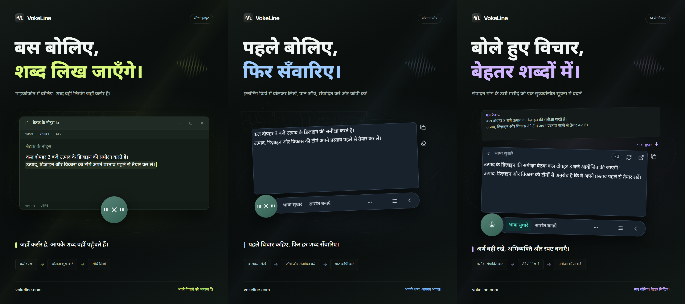

# VokeLine | डेस्कटॉप वॉइस इनपुट और AI टेक्स्ट असिस्टेंट

[English](README.md) | [Español](README.es.md) | [Português (Brasil)](README.pt-BR.md) | [Português (Portugal)](README.pt-PT.md) | [Français](README.fr.md) | [Deutsch](README.de.md) | [Italiano](README.it.md) | [Nederlands](README.nl.md)

[Русский](README.ru.md) | [Polski](README.pl.md) | [Türkçe](README.tr.md) | [Українська](README.uk.md) | [日本語](README.ja.md) | [한국어](README.ko.md) | [Bahasa Indonesia](README.id.md) | [Tiếng Việt](README.vi.md)

[ไทย](README.th.md) | [Bahasa Melayu](README.ms.md) | [हिन्दी](README.hi.md) | [বাংলা](README.bn.md) | [简体中文](README.zh-CN.md) | [繁體中文](README.zh-TW.md) | [Svenska](README.sv.md) | [Čeština](README.cs.md)

[Norsk bokmål](README.nb.md) | [Dansk](README.da.md) | [Suomi](README.fi.md) | [Română](README.ro.md) | [Ελληνικά](README.el.md) | [Magyar](README.hu.md)

[आधिकारिक वेबसाइट](https://vokeline.com/) · [डाउनलोड करें](https://vokeline.com/hi/download) · [गाइड और अपडेट](https://vokeline.com/hi/docs/start)

## VokeLine के बारे में

VokeLine डेस्कटॉप पर वॉइस इनपुट और AI से टेक्स्ट पर काम करने वाला सहायक है। यह लाइव आवाज़ या ऑडियो फ़ाइल को बदलाव करने योग्य टेक्स्ट में बदलता है। फिर आप AI कार्य, कॉपी, खोज या रिकॉर्ड व्यवस्थित करने का विकल्प चुनते हैं।

हमेशा दिखने वाला बटन और फ़्लोटिंग टूलबार लाइव वॉइस इनपुट व तुरंत किए जाने वाले कामों के लिए हैं। मुख्य विंडो में ऑडियो फ़ाइलें, AI कार्य, इतिहास, क्लाउड नोट्स, मॉडल, उपयोग और सेटिंग्स सँभालते हैं।

हमेशा दिखने वाला बटन पूरी स्क्रीन घेरे बिना वॉइस इनपुट उपलब्ध रखता है। टेक्स्ट की पुष्टि कब करनी है और आगे क्या करना है, आप तय करते हैं।

**बोलना शुरू करें → कर्सर की जगह पर जाँचें → अगला कदम चुनें**

_इंटरफ़ेस का उदाहरण, बाएँ से दाएँ: सीधा इनपुट मोड, एडिटर मोड और AI से लेखन सुधार। टेक्स्ट और क्रेडिट की संख्या नमूने हैं। नतीजा जाँचें। असली क्रेडिट खर्च के लिए ऐप में दी गई जानकारी देखें।_

## यह किनके लिए है

- **काम के संदेशों का जवाब देने वाले लोग**: वेब पेज या दस्तावेज़ पढ़ते समय अपना जवाब बोलें। टेक्स्ट बदलकर मौजूदा ऐप में कॉपी करें; बार-बार ऐप बदलने की ज़रूरत नहीं है।
- **छात्र और शोधकर्ता**: पढ़ते समय अपने अवलोकन और निष्कर्ष बोलें। फिर AI कार्य से मूल टेक्स्ट का सारांश बनाएँ या उसे नए ढंग से व्यवस्थित करें।
- **लेखक और सामग्री बनाने वाले लोग**: पहला ड्राफ़्ट बोलकर लिखें। कर्सर की जगह बदलकर और जानकारी जोड़ें, फिर अंतिम टेक्स्ट की भाषा सुधारें।
- **इंटरव्यू या दूसरी ऑडियो फ़ाइलों पर काम करने वाले लोग**: समर्थित ऑडियो फ़ाइलें एक साथ जोड़ें और प्रगति देखें। तैयार टेक्स्ट को इतिहास में भी रखने के लिए “डिवाइस का इतिहास सहेजें” चालू करें।

## मुख्य सुविधाएँ

- **बदलाव करने योग्य मूल टेक्स्ट**: कर्सर की जगह बदलें, टेक्स्ट एडिट करें या थोड़ा रुककर फिर बोलें। इसके बाद तय करें कि कॉपी करना है, टेक्स्ट लिखना है, खोजना है या AI इस्तेमाल करना है।
- **ऑडियो फ़ाइल ट्रांसक्रिप्शन**: समर्थित ऑडियो फ़ाइलें एक साथ जोड़ें और प्रगति देखें। तैयार टेक्स्ट को इतिहास में भी रखने के लिए “डिवाइस का इतिहास सहेजें” चालू करें।
- **लोकल स्पीच रिकग्निशन मॉडल**: मॉडल डाउनलोड करें और लाइव वॉइस इनपुट तथा ऑडियो फ़ाइल ट्रांसक्रिप्शन के लिए अलग-अलग डिफ़ॉल्ट मॉडल चुनें।
- **AI से समझाएँ, भाषा सुधारें और अपने कार्य बनाएँ**: मौजूदा मूल टेक्स्ट से कोई विचार समझाएँ, मुख्य बातें निकालें, भाषा बेहतर बनाएँ या अपना सहेजा हुआ निर्देश चलाएँ। बार-बार इस्तेमाल होने वाले निर्देश बनाएँ, उनका क्रम बदलें और चुनें कि कौन-से कार्य फ़्लोटिंग टूलबार पर दिखें।
- **खोजें या कॉपी करें**: अंतिम टेक्स्ट सीधे कॉपी करें या चुने हुए सर्च इंजन को भेजकर सिस्टम के ब्राउज़र में आगे खोजें।
- **डिवाइस का इतिहास और क्लाउड नोट्स**: इतिहास इस डिवाइस पर अतिथि या खाते के हिसाब से अलग रहता है। कोई रिकॉर्ड तभी अपलोड होता है जब आप “क्लाउड में सहेजें” क्लिक करते हैं।
- **व्यवस्थित मुख्य विंडो**: उपयोग देखें, ऑडियो फ़ाइलों का ट्रांसक्रिप्शन करें, AI कार्य सँभालें, डिवाइस का इतिहास व क्लाउड नोट्स देखें और लोकल मॉडल सेट करें।

AI कार्य पहले से कॉन्फ़िगर की गई सेवाओं, नेटवर्क, उपलब्ध क्रेडिट और मौजूदा रिलीज़ की स्थिति पर निर्भर करते हैं।

## इस्तेमाल कैसे करें

### 1. डाउनलोड और इंस्टॉल

[डाउनलोड करें](https://vokeline.com/hi/download)

आधिकारिक डाउनलोड पेज खोलें और अपने ऑपरेटिंग सिस्टम व प्रोसेसर के लिए सही इंस्टॉलर चुनें। इंस्टॉल करने के निर्देश पूरे करें और VokeLine खोलें। पहला लोकल आवाज़ मॉडल डाउनलोड करने के लिए इंटरनेट चालू रखें।

VokeLine Windows और macOS के लिए बनाया गया है। Linux संस्करण अभी विकास में है। उपलब्ध संस्करण, आर्किटेक्चर और सिस्टम की ज़रूरतें डाउनलोड पृष्ठ पर देखें।

### 2. पहला मॉडल तैयार करें

**कहाँ और क्या चाहिए:** मॉडल → स्थानीय मॉडल। इंटरनेट और डिस्क में जगह चाहिए। कार्ड पर आकार, अनुमानित मेमोरी और समर्थित काम दिखते हैं।

1. लाइव ट्रांसक्रिप्शन वाला मॉडल चुनें और भाषा व डिवाइस की जरूरतें देखें। केवल फ़ाइल मॉडल लाइव रिकॉर्डिंग में नहीं चलता।
2. डाउनलोड चुनें और डाउनलोड, जाँच व इंस्टॉल खत्म होने दें। जरूरत हो तो रोकें और कनेक्शन लौटने पर जारी रखें।
3. इस्तेमाल करें चुनकर रिकॉर्डिंग, फ़ाइल या दोनों का डिफ़ॉल्ट सेट करें, जितना मॉडल सपोर्ट करता हो।
4. रिकॉर्डिंग में इस्तेमाल का संकेत देखें और होम पर लौटें।

**नतीजा:** नई रिकॉर्डिंग चुने मॉडल का इस्तेमाल करती है। डाउनलोड अपने आप डिफ़ॉल्ट नहीं चुनता; इस्तेमाल करें भी चुनें। [मॉडल की समस्याएँ](https://vokeline.com/hi/docs/help#guide-model-downloads) देखें।

#### माइक्रोफ़ोन जाँचें

**कहाँ:** सेटिंग्स → वॉइस और शॉर्टकट → इनपुट डिवाइस। माइक्रोफ़ोन जुड़ा हो, म्यूट न हो और सिस्टम की अनुमति होनी चाहिए।

1. सिस्टम का डिफ़ॉल्ट या खास माइक्रोफ़ोन चुनें। बाहरी डिवाइस हटे तो उपलब्ध डिवाइस फिर चुनें।
2. जाँच शुरू कर कुछ बोलें। यह 10 सेकंड में खत्म होती है और टेस्ट रिकॉर्डिंग सेव नहीं करती।
3. आवाज़ मिलने पर आगे बढ़ें। नहीं मिले तो म्यूट, इनपुट वॉल्यूम और दूरी जाँचकर दोबारा टेस्ट करें।
4. लिंक से माइक्रोफ़ोन की अनुमति खोलें; लिंक न चले तो सिस्टम सेटिंग्स खुद खोलें।

**नतीजा:** जाँच में आवाज़ मिलती है और डिवाइस उपलब्ध रहता है। [फ़ाइल ट्रांसक्रिप्शन](https://vokeline.com/hi/docs/features#guide-audio-files) के लिए माइक्रोफ़ोन नहीं चाहिए।

### 3. लाइव वॉइस इनपुट

दोनों मोड में रिकॉर्डिंग मॉडल, माइक्रोफ़ोन और अनुमति चाहिए। स्थानीय ट्रांसक्रिप्शन के लिए लॉग इन या AI क्रेडिट की ज़रूरत नहीं होती। पहले [माइक्रोफ़ोन जाँचें](https://vokeline.com/hi/docs/start#guide-microphone)।

| मोड   | खोलना                                  | टेक्स्ट         | काम                  |
| ----- | -------------------------------------- | --------------- | -------------------- |
| एडिटर | खास शॉर्टकट या डिफ़ॉल्ट पर माइक्रोफ़ोन | फ़्लोटिंग एडिटर | जाँच, AI, खोज।       |
| सीधा  | खास शॉर्टकट या डिफ़ॉल्ट पर माइक्रोफ़ोन | चुना फ़ील्ड     | लक्ष्य ऐप में लिखना। |

#### एडिटर

1. एडिटर शॉर्टकट लें या उसे डिफ़ॉल्ट करके माइक्रोफ़ोन दबाएँ।
2. बोलें, कंट्रोल से रोकें और पूरा होने दें।
3. मूल सुधारकर कॉपी करें या AI काम या खोज चलाएँ।

**नतीजा:** मूल टेक्स्ट एडिटर में रहता है। AI परिणाम अलग दिखता है और उसे अलग से कॉपी किया जा सकता है। ट्रांसक्रिप्शन अपने आप AI अनुरोध नहीं भेजता।

#### सीधा इनपुट

**इसके अलावा:** लक्ष्य ऐप में संपादन योग्य टेक्स्ट फ़ील्ड चाहिए। वॉइस सेटिंग्स से सीधे इनपुट की अनुमति सँभालें; macOS पर माँगे जाने पर Accessibility भी दें।

1. लक्ष्य फ़ील्ड में क्लिक कर कर्सर रखें और सीधे मोड का शॉर्टकट लें।
2. माँगा जाए तो फ़ील्ड चुनें और रिकॉर्डिंग शुरू होने दें।
3. बोलते समय उसी फ़ील्ड में रहें; विंडो या लिखने की जगह न बदलें।
4. कंट्रोल या संबंधित शॉर्टकट से रोककर टेक्स्ट जाँचें।

**नतीजा:** तय फ़ील्ड में टेक्स्ट जाता है। न जाए तो फ़ील्ड और अनुमति देखें या एडिटर से कॉपी करें। स्पष्ट लक्ष्य के बिना बार-बार न कोशिश करें।

### 4. ऑडियो फ़ाइल ट्रांसक्रिप्शन

**कहाँ और क्या चाहिए:** बाएँ मेनू में फ़ाइल ट्रांसक्रिप्शन और उपयुक्त स्थानीय मॉडल। माइक्रोफ़ोन, साइन इन या AI क्रेडिट नहीं चाहिए।

| सीमा           | शर्त                                                      |
| -------------- | --------------------------------------------------------- |
| फ़ॉर्मेट       | WAV, MP3, FLAC, OGG, M4A, MP4।                            |
| आकार           | खाली नहीं, प्रति फ़ाइल 2 GB तक।                           |
| चयन            | एक बार 100।                                               |
| वक्ता अलग करना | अभी उपलब्ध नहीं; केवल वक्ताओं को अलग न करने का विकल्प है। |

1. फ़ाइल चुनें या खींचकर लाएँ और जरूरत हो तो और जोड़ें।
2. अमान्य या न पढ़ सकने वाली फ़ाइलें सूची से हटाएँ। बाहर बदलाव हो तो फिर चुनें।
3. स्थानीय मॉडल चुनें। ऑडियो भाषा चुनने की सुविधा हो, तो उपलब्ध विकल्पों में ज्ञात भाषा चुनें। केवल अपने आप भाषा पहचानने वाले मॉडल इसे खुद तय करते हैं; दोनों स्थितियों में बने हुए टेक्स्ट की जाँच करें।
4. ट्रांसक्रिप्शन शुरू करके कतार, पढ़ना, रूपांतरण और पूरा होने की स्थिति देखें।
5. पूरा नतीजा खोलें, जाँचें और टेक्स्ट कॉपी करें।

**नतीजा:** हर फ़ाइल का अलग काम बनता है। स्थानीय सेव चालू हो तो वर्तमान अतिथि या अकाउंट में टेक्स्ट रहता है, अपने आप क्लाउड में नहीं।

### 5. AI टेक्स्ट कार्रवाई

**कहाँ और क्या चाहिए:** AI पेज पर सेट करें और एडिटर से चलाएँ। साइन इन, इंटरनेट, उपलब्ध मॉडल और पर्याप्त क्रेडिट चाहिए। पहले मॉडल, भाषा और क्रेडिट का विवरण देखें।

| काम                 | उद्देश्य         | भाषा  |
| ------------------- | ---------------- | ----- |
| समझाएँ              | अर्थ स्पष्ट      | चुनी। |
| भाषा सुधारें        | अभिव्यक्ति सुधार | मूल।  |
| सारांश बनाएँ        | सामग्री छोटी     | चुनी। |
| मुख्य बातें निकालें | महत्वपूर्ण       | चुनी। |
| गलतियाँ सुधारें     | जाँच/सुधार       | मूल।  |

1. डिफ़ॉल्ट AI मॉडल और आउटपुट भाषा चुनकर सेव करें।
2. टेक्स्ट तैयार करके इनपुट सीमा देखें।
3. काम चुनें, क्रेडिट विवरण देखें और नतीजे का इंतजार करें।
4. नतीजा जाँचकर कॉपी करें या बदलाव के लिए मूल पर लौटें।

**नतीजा:** नतीजा अलग दिखता है। काम चलाने पर ही टेक्स्ट ऑनलाइन सेवा में जाता है। AI मॉडल और वॉइस मॉडल अलग चुनाव हैं।

“मूल टेक्स्ट की भाषा के अनुसार” चुनने पर मूल टेक्स्ट की भाषा इस्तेमाल होगी। “भाषा सुधारें” और “गलतियाँ सुधारें” कार्य हमेशा मूल भाषा बनाए रखते हैं।

“फिर कोशिश करें” उसी कार्य को बहाल करने की कोशिश करता है। “फिर से चलाएँ” नया कार्य शुरू करता है और फिर से क्रेडिट खर्च हो सकते हैं। प्रोसेसिंग या परिणाम की जाँच चल रही हो, तो अगला कार्य शुरू करने से पहले स्थिति अपडेट होने दें।

#### अपने कार्य

1. नाम और निर्देश देकर नया काम बनाएं, जैसे फैसलों और कार्यों वाली मीटिंग नोट्स।
2. मॉडल, भाषा और दिखाना सेट करके सेव करें। निर्देश में पासवर्ड, कुंजी या संवेदनशील जानकारी न डालें।
3. छोटे टेक्स्ट पर टेस्ट करके निर्देश सुधारें। अधिकतम 20 कस्टम काम बन सकते हैं।

### 6. डिवाइस का इतिहास और क्लाउड नोट्स

#### स्थानीय इतिहास और आँकड़े

**कहाँ और क्या चाहिए:** हिस्ट्री या होम के हाल के रिकॉर्ड। इस डिवाइस पर मौजूदा अतिथि या खाते के रिकॉर्ड बिना इंटरनेट देख सकते हैं।

1. सभी, वॉइस या AI फ़िल्टर से रिकॉर्ड खोजकर खोलें।
2. वॉइस मूल या AI मूल और नतीजा पढ़कर जरूरी भाग कॉपी करें।

#### क्लाउड में सहेजना

**कहाँ और क्या चाहिए:** साइन इन करके हिस्ट्री → रिकॉर्ड → क्लाउड में सेव करें। इंटरनेट और मौजूदा सीमा के भीतर जगह चाहिए।

1. जिस अकाउंट में टेक्स्ट रखना है उसमें साइन इन करके उसकी स्थानीय हिस्ट्री खोलें।
2. मूल या AI नतीजे में अनचाही जानकारी देख लें, फिर क्लाउड में सेव करें।
3. रिकॉर्ड सेव होने या पहले से मौजूद होने का संदेश आने दें। गलती हो तो मूल रखें, नेटवर्क और सीमा देखें और फिर कोशिश करें।
4. क्लाउड खोलकर रिफ़्रेश करें और टेक्स्ट जाँचें।

**नतीजा:** उसी अकाउंट के दूसरे डिवाइस पर टेक्स्ट मिलेगा। स्थानीय मूल रहता है; हटाने से क्लाउड कॉपी नहीं हटती।

## आम सवाल

### क्या VokeLine इस्तेमाल करने के लिए खाता चाहिए?

डिवाइस पर वॉइस इनपुट, लोकल मॉडल, डिवाइस का इतिहास और कॉपी बिना लॉगिन के इस्तेमाल कर सकते हैं। AI सुविधाओं, क्लाउड नोट्स और खाते के विकल्पों के लिए लॉगिन ज़रूरी है।

[कीमतें](https://vokeline.com/hi/pricing)

### टेक्स्ट नहीं है या गलत है

जाँचें कि मॉडल बोली जा रही भाषा को सपोर्ट करता है और चुना हुआ माइक्रोफ़ोन काम कर रहा है। आसपास का शोर कम करके फिर कोशिश करें। रिकॉर्डिंग की भाषा अपने आप पहचानी जाती है; फ़ाइल के लिए भाषा तभी चुन सकते हैं जब मॉडल इसकी अनुमति देता हो। इंटरफ़ेस की भाषा बदलने से पहचान की भाषा नहीं बदलती। किसी दूसरी भाषा में व्याख्या, सारांश या मुख्य बातें पाने के लिए संबंधित AI कार्य और उसकी आउटपुट भाषा चुनें। ऑडियो भाषा मॉडल को बताती है कि किस भाषा की आवाज़ पहचाननी है।

### सीधा इनपुट असफल है या टेक्स्ट फ़ील्ड माँगता है

संपादन योग्य फ़ील्ड में क्लिक कर कर्सर रखें और सीधा मोड शुरू करें। माँगा जाए तो लक्ष्य चुनें; बोलते समय विंडो या फ़ील्ड न बदलें।

अनुमति और macOS Accessibility देखें। लिखना न चले तो पहले [एडिटर](https://vokeline.com/hi/docs/features#guide-editor) से कॉपी और पेस्ट करें, फिर समस्या जाँचें।

### फ़ाइल जोड़ना या ट्रांसक्रिप्शन शुरू करना संभव नहीं

WAV, MP3, FLAC, OGG, M4A या MP4 होना चाहिए, खाली नहीं, प्रति फ़ाइल अधिकतम 2 GB और एक बार में 100। अमान्य हटाकर मॉडल व भाषा देखें।

स्थान, नाम, बाहरी बदलाव या चयन की अवधि खत्म होने पर फिर चुनें। डिकोडिंग की गलती में प्लेबैक, ऑडियो ट्रैक और खराबी देखें।

## डेटा और गोपनीयता

माइक्रोफ़ोन का ऑडियो सिर्फ़ डिवाइस पर ट्रांसक्रिप्शन के लिए इस्तेमाल होता है; यह क्लाउड नोट्स के रूप में नहीं सहेजा जाता। संबंधित AI अनुरोध इंटरनेट पर तभी भेजा जाता है जब आप AI कार्य चुनते हैं।

| काम                    | स्थान                                                                            |
| ---------------------- | -------------------------------------------------------------------------------- |
| स्थानीय ट्रांसक्रिप्शन | डिवाइस मॉडल, अपने आप अपलोड नहीं।                                                 |
| इतिहास                 | खाता/अतिथि क्षेत्र, अतिरिक्त एन्क्रिप्शन नहीं; डिवाइस/सिस्टम खाता सुरक्षित रखें। |
| AI                     | जरूरी टेक्स्ट चुनी सेवा को।                                                      |
| खोज                    | क्वेरी चुने इंजन को।                                                             |
| क्लाउड                 | चुना टेक्स्ट नेटवर्क से।                                                         |

सेटिंग → डेटा और गोपनीयता में “डिवाइस का इतिहास सहेजें” बंद करने से केवल नए टेक्स्ट रिकॉर्ड सेव होना बंद होते हैं; पुराने रिकॉर्ड नहीं मिटते। होम पर रिकॉर्डिंग और फ़ाइल ट्रांसक्रिप्शन की संख्या, ऑडियो की अवधि और बने हुए अक्षरों की संख्या के आँकड़े दर्ज होते रहते हैं। इन आँकड़ों में ट्रांसक्रिप्ट का टेक्स्ट शामिल नहीं होता।

यह विकल्प इतिहास पेज में नए रिकॉर्ड सेव होने को नियंत्रित करता है। फ़ाइल ट्रांसक्रिप्शन के कार्य और परिणाम इस डिवाइस पर अलग से रखे जाते हैं। कार्य की ज़रूरत न हो, तो फ़ाइल ट्रांसक्रिप्शन में “कार्य को सूची से हटाएँ” चुनें; इतिहास या क्लाउड में पहले से सेव टेक्स्ट नहीं मिटेगा।

डिवाइस का इतिहास अतिथि और हर खाते के लिए अलग रहता है। सिर्फ़ वे रिकॉर्ड खाते के क्लाउड नोट्स में कॉपी होते हैं जिन्हें आप खुद सहेजने का विकल्प चुनते हैं।

[खाता और डेटा](https://vokeline.com/hi/docs/account)

## आधिकारिक वेबसाइट और मदद

- [आधिकारिक वेबसाइट: vokeline.com](https://vokeline.com/)
- [शुरुआत करें](https://vokeline.com/hi/docs/start)
- [सुविधाएँ](https://vokeline.com/hi/docs/features)
- [समस्या समाधान](https://vokeline.com/hi/docs/help)

**कहाँ:** डेस्कटॉप ऐप के “खाता” मेनू से “खाता” खोलें, फिर वेबसाइट पर “सहायता और फ़ीडबैक” चुनें। ज़रूरत हो तो लॉग इन करें।

1. संस्करण, सिस्टम, फ़ीचर, चरण और अपेक्षित व असली नतीजा लिखें।
2. सटीक संदेश, मॉडल, फ़ाइल प्रकार व आकार या ऑर्डर और क्रेडिट का समय दें।
