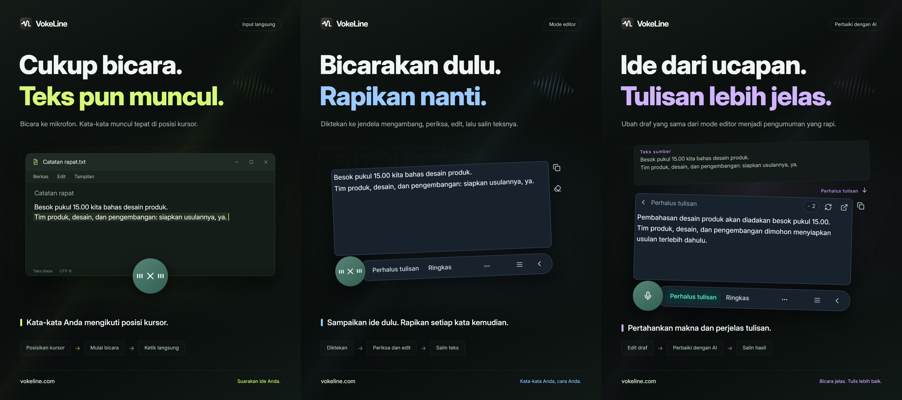

# VokeLine — input suara di desktop dan asisten teks AI

[English](README.md) | [Español](README.es.md) | [Português (Brasil)](README.pt-BR.md) | [Português (Portugal)](README.pt-PT.md) | [Français](README.fr.md) | [Deutsch](README.de.md) | [Italiano](README.it.md) | [Nederlands](README.nl.md)

[Русский](README.ru.md) | [Polski](README.pl.md) | [Türkçe](README.tr.md) | [Українська](README.uk.md) | [日本語](README.ja.md) | [한국어](README.ko.md) | [Bahasa Indonesia](README.id.md) | [Tiếng Việt](README.vi.md)

[ไทย](README.th.md) | [Bahasa Melayu](README.ms.md) | [हिन्दी](README.hi.md) | [বাংলা](README.bn.md) | [简体中文](README.zh-CN.md) | [繁體中文](README.zh-TW.md) | [Svenska](README.sv.md) | [Čeština](README.cs.md)

[Norsk bokmål](README.nb.md) | [Dansk](README.da.md) | [Suomi](README.fi.md) | [Română](README.ro.md) | [Ελληνικά](README.el.md) | [Magyar](README.hu.md)

[Situs resmi](https://vokeline.com/) · [Unduh](https://vokeline.com/id/download) · [Panduan dan kabar terbaru](https://vokeline.com/id/docs/start)

## Tentang VokeLine

VokeLine adalah asisten input suara dan teks AI untuk desktop. Ucapan real-time atau file audio diubah menjadi teks yang dapat diedit. Anda menentukan apakah akan memakai AI, menyalin, mencari, atau mengatur catatan.

Tombol tetap dan bilah mengambang menangani dikte real-time serta tindakan cepat. Jendela utama mengelola file audio, tindakan AI, riwayat, catatan cloud, model, statistik, dan pengaturan.

Tombol tetap membuat input suara mudah dijangkau tanpa memenuhi layar. Anda menentukan kapan teks dikonfirmasi dan apa langkah berikutnya.

**Mulai berbicara → Tinjau di kursor → Pilih langkah berikutnya**

_Ilustrasi antarmuka, dari kiri ke kanan: input langsung, mode editor, dan perbaikan teks dengan AI. Teks dan jumlah kredit adalah contoh. Periksa hasilnya; penggunaan kredit sebenarnya mengikuti informasi di aplikasi._

## Untuk siapa

- **Orang yang membalas pesan kerja**: Dikte respons saat membaca halaman atau dokumen, edit, lalu salin ke aplikasi saat ini.
- **Pelajar dan peneliti**: Ucapkan pengamatan dan kesimpulan saat membaca, lalu ringkas atau susun ulang teks dengan tindakan AI.
- **Penulis dan pembuat konten**: Dikte draf, pindahkan kursor untuk menambah detail, lalu sempurnakan ungkapannya.
- **Orang yang mengolah wawancara atau audio lain**: Tambahkan beberapa file audio yang didukung dan pantau progresnya. Aktifkan “Simpan riwayat lokal” untuk menyimpan teks yang selesai juga dalam riwayat.

## Fitur utama

- **Transkrip yang dapat diedit**: Pindahkan kursor, perbaiki kata, jeda, dan lanjutkan berbicara sebelum menyalin, menyisipkan, mencari, atau menggunakan AI.
- **Transkripsi audio**: Tambahkan beberapa file audio yang didukung dan pantau progresnya. Aktifkan “Simpan riwayat lokal” untuk menyimpan teks yang selesai juga dalam riwayat.
- **Model pengenalan suara lokal**: Unduh model dan pilih model bawaan terpisah untuk dikte real-time serta transkripsi file audio.
- **Penjelasan AI, penyempurnaan teks, dan tindakan khusus**: Gunakan transkrip saat ini untuk menjelaskan ide, mengekstrak poin penting, memperbaiki kata, atau menjalankan instruksi tersimpan. Buat dan urutkan instruksi yang dapat digunakan kembali, lalu pilih tindakan mana yang muncul di bilah alat mengambang.
- **Cari atau salin**: Salin transkrip final secara langsung, atau kirim ke mesin pencari pilihan Anda di browser sistem.
- **Riwayat lokal dan catatan cloud**: Riwayat disimpan di perangkat ini secara terpisah untuk setiap tamu atau akun. Entri diunggah hanya setelah Anda memilih “Simpan ke cloud”.
- **Jendela utama yang tertata**: Lihat statistik penggunaan, transkripsikan file audio, kelola tindakan AI, jelajahi riwayat lokal dan catatan cloud, serta atur model lokal.

Tindakan AI bergantung pada layanan yang dikonfigurasi, akses jaringan, kredit yang tersedia, dan status rilis saat ini.

## Panduan penggunaan

### 1. Unduh dan instal

[Unduh](https://vokeline.com/id/download)

Buka halaman unduhan resmi dan pilih penginstal untuk sistem operasi serta prosesor Anda. Ikuti petunjuk instalasi, lalu buka VokeLine. Tetap terhubung ke internet untuk mengunduh model suara lokal pertama.

VokeLine dirancang untuk Windows dan macOS. Versi Linux sedang dikembangkan. Lihat halaman unduhan untuk rilis yang tersedia, arsitektur, dan persyaratan sistem.

### 2. Siapkan model pertama

**Lokasi dan syarat:** Model → Model lokal. Anda perlu internet dan ruang disk. Kartu menampilkan ukuran, perkiraan memori, dan tugas yang didukung.

1. Pilih model transkripsi langsung dan periksa bahasa serta kebutuhan perangkat. Model khusus berkas tidak bisa dipakai untuk rekaman langsung.
2. Pilih Unduh dan tunggu unduhan, pemeriksaan, serta instalasi selesai. Jeda dan lanjutkan setelah terhubung kembali bila perlu.
3. Pilih Gunakan dan tentukan bawaan untuk rekaman, berkas, atau keduanya sesuai dukungan.
4. Periksa penanda penggunaan untuk rekaman, lalu kembali ke halaman utama.

**Hasil:** Rekaman baru memakai model pilihan. Unduhan tidak otomatis memilih model bawaan; pilih juga Gunakan. Lihat [Masalah model](https://vokeline.com/id/docs/help#guide-model-downloads).

#### Periksa mikrofon

**Lokasi:** Pengaturan → Suara dan pintasan → Perangkat input. Mikrofon harus tersambung, tidak dibisukan, dan diizinkan sistem.

1. Pilih mikrofon bawaan sistem atau perangkat tertentu. Pilih perangkat yang tersedia lagi jika mikrofon eksternal dilepas.
2. Mulai pengujian dan ucapkan beberapa kata. Tes selesai dalam 10 detik tanpa menyimpan rekaman tes.
3. Lanjutkan setelah suara terdeteksi. Jika tidak, periksa apakah mikrofon dibisukan, volume input, dan jaraknya, lalu uji lagi.
4. Buka izin mikrofon dari tautan atau secara manual dari pengaturan sistem jika tautannya gagal.

**Hasil:** Pengujian mendeteksi suara dan perangkat tersedia. [Transkripsi file](https://vokeline.com/id/docs/features#guide-audio-files) tidak membutuhkan mikrofon.

### 3. Input suara langsung

Kedua mode perlu model rekaman, mikrofon, dan izin. Transkripsi lokal tidak memerlukan akun atau kredit AI. [Periksa mikrofon](https://vokeline.com/id/docs/start#guide-microphone) dahulu.

| Mode     | Akses                                       | Teks              | Tujuan                      |
| -------- | ------------------------------------------- | ----------------- | --------------------------- |
| Editor   | Pintasan sendiri atau mikrofon jika default | Editor mengambang | Periksa, AI dan pencarian.  |
| Langsung | Pintasan sendiri atau mikrofon jika default | Kolom terpilih    | Menulis ke aplikasi tujuan. |

#### Editor

1. Gunakan pintasan Editor atau jadikan bawaan dan tekan mikrofon.
2. Berbicara, hentikan dengan kontrol, dan tunggu penyelesaian.
3. Edit dan salin teks asli atau pilih tindakan AI atau pencarian.

**Hasil:** Teks asli tetap di editor. Hasil AI ditampilkan dan disalin terpisah. Transkripsi tidak otomatis mengirim permintaan AI.

#### Input langsung

**Syarat tambahan:** Aplikasi tujuan harus memiliki kolom teks yang bisa diedit. Kelola izin mode Langsung di pengaturan suara; izinkan Accessibility di macOS jika diminta.

1. Klik kolom tujuan, letakkan kursor, dan gunakan pintasan Langsung.
2. Pilih kolom jika diminta dan tunggu rekaman dimulai.
3. Tetap di kolom yang sama saat berbicara; jangan berpindah jendela atau lokasi input.
4. Hentikan dengan kontrol atau pintasan yang sesuai dan periksa teks.

**Hasil:** Teks masuk ke kolom tujuan yang dikunci. Jika gagal, periksa kolom dan izin atau salin dari Editor. Jangan mencoba berulang tanpa tujuan jelas.

### 4. Transkripsi audio

**Lokasi dan syarat:** Transkripsi file di menu samping dengan model lokal yang sesuai. Tidak perlu mikrofon, masuk akun, atau kredit AI.

| Batas               | Syarat                                   |
| ------------------- | ---------------------------------------- |
| Format              | WAV, MP3, FLAC, OGG, M4A, MP4.           |
| Ukuran              | Tidak kosong, hingga 2 GB masing-masing. |
| Pilihan             | 100 sekali pilih.                        |
| Pemisahan pembicara | Belum didukung, tanpa pemisahan saja.    |

1. Pilih atau seret berkas dan tambahkan lagi sesuai kebutuhan.
2. Periksa daftar dan hapus berkas tidak valid atau tidak terbaca. Pilih ulang setelah perubahan eksternal.
3. Pilih model lokal. Jika mendukung pemilihan bahasa audio, pilih bahasa yang diketahui dari opsi tersedia. Model yang hanya mendukung deteksi otomatis akan mengenalinya sendiri; periksa hasil teks pada kedua kondisi.
4. Mulai transkripsi dan pantau antrean, pembacaan, transkripsi, dan penyelesaian.
5. Buka hasil selesai, periksa teks, dan salin transkrip.

**Hasil:** Setiap berkas menjadi tugas tersendiri. Jika penyimpanan lokal aktif, teks masuk ke tamu atau akun saat ini, bukan otomatis ke cloud.

### 5. Aksi teks AI

**Lokasi dan syarat:** Atur di halaman Tindakan AI dan jalankan dari editor. Anda perlu masuk, internet, model tersedia, dan cukup kredit. Periksa model, bahasa, dan informasi kredit sebelum menjalankan.

| Aksi               | Tujuan               | Bahasa   |
| ------------------ | -------------------- | -------- |
| Jelaskan           | Memperjelas makna    | Pilihan. |
| Perhalus tulisan   | Memperbaiki ungkapan | Asli.    |
| Ringkas            | Memadatkan           | Pilihan. |
| Ambil poin penting | Mengambil inti       | Pilihan. |
| Koreksi            | Memeriksa teks       | Asli.    |

1. Pilih model AI bawaan dan bahasa keluaran, lalu simpan.
2. Siapkan teks dan periksa batas input.
3. Pilih tindakan, periksa kredit, dan tunggu hasil.
4. Periksa dan salin hasil atau kembali ke teks asli untuk perubahan.

**Hasil:** Hasil muncul terpisah. Teks dikirim hanya saat Anda menjalankan tindakan. Model AI dan model suara adalah pilihan berbeda.

“Ikuti bahasa teks sumber” memakai bahasa teks asli. Tindakan “Perhalus tulisan” dan “Koreksi” selalu mempertahankan bahasa tersebut.

“Coba lagi” mencoba memulihkan operasi yang sama. “Jalankan lagi” memulai operasi baru dan bisa memakai kredit lagi. Jika pemrosesan atau pemeriksaan hasil masih berlangsung, tunggu perubahan status sebelum memulai operasi lain.

#### Tindakan khusus

1. Buat tindakan dengan nama dan instruksi, misalnya catatan rapat berisi keputusan dan tugas.
2. Atur model, bahasa, dan tampilan lalu simpan. Jangan memasukkan kata sandi, kunci, atau data sensitif ke instruksi.
3. Uji dengan teks singkat dan perbaiki instruksi. Maksimal 20 tindakan khusus bisa dibuat.

### 6. Riwayat lokal dan catatan cloud

#### Riwayat dan statistik lokal

**Lokasi dan syarat:** Riwayat atau catatan terbaru di halaman utama. Anda melihat tamu atau akun aktif pada perangkat ini tanpa internet.

1. Cari dan buka catatan dengan filter Semua, Suara, atau AI.
2. Baca teks asli suara atau teks asli dan hasil AI, lalu salin bagian yang perlu.

#### Simpan cloud

**Lokasi dan syarat:** Masuk lalu pilih Riwayat → catatan → Simpan ke cloud. Anda perlu internet dan ruang dalam batas saat ini.

1. Masuk ke akun pemilik teks yang diinginkan dan buka riwayat lokalnya.
2. Periksa teks asli atau hasil AI untuk isi yang tidak ingin dikirim, lalu simpan ke cloud.
3. Tunggu konfirmasi bahwa catatan sudah tersimpan atau sudah ada. Saat gagal, simpan teks asli, periksa jaringan dan batas, lalu coba lagi.
4. Buka cloud, segarkan, dan periksa teks.

**Hasil:** Teks tersedia di perangkat lain pada akun yang sama. Teks lokal asli tetap; menghapusnya tidak menghapus salinan cloud.

## Pertanyaan umum

### Apakah saya memerlukan akun untuk menggunakan VokeLine?

Dikte lokal, model lokal, riwayat, dan penyalinan dapat dipakai tanpa masuk. Fitur AI, catatan cloud, dan fitur akun memerlukan masuk.

[Harga](https://vokeline.com/id/pricing)

### Teks tidak ada atau tidak akurat

Pastikan model mendukung bahasa yang diucapkan dan mikrofon pilihan berfungsi, lalu kurangi kebisingan dan coba lagi. Bahasa rekaman dideteksi otomatis; untuk file, bahasa bisa ditentukan jika model mendukungnya. Bahasa antarmuka tidak mengubah pengenalan suara. Untuk memperoleh penjelasan, ringkasan, atau poin penting dalam bahasa lain, pilih tindakan AI yang sesuai dan bahasa keluarannya. Bahasa audio memberi tahu model bahasa yang harus dikenali.

### Input langsung gagal atau meminta kolom teks

Klik kolom yang bisa diedit, letakkan kursor, dan mulai mode Langsung. Pilih tujuan saat diminta; jangan pindah jendela atau kolom ketika berbicara.

Periksa izin dan Accessibility macOS. Jika penulisan ditolak, salin dari [Editor](https://vokeline.com/id/docs/features#guide-editor) dan tempel manual dahulu, baru telusuri masalahnya.

### Berkas tidak bisa ditambahkan atau transkripsi tidak dimulai

Periksa WAV, MP3, FLAC, OGG, M4A, atau MP4, berkas tidak kosong maksimal 2 GB dan maksimal 100 per pilihan. Hapus yang tidak valid dan periksa model serta bahasa.

Pilih ulang setelah pindah, ganti nama, perubahan eksternal, atau pilihan kedaluwarsa. Periksa pemutaran, trek audio, dan kerusakan jika dekode gagal.

## Data dan privasi

Audio mikrofon diproses secara lokal menjadi teks dan tidak disimpan dalam catatan cloud. Permintaan ke layanan AI hanya dikirim setelah Anda memilih tindakan AI.

| Tugas   | Tujuan                                                                      |
| ------- | --------------------------------------------------------------------------- |
| Lokal   | Model perangkat, bukan unggah otomatis.                                     |
| Riwayat | Area akun/tamu tanpa enkripsi tambahan; lindungi perangkat dan akun sistem. |
| AI      | Teks yang diperlukan untuk tindakan dikirim ke layanan yang dipilih.        |
| Cari    | Kueri ke mesin terpilih.                                                    |
| Cloud   | Teks pilihan lewat jaringan.                                                |

Mematikan “Simpan riwayat lokal” di Pengaturan → Data dan privasi menghentikan penyimpanan teks baru tanpa menghapus catatan lama. Halaman utama tetap mencatat statistik rekaman dan transkripsi file: jumlah sesi, durasi audio, dan jumlah karakter hasil. Statistik ini tidak memuat teks transkrip.

Pilihan ini mengatur catatan baru pada halaman Riwayat. Tugas transkripsi file dan hasilnya disimpan terpisah di perangkat ini. Jika tugas tidak diperlukan lagi, gunakan “Hapus tugas dari daftar” pada Transkripsi file; teks yang sudah disimpan dalam riwayat atau cloud tetap ada.

Riwayat tamu dan setiap akun disimpan terpisah di perangkat. Hanya entri yang Anda pilih untuk disimpan yang disalin ke catatan cloud akun.

[Akun dan data](https://vokeline.com/id/docs/account)

## Situs resmi dan bantuan

- [Situs resmi: vokeline.com](https://vokeline.com/)
- [Langkah awal](https://vokeline.com/id/docs/start)
- [Fitur](https://vokeline.com/id/docs/features)
- [Pemecahan masalah](https://vokeline.com/id/docs/help)

**Lokasi:** Buka “Akun” dari menu “Akun” aplikasi desktop, lalu pilih “Bantuan dan masukan” di situs. Masuk ke akun jika diperlukan.

1. Sertakan versi, sistem, fitur, langkah, harapan, dan hasil nyata.
2. Sertakan pesan tepat dan model, format dan ukuran berkas, atau waktu pesanan dan kredit sesuai kasus.
