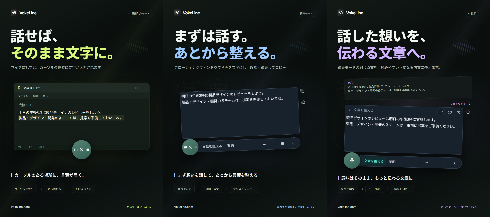

# VokeLine｜デスクトップ音声入力と AI テキストアシスタント

[English](README.md) | [Español](README.es.md) | [Português (Brasil)](README.pt-BR.md) | [Português (Portugal)](README.pt-PT.md) | [Français](README.fr.md) | [Deutsch](README.de.md) | [Italiano](README.it.md) | [Nederlands](README.nl.md)

[Русский](README.ru.md) | [Polski](README.pl.md) | [Türkçe](README.tr.md) | [Українська](README.uk.md) | [日本語](README.ja.md) | [한국어](README.ko.md) | [Bahasa Indonesia](README.id.md) | [Tiếng Việt](README.vi.md)

[ไทย](README.th.md) | [Bahasa Melayu](README.ms.md) | [हिन्दी](README.hi.md) | [বাংলা](README.bn.md) | [简体中文](README.zh-CN.md) | [繁體中文](README.zh-TW.md) | [Svenska](README.sv.md) | [Čeština](README.cs.md)

[Norsk bokmål](README.nb.md) | [Dansk](README.da.md) | [Suomi](README.fi.md) | [Română](README.ro.md) | [Ελληνικά](README.el.md) | [Magyar](README.hu.md)

[公式サイト](https://vokeline.com/) · [ダウンロード](https://vokeline.com/ja/download) · [ユーザーガイド](https://vokeline.com/ja/docs/start)

## VokeLineとは

VokeLine はデスクトップ音声入力・AI テキストアシスタントです。リアルタイム音声または音声ファイルを編集可能なテキストに変換し、AI テキスト操作、コピー、検索、記録整理を選べます。

常駐ボタンとフローティングツールバーはリアルタイム音声入力と即時操作に使用します。メインウィンドウでは音声ファイル、AIアクション、履歴、クラウド記録、モデル、使用状況、設定を管理します。

マイクボタンかショートカットで話し始め、文字を確認したらコピー、入力、AIアクションを選びます。どの段階でも自分で操作を決められます。

**話し始める → カーソル位置で確認 → 次の操作を選択**

_画面イメージ。左から直接入力モード、編集モード、AIによる推敲です。文章とクレジット数は例です。結果を確認し、実際の消費クレジットはアプリの表示に従ってください。_

## こんな方におすすめ

- **仕事のメッセージに返信する方**：ページや文書を読みながら返信を口述し、編集して現在のアプリへコピーできます。
- **学生・研究者**：読みながら観察や結論を話し、AIアクションで文字起こしを要約または再整理します。
- **文章を書く方・コンテンツ制作者**：最初の下書きを口述し、カーソルを移動して詳細を追加し、最後の表現を整えます。
- **インタビューなどの音声を文字にしたい方**：対応する音声ファイルをまとめて追加し、進捗を確認できます。「この端末に履歴を保存」をオンにすると、完成したテキストを履歴にも残せます。

## 主な機能

- **編集できる文字起こし**：カーソルを移動し、表現を直し、一時停止して話し続けてから、コピー、挿入、検索、AI の使用を選べます。
- **音声ファイルの文字起こし**：対応する音声ファイルをまとめて追加し、進捗を確認できます。「この端末に履歴を保存」をオンにすると、完成したテキストを履歴にも残せます。
- **ローカル音声モデル**：リアルタイム音声入力と音声ファイル文字起こしに別々の既定モデルをダウンロードして選択できます。
- **AIによる解説、文章の調整、カスタムアクション**：現在の文字起こしを使って、内容の説明、要点抽出、表現の改善、保存した指示の実行ができます。再利用できる指示を作成・並べ替え、フローティングツールバーに表示する操作を選べます。
- **検索またはコピー**：完成した文字起こしを直接コピーするか、システムブラウザーで好みの検索エンジンへ送信します。
- **ローカル履歴とクラウド記録**：履歴はこのデバイスで利用者ごとに分離されます。明示的に選んだ記録だけをクラウドへ保存します。
- **整理されたメインウィンドウ**：使用状況の確認、音声ファイルの文字起こし、AIアクションの管理、ローカル履歴とクラウド記録の閲覧、モデル設定ができます。

AIアクションは、設定したサービス、ネットワーク接続、利用可能なクレジット、現在の提供状況に依存します。

## 使い方

### 1. ダウンロードとインストール

[ダウンロード](https://vokeline.com/ja/download)

公式ダウンロードページで、OSとプロセッサーに合うインストーラーを選びます。案内に従ってインストールし、VokeLineを起動してください。最初のローカル音声モデルをダウンロードするため、ネット接続を保ちます。

VokeLine は Windows と macOS 向けに開発されています。Linux 版は開発中です。ダウンロードページで公開済みのバージョン、アーキテクチャ、システム要件をご確認ください。

### 2. 最初のモデルを準備する

**操作場所と事前の準備：** モデル → ローカルモデル。ダウンロードには通信と空き容量が必要です。カードでサイズ、想定メモリ、対応する作業を確認できます。

1. 録音の文字起こしに対応したモデルを選び、言語と端末要件を確認します。ファイル専用モデルではリアルタイム録音はできません。
2. ダウンロードを選び、取得、ファイル確認、インストールが終わるまで待ちます。一時的にオフラインにする場合は一時停止し、接続後に再開します。
3. インストール済みモデルで使用を選びます。両方の作業に対応する場合は、録音用、ファイル用、または両方の既定モデルに設定します。
4. 録音に使用中であることを示す表示を確認してから、ホームに戻ります。

**完了すると：** 以降の録音にそのモデルが使われます。ダウンロード完了だけでは選択されないため、使用を押す必要があります。破損、メモリ不足、ダウンロード失敗は[モデルの問題](https://vokeline.com/ja/docs/help#guide-model-downloads)で確認します。

#### マイクを確認する

**操作場所：** 設定 → 音声とショートカット → 入力デバイス。接続済みでミュートされていないマイクと、OS の使用許可が必要です。

1. システム既定の入力か、使うマイクを選びます。外付け機器を外した場合は、利用可能な入力を選び直します。
2. マイクのテストを選び、短く話します。10 秒以内に自動で終了し、テスト音声は保存しません。
3. 音が検出されたら続けます。検出されなければ、ミュート、入力音量、距離を確認して再テストします。
4. 許可が不足していればマイク権限設定を開きます。自動で開けない場合は OS の設定を手動で確認します。

**完了すると：** テストで音が検出され、デバイスの利用不可表示がなくなります。ファイルの文字起こしにはマイクは不要なので、[音声ファイルの文字起こし](https://vokeline.com/ja/docs/features#guide-audio-files)から始められます。

### 3. リアルタイム音声入力

どちらのモードも、録音用モデル、マイク、OS の権限が必要です。ローカル処理にログインや AI クレジットは不要です。先に[マイクを確認](https://vokeline.com/ja/docs/start#guide-microphone)してください。

| モード   | 開き方                                                       | 文字の表示先                           | 用途                           |
| -------- | ------------------------------------------------------------ | -------------------------------------- | ------------------------------ |
| 編集     | 専用ショートカット、または編集が既定のときのマイクボタン     | 修正・コピーできるフローティング編集欄 | 文字の確認、AI、検索後に利用。 |
| 直接入力 | 専用ショートカット、または直接入力が既定のときのマイクボタン | 選択した入力欄                         | 作業中のアプリへ直接書き込み。 |

#### 編集モード

1. 編集用ショートカットを使うか、編集を既定にしてマイクを押します。
2. 話し終えたら録音コントロールで停止し、文字の整理を待ちます。
3. 原文を修正してコピーするか、AIアクションや検索を選びます。

**結果：** 原文は編集欄に残ります。AI の結果は別に表示され、それぞれコピーできます。文字起こしだけでは AI リクエストは送られません。

#### 直接入力モード

**追加の条件：** 書き込み先に編集可能な入力欄が必要です。設定 → 音声とショートカットの直接入力権限管理で OS の許可を設定します。macOS では案内に従いアクセシビリティも許可します。

1. 書き込み先をクリックしてカーソルを置き、直接入力のショートカットを使います。
2. 入力欄を選ぶよう表示されたら、目的の欄を選んで録音開始を待ちます。
3. 録音中はその位置を保ち、別のウィンドウや欄に切り替えないでください。
4. 録音コントロールか対応するショートカットで終了し、挿入された文字を確認します。

**結果：** 固定した入力先に文字が書き込まれます。失敗時は入力先と権限を確認し、必要なら編集モードでコピー・貼り付けします。入力先が不明なまま何度も再試行しないでください。

### 4. 音声ファイルの文字起こし

**操作場所と事前の準備：** 左側のファイルの文字起こし。対応するローカルモデルを先にインストールします。ログイン、マイク、AI クレジットは不要です。

| 項目       | 現在の条件                              |
| ---------- | --------------------------------------- |
| 形式       | WAV、MP3、FLAC、OGG、M4A、MP4。         |
| サイズ     | 空でないファイル、1 件につき最大 2 GB。 |
| 一度の追加 | 最大 100 件。                           |
| 話者の区別 | 現在非対応。区別しない設定のみ。        |

1. ファイル選択かドラッグで追加します。さらに追加する操作で補充できます。
2. 準備画面で一覧を確認し、形式・サイズ・名前・読み取りに問題のある項目を外します。外部で変更されたファイルは選び直します。
3. ローカルモデルを選びます。音声の言語を指定できるモデルでは、選択肢から分かっている言語を選びます。自動判定のみのモデルは言語を自動で検出するため、どちらの場合も文字起こしの結果を確認してください。
4. 開始し、待機、読み取り、文字起こし、文章整理の進行を一覧で確認します。
5. 完了した結果を開き、本文を確認してコピーします。

**結果：** 各ファイルが個別の作業になります。ローカル記録の保存が有効なら、完成した文字は現在のアカウントまたはゲストの履歴へ保存されます。クラウドには自動保存されません。

### 5. AI による文章処理

**操作場所と事前の準備：** AIアクションページで設定し、フローティング編集ツールバーから実行します。ログイン、通信、利用可能な AI モデル、十分なクレジットが必要です。実行前にモデル・出力言語・必要クレジットを確認します。

| 操作         | 用途               | 出力言語         |
| ------------ | ------------------ | ---------------- |
| 解説         | 原文の意味を説明   | 選択した言語。   |
| 文章を整える | 表現を整える       | 原文に合わせる。 |
| 要約         | 主な内容をまとめる | 選択した言語。   |
| 要点を抽出   | 重要な点を抽出     | 選択した言語。   |
| 校正         | 文字を確認・修正   | 原文に合わせる。 |

1. AIアクションで既定のモデルと出力言語を選び、保存します。
2. 編集欄に文章を準備し、入力上限を確認します。
3. 操作を選び、クレジット表示を確認して完了を待ちます。
4. 結果を確認してコピーします。原文を直す場合は原文編集へ戻ります。

**結果：** 結果領域に処理済み文章が表示されます。自分で実行したときだけ対象文章がオンラインサービスへ送られます。AI モデルと音声モデルの選択は別です。

「原文の言語に合わせる」を選ぶと原文の言語を使います。「文章を整える」と「校正」は常に原文の言語を使います。

「再試行」は同じ処理の復旧を試みます。「再実行」は新しい処理を開始するため、再度クレジットを消費する場合があります。処理や結果の確認が続いているときは、状態が更新されるまで待ってから次の操作を行ってください。

#### カスタム操作

1. 新規操作を選び、名前と指示文を入力します。例：「原文を議事録にして、決定事項と担当作業を列挙する」。
2. モデル・言語・表示設定を保存します。パスワードや鍵などの機密情報は指示文に書かないでください。
3. 短い文章で試して調整します。カスタム操作は最大 20 件です。

### 6. ローカル履歴とクラウド記録

#### ローカル履歴と利用統計

**操作場所と条件：** 左側の履歴、またはホームの最近の記録。現在のゲスト・アカウントがこの端末で作った記録のみを表示します。閲覧に接続は不要です。

1. すべて、音声、AI で絞り込み、記録を選んで詳細を開きます。
2. 音声は原文、AI は原文と結果を確認し、必要な部分をコピーします。

#### クラウドに保存

**操作場所と条件：** ログイン後、履歴 → 記録 → クラウドに保存。接続が必要で、記録数の上限内であることを確認します。

1. 保存先のアカウントにログインして、そのローカル履歴を開きます。
2. 記録の原文や AI 結果に送信したくない内容がないか確認し、保存を選びます。
3. 保存済み、または既存の表示を待ちます。失敗したら原文を残し、通信と上限を確認して再試行します。
4. クラウド記録を更新し、保存した内容を確認します。

**操作後：** 同じアカウントで他の端末から読めるクラウド記録になります。ローカル原文は残り、後で消してもクラウド側は消えません。

## よくある質問

### VokeLine の利用にアカウントは必要ですか？

ローカル音声入力、ローカルモデル、履歴、コピーはアカウントなしでも利用できます。AI の利用権、クラウド記録、アカウント機能にはログインが必要です。

[料金](https://vokeline.com/ja/pricing)

### 文字がない・認識が正しくない

モデルが話している言語に対応し、選択したマイクが使えるか確認してから、周囲の騒音を減らして試してください。録音では言語が自動判定されます。ファイルではモデルが対応している場合に限り、音声の言語を指定できます。表示言語を変更しても認識言語は変わりません。別の言語で解説、要約、要点の抽出を行う場合は、対応する AI アクションと出力言語を選びます。音声の言語は、モデルに認識対象の言語を伝える設定です。

### 直接入力されない・入力欄の選択を求められる

編集できる欄を先にクリックしてカーソルを置き、直接入力キーを使います。選択待ちなら案内に従って欄を指定します。録音中はウィンドウや入力位置を変えないでください。

必要な直接入力権限を設定し、macOS はアクセシビリティも確認します。対象アプリが挿入を受け付けなければ、[編集モード](https://vokeline.com/ja/docs/features#guide-editor)で文章を確保してコピー・貼り付けし、その後に原因を調べます。

### ファイルを追加・処理開始できない

WAV、MP3、FLAC、OGG、M4A、MP4 の空でないファイルか、各 2 GB 以内、一度に 100 件以内か確認します。不適合項目を外し、ファイル用モデルと言語を選びます。

移動・改名・外部変更や選択の失効後は選び直します。拡張子が合うのに読めない場合は再生できるか、音声トラックがあるか、破損がないか確認します。

## データとプライバシー

マイク音声は文字起こしのために処理され、クラウド記録として保存されません。AI リクエストは、AIアクションを選択した後にのみ開始されます。

| 操作                               | 内容の保存・送信先                                                                                               |
| ---------------------------------- | ---------------------------------------------------------------------------------------------------------------- |
| ローカル録音・ファイルの文字起こし | この端末でローカル処理。自動でクラウド記録にはしません。                                                         |
| ローカル記録の保存                 | 使用中のアカウントまたはゲストとして端末内に保存。追加暗号化はないため、端末と OS アカウントを保護してください。 |
| AIアクション                       | 必要な文章を選択したオンラインサービスに送信。                                                                   |
| Web 検索                           | 検索語を選択したエンジンに送信。                                                                                 |
| クラウド保存                       | 選択した文字記録を通信経由でアカウントへ保存。                                                                   |

設定 →「データとプライバシー」で「この端末に履歴を保存」をオフにすると、新しい本文の保存が止まります。保存済みの記録は削除されません。ホームには録音とファイルの文字起こしによる回数、音声の長さ、出力文字数が引き続き集計されます。この統計に文字起こしの本文は含まれません。

この設定で制御するのは「履歴」への新しい記録の保存です。ファイルの文字起こし作業とその結果は、別にこの端末へ保存されます。不要になった作業は「ファイルの文字起こし」で「タスクを削除」を選びます。履歴やクラウドに保存済みの文字は削除されません。

ローカル履歴はゲストまたはアカウントごとに分離されます。明示的に保存した記録だけがアカウントのクラウド記録へコピーされます。

[アカウントとデータ](https://vokeline.com/ja/docs/account)

## 公式サイトとサポート

- [公式サイト：vokeline.com](https://vokeline.com/)
- [はじめに](https://vokeline.com/ja/docs/start)
- [機能の使い方](https://vokeline.com/ja/docs/features)
- [困ったときは](https://vokeline.com/ja/docs/help)

**操作場所：** デスクトップアプリの「アカウント」メニューで「アカウント」を選び、Web の「ヘルプとフィードバック」を開きます。必要に応じてログインしてください。

1. バージョン、OS、機能、行った操作、期待した結果、実際の結果を記載します。
2. 正確なメッセージを添えます。モデル名、ファイルの形式・サイズ、支払いやクレジット記録の時刻など、問題に必要な情報も記載します。
