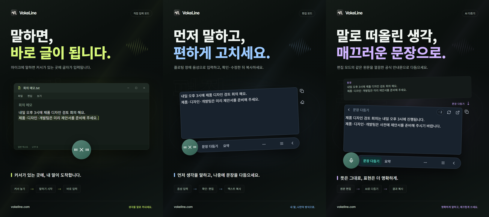

# VokeLine — 데스크톱 음성 입력 및 AI 텍스트 도우미

[English](README.md) | [Español](README.es.md) | [Português (Brasil)](README.pt-BR.md) | [Português (Portugal)](README.pt-PT.md) | [Français](README.fr.md) | [Deutsch](README.de.md) | [Italiano](README.it.md) | [Nederlands](README.nl.md)

[Русский](README.ru.md) | [Polski](README.pl.md) | [Türkçe](README.tr.md) | [Українська](README.uk.md) | [日本語](README.ja.md) | [한국어](README.ko.md) | [Bahasa Indonesia](README.id.md) | [Tiếng Việt](README.vi.md)

[ไทย](README.th.md) | [Bahasa Melayu](README.ms.md) | [हिन्दी](README.hi.md) | [বাংলা](README.bn.md) | [简体中文](README.zh-CN.md) | [繁體中文](README.zh-TW.md) | [Svenska](README.sv.md) | [Čeština](README.cs.md)

[Norsk bokmål](README.nb.md) | [Dansk](README.da.md) | [Suomi](README.fi.md) | [Română](README.ro.md) | [Ελληνικά](README.el.md) | [Magyar](README.hu.md)

[공식 웹사이트](https://vokeline.com/) · [다운로드](https://vokeline.com/ko/download) · [사용자 가이드](https://vokeline.com/ko/docs/start)

## VokeLine 소개

VokeLine은 데스크톱 음성 입력 및 AI 텍스트 도우미입니다. 실시간 음성 또는 오디오 파일을 편집 가능한 텍스트로 변환한 뒤 AI 텍스트 작업, 복사, 검색 또는 기록 정리를 선택할 수 있습니다.

화면에 항상 표시되는 버튼과 플로팅 도구 모음은 실시간 받아쓰기와 즉시 작업을 담당합니다. 메인 창에서는 오디오 파일, AI 작업, 기록, 클라우드 기록, 모델, 사용량 및 설정을 관리합니다.

마이크 버튼이나 단축키로 말하기를 시작하고, 글을 확인한 뒤 복사, 입력 또는 AI 작업을 선택하세요. 각 단계는 직접 결정할 수 있습니다.

**말하기 시작 → 커서 위치에서 확인 → 다음 작업 선택**

_화면 예시입니다. 왼쪽부터 직접 입력 모드, 편집 모드, AI 글 다듬기입니다. 텍스트와 크레딧 수치는 예시입니다. 결과를 확인하고 실제 크레딧 사용량은 앱에 표시된 정보를 따르세요._

## 이런 분께 적합합니다

- **업무 메시지에 답하는 분**: 페이지나 문서를 읽으면서 답변을 말하고 편집한 뒤 현재 앱에 복사하세요.
- **학생과 연구자**: 읽으면서 관찰과 결론을 말한 뒤 AI 작업으로 텍스트를 요약하거나 다시 정리하세요.
- **작가와 콘텐츠 제작자**: 첫 초안을 말로 작성하고 커서를 이동해 세부 내용을 추가한 뒤 최종 표현을 다듬으세요.
- **인터뷰 등 음성 파일을 정리하는 분**: 지원되는 오디오 파일을 한꺼번에 추가하고 진행 상황을 확인하세요. “이 기기에 기록 저장”을 켜면 완성된 텍스트를 기록에도 보관할 수 있습니다.

## 주요 기능

- **편집 가능한 텍스트**: 커서를 옮기고 문장을 고치고 잠시 멈췄다가 계속 말한 뒤 복사, 입력, 검색 또는 AI 사용을 선택하세요.
- **오디오 파일 변환**: 지원되는 오디오 파일을 한꺼번에 추가하고 진행 상황을 확인하세요. “이 기기에 기록 저장”을 켜면 완성된 텍스트를 기록에도 보관할 수 있습니다.
- **로컬 음성 모델**: 실시간 받아쓰기와 오디오 파일 텍스트 변환에 서로 다른 기본 모델을 다운로드하고 선택할 수 있습니다.
- **AI 설명, 다듬기 및 사용자 지정 작업**: 현재 텍스트를 사용해 아이디어를 설명하고 핵심 내용을 추출하고 표현을 개선하거나 저장된 지시를 실행하세요. 재사용 가능한 지시를 만들고 정렬한 뒤 플로팅 도구 모음에 표시할 작업을 선택하세요.
- **검색 또는 복사**: 완성된 텍스트를 바로 복사하거나 시스템 브라우저에서 선호하는 검색 엔진으로 보내세요.
- **로컬 기록 및 클라우드 기록**: 기록은 이 기기에서 사용자별로 분리됩니다. 사용자가 직접 선택한 개별 기록만 클라우드에 저장됩니다.
- **정리된 메인 창**: 사용량 확인, 오디오 파일 텍스트 변환, AI 작업 관리, 로컬 기록 및 클라우드 기록 탐색, 모델 설정을 할 수 있습니다.

AI 작업은 설정된 서비스, 네트워크 연결, 사용 가능한 크레딧 및 현재 제공 상태에 따라 달라집니다.

## 사용 방법

### 1. 다운로드와 설치

[다운로드](https://vokeline.com/ko/download)

공식 다운로드 페이지에서 운영체제와 프로세서에 맞는 설치 파일을 선택하세요. 안내에 따라 설치한 뒤 VokeLine을 실행하세요. 첫 로컬 음성 모델을 다운로드할 때는 인터넷 연결이 필요합니다.

VokeLine은 Windows와 macOS를 위해 개발되었습니다. Linux 버전은 개발 중입니다. 다운로드 페이지에서 제공되는 버전, 아키텍처 및 시스템 요구 사항을 확인하세요.

### 2. 첫 모델 준비하기

**위치와 조건:** 모델 → 로컬 모델. 인터넷과 충분한 저장 공간이 필요하며, 카드에서 다운로드 크기, 예상 메모리, 지원 작업을 확인할 수 있습니다.

1. 실시간 녹음 변환을 지원하는 모델을 고르고 언어와 기기 요구 사항을 확인하세요. 파일 전용 모델은 실시간 녹음에 쓸 수 없습니다.
2. 다운로드 후 파일 검사와 설치가 끝날 때까지 기다리세요. 잠시 연결을 끊어야 하면 일시 정지하고, 다시 연결한 뒤 계속하세요.
3. 설치된 모델에서 사용을 선택하세요. 두 작업을 모두 지원하면 녹음용, 파일용 또는 둘 다의 기본 모델로 지정할 수 있습니다.
4. 녹음에 사용 중인 표시를 확인한 뒤 홈으로 돌아가세요.

**완료 후:** 새 녹음은 선택한 모델을 사용합니다. 다운로드만으로는 선택되지 않으므로 사용을 눌러야 합니다. 손상이나 메모리 부족, 다운로드 실패는 [모델 문제](https://vokeline.com/ko/docs/help#guide-model-downloads)를 참고하세요.

#### 마이크 확인하기

**위치:** 설정 → 음성 및 단축키 → 입력 장치. 마이크가 연결되어 있고 음소거가 해제되어야 하며, 시스템 사용 권한이 필요합니다.

1. 시스템 기본 장치나 사용할 마이크를 선택하세요. 외부 장치를 뺐다면 사용 가능한 입력을 다시 고르세요.
2. 마이크 테스트를 누르고 몇 마디 말하세요. 10초 이내에 자동 종료되며 테스트 녹음은 저장하지 않습니다.
3. 소리가 감지되면 진행하세요. 그렇지 않으면 음소거, 시스템 입력 음량, 마이크와의 거리를 확인하고 다시 테스트하세요.
4. 권한이 부족하면 마이크 권한 설정을 여세요. 자동으로 열리지 않으면 시스템 설정에서 직접 확인하세요.

**완료 후:** 테스트에서 소리가 감지되고 장치 사용 불가 표시가 없어집니다. 파일 변환에는 마이크가 필요 없으므로 [오디오 파일 변환](https://vokeline.com/ko/docs/features#guide-audio-files)부터 진행해도 됩니다.

### 3. 실시간 음성 입력

두 모드 모두 사용할 녹음 모델, 마이크와 시스템 권한이 필요합니다. 로컬 변환은 로그인과 AI 크레딧이 필요 없습니다. 먼저 [마이크 확인](https://vokeline.com/ko/docs/start#guide-microphone)을 진행하세요.

| 모드      | 여는 방법                                          | 텍스트 위치                     | 용도                         |
| --------- | -------------------------------------------------- | ------------------------------- | ---------------------------- |
| 편집      | 전용 단축키 또는 편집이 기본일 때 마이크 버튼      | 수정·복사 가능한 떠 있는 편집창 | 검토, AI 작업, 검색 후 사용. |
| 직접 입력 | 전용 단축키 또는 직접 입력이 기본일 때 마이크 버튼 | 선택한 대상 입력칸              | 작업 중인 앱에 바로 입력.    |

#### 편집 모드

1. 편집 단축키를 쓰거나 기본 모드를 편집으로 지정하고 마이크를 누르세요.
2. 말한 뒤 녹음 컨트롤로 종료하고 텍스트 정리를 기다리세요.
3. 원문을 수정·복사하거나 AI 또는 검색을 선택하세요.

**결과:** 원문은 편집창에 남고 AI 결과는 별도로 표시되어 각각 복사할 수 있습니다. 단순 변환만으로 AI 요청이 전송되지는 않습니다.

#### 직접 입력 모드

**추가 조건:** 대상 앱에 편집 가능한 입력칸이 있어야 합니다. 설정 → 음성 및 단축키의 직접 입력 권한 관리에서 필요한 권한을 처리하세요. macOS에서는 손쉬운 사용 권한도 안내에 따라 허용하세요.

1. 대상 입력칸을 클릭해 커서를 놓고 직접 입력 단축키를 사용하세요.
2. 입력칸 선택 안내가 나오면 대상을 지정하고 녹음 시작을 기다리세요.
3. 말하는 동안 입력 위치를 유지하고 창이나 입력칸을 바꾸지 마세요.
4. 녹음 컨트롤이나 해당 단축키로 종료한 뒤 입력된 텍스트를 확인하세요.

**결과:** 고정한 대상에 텍스트가 입력됩니다. 실패하면 대상과 권한을 확인하고, 필요하면 편집 모드로 복사·붙여넣기 하세요. 대상이 불분명한 채로 반복하지 마세요.

### 4. 오디오 파일 변환

**위치와 조건:** 왼쪽 파일 변환 메뉴. 파일을 지원하는 로컬 모델을 먼저 설치하세요. 로그인, 마이크, AI 크레딧은 필요 없습니다.

| 항목         | 현재 조건                                       |
| ------------ | ----------------------------------------------- |
| 형식         | WAV, MP3, FLAC, OGG, M4A, MP4.                  |
| 크기         | 빈 파일 제외, 파일당 최대 2 GB.                 |
| 한 번에 추가 | 최대 100개.                                     |
| 화자 구분    | 현재 지원하지 않으며 구분하지 않는 옵션만 제공. |

1. 파일 선택 또는 끌어놓기로 추가하고, 더 추가하기로 보충하세요.
2. 준비 화면 목록에서 형식·크기·이름·읽기 상태가 잘못된 파일을 제거하세요. 외부에서 변경된 파일은 다시 선택하세요.
3. 로컬 모델을 선택하세요. 오디오 언어 지정을 지원하는 모델이라면 제공되는 항목에서 알고 있는 언어를 선택하세요. 자동 감지만 지원하는 모델은 언어를 스스로 감지하므로, 어느 경우든 변환 결과를 확인하세요.
4. 시작한 뒤 대기, 오디오 읽기, 변환, 텍스트 정리 상태를 확인하세요.
5. 완료되면 결과를 열어 확인하고 본문을 복사하세요.

**결과:** 파일마다 개별 작업이 생깁니다. 이 기기에 기록 저장이 켜져 있으면 완료된 텍스트는 현재 계정 또는 게스트 기록에 저장되며 클라우드에는 자동 저장되지 않습니다.

### 5. AI 텍스트 작업

**위치와 조건:** AI 작업 페이지에서 설정하고 떠 있는 편집 도구 모음에서 실행합니다. 로그인, 인터넷, 이용 가능한 모델과 충분한 크레딧이 필요하며 실행 전에 모델·출력 언어·크레딧 조건을 확인하세요.

| 작업           | 목적             | 출력 언어    |
| -------------- | ---------------- | ------------ |
| 설명           | 원문의 의미 설명 | 선택한 언어. |
| 문장 다듬기    | 표현 개선        | 원문 언어.   |
| 요약           | 주요 내용 정리   | 선택한 언어. |
| 핵심 내용 추출 | 중요 포인트 추출 | 선택한 언어. |
| 교정           | 텍스트 확인·수정 | 원문 언어.   |

1. AI 작업에서 기본 모델과 출력 언어를 선택하고 저장하세요.
2. 편집창에 텍스트를 준비하고 입력 제한을 확인하세요.
3. 작업을 골라 크레딧 안내를 확인한 뒤 기다리세요.
4. 결과를 검토·복사하고 원문 수정이 필요하면 돌아가세요.

**결과:** 결과 영역에 출력이 표시됩니다. 직접 실행할 때만 관련 텍스트가 온라인 서비스로 전송됩니다. AI 모델과 음성 모델 선택은 서로 대체되지 않습니다.

“원문 언어 따르기”를 선택하면 원문 언어를 사용합니다. “문장 다듬기”와 “교정” 작업은 항상 원문 언어를 유지합니다.

“다시 시도”는 같은 작업의 복구를 시도합니다. “다시 실행”은 새 작업을 시작하므로 크레딧이 다시 사용될 수 있습니다. 처리나 결과 확인이 진행 중이라면 상태가 갱신될 때까지 기다린 뒤 다음 작업을 실행하세요.

#### 사용자 지정 작업

1. 새 작업에서 이름과 프롬프트를 입력하세요. 예: 원문을 회의록으로 정리하고 결정 사항과 할 일을 나열하기.
2. 모델·언어·표시 여부를 저장하세요. 프롬프트에 비밀번호나 키 등 민감한 내용을 넣지 마세요.
3. 짧은 텍스트로 확인한 뒤 조정하세요. 사용자 지정 작업은 최대 20개입니다.

### 6. 로컬 기록 및 클라우드 기록

#### 로컬 기록과 사용 통계

**위치와 조건:** 왼쪽 기록 또는 홈의 최근 기록. 현재 계정·게스트의 이 기기 기록만 표시하며 인터넷은 필요 없습니다.

1. 전체·음성·AI 필터로 찾아 선택하고 자세히 보세요.
2. 음성은 원문, AI는 원문과 결과를 보며 필요한 부분을 복사하세요.

#### 클라우드에 저장

**위치와 조건:** 로그인 후 기록에서 항목을 선택해 클라우드 저장을 사용하세요. 인터넷과 기록 한도 내 여유가 필요합니다.

1. 저장할 계정으로 로그인하고 그 계정의 로컬 기록을 여세요.
2. 원문·AI 결과에서 보내고 싶지 않은 내용이 없는지 확인해 저장하세요.
3. 저장 또는 이미 존재 안내를 기다리세요. 실패하면 로컬 원문을 보존하고 연결·한도를 확인해 재시도하세요.
4. 클라우드 기록을 새로 고쳐 내용을 확인하세요.

**결과:** 같은 계정의 다른 기기에서도 볼 수 있는 기록이 됩니다. 로컬 원문은 유지되며 나중에 지워도 클라우드는 지워지지 않습니다.

## 자주 묻는 질문

### VokeLine을 사용하려면 계정이 필요한가요?

로컬 받아쓰기, 로컬 모델, 기록 및 복사는 계정 없이 사용할 수 있습니다. AI 이용 권한, 클라우드 기록 및 계정 기능에는 로그인이 필요합니다.

[요금](https://vokeline.com/ko/pricing)

### 텍스트 없음 또는 잘못된 인식

모델이 발화 언어를 지원하는지, 선택한 마이크가 작동하는지 확인하고 주변 소음을 줄여 다시 시도하세요. 녹음에서는 언어를 자동으로 감지합니다. 파일의 오디오 언어는 모델이 수동 지정을 지원할 때만 선택할 수 있습니다. 화면 언어를 바꿔도 음성 인식 언어는 바뀌지 않습니다. 다른 언어로 설명, 요약, 핵심 내용 추출을 하려면 해당 AI 작업과 출력 언어를 선택하세요. 오디오 언어는 모델이 인식할 언어를 지정하는 설정입니다.

### 직접 입력 실패 또는 입력칸 선택 요구

편집 가능한 대상 칸을 먼저 클릭해 커서를 놓고 단축키를 사용하세요. 선택 대기라면 안내대로 지정하고 녹음 중 창이나 입력 위치를 바꾸지 마세요.

필요한 직접 입력 권한을 처리하고 macOS에서는 손쉬운 사용을 확인하세요. 대상이 입력을 거부하면 [편집 모드](https://vokeline.com/ko/docs/features#guide-editor)로 텍스트를 검토·복사해 보존한 뒤 조사하세요.

### 파일 추가나 시작 불가

WAV, MP3, FLAC, OGG, M4A, MP4의 빈 파일이 아닌지, 파일당 2 GB 이내인지, 한 번에 100개 이내인지 확인하세요. 잘못된 항목을 제거하고 파일용 모델·언어를 선택하세요.

이름 변경·이동·외부 수정·선택 만료 후 다시 선택하세요. 지원 확장자여도 재생, 오디오 트랙 존재와 손상 여부를 확인해야 합니다.

## 데이터와 개인정보

마이크 음성은 텍스트 변환을 위해 처리되며 클라우드 기록으로 저장되지 않습니다. AI 요청은 AI 작업을 선택한 뒤에만 시작됩니다.

| 작업                | 내용의 위치                                                                     |
| ------------------- | ------------------------------------------------------------------------------- |
| 로컬 녹음·파일 변환 | 이 기기의 모델로 처리하며 클라우드에 자동 저장하지 않음.                        |
| 이 기기에 기록 저장 | 현재 계정·게스트의 기기 영역. 추가 암호화가 없으므로 기기와 시스템 계정을 보호. |
| AI 작업             | 필요한 텍스트를 선택한 온라인 서비스에 전송.                                    |
| 웹 검색             | 선택한 검색 엔진에 검색어 전송.                                                 |
| 클라우드 저장       | 선택한 텍스트를 네트워크로 계정 클라우드에 저장.                                |

설정 → “데이터 및 개인정보 보호”에서 “이 기기에 기록 저장”을 끄면 새로운 텍스트 기록의 저장만 중단되며, 기존 기록은 유지됩니다. 홈에서는 녹음과 파일 텍스트 변환의 사용 횟수, 오디오 길이, 출력 문자 수를 계속 집계합니다. 이 통계에는 변환된 텍스트 본문이 포함되지 않습니다.

이 설정은 기록 페이지에 새 항목을 저장할지 결정합니다. 파일 텍스트 변환 작업과 결과는 이 기기에 별도로 보관됩니다. 작업이 더 이상 필요 없으면 파일 텍스트 변환에서 “작업 삭제”를 사용하세요. 기록이나 클라우드에 이미 저장한 텍스트는 삭제되지 않습니다.

로컬 기록은 게스트 또는 계정별로 분리됩니다. 사용자가 직접 저장한 기록만 계정의 클라우드 기록으로 복사됩니다.

[계정과 데이터](https://vokeline.com/ko/docs/account)

## 공식 웹사이트와 도움말

- [공식 웹사이트: vokeline.com](https://vokeline.com/)
- [시작하기](https://vokeline.com/ko/docs/start)
- [기능 사용하기](https://vokeline.com/ko/docs/features)
- [문제 해결](https://vokeline.com/ko/docs/help)

**위치:** 데스크톱 앱의 “계정” 메뉴에서 “계정”을 선택한 뒤 웹사이트의 “도움말 및 피드백”을 여세요. 필요하면 로그인하세요.

1. 앱 버전, OS, 기능, 실행한 일, 기대한 결과와 실제 결과를 적으세요.
2. 정확한 안내를 첨부하세요. 모델 이름, 파일 형식·크기, 관련 결제·크레딧 시각 등 필요한 정보도 적으세요.
