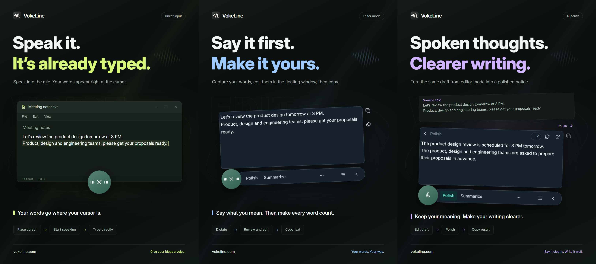

# VokeLine — Desktop Voice Dictation & AI Assistant

[English](README.md) | [Español](README.es.md) | [Português (Brasil)](README.pt-BR.md) | [Português (Portugal)](README.pt-PT.md) | [Français](README.fr.md) | [Deutsch](README.de.md) | [Italiano](README.it.md) | [Nederlands](README.nl.md)

[Русский](README.ru.md) | [Polski](README.pl.md) | [Türkçe](README.tr.md) | [Українська](README.uk.md) | [日本語](README.ja.md) | [한국어](README.ko.md) | [Bahasa Indonesia](README.id.md) | [Tiếng Việt](README.vi.md)

[ไทย](README.th.md) | [Bahasa Melayu](README.ms.md) | [हिन्दी](README.hi.md) | [বাংলা](README.bn.md) | [简体中文](README.zh-CN.md) | [繁體中文](README.zh-TW.md) | [Svenska](README.sv.md) | [Čeština](README.cs.md)

[Norsk bokmål](README.nb.md) | [Dansk](README.da.md) | [Suomi](README.fi.md) | [Română](README.ro.md) | [Ελληνικά](README.el.md) | [Magyar](README.hu.md)

[Official website](https://vokeline.com/) · [Download](https://vokeline.com/download) · [User guide](https://vokeline.com/docs/start)

## About VokeLine

VokeLine is a desktop voice-input and AI text assistant. It turns live speech or audio files into editable text, then lets you choose AI text actions, copy, search, or record organization.

The persistent control and floating toolbar handle live dictation and immediate actions. The main window manages audio files, AI actions, history, cloud records, models, usage, and settings.

Click the microphone or press a shortcut, speak, review your words, then copy, insert, or run an AI action. You stay in control of each step.

**Start speaking → Review at the cursor → Choose the next action**

_Interface illustration, left to right: Direct mode, Editor mode, and AI polishing. The text and credit values are examples. Review the result; actual credit use follows the information shown in the app._

## Who it is for

- **People replying to messages at work**: Dictate a response while reading a page or document, edit it, then copy it into the current app.
- **Students and researchers**: Speak observations as you read, then summarize or reorganize the transcript with an AI action.
- **Writers and content creators**: Dictate a first draft, move the cursor to add details, and polish the final wording.
- **People working with interviews or other audio**: Queue supported audio files and track progress. Enable “Save local records” to also keep completed transcripts in local history.

## Main features

- **Editable transcript**: Move the caret, correct wording, pause, and continue speaking before copying, inserting, searching, or using AI.
- **Transcribing audio files**: Queue supported audio files and track progress. Enable “Save local records” to also keep completed transcripts in local history.
- **Local speech models**: Download and choose separate defaults for real-time dictation and audio-file transcription.
- **AI explanation, polish, and custom actions**: Use the current transcript to explain an idea, extract key points, improve wording, or run a saved instruction. Create and order reusable instructions, then choose which actions appear on the floating toolbar.
- **Search or copy**: Copy the final transcript directly, or send it to your preferred search engine in the system browser.
- **Local history and cloud records**: History stays partitioned on this device. Save an individual record to the cloud only when you explicitly choose to.
- **Organized main window**: Review usage, transcribe audio files, manage AI actions, browse local history and cloud records, and configure models.

AI actions depend on the configured service, network access, available credits, and current release status.

## How to use VokeLine

### 1. Download and install

[Download](https://vokeline.com/download)

Open the official download page and choose the installer for your operating system and processor. Follow the installation prompts, then open VokeLine. Keep an internet connection for the first local speech model download.

VokeLine is built for Windows and macOS. The Linux version is in development. Check the download page for available releases, architectures, and system requirements.

### 2. Prepare your first model

**Where and what you need:** Open Models → Local models. Downloads need an internet connection and enough disk space. Each card lists its download size, estimated memory use, and supported tasks.

1. Choose a model that supports live transcription, and check its languages and device requirements. A file-only model cannot be used for live recording.
2. Select Download and wait for downloading, file checks, and installation to finish. Pause download if you need to disconnect, then Resume download when you are online again.
3. Select Use on the installed model. If it supports both tasks, choose whether to make it the default for live transcription, file transcription, or both.
4. Check that the card shows it is in use for live transcription before returning to Home.

**What happens:** New recordings use that local model. Finishing a download does not select the model for you: you still need to choose Use. For damaged files, insufficient memory, or download failures, see [Model problems](https://vokeline.com/docs/help#guide-model-downloads).

#### Check your microphone

**Where to start:** Settings → Voice and shortcuts → Input device. Recording needs a connected, unmuted microphone and permission to use it.

1. Choose the system default device or the specific microphone you want. If an external device is disconnected, select an available input again.
2. Select Test microphone and say a few words. The test finishes automatically within 10 seconds and does not save this test recording.
3. Continue once sound is detected. Otherwise check mute, system input volume, and your distance from the microphone, then test again.
4. If permission is denied, use the microphone permission settings link. Open your system settings manually if the link cannot do so.

**What happens:** The test detects sound and the input device has no unavailable warning. File transcription does not need a microphone; for that task, go straight to [Transcribing audio files](https://vokeline.com/docs/features#guide-audio-files).

### 3. Live voice input

Both modes need a usable recording model, microphone, and system permissions. Local transcription does not require sign-in or AI credits. [Check your microphone](https://vokeline.com/docs/start#guide-microphone) first.

| Mode        | How to open it                                                                  | Where text appears                             | Best for                                                  |
| ----------- | ------------------------------------------------------------------------------- | ---------------------------------------------- | --------------------------------------------------------- |
| Editor mode | Its shortcut, or the Home/floating microphone button when Editor is the default | Floating editor; text can be edited and copied | Reviewing text, running AI, or searching before using it. |
| Direct mode | Its shortcut, or the microphone button when Direct is the default               | The selected destination text field            | Writing directly into the app you are editing.            |

#### Editor mode

1. Use the Editor mode shortcut, or set Editor as the default and select the microphone button.
2. Speak, then use the recording control to finish and wait for finalization.
3. Edit the original text and copy it, or choose an AI action or search.

**What happens:** The original stays in the floating editor. AI output is shown separately and can be copied separately. Transcribing text alone does not automatically send an AI request.

#### Direct mode

**Extra requirements:** Your destination app must have an editable text field. If system permission is required, use Manage Direct mode permissions in Settings → Voice and shortcuts. On macOS, follow the prompts to allow Accessibility access too.

1. Click the destination text field, position the cursor, and use the Direct mode shortcut.
2. If prompted to select a text field, select the destination and wait for recording to start.
3. Keep that input location while speaking; do not switch windows or text fields.
4. Finish using the recording control or the matching shortcut, then check the inserted text.

**What happens:** Text is written to the locked destination. If insertion fails, check the field and permissions; use Editor mode to copy and paste if necessary. Do not retry repeatedly without a clear destination.

### 4. Transcribing audio files

**Where and what you need:** File transcription in the sidebar. Install a local model with file-transcription support first. No sign-in, AI credits, or microphone is needed.

| Limit              | Current requirement                                                 |
| ------------------ | ------------------------------------------------------------------- |
| Formats            | WAV, MP3, FLAC, OGG, M4A, MP4.                                      |
| File size          | Non-empty files, up to 2 GB each.                                   |
| Batch size         | Up to 100 files per selection.                                      |
| Speaker separation | Unavailable in this version; only no speaker separation is offered. |

1. Select Choose files or drag files into the page. Use Add more files to add more.
2. Check the list under Prepare transcription. Remove files with invalid formats, sizes, names, or read states. Select a file again if it has changed externally.
3. Choose a local model. If it lets you set Audio language, select a known language from the available choices. Automatic-only models detect the language themselves; review the transcript either way.
4. Select Transcribe and watch each task progress through queued, reading, transcribing, and finalizing states.
5. When complete, select View result, review the text, and choose Copy transcript.

**What happens:** Each file has its own task. With Save local records enabled, the finished text is saved in the current identity's local history. It is not automatically saved to the cloud.

### 5. AI text actions

**Where and what you need:** Configure actions in AI Actions; run them from the floating editor toolbar. Running an action needs sign-in, internet, an available AI service, and enough credits. Check the output language and credit information before execution.

| Action     | Purpose                             | Output language           |
| ---------- | ----------------------------------- | ------------------------- |
| Explain    | Explain the original text's meaning | Selected output language. |
| Polish     | Improve expression                  | Original text's language. |
| Summarize  | Condense the main content           | Selected output language. |
| Key points | Extract the important points        | Selected output language. |
| Proofread  | Check and correct text              | Original text's language. |

1. Choose an output language on AI Actions, then save.
2. Prepare the text in the floating editor and check the input limit.
3. Choose an action, check its credit information, and wait for completion.
4. Review and copy the result. Return to the original if you need to edit it.

**What happens:** Output appears in the result area. Text goes to the online AI service only when you actively run the action.

“Follow source language” uses the original text’s language. The “Polish” and “Proofread” actions always keep the original language.

“Retry” tries to recover the same operation. “Run again” starts a new operation and may spend credits again. If processing or result verification is still pending, read the status and wait before running another operation.

#### Custom actions

1. Select New action in AI Actions. Enter a name and prompt, such as “Turn the original into meeting notes with decisions and action items.”
2. Set its language and toolbar visibility, then save. Do not put passwords, keys, or other sensitive information in prompts.
3. Test with a short text and refine the prompt. You can create up to 20 custom actions.

### 6. Local history and cloud records

#### Local history and usage statistics

**Where and what you need:** History in the sidebar; Recent records on Home also opens entries. You see only the current guest or account's records on this device. Viewing local content does not need internet.

1. Find an entry with All, Voice, or AI filters and select it for details.
2. View the original for voice records, or the original and output for AI records. Copy the part you need.

#### Save to the cloud

**Where and what you need:** Sign in, then choose History → an entry → Save to cloud. You need internet and room within the current cloud-record limit.

1. Sign in to the account that should own the record, then open that account's local history.
2. Select an entry, check the original or AI output for content you do not want uploaded, and choose Save to cloud.
3. Wait for a saved or already-exists message. If it fails, retain the local original, check the network and limit, and retry.
4. Open Cloud records, refresh, and check the saved content.

**What happens:** The record content becomes that account's cloud record, viewable on other devices signed in to the same account. The local original remains; deleting it later does not delete the cloud copy.

## Common questions

### Do I need an account to use VokeLine?

Local dictation, local models, history, and copy can work without an account. AI entitlements, cloud records, and account features require sign-in.

[Pricing](https://vokeline.com/pricing)

### Text is missing or inaccurate

Check that the model supports the spoken language and that the selected microphone works, then reduce background noise and try again. Live recording detects the audio language automatically; file transcription lets you select it when the model supports language selection. Changing the interface language does not change speech recognition. To explain, summarize, or extract key points in another language, choose the corresponding AI action and set its output language. The audio-language setting tells the model what language to recognize.

### Direct input fails or asks you to select a text field

Click an editable destination field and position the cursor before using the Direct shortcut. If VokeLine is waiting for a destination, select it as prompted. Keep that input location while recording; do not switch windows or move to another field.

Use Manage Direct mode permissions when required, and check Accessibility access on macOS. If the destination rejects insertion, use [Editor mode](https://vokeline.com/docs/features#guide-editor) to review and copy the text first, then troubleshoot Direct mode without losing the content.

### Files cannot be added or transcription cannot start

Check for WAV, MP3, FLAC, OGG, M4A, or MP4; non-empty files of at most 2 GB each; and no more than 100 files per selection. Remove invalid entries and confirm a local file-transcription model and audio language are selected.

Select files again after renaming, moving, external changes, or an expired selection. If the extension is supported but decoding fails, check playback, the presence of an audio track, and whether the file is damaged.

## Data and privacy

Microphone audio is processed for transcription and is not kept as a cloud record. AI requests begin only after you choose an AI action.

| Action                                | Where the content goes                                                                                                                                        |
| ------------------------------------- | ------------------------------------------------------------------------------------------------------------------------------------------------------------- |
| Local recording or file transcription | Processed with a local model on this device; not automatically uploaded as a cloud record.                                                                    |
| Save local records                    | Text stays on this device, with guest and account records kept separate. Local records have no additional encryption; protect your device and system account. |
| AI text actions                       | The text needed for this operation goes to the chosen online service.                                                                                         |
| Web search                            | The query goes to the chosen search engine.                                                                                                                   |
| Save to cloud                         | The record content is sent to the account's cloud records over the network.                                                                                   |

Turning off “Save local records” in Settings → Data and privacy stops saving new text records; existing entries remain. Home still records statistics for recordings and file transcription: session count, audio duration, and output characters. These statistics contain no transcript text.

This switch controls new entries on the History page. File-transcription tasks and their results are stored separately on this device. Use “Remove task” on the File transcription page when you no longer need a task; removing it does not delete a transcript already saved in History or the cloud.

Local history is partitioned by guest or account identity. Only records you explicitly save are copied to your cloud-record account.

[Account and data](https://vokeline.com/docs/account)

## Official website and support

- [Official website: vokeline.com](https://vokeline.com/)
- [Getting started](https://vokeline.com/docs/start)
- [Using features](https://vokeline.com/docs/features)
- [Troubleshooting](https://vokeline.com/docs/help)

**Where to start:** Open “Account center” from the desktop “Account” menu, then choose “Help & Feedback” on the website. Sign in if needed.

1. Include the app version, operating system, feature, what you did, what you expected, and what happened.
2. Include the exact message. Add the model name for model issues, format and size for file issues, or the relevant order/credit-entry time for credit issues.
