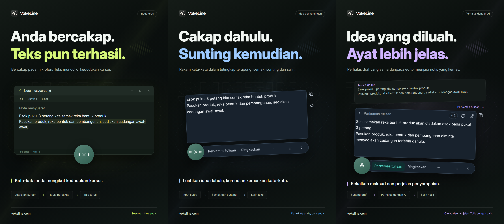

# VokeLine | Input suara desktop dan pembantu teks AI

[English](README.md) | [Español](README.es.md) | [Português (Brasil)](README.pt-BR.md) | [Português (Portugal)](README.pt-PT.md) | [Français](README.fr.md) | [Deutsch](README.de.md) | [Italiano](README.it.md) | [Nederlands](README.nl.md)

[Русский](README.ru.md) | [Polski](README.pl.md) | [Türkçe](README.tr.md) | [Українська](README.uk.md) | [日本語](README.ja.md) | [한국어](README.ko.md) | [Bahasa Indonesia](README.id.md) | [Tiếng Việt](README.vi.md)

[ไทย](README.th.md) | [Bahasa Melayu](README.ms.md) | [हिन्दी](README.hi.md) | [বাংলা](README.bn.md) | [简体中文](README.zh-CN.md) | [繁體中文](README.zh-TW.md) | [Svenska](README.sv.md) | [Čeština](README.cs.md)

[Norsk bokmål](README.nb.md) | [Dansk](README.da.md) | [Suomi](README.fi.md) | [Română](README.ro.md) | [Ελληνικά](README.el.md) | [Magyar](README.hu.md)

[Laman web rasmi](https://vokeline.com/) · [Muat turun](https://vokeline.com/ms/download) · [Panduan dan perkembangan terkini](https://vokeline.com/ms/docs/start)

## Tentang VokeLine

VokeLine ialah pembantu input suara desktop dan teks AI. Ia menukar pertuturan masa nyata atau fail audio kepada teks yang boleh disunting. Kemudian anda pilih pemprosesan teks AI, penyalinan, carian atau penyusunan rekod.

Kawalan yang sentiasa tersedia dan bar alat terapung menyediakan input suara masa nyata serta tindakan segera. Tetingkap utama digunakan untuk mengurus fail audio, tindakan AI, sejarah, nota awan, model, penggunaan dan tetapan.

Kawalan yang sentiasa tersedia memudahkan input suara tanpa memenuhi skrin. Anda tentukan bila mahu mengesahkan teks dan tindakan seterusnya.

**Mula bercakap → Semak pada kedudukan kursor → Pilih tindakan seterusnya**

_Ilustrasi antara muka, dari kiri ke kanan: input terus, mod editor dan penambahbaikan teks dengan AI. Teks dan nilai kredit ialah contoh. Semak hasilnya; penggunaan kredit sebenar mengikut maklumat dalam aplikasi._

## Sesuai untuk siapa

- **Pengguna yang membalas mesej kerja**: Sambil membaca halaman web atau dokumen, sebutkan balasan anda. Sunting dan salin ke aplikasi semasa tanpa perlu bertukar-tukar aplikasi.
- **Pelajar dan penyelidik**: Sebutkan pemerhatian dan kesimpulan sambil membaca, kemudian gunakan tindakan AI untuk meringkaskan atau menyusun semula teks asal.
- **Penulis dan pencipta kandungan**: Sebutkan draf awal, gerakkan kursor untuk menambah butiran, kemudian perkemas gaya bahasa akhir.
- **Pengguna yang mengurus temu bual atau audio lain**: Tambahkan beberapa fail audio yang disokong dan pantau kemajuan. Hidupkan “Simpan sejarah pada peranti” untuk turut menyimpan teks yang selesai dalam sejarah.

## Ciri utama

- **Teks asal yang boleh disunting**: Gerakkan kursor, sunting teks atau berhenti seketika sebelum menyambung pertuturan. Kemudian pilih untuk menyalin, memasukkan teks, mencari atau menggunakan AI.
- **Transkripsi fail audio**: Tambahkan beberapa fail audio yang disokong dan pantau kemajuan. Hidupkan “Simpan sejarah pada peranti” untuk turut menyimpan teks yang selesai dalam sejarah.
- **Model pengecaman pertuturan setempat**: Muat turun model dan pilih model lalai secara berasingan untuk input suara masa nyata serta transkripsi fail audio.
- **Penjelasan AI, penambahbaikan teks dan tindakan tersuai**: Gunakan teks asal semasa untuk menerangkan konsep, mendapatkan isi utama, menambah baik gaya bahasa atau menjalankan arahan tersuai yang telah disimpan. Cipta arahan yang boleh digunakan semula, susun urutannya dan pilih tindakan yang dipaparkan pada bar alat terapung.
- **Cari atau salin**: Salin terus teks akhir, atau serahkan kepada enjin carian pilihan anda dan teruskan penerokaan dalam pelayar sistem.
- **Sejarah pada peranti dan nota awan**: Sejarah disimpan mengikut identiti pada peranti semasa. Sesuatu rekod hanya dimuat naik apabila anda memilih “Simpan ke awan”.
- **Antara muka utama yang teratur**: Semak penggunaan, transkripsikan fail audio, urus tindakan AI, lihat sejarah pada peranti dan nota awan serta tetapkan model setempat.

Tindakan AI bergantung pada perkhidmatan yang dikonfigurasikan, rangkaian, kredit tersedia dan status keluaran semasa.

## Panduan penggunaan

### 1. Muat turun dan pasang

[Muat turun](https://vokeline.com/ms/download)

Buka halaman muat turun rasmi dan pilih pemasang untuk sistem pengendalian serta pemproses anda. Ikut langkah pemasangan, kemudian buka VokeLine. Kekalkan sambungan internet untuk memuat turun model suara setempat yang pertama.

VokeLine direka untuk Windows dan macOS. Versi Linux sedang dibangunkan. Semak halaman muat turun untuk versi yang tersedia, seni bina dan keperluan sistem.

### 2. Sediakan model pertama

**Lokasi dan keperluan:** Model → Model setempat. Internet dan ruang cakera diperlukan. Kad menunjukkan saiz, anggaran memori dan tugas yang disokong.

1. Pilih model transkripsi masa nyata dan semak bahasa serta keperluan peranti. Model khusus fail tidak boleh digunakan untuk rakaman langsung.
2. Pilih Muat turun dan tunggu muat turun, semakan serta pemasangan selesai. Jeda dan sambung selepas sambungan pulih jika perlu.
3. Pilih Gunakan dan tetapkan lalai untuk rakaman, fail atau kedua-duanya mengikut sokongan.
4. Semak penanda penggunaan rakaman, kemudian kembali ke halaman utama.

**Hasil:** Rakaman baharu menggunakan model pilihan. Muat turun tidak menetapkan lalai secara automatik; pilih juga Gunakan. Lihat [Masalah model](https://vokeline.com/ms/docs/help#guide-model-downloads).

#### Semak mikrofon

**Lokasi:** Tetapan → Suara dan pintasan → Peranti input. Mikrofon mesti disambungkan, tidak dibisukan dan dibenarkan oleh sistem.

1. Pilih mikrofon lalai sistem atau peranti tertentu. Pilih semula peranti tersedia jika mikrofon luaran ditanggalkan.
2. Mulakan ujian dan sebut beberapa perkataan. Ia tamat dalam 10 saat tanpa menyimpan rakaman ujian.
3. Teruskan apabila bunyi dikesan. Jika tidak, semak sama ada mikrofon dibisukan, kelantangan input dan jarak, lalu uji semula.
4. Buka kebenaran mikrofon melalui pautan atau secara manual dalam tetapan sistem jika pautan gagal.

**Hasil:** Ujian mengesan bunyi dan peranti tersedia. [Transkripsi fail](https://vokeline.com/ms/docs/features#guide-audio-files) tidak memerlukan mikrofon.

### 3. Suara masa nyata

Kedua-dua mod memerlukan model rakaman, mikrofon dan kebenaran. Transkripsi setempat tidak memerlukan akaun atau kredit AI. [Semak mikrofon](https://vokeline.com/ms/docs/start#guide-microphone) dahulu.

| Mod        | Akses                                     | Teks                | Tujuan                    |
| ---------- | ----------------------------------------- | ------------------- | ------------------------- |
| Penyunting | Pintasan sendiri atau mikrofon jika lalai | Penyunting terapung | Semak, AI, carian.        |
| Langsung   | Pintasan sendiri atau mikrofon jika lalai | Medan dipilih       | Menulis aplikasi sasaran. |

#### Penyunting

1. Gunakan pintasan Penyunting atau jadikannya lalai dan tekan mikrofon.
2. Bercakap, hentikan melalui kawalan dan tunggu penyelesaian.
3. Sunting dan salin teks asal atau pilih tindakan AI atau carian.

**Hasil:** Teks asal kekal dalam editor. Hasil AI dipaparkan dan disalin berasingan. Transkripsi tidak menghantar permintaan AI secara automatik.

#### Input terus

**Keperluan tambahan:** Aplikasi sasaran mesti mempunyai medan teks yang boleh disunting. Urus kebenaran mod input terus dalam tetapan suara; benarkan Accessibility pada macOS jika diminta.

1. Klik medan sasaran, letakkan kursor dan gunakan pintasan Terus.
2. Pilih medan jika diminta dan tunggu rakaman bermula.
3. Kekalkan medan yang sama semasa bercakap; jangan bertukar tetingkap atau lokasi input.
4. Hentikan melalui kawalan atau pintasan sepadan dan semak teks.

**Hasil:** Teks dimasukkan ke medan sasaran yang dikunci. Jika gagal, semak medan dan kebenaran atau salin daripada Penyunting. Jangan cuba berulang tanpa sasaran jelas.

### 4. Transkripsi fail audio

**Lokasi dan keperluan:** Transkripsi fail dalam menu sisi dengan model setempat yang sesuai. Mikrofon, log masuk dan kredit AI tidak diperlukan.

| Had                 | Syarat                                    |
| ------------------- | ----------------------------------------- |
| Format              | WAV, MP3, FLAC, OGG, M4A, MP4.            |
| Saiz                | Bukan kosong, 2 GB setiap fail maksimum.  |
| Pilihan             | 100 sekali.                               |
| Pengasingan penutur | Belum disokong, tanpa pengasingan sahaja. |

1. Pilih atau seret fail masuk dan tambah lagi jika perlu.
2. Semak senarai dan buang fail tidak sah atau tidak dapat dibaca. Pilih semula selepas perubahan luaran.
3. Pilih model setempat. Jika model membenarkan pilihan bahasa audio, pilih bahasa yang diketahui daripada pilihan tersedia. Model dengan pengesanan automatik sahaja mengenal pasti bahasa sendiri; semak teks dalam kedua-dua keadaan.
4. Mulakan transkripsi dan pantau barisan, pembacaan, transkripsi dan penyelesaian.
5. Buka hasil siap, semak teks dan salin transkrip.

**Hasil:** Setiap fail mempunyai tugas sendiri. Jika simpanan setempat aktif, teks disimpan untuk tetamu atau akaun semasa, bukan automatik ke awan.

### 5. Tindakan teks AI

**Lokasi dan keperluan:** Tetapkan di halaman Tindakan AI dan jalankan dari editor. Anda perlu log masuk, internet, model tersedia dan kredit mencukupi. Semak model, bahasa dan maklumat kredit sebelum menjalankan.

| Tindakan              | Tujuan            | Bahasa   |
| --------------------- | ----------------- | -------- |
| Terangkan             | Terangkan makna   | Pilihan. |
| Perkemas tulisan      | Perbaiki ungkapan | Asal.    |
| Ringkaskan            | Padatkan          | Pilihan. |
| Keluarkan isi penting | Ambil utama       | Pilihan. |
| Semak dan betulkan    | Betulkan          | Asal.    |

1. Pilih model AI lalai dan bahasa keluaran, kemudian simpan.
2. Sediakan teks dan semak had input.
3. Pilih tindakan, semak kredit dan tunggu hasil.
4. Semak dan salin hasil atau kembali ke teks asal untuk perubahan.

**Hasil:** Hasil muncul berasingan. Teks dihantar hanya apabila anda menjalankan tindakan. Model AI dan model suara ialah pilihan berbeza.

“Ikut bahasa teks sumber” menggunakan bahasa teks asal. Tindakan “Perkemas tulisan” dan “Semak dan betulkan” sentiasa mengekalkan bahasa itu.

“Cuba lagi” cuba memulihkan operasi yang sama. “Jalankan semula” memulakan operasi baharu dan mungkin menggunakan kredit lagi. Jika pemprosesan atau semakan hasil masih berjalan, tunggu perubahan status sebelum memulakan operasi lain.

#### Tindakan tersuai

1. Cipta tindakan dengan nama dan arahan, contohnya nota mesyuarat dengan keputusan dan tugas.
2. Tetapkan model, bahasa dan paparan dan simpan. Jangan masukkan kata laluan, kunci atau maklumat sensitif dalam arahan.
3. Uji dengan teks pendek dan perbaiki arahan. Maksimum 20 tindakan tersuai boleh dicipta.

### 6. Sejarah pada peranti dan nota awan

#### Sejarah setempat dan statistik

**Lokasi dan keperluan:** Sejarah atau rekod terkini pada halaman utama. Anda melihat tetamu atau akaun aktif pada peranti ini tanpa internet.

1. Cari dan buka rekod dengan penapis Semua, Suara atau AI.
2. Baca teks asal suara atau teks asal dan hasil AI, lalu salin bahagian yang diperlukan.

#### Simpan awan

**Lokasi dan keperluan:** Log masuk dan pilih Sejarah → rekod → Simpan ke awan. Internet dan ruang dalam had semasa diperlukan.

1. Log masuk ke akaun pemilik teks yang diingini dan buka sejarah setempatnya.
2. Semak teks asal atau hasil AI untuk kandungan yang tidak mahu dihantar, kemudian simpan ke awan.
3. Tunggu pengesahan bahawa rekod telah disimpan atau sudah wujud. Jika gagal, kekalkan asal, semak rangkaian dan had, lalu cuba semula.
4. Buka awan, segar semula dan semak teks.

**Hasil:** Teks tersedia pada peranti lain dengan akaun sama. Teks asal kekal setempat; memadamnya tidak memadam salinan awan.

## Soalan lazim

### Adakah saya memerlukan akaun untuk menggunakan VokeLine?

Input suara setempat, model setempat, sejarah pada peranti dan penyalinan boleh digunakan tanpa log masuk. Penggunaan AI, nota awan dan ciri akaun memerlukan log masuk.

[Harga](https://vokeline.com/ms/pricing)

### Teks tiada atau tidak tepat

Pastikan model menyokong bahasa yang dituturkan dan mikrofon pilihan berfungsi, kemudian kurangkan bunyi latar dan cuba lagi. Bahasa rakaman dikesan secara automatik; bagi fail, bahasa boleh ditentukan jika model menyokongnya. Bahasa antara muka tidak mengubah pengecaman pertuturan. Untuk mendapatkan penerangan, ringkasan atau isi penting dalam bahasa lain, pilih tindakan AI yang sesuai dan bahasa keluarannya. Bahasa audio memberitahu model bahasa yang perlu dikenal pasti.

### Input terus gagal atau meminta medan teks

Klik medan boleh disunting, letakkan kursor dan mulakan mod input terus. Pilih sasaran apabila diminta; jangan bertukar tetingkap atau medan semasa bercakap.

Semak kebenaran dan Accessibility macOS. Jika penulisan ditolak, salin daripada [Penyunting](https://vokeline.com/ms/docs/features#guide-editor) dan tampal secara manual dahulu, kemudian siasat masalah.

### Fail tidak boleh ditambah atau transkripsi tidak bermula

Semak WAV, MP3, FLAC, OGG, M4A atau MP4, fail tidak kosong maksimum 2 GB dan maksimum 100 setiap pilihan. Buang yang tidak sah dan semak model serta bahasa.

Pilih semula selepas berpindah, menukar nama, perubahan luaran atau pilihan tamat tempoh. Semak main balik, trek audio dan kerosakan jika penyahkodan gagal.

## Data dan privasi

Audio mikrofon hanya digunakan untuk transkripsi setempat dan tidak disimpan sebagai nota awan. Permintaan AI melalui internet hanya dibuat apabila anda memilih tindakan AI yang berkaitan.

| Tugas    | Destinasi                                                                        |
| -------- | -------------------------------------------------------------------------------- |
| Setempat | Model peranti, bukan muat naik automatik.                                        |
| Sejarah  | Ruang akaun/tetamu tanpa penyulitan tambahan; lindungi peranti dan akaun sistem. |
| AI       | Teks yang diperlukan untuk tindakan dihantar ke perkhidmatan yang dipilih.       |
| Cari     | Pertanyaan ke enjin dipilih.                                                     |
| Awan     | Teks pilihan melalui rangkaian.                                                  |

Mematikan “Simpan sejarah pada peranti” dalam Tetapan → Data dan privasi menghentikan simpanan teks baharu tanpa memadam rekod sedia ada. Halaman utama masih merekodkan statistik rakaman dan transkripsi fail: bilangan sesi, tempoh audio dan jumlah aksara yang dihasilkan. Statistik ini tidak mengandungi teks transkrip.

Pilihan ini mengawal rekod baharu pada halaman Sejarah. Tugas transkripsi fail dan hasilnya disimpan berasingan pada peranti ini. Jika tugas tidak diperlukan lagi, gunakan “Alih keluar tugas” dalam Transkripsi fail; teks yang sudah disimpan dalam sejarah atau awan kekal.

Sejarah pada peranti diasingkan mengikut identiti tetamu atau akaun. Hanya rekod yang anda pilih untuk disimpan akan disalin ke nota awan akaun anda.

[Akaun dan data](https://vokeline.com/ms/docs/account)

## Laman rasmi dan bantuan

- [Laman web rasmi: vokeline.com](https://vokeline.com/)
- [Langkah pertama](https://vokeline.com/ms/docs/start)
- [Ciri](https://vokeline.com/ms/docs/features)
- [Penyelesaian masalah](https://vokeline.com/ms/docs/help)

**Lokasi:** Buka “Akaun” daripada menu “Akaun” aplikasi desktop, kemudian pilih “Bantuan dan maklum balas” di laman web. Log masuk jika diperlukan.

1. Sertakan versi, sistem, fungsi, langkah, jangkaan dan hasil sebenar.
2. Sertakan mesej tepat dan model, format dan saiz fail, atau masa pesanan dan kredit mengikut kes.
