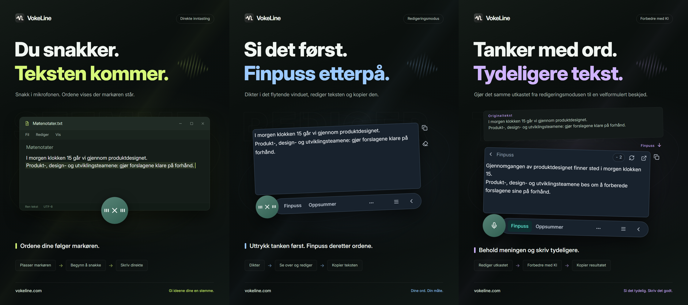

# VokeLine | Diktering og KI-tekstassistent for datamaskinen

[English](README.md) | [Español](README.es.md) | [Português (Brasil)](README.pt-BR.md) | [Português (Portugal)](README.pt-PT.md) | [Français](README.fr.md) | [Deutsch](README.de.md) | [Italiano](README.it.md) | [Nederlands](README.nl.md)

[Русский](README.ru.md) | [Polski](README.pl.md) | [Türkçe](README.tr.md) | [Українська](README.uk.md) | [日本語](README.ja.md) | [한국어](README.ko.md) | [Bahasa Indonesia](README.id.md) | [Tiếng Việt](README.vi.md)

[ไทย](README.th.md) | [Bahasa Melayu](README.ms.md) | [हिन्दी](README.hi.md) | [বাংলা](README.bn.md) | [简体中文](README.zh-CN.md) | [繁體中文](README.zh-TW.md) | [Svenska](README.sv.md) | [Čeština](README.cs.md)

[Norsk bokmål](README.nb.md) | [Dansk](README.da.md) | [Suomi](README.fi.md) | [Română](README.ro.md) | [Ελληνικά](README.el.md) | [Magyar](README.hu.md)

[Offisielt nettsted](https://vokeline.com/) · [Last ned](https://vokeline.com/nb/download) · [Brukerveiledninger](https://vokeline.com/nb/docs/start)

## Om VokeLine

VokeLine er en skrivebordsapp for diktering og tekstbehandling med KI. Den gjør tale i sanntid eller lydfiler om til redigerbar tekst. Deretter velger du KI-handlinger, kopiering, søk eller organisering av oppføringer.

Kontrollen som alltid vises, og den flytende verktøylinjen brukes til diktering i sanntid og raske handlinger. I hovedvinduet administrerer du lydfiler, KI-handlinger, historikk, notater i skyen, modeller, bruk og innstillinger.

Den faste kontrollen holder taleinndata lett tilgjengelig uten å fylle skjermen. Du bestemmer når teksten er endelig og hva som skjer videre.

**Begynn å snakke → Gjennomgå ved markøren → Velg neste handling**

_Illustrasjon av grensesnittet, fra venstre mot høyre: direkte modus, redigeringsmodus og tekstforbedring med KI. Tekst og kredittverdier er eksempler. Kontroller resultatet; det faktiske kredittforbruket følger informasjonen i appen._

## Hvem passer det for

- **Personer som svarer på jobbmeldinger**: Dikter et svar mens du leser en nettside eller et dokument. Rediger teksten og kopier den til appen du bruker, uten å bytte frem og tilbake.
- **Studenter og forskere**: Snakk inn observasjoner og konklusjoner mens du leser. Bruk deretter en KI-handling til å oppsummere eller organisere originalteksten på nytt.
- **Skribenter og innholdsskapere**: Dikter et førsteutkast, flytt markøren for å legge til detaljer, og finpuss den endelige ordlyden.
- **Personer som arbeider med intervjuer eller andre lydfiler**: Legg til flere støttede lydfiler og følg fremdriften. Slå på «Lagre lokal historikk» for å beholde den ferdige teksten også i historikken.

## Viktige funksjoner

- **Redigerbar originaltekst**: Flytt markøren, rett opp ordlyden, ta en pause og fortsett å snakke før du kopierer, setter inn, søker eller bruker KI.
- **Lydfiler**: Legg til flere støttede lydfiler og følg fremdriften. Slå på «Lagre lokal historikk» for å beholde den ferdige teksten også i historikken.
- **Lokal modell for talegjenkjenning**: Last ned og velg separate standardmodeller for sanntidsdiktering og lydfiltranskripsjon.
- **KI-forklaring, finpussing og egendefinerte handlinger**: Bruk gjeldende transkripsjon til å forklare en idé, trekke ut nøkkelpunkter, forbedre ordlyden eller kjøre en lagret instruksjon. Opprett og sorter gjenbrukbare instruksjoner, og velg deretter hvilke handlinger som vises på den flytende verktøylinjen.
- **Søk eller kopier**: Kopier den ferdige teksten direkte, eller send den til søkemotoren du har valgt og fortsett i systemnettleseren.
- **Lokal historikk og notater i skyen**: Historikken lagres separat for gjesten og hver konto på denne enheten. En oppføring lastes opp først når du klikker på «Lagre til skyen».
- **Organisert hovedvindu**: Se bruken, transkriber lydfiler, administrer KI-handlinger, se lokal historikk og notater i skyen, og konfigurer lokale modeller.

KI-handlinger er avhengige av tjenestene som er konfigurert, nettverket, tilgjengelige kreditter og funksjonenes nåværende utgivelsesstatus.

## Slik bruker du VokeLine

### 1. Last ned og installer

[Last ned](https://vokeline.com/nb/download)

Åpne den offisielle nedlastingssiden og velg installasjonsfil for operativsystemet og prosessoren din. Følg installasjonstrinnene og åpne VokeLine. Behold nettforbindelsen for å laste ned den første lokale talemodellen.

VokeLine er utviklet for Windows og macOS. Linux-versjonen er under utvikling. Se nedlastingssiden for tilgjengelige versjoner, arkitekturer og systemkrav.

### 2. Klargjør den første modellen

**Hvor og hva du trenger:** Modeller → Lokale modeller. Du trenger nett og nok diskplass. Modellkortet viser størrelse, anslått minnebruk og støttede oppgaver.

1. Velg en modell for sanntidstranskripsjon og sjekk språk og maskinvarekrav. En modell bare for filer kan ikke brukes til liveopptak.
2. Trykk Last ned og vent på nedlasting, kontroll og installasjon. Sett på pause og fortsett etter tilkobling ved behov.
3. Trykk Bruk og velg standardmodell for opptak, filer eller begge, avhengig av støtte.
4. Kontroller at kortet viser modellen i bruk for opptak, og gå tilbake til startsiden.

**Resultat:** Nye opptak bruker modellen. Nedlasting velger den ikke automatisk: trykk også Bruk. Se [Modellproblemer](https://vokeline.com/nb/docs/help#guide-model-downloads).

#### Sjekk mikrofonen

**Hvor:** Innstillinger → Tale og hurtigtaster → Inndataenhet. Mikrofonen må være tilkoblet, ikke dempet og ha systemets tillatelse.

1. Velg systemets standardmikrofon eller en bestemt enhet. Velg en tilgjengelig enhet igjen hvis en ekstern mikrofon kobles fra.
2. Start mikrofontesten og si noen ord. Den slutter innen 10 sekunder uten å lagre testopptaket.
3. Fortsett når lyd registreres. Ellers sjekk demping, inngangsvolum og avstand, og test igjen.
4. Åpne mikrofontillatelser fra lenken, eller åpne systeminnstillingene manuelt hvis lenken ikke virker.

**Resultat:** Testen registrerer lyd, og enheten er tilgjengelig. [Filtranskripsjon](https://vokeline.com/nb/docs/features#guide-audio-files) trenger ikke mikrofon.

### 3. Taleinndata i sanntid

Begge moduser trenger opptaksmodell, mikrofon og tillatelser. Lokal transkripsjon krever verken konto eller KI-kreditter. [Sjekk mikrofonen](https://vokeline.com/nb/docs/start#guide-microphone) først.

| Modus      | Åpne                                    | Tekst              | Bruk            |
| ---------- | --------------------------------------- | ------------------ | --------------- |
| Redigering | Egen snarvei eller mikrofon om standard | Flytende redigerer | Sjekk, KI, søk. |
| Direkte    | Egen snarvei eller mikrofon om standard | Valgt felt         | Målapp.         |

#### Redigering

1. Bruk redigeringssnarveien, eller velg modusen som standard og trykk mikrofonen.
2. Snakk, stopp med kontrollen og vent på ferdigstilling.
3. Rediger og kopier originalen eller velg KI-handling eller søk.

**Resultat:** Originalen blir i editoren. KI-resultatet vises og kopieres separat. Transkripsjon sender ikke en KI-forespørsel automatisk.

#### Direkte

**I tillegg:** Målappen må ha et redigerbart tekstfelt. Administrer tillatelser for direkte inndata i taleinnstillingene. Gi VokeLine tilgang under Tilgjengelighet på macOS når du blir bedt om det.

1. Klikk i målfeltet, plasser markøren og bruk direkte hurtigtast.
2. Velg tekstfelt hvis du blir bedt om det, og vent på opptaksstart.
3. Behold samme felt mens du snakker; ikke bytt vindu eller innsettingssted.
4. Stopp med kontrollen eller tilsvarende hurtigtast og sjekk teksten.

**Resultat:** Teksten settes inn i det låste målfeltet. Ved feil, sjekk felt og tillatelser eller kopier fra editoren. Ikke prøv gjentatte ganger uten klart mål.

### 4. Transkriber lydfiler

**Hvor og hva du trenger:** Filtranskripsjon i sidemenyen, med en lokal modell som støtter filer. Du trenger ikke mikrofon, innlogging eller KI-kreditter.

| Grense         | Krav                           |
| -------------- | ------------------------------ |
| Formater       | WAV, MP3, FLAC, OGG, M4A, MP4. |
| Størrelse      | Ikke tom, opptil 2 GB hver.    |
| Valg           | 100 samtidig.                  |
| Talerinndeling | Ikke støttet, bare uten.       |

1. Velg eller dra inn filer, og legg til flere ved behov.
2. Sjekk listen og fjern ugyldige eller uleselige filer. Velg en fil på nytt etter ekstern endring.
3. Velg en lokal modell. Hvis den tillater valg av lydspråk, velg det kjente språket blant alternativene. Modeller med bare automatisk oppdagelse velger selv; kontroller teksten i begge tilfeller.
4. Start transkripsjon og følg kø, lesing, transkripsjon og ferdigstilling.
5. Åpne ferdig resultat, kontroller og kopier teksten.

**Resultat:** Hver fil får egen oppgave. Med lokal lagring på lagres teksten under gjesten eller kontoen som er aktiv, ikke automatisk i skyen.

### 5. KI-teksthandlinger

**Hvor og hva du trenger:** Konfigurer på KI-siden og kjør fra editoren. Innlogging, nett, tilgjengelig modell og nok kreditter kreves. Sjekk modell, språk og kredittopplysninger før kjøring.

| Handling              | Mål           | Språk     |
| --------------------- | ------------- | --------- |
| Forklar               | Tydeliggjør   | Valgt.    |
| Finpuss               | Uttrykk bedre | Original. |
| Oppsummer             | Kort innhold  | Valgt.    |
| Trekk ut hovedpunkter | Viktig        | Valgt.    |
| Korrekturles          | Rett          | Original. |

1. Velg standard KI-modell og utgangsspråk og lagre.
2. Forbered teksten og sjekk inndatagrensen.
3. Velg handling, sjekk kreditter og vent på resultat.
4. Kontroller og kopier resultatet, eller gå tilbake til originalen for endringer.

**Resultat:** Resultatet vises separat. Teksten sendes først når du kjører handlingen. KI-modell er en annen innstilling enn talemodell.

«Samme språk som originalteksten» bruker språket i originalteksten. Handlingene «Finpuss» og «Korrekturles» beholder alltid dette språket.

«Prøv igjen» prøver å gjenopprette samme handling. «Kjør på nytt» starter en ny og kan bruke kreditter igjen. Vent på en statusoppdatering hvis behandlingen eller resultatkontrollen fortsatt pågår før du starter en annen handling.

#### Egendefinerte handlinger

1. Lag en ny handling med navn og instruksjon, som møtereferat med beslutninger og oppgaver.
2. Velg modell, språk og visning og lagre. Ikke legg passord, nøkler eller sensitive opplysninger i instruksjonen.
3. Test med kort tekst og finjuster. Du kan ha opptil 20 egne handlinger.

### 6. Lokal historikk og notater i skyen

#### Lokal historikk og statistikk

**Hvor og hva du trenger:** Historikk eller nylige oppføringer på startsiden. Du ser aktiv gjest eller konto på denne enheten uten nett.

1. Finn og åpne oppføring med Alle, Tale eller KI-filter.
2. Les taleoriginal eller KI-original og resultat og kopier det du trenger.

#### Lagre i skyen

**Hvor og hva du trenger:** Logg inn og velg Historikk → oppføring → Lagre i skyen. Nett og plass innen gjeldende grense kreves.

1. Logg inn på kontoen som skal eie teksten, og åpne dens lokale historikk.
2. Kontroller original eller KI-resultat for uønsket innhold og velg skylagring.
3. Vent på bekreftelsen om at oppføringen er lagret eller allerede finnes. Ved feil, behold originalen, sjekk nett og grense og prøv igjen.
4. Åpne skyoppføringer, oppdater og sjekk teksten.

**Resultat:** Teksten er tilgjengelig på andre enheter med samme konto. Originalen blir lokalt; å slette den sletter ikke skyens kopi.

## Vanlige spørsmål

### Må jeg logge på for å bruke VokeLine?

Lokal diktering, lokale modeller, lokal historikk og kopiering kan brukes uten pålogging. KI-funksjoner, notater i skyen og kontofunksjoner krever pålogging.

[Priser](https://vokeline.com/nb/pricing)

### Teksten mangler eller har feil

Sjekk at modellen støtter språket som snakkes, og at valgt mikrofon virker. Reduser bakgrunnsstøyen og prøv igjen. Språket oppdages automatisk ved opptak; for filer kan du velge det hvis modellen støtter dette. Grensesnittspråket endrer ikke talegjenkjenningen. For å få en forklaring, et sammendrag eller hovedpunkter på et annet språk velger du den aktuelle KI-handlingen og utdataspråket. Lydspråket angir hvilket språk modellen skal kjenne igjen.

### Direkte input mislykkes eller ber om et tekstfelt

Klikk i redigerbart felt, plasser markøren og start direkte modus. Velg mål ved spørsmål. Ikke bytt vindu eller felt mens du snakker.

Sjekk direkte tillatelser og Tilgjengelighet på macOS. Hvis innsetting avvises, kopier først fra [Editor](https://vokeline.com/nb/docs/features#guide-editor) og lim inn manuelt før feilsøking.

### Filen kan ikke legges til eller transkripsjonen starter ikke

Sjekk WAV, MP3, FLAC, OGG, M4A eller MP4, ikke tom fil på maks 2 GB og maks 100 per valg. Fjern ugyldige og sjekk filmodell og lydspråk.

Velg fil igjen etter flytting, navneendring, ekstern endring eller utløpt valg. Ved dekodingsfeil sjekk avspilling, lydspor og skader.

## Data og personvern

Mikrofonlyden brukes bare til lokal transkribering og lagres ikke som notater i skyen. En KI-forespørsel sendes over internett først når du velger den aktuelle KI-handlingen.

| Handling                               | Hvor innholdet sendes eller lagres                                                                                                     |
| -------------------------------------- | -------------------------------------------------------------------------------------------------------------------------------------- |
| Lokal diktering eller filtranskripsjon | Behandles med en lokal modell på denne enheten. Innholdet lastes ikke automatisk opp til skyen.                                        |
| Lagre lokal historikk                  | Teksten blir på enheten, separat for gjesten og hver konto. Oppføringene har ikke ekstra kryptering. Beskytt enheten og systemkontoen. |
| KI-teksthandlinger                     | Teksten som trengs for handlingen, sendes til den valgte nettjenesten.                                                                 |
| Nettsøk                                | Søkeordene sendes til den valgte søkemotoren.                                                                                          |
| Lagre i skyen                          | Den valgte tekstoppføringen sendes over nett til kontoens skyposter.                                                                   |

Hvis du slår av «Lagre lokal historikk» under Innstillinger → Data og personvern, lagres ikke nye historikktekster, men eksisterende oppføringer beholdes. Hjem-siden samler fortsatt statistikk for opptak og filtranskribering: antall økter, lydlengde og antall produserte tegn. Statistikken inneholder ikke selve transkripsjonsteksten.

Denne innstillingen styrer nye oppføringer på Historikk-siden. Filtranskriberingsoppgaver og resultatene deres lagres separat på enheten. Bruk «Fjern oppgaven fra listen» under Transkribering av filer når oppgaven ikke trengs; tekst som allerede er lagret i historikken eller skyen, beholdes.

Lokal historikk lagres separat for gjesten og hver konto. Bare oppføringer du velger å lagre, kopieres til kontoens notater i skyen.

[Konto og data](https://vokeline.com/nb/docs/account)

## Offisielt nettsted og hjelp

- [Offisielt nettsted: vokeline.com](https://vokeline.com/)
- [Kom i gang](https://vokeline.com/nb/docs/start)
- [Funksjoner](https://vokeline.com/nb/docs/features)
- [Feilsøking](https://vokeline.com/nb/docs/help)

**Hvor:** Åpne «Konto» fra skrivebordsappens meny «Konto», og velg deretter «Hjelp og tilbakemelding» på nettstedet. Logg inn ved behov.

1. Oppgi versjon, system, funksjon, steg og forventet og faktisk resultat.
2. Ta med nøyaktig melding og modell, filformat og størrelse eller ordre- og kredittidspunkt etter behov.
