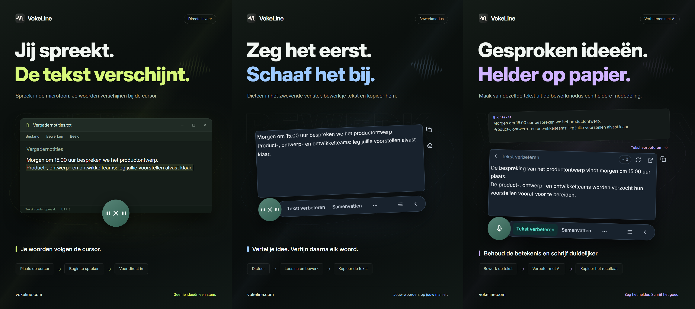

# VokeLine | Desktopspraakinvoer en AI-tekstassistent

[English](README.md) | [Español](README.es.md) | [Português (Brasil)](README.pt-BR.md) | [Português (Portugal)](README.pt-PT.md) | [Français](README.fr.md) | [Deutsch](README.de.md) | [Italiano](README.it.md) | [Nederlands](README.nl.md)

[Русский](README.ru.md) | [Polski](README.pl.md) | [Türkçe](README.tr.md) | [Українська](README.uk.md) | [日本語](README.ja.md) | [한국어](README.ko.md) | [Bahasa Indonesia](README.id.md) | [Tiếng Việt](README.vi.md)

[ไทย](README.th.md) | [Bahasa Melayu](README.ms.md) | [हिन्दी](README.hi.md) | [বাংলা](README.bn.md) | [简体中文](README.zh-CN.md) | [繁體中文](README.zh-TW.md) | [Svenska](README.sv.md) | [Čeština](README.cs.md)

[Norsk bokmål](README.nb.md) | [Dansk](README.da.md) | [Suomi](README.fi.md) | [Română](README.ro.md) | [Ελληνικά](README.el.md) | [Magyar](README.hu.md)

[Officiële website](https://vokeline.com/) · [Downloaden](https://vokeline.com/nl/download) · [Handleidingen en nieuws](https://vokeline.com/nl/docs/start)

## Over VokeLine

VokeLine is een desktopassistent voor spraakinvoer en AI-tekstbewerking. De app zet live spraak en audiobestanden om in bewerkbare tekst. Jij kiest daarna AI-verwerking, kopiëren, zoeken of het organiseren van notities.

De zwevende knop en werkbalk zijn voor live dicteren en directe tekstacties. Het hoofdvenster beheert audio, AI-acties, geschiedenis, cloudnotities, modellen, gebruik en instellingen.

De zwevende knop houdt dicteren binnen handbereik zonder het scherm te vullen. Jij beslist wanneer je tekst bevestigt en wat je daarna doet.

**Begin met spreken → Controleren bij de cursor → Kies de volgende stap**

_Illustratie van de interface, van links naar rechts: directe modus, editormodus en tekstverbetering met AI. De tekst en creditbedragen zijn voorbeelden. Controleer het resultaat; voor het werkelijke creditverbruik gelden de gegevens in de app._

## Voor wie is het

- **Mensen die werkberichten beantwoorden**: Dicteer een antwoord terwijl je een pagina of document leest, pas het aan en kopieer het naar je huidige app.
- **Studenten en onderzoekers**: Dicteer observaties en conclusies tijdens het lezen en laat AI ze samenvatten of opnieuw ordenen.
- **Schrijvers en makers van inhoud**: Dicteer een eerste versie, voeg details toe bij de cursor en verbeter daarna de definitieve formulering.
- **Mensen die interviews of andere audio verwerken**: Voeg meerdere ondersteunde audiobestanden toe en volg de voortgang. Schakel “Lokale geschiedenis bewaren” in om de voltooide tekst ook in de geschiedenis te bewaren.

## Belangrijkste functies

- **Bewerkbare brontekst**: Verplaats de cursor, corrigeer tekst en dicteer verder. Kies daarna of je wilt kopiëren, invoegen, zoeken of AI gebruiken.
- **Audiobestanden transcriberen**: Voeg meerdere ondersteunde audiobestanden toe en volg de voortgang. Schakel “Lokale geschiedenis bewaren” in om de voltooide tekst ook in de geschiedenis te bewaren.
- **Lokale spraakmodellen**: Download modellen en kies afzonderlijk de standaard voor live dicteren en voor audiobestanden.
- **AI-uitleg, tekstverbetering en eigen acties**: Leg begrippen uit, haal hoofdpunten naar voren, verbeter de formulering of pas opgeslagen instructies toe op de huidige tekst. Maak en orden herbruikbare instructies en kies welke in de zwevende werkbalk verschijnen.
- **Zoeken of kopiëren**: Kopieer de definitieve tekst of geef deze door aan je gekozen zoekmachine om verder te zoeken in de systeembrowser.
- **Lokale geschiedenis en cloudnotities**: De geschiedenis blijft op dit apparaat, gescheiden per identiteit. Alleen een notitie die je zelf in de cloud opslaat, wordt geüpload.
- **Een overzichtelijk hoofdvenster**: Bekijk gebruik, transcribeer audio, beheer AI-acties, doorzoek lokale geschiedenis en cloudnotities en stel lokale modellen in.

AI-acties hangen af van de ingestelde dienst, de verbinding, beschikbare credits en de huidige beschikbaarheid.

## Aan de slag

### 1. Downloaden en installeren

[Downloaden](https://vokeline.com/nl/download)

Open de officiële downloadpagina en kies het installatiebestand voor je besturingssysteem en processor. Volg de installatiestappen en open VokeLine. Houd verbinding met internet om het eerste lokale spraakmodel te downloaden.

VokeLine is ontworpen voor Windows en macOS. De Linux-versie is in ontwikkeling. Bekijk de downloadpagina voor beschikbare versies, architecturen en systeemvereisten.

### 2. Het eerste model voorbereiden

**Waar en vereisten:** Modellen → Lokale modellen. Je hebt verbinding en vrije ruimte nodig. Kaarten tonen grootte, geschat geheugen en taken.

1. Kies ondersteuning voor live-transcriptie en controleer taal en apparaateisen. Een model dat alleen bestandstranscriptie ondersteunt, kun je niet gebruiken voor live-opnamen.
2. Download en wacht op controle en installatie. Pauzeer zo nodig en hervat na verbinden.
3. Kies Gebruiken en maak het standaard voor opname, bestanden of beide.
4. Controleer de opnamemarkering en ga terug naar Home.

**Daarna:** Nieuwe opnamen gebruiken het model. Downloaden selecteert het niet vanzelf; Gebruiken blijft nodig. Zie [Modellen](https://vokeline.com/nl/docs/help#guide-model-downloads) voor fouten en geheugenproblemen.

#### De microfoon testen

**Waar:** Instellingen → Spraak en sneltoetsen → Invoerapparaat. Aangesloten, niet gedempt en systeemtoestemming vereist.

1. Kies systeemstandaard of een specifieke microfoon. Selecteer opnieuw na loskoppelen van een extern apparaat.
2. Test en spreek kort. Binnen 10 seconden stopt de test zonder deze opname te bewaren.
3. Ga verder bij geluid; controleer anders demping, volume en afstand en test opnieuw.
4. Open microfoonrechten, zo nodig handmatig in het systeem.

**Daarna:** Geluid wordt gevonden zonder onbeschikbaarmelding. Bestanden hebben geen microfoon nodig: [Audiobestanden](https://vokeline.com/nl/docs/features#guide-audio-files).

### 3. Live spraakinvoer

Beide modi vragen opnamemodel, microfoon en rechten. Lokaal transcriberen vraagt geen login of credits. [Test de microfoon](https://vokeline.com/nl/docs/start#guide-microphone).

| Modus  | Openen                                                                     | Tekst staat                | Gebruik                              |
| ------ | -------------------------------------------------------------------------- | -------------------------- | ------------------------------------ |
| Editor | De eigen sneltoets, of de microfoonknop wanneer deze modus de standaard is | Bewerkbare zwevende editor | Nakijken, AI en zoeken vóór gebruik. |
| Direct | De eigen sneltoets, of de microfoonknop wanneer deze modus de standaard is | Gekozen invoerveld         | Schrijven in de doelapp.             |

#### Editormodus

1. Gebruik de sneltoets of maak standaard en druk op microfoon.
2. Spreek, beëindig de opname en wacht op afronding.
3. Bewerk/kopieer het origineel of kies AI/zoeken.

**Resultaat:** Origineel blijft; AI-uitvoer staat apart en is apart kopieerbaar. Transcriptie alleen verstuurt geen AI-verzoek.

#### Directe modus

**Extra:** Een bewerkbaar doelveld is vereist. Beheer de machtigingen voor de directe modus onder Spraak en sneltoetsen. Geef VokeLine op macOS ook toestemming via Toegankelijkheid als daarom wordt gevraagd.

1. Klik het doel, zet de cursor en gebruik de toets.
2. Kies het veld wanneer gevraagd en wacht.
3. Houd venster en invoerpositie gelijk tijdens spreken.
4. Stop via bediening of toets en controleer de tekst.

**Resultaat:** Tekst gaat naar het vastgelegde veld. Controleer rechten/doel bij fouten of kopieer/plak vanuit Editor. Herhaal niet zonder duidelijk doel.

### 4. Audiobestanden transcriberen

**Waar en voorwaarden:** Bestandstranscriptie met geïnstalleerd geschikt lokaal model. Geen microfoon, account of credits vereist.

| Limiet            | Huidige eis                                          |
| ----------------- | ---------------------------------------------------- |
| Formaten          | WAV, MP3, FLAC, OGG, M4A, MP4.                       |
| Grootte           | Niet leeg, maximaal 2 GB per bestand.                |
| Selectie          | Tot 100 tegelijk.                                    |
| Sprekers scheiden | Momenteel niet ondersteund; alleen zonder scheiding. |

1. Kies of sleep bestanden en voeg meer toe waar nodig.
2. Verwijder ongeldige formaten, groottes, namen of leesstatussen bij voorbereiding; selecteer extern gewijzigde opnieuw.
3. Kies een lokaal model. Als het model een audiotaal laat kiezen, selecteer dan de bekende taal uit de beschikbare opties. Modellen die alleen automatische herkenning ondersteunen bepalen de taal zelf; controleer de tekst in beide gevallen.
4. Start en volg wachtrij, lezen, transcriberen en afronden.
5. Open het resultaat, kijk na en kopieer.

**Resultaat:** Elk bestand heeft een eigen taak. Lokale opslag bewaart de voltooide tekst voor huidige gast/account, niet automatisch cloud.

### 5. AI-tekstacties

**Waar en voorwaarden:** Stel acties in op AI-acties en voer ze uit in de editorbalk. Aanmelden, internet, een beschikbare AI-dienst en genoeg credits zijn vereist. Controleer de uitvoertaal en de creditinformatie.

| Actie                 | Doel                     | Taal       |
| --------------------- | ------------------------ | ---------- |
| Uitleggen             | Betekenis verduidelijken | Gekozen.   |
| Tekst verbeteren      | Formulering verbeteren   | Origineel. |
| Samenvatten           | Hoofdinhoud inkorten     | Gekozen.   |
| Kernpunten extraheren | Belangrijkste punten     | Gekozen.   |
| Corrigeren            | Nakijken en corrigeren   | Origineel. |

1. Kies de uitvoertaal en sla op.
2. Bereid tekst voor en controleer invoerlimiet.
3. Kies actie, bekijk credits en wacht.
4. Kijk na en kopieer of ga terug om het origineel te bewerken.

**Resultaat:** De uitvoer verschijnt in het resultaatvak. Tekst wordt alleen naar de online AI-dienst gestuurd wanneer je de actie start.

“Taal van de brontekst volgen” gebruikt de taal van de oorspronkelijke tekst. De acties “Tekst verbeteren” en “Corrigeren” behouden die taal altijd.

“Opnieuw proberen” probeert dezelfde bewerking te herstellen. “Opnieuw uitvoeren” start een nieuwe bewerking en kan opnieuw credits kosten. Wacht als de verwerking of resultaatcontrole nog loopt voordat je een andere bewerking start.

#### Eigen acties

1. Maak een actie met een naam en instructie, bijvoorbeeld om van de oorspronkelijke tekst notulen met besluiten en actiepunten te maken.
2. Sla taal en zichtbaarheid op; zet geen wachtwoorden, sleutels of gevoelige gegevens in instructies.
3. Test kort en verfijn; maximaal 20 eigen acties.

### 6. Lokale geschiedenis en cloudnotities

#### Lokale geschiedenis en statistieken

**Waar en voorwaarden:** Geschiedenis of recente items op Home. Huidige gast/account op dit apparaat; geen netwerk nodig.

1. Filter Alles, Spraak of AI en open een item.
2. Lees origineel of origineel plus AI-uitvoer en kopieer het gewenste.

#### In de cloud bewaren

**Waar en voorwaarden:** Na aanmelden een geschiedenisitem naar cloud opslaan. Netwerk en ruimte binnen de limiet vereist.

1. Meld het ontvangende account aan en open diens geschiedenis.
2. Controleer origineel/resultaat op ongewenste inhoud en sla op.
3. Wacht op de bevestiging dat het item is opgeslagen of al bestaat. Bewaar origineel bij fouten, controleer netwerk/limiet en probeer opnieuw.
4. Ververs clouditems en controleer tekst.

**Resultaat:** Tekst is zichtbaar op andere apparaten van hetzelfde account. Lokaal origineel blijft; later wissen verwijdert de cloudkopie niet.

## Veelgestelde vragen

### Heb ik een account nodig om VokeLine te gebruiken?

Lokaal dicteren, lokale modellen, geschiedenis en kopiëren werken zonder inloggen. Voor AI-diensten, cloudnotities en accountfuncties moet je inloggen.

[Prijzen](https://vokeline.com/nl/pricing)

### Geen of foutieve tekst

Controleer of het model de gesproken taal ondersteunt en de gekozen microfoon werkt. Verminder achtergrondgeluid en probeer opnieuw. Bij opnamen wordt de taal automatisch herkend; voor bestanden kun je die selecteren als het model dit ondersteunt. De interfacetaal verandert de spraakherkenning niet. Wil je tekst in een andere taal laten uitleggen, samenvatten of de kernpunten laten uitwerken, kies dan de bijbehorende AI-actie en stel de uitvoertaal in. De audiotaal vertelt het model welke taal het moet herkennen.

### Direct schrijft niet of vraagt een veld

Klik het bewerkbare veld en zet cursor voor gebruik. Selecteer als gevraagd en wissel niet van venster of invoerplek tijdens opname.

Stel rechten in en macOS Toegankelijkheid. Weigert de app invoer, behoud tekst met [Editor](https://vokeline.com/nl/docs/features#guide-editor) en kopieer/plak voordat je onderzoekt.

### Toevoegen of starten lukt niet

Controleer WAV, MP3, FLAC, OGG, M4A, MP4, niet-leeg, maximaal 2 GB en 100 per selectie. Verwijder ongeldige en kies model/taal.

Selecteer opnieuw na verplaatsen, naamwijziging, externe bewerking of verlopen selectie. Controleer afspelen, audiotrack en schade bij correcte extensie.

## Gegevens en privacy

Microfoonaudio wordt alleen lokaal getranscribeerd en niet als cloudnotitie opgeslagen. Een online AI-verzoek wordt alleen verstuurd wanneer je een AI-actie kiest.

| Taak                | Bestemming                                                                                  |
| ------------------- | ------------------------------------------------------------------------------------------- |
| Lokale transcriptie | Model op dit apparaat, geen automatische cloudopslag.                                       |
| Lokale geschiedenis | Huidige gast/accountgebied zonder extra versleuteling; bescherm apparaat en systeemaccount. |
| AI                  | Benodigde tekst naar gekozen onlinedienst.                                                  |
| Zoekopdracht        | Termen naar gekozen zoekmachine.                                                            |
| Cloud               | Gekozen tekst via netwerk naar account.                                                     |

Als je “Lokale geschiedenis bewaren” uitschakelt onder Instellingen → Gegevens en privacy, worden nieuwe teksten niet meer opgeslagen. Bestaande records blijven staan. De startpagina houdt statistieken voor opnamen en bestandstranscripties bij: aantal sessies, audioduur en geproduceerde tekens. De statistieken bevatten geen transcriptietekst.

Deze schakelaar bepaalt of er nieuwe items in Geschiedenis worden opgeslagen. Bestandstranscriptietaken en hun resultaten worden apart op dit apparaat bewaard. Gebruik “Taak verwijderen” bij Bestanden transcriberen als je een taak niet meer nodig hebt; tekst die al in de geschiedenis of cloud is opgeslagen blijft bestaan.

Gastmodus en accounts hebben gescheiden geschiedenissen. Alleen notities die je uitdrukkelijk opslaat, worden naar de cloudnotities van het account gekopieerd.

[Account en gegevens](https://vokeline.com/nl/docs/account)

## Officiële website en hulp

- [Officiële website: vokeline.com](https://vokeline.com/)
- [Aan de slag](https://vokeline.com/nl/docs/start)
- [Functies](https://vokeline.com/nl/docs/features)
- [Problemen oplossen](https://vokeline.com/nl/docs/help)

**Waar:** Open “Mijn account” vanuit het menu “Account” in de desktop-app en kies “Hulp en feedback” op de website. Meld je aan als dat nodig is.

1. Noem versie, systeem, functie, stappen, verwachting en uitkomst.
2. Voeg exacte melding en model, formaat/grootte of tijd van betaling/credits toe.
