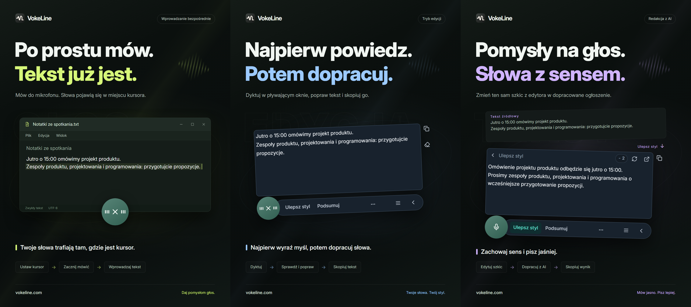

# VokeLine — dyktowanie na komputerze i asystent tekstu AI

[English](README.md) | [Español](README.es.md) | [Português (Brasil)](README.pt-BR.md) | [Português (Portugal)](README.pt-PT.md) | [Français](README.fr.md) | [Deutsch](README.de.md) | [Italiano](README.it.md) | [Nederlands](README.nl.md)

[Русский](README.ru.md) | [Polski](README.pl.md) | [Türkçe](README.tr.md) | [Українська](README.uk.md) | [日本語](README.ja.md) | [한국어](README.ko.md) | [Bahasa Indonesia](README.id.md) | [Tiếng Việt](README.vi.md)

[ไทย](README.th.md) | [Bahasa Melayu](README.ms.md) | [हिन्दी](README.hi.md) | [বাংলা](README.bn.md) | [简体中文](README.zh-CN.md) | [繁體中文](README.zh-TW.md) | [Svenska](README.sv.md) | [Čeština](README.cs.md)

[Norsk bokmål](README.nb.md) | [Dansk](README.da.md) | [Suomi](README.fi.md) | [Română](README.ro.md) | [Ελληνικά](README.el.md) | [Magyar](README.hu.md)

[Oficjalna strona](https://vokeline.com/) · [Pobierz](https://vokeline.com/pl/download) · [Poradniki i aktualności](https://vokeline.com/pl/docs/start)

## Czym jest VokeLine

VokeLine to asystent dyktowania i tekstu AI na komputer. Zamienia mowę na żywo lub pliki audio na edytowalny tekst. Ty wybierasz, czy przetworzyć go przez AI, skopiować, wyszukać czy uporządkować w notatkach.

Stały przycisk i pływający pasek służą do dyktowania na żywo i bieżących działań. W głównym oknie zarządzasz plikami audio, działaniami AI, historią, notatkami w chmurze, modelami, statystykami i ustawieniami.

Stały przycisk sprawia, że wprowadzanie głosowe jest pod ręką, nie zajmując całego ekranu. Ty decydujesz, kiedy tekst jest ostateczny i co z nim zrobić.

**Zacznij mówić → Sprawdź w miejscu kursora → Wybierz następne działanie**

_Ilustracja interfejsu, od lewej: tryb bezpośredni, tryb edycji i poprawianie tekstu przez AI. Tekst i liczby punktów są przykładami. Sprawdź wynik; rzeczywiste zużycie punktów określają informacje w aplikacji._

## Dla kogo

- **Osoby odpowiadające na wiadomości w pracy**: Czytając stronę lub dokument, podyktuj odpowiedź, popraw ją i skopiuj do bieżącej aplikacji.
- **Studenci i badacze**: Podczas czytania dyktuj obserwacje i wnioski, a następnie podsumuj lub uporządkuj tekst za pomocą działania AI.
- **Autorzy tekstów i twórcy treści**: Podyktuj pierwszą wersję, przesuń kursor, aby dodać szczegóły, i popraw ostateczne sformułowania.
- **Osoby pracujące z wywiadami lub innymi nagraniami**: Dodaj kilka obsługiwanych plików audio i śledź postęp. Włącz „Zapisuj lokalną historię”, jeśli chcesz zachować gotowy tekst również w historii.

## Najważniejsze funkcje

- **Edytowalny transkrypt**: Przesuń kursor, popraw sformułowania, zrób pauzę i mów dalej, zanim skopiujesz, wstawisz, wyszukasz lub użyjesz AI.
- **Transkrypcja plików audio**: Dodaj kilka obsługiwanych plików audio i śledź postęp. Włącz „Zapisuj lokalną historię”, jeśli chcesz zachować gotowy tekst również w historii.
- **Lokalny model rozpoznawania mowy**: Pobierz modele i wybierz osobne domyślne modele dla dyktowania na żywo i transkrypcji plików audio.
- **Wyjaśnienia AI, poprawianie stylu i działania niestandardowe**: Użyj bieżącego transkryptu, aby wyjaśnić pojęcie, wyodrębnić kluczowe punkty, poprawić sformułowania lub uruchomić zapisaną instrukcję. Twórz i porządkuj instrukcje wielokrotnego użytku, a następnie wybierz, które działania mają być widoczne na pływającym pasku narzędzi.
- **Wyszukaj lub skopiuj**: Skopiuj ostateczny transkrypt bezpośrednio lub przekaż go do wybranej wyszukiwarki w przeglądarce systemowej.
- **Lokalna historia i notatki w chmurze**: Historia jest przechowywana na urządzeniu osobno dla każdej tożsamości. Wpis jest przesyłany dopiero po wybraniu „Zapisz w chmurze”.
- **Uporządkowane okno główne**: Przeglądaj statystyki użycia, transkrybuj pliki audio, zarządzaj działaniami AI, przeglądaj lokalną historię i notatki w chmurze oraz konfiguruj lokalne modele.

Działania AI zależą od skonfigurowanej usługi, dostępu do sieci, dostępnych punktów i bieżącego statusu wydania.

## Jak korzystać

### 1. Pobieranie i instalacja

[Pobierz](https://vokeline.com/pl/download)

Otwórz oficjalną stronę pobierania i wybierz instalator dla swojego systemu oraz procesora. Wykonaj kroki instalacji, a następnie otwórz VokeLine. Zachowaj połączenie z internetem, aby pobrać pierwszy lokalny model rozpoznawania mowy.

VokeLine jest przeznaczony dla Windows i macOS. Wersja na Linux jest w przygotowaniu. Dostępne wersje, architektury i wymagania systemowe znajdziesz na stronie pobierania.

### 2. Przygotowanie pierwszego modelu

**Gdzie i wymagania:** Modele → Modele lokalne. Sieć i wolne miejsce; karty pokazują rozmiar, pamięć i zadania.

1. Wybierz model do transkrypcji na żywo i sprawdź języki oraz wymagania. Model tylko do plików nie obsłuży nagrania na żywo.
2. Kliknij Pobierz i zaczekaj na pobranie, sprawdzenie oraz instalację. W razie potrzeby wstrzymaj i wznów po połączeniu.
3. Kliknij Użyj i ustaw model dla nagrań, plików lub obu rodzajów zadań zgodnie z obsługą.
4. Sprawdź oznaczenie użycia do nagrań i wróć na stronę główną.

**Po wykonaniu:** Nowe nagrania używają modelu. Samo pobranie nie aktywuje modelu: trzeba też kliknąć Użyj. Błędy i pamięć: [Modele](https://vokeline.com/pl/docs/help#guide-model-downloads).

#### Sprawdzenie mikrofonu

**Gdzie:** Ustawienia → Głos i skróty → Urządzenie wejściowe. Podłączony, niewyciszony mikrofon i zgoda systemu są konieczne.

1. Wybierz mikrofon systemowy lub konkretny. Po odłączeniu zewnętrznego wybierz dostępne urządzenie ponownie.
2. Uruchom test i powiedz kilka słów. Kończy się w 10 sekund i nie zapisuje nagrania testowego.
3. Kontynuuj po wykryciu dźwięku. Inaczej sprawdź wyciszenie, głośność wejścia i odległość, a potem testuj ponownie.
4. Otwórz uprawnienia mikrofonu z linku lub ręcznie w systemie, jeśli link nie działa.

**Po wykonaniu:** Test wykrywa dźwięk, urządzenie nie jest niedostępne. Pliki nie wymagają mikrofonu: [Audio](https://vokeline.com/pl/docs/features#guide-audio-files).

### 3. Głos na żywo

Oba tryby potrzebują modelu, mikrofonu i uprawnień. Lokalna transkrypcja bez konta i punktów. [Sprawdź mikrofon](https://vokeline.com/pl/docs/start#guide-microphone).

| Tryb        | Otwarcie                                | Tekst trafia     | Zastosowanie                   |
| ----------- | --------------------------------------- | ---------------- | ------------------------------ |
| Edytor      | Własny skrót lub mikrofon, gdy domyślny | Pływający edytor | Sprawdzanie, AI, wyszukiwanie. |
| Bezpośredni | Własny skrót lub mikrofon, gdy domyślny | Wybrane pole     | Wpis do aplikacji docelowej.   |

#### Edytor

1. Użyj skrótu edytora lub ustaw go domyślnym i naciśnij mikrofon.
2. Mów, zatrzymaj kontrolką i zaczekaj na zakończenie.
3. Popraw i skopiuj oryginał albo wybierz działanie AI lub wyszukiwanie.

**Rezultat:** Oryginał zostaje; AI jest osobno i kopiuje się osobno. Sama transkrypcja nie wysyła do AI.

#### Wpis bezpośredni

**Dodatkowo:** Cel musi być edytowalny. Zarządzaj uprawnieniami wpisu w Głosie i skrótach, a na macOS zezwól na Dostępność według wskazówki.

1. Kliknij pole docelowe, ustaw kursor i użyj skrótu bezpośredniego.
2. Wybierz pole, gdy zostaniesz poproszony, i poczekaj na start.
3. Zachowaj to samo pole podczas mówienia; nie zmieniaj okna ani miejsca wpisywania.
4. Zatrzymaj kontrolką lub odpowiednim skrótem i sprawdź tekst.

**Rezultat:** Tekst trafia do ustalonego pola. Przy błędzie sprawdź pole i uprawnienia lub skopiuj z edytora. Nie ponawiaj bez wyraźnego celu.

### 4. Transkrypcja plików audio

**Gdzie i warunki:** Pliki z zainstalowanym kompatybilnym modelem. Mikrofon, konto i punkty niepotrzebne.

| Limit               | Warunek                                              |
| ------------------- | ---------------------------------------------------- |
| Formaty             | WAV, MP3, FLAC, OGG, M4A, MP4.                       |
| Rozmiar             | Niepuste, do 2 GB każdy.                             |
| Wybór               | Do 100 na raz.                                       |
| Rozróżnianie mówców | Niedostępne; dostępna jest tylko opcja bez podziału. |

1. Wybierz lub przeciągnij pliki i dodaj kolejne w razie potrzeby.
2. Sprawdź listę i usuń nieprawidłowe lub nieczytelne pliki. Po zmianie poza aplikacją wybierz plik ponownie.
3. Wybierz model lokalny. Jeśli pozwala określić język dźwięku, wskaż znany język wśród dostępnych opcji. Modele obsługujące wyłącznie wykrywanie automatyczne wybierają go same; w obu przypadkach sprawdź tekst.
4. Uruchom transkrypcję i obserwuj kolejkę, odczyt, transkrypcję i kończenie.
5. Otwórz gotowy wynik, sprawdź i skopiuj tekst.

**Rezultat:** Każdy plik ma osobne zadanie. Przy włączonym zapisie tekst trafia do lokalnej historii aktualnego konta lub gościa, a nie automatycznie do chmury.

### 5. Działania tekstowe AI

**Gdzie i warunki:** Ustawienia na stronie AI, wykonanie w edytorze. Wymagane konto, sieć, model i punkty. Sprawdź model, język i koszt przed startem.

| Działanie                       | Cel                    | Język      |
| ------------------------------- | ---------------------- | ---------- |
| Wyjaśnij                        | Objaśnić znaczenie     | Wybrany.   |
| Ulepsz styl                     | Ulepszyć sformułowanie | Oryginału. |
| Podsumuj                        | Skrócić treść          | Wybrany.   |
| Wyodrębnij najważniejsze punkty | Wyodrębnić ważne       | Wybrany.   |
| Popraw błędy                    | Sprawdzić i skorygować | Oryginału. |

1. Wybierz domyślny model AI i język wyjścia, a potem zapisz.
2. Przygotuj tekst i sprawdź limit wejścia.
3. Wybierz działanie, sprawdź punkty i poczekaj na wynik.
4. Sprawdź i skopiuj wynik albo wróć do oryginału, by go zmienić.

**Rezultat:** Wynik jest wyświetlany osobno. Tekst trafia do usługi online dopiero po uruchomieniu działania przez użytkownika. Modele AI i modele rozpoznawania mowy wybiera się niezależnie.

Opcja „Zachowaj język tekstu źródłowego” używa języka tekstu źródłowego. Akcje „Ulepsz styl” i „Popraw błędy” zawsze zachowują ten język.

„Spróbuj ponownie” próbuje przywrócić tę samą operację. „Wykonaj ponownie” rozpoczyna nową i może ponownie zużyć punkty. Jeśli przetwarzanie lub sprawdzanie wyniku nadal trwa, poczekaj na zmianę stanu przed rozpoczęciem kolejnej operacji.

#### Działania niestandardowe

1. Utwórz działanie z nazwą i instrukcją, na przykład notatkę ze spotkania z decyzjami i zadaniami.
2. Ustaw model, język i widoczność i zapisz. Nie dodawaj haseł, kluczy ani wrażliwych danych do instrukcji.
3. Przetestuj krótki tekst i dopracuj instrukcję. Można utworzyć do 20 własnych działań.

### 6. Lokalna historia i notatki w chmurze

#### Historia lokalna i statystyki

**Gdzie i warunki:** Historia lub ostatnie wpisy na stronie głównej. Widzisz aktualnego gościa lub konto na tym urządzeniu bez internetu.

1. Znajdź i otwórz wpis filtrami Wszystkie, Głos lub AI.
2. Przeczytaj głosowy oryginał lub oryginał i wynik AI, a potem skopiuj potrzebną część.

#### Zapisać w chmurze

**Gdzie i warunki:** Po zalogowaniu wybierz wpis historii i chmurę. Internet i miejsce w limicie konieczne.

1. Zaloguj się na konto przyszłego właściciela tekstu i otwórz jego lokalną historię.
2. Sprawdź oryginał lub wynik pod kątem niechcianych treści i zapisz w chmurze.
3. Poczekaj na sukces lub informację, że już istnieje. Przy błędzie zachowaj oryginał, sprawdź sieć i limit i ponów.
4. Otwórz chmurę, odśwież i sprawdź tekst.

**Rezultat:** Dostęp na innych urządzeniach tego konta. Oryginał zostaje, jego skasowanie nie usuwa chmury.

## Częste pytania

### Czy do korzystania z VokeLine potrzebne jest konto?

Lokalne dyktowanie, modele mowy, historia i kopiowanie działają bez logowania. Korzystanie z uprawnień AI, notatek w chmurze i funkcji konta wymaga zalogowania.

[Cennik](https://vokeline.com/pl/pricing)

### Brak lub zły tekst

Sprawdź, czy model obsługuje język nagrania, a wybrany mikrofon działa. Ogranicz hałas i spróbuj ponownie. Podczas nagrywania język jest wykrywany automatycznie; dla plików możesz go wskazać, jeśli model na to pozwala. Język interfejsu nie zmienia rozpoznawania mowy. Aby uzyskać objaśnienie, podsumowanie lub główne punkty w innym języku, wybierz odpowiednią akcję AI i język wyniku. Język dźwięku określa, jaką mowę ma rozpoznawać model.

### Nie wpisuje albo żąda pola

Kliknij edytowalne pole i ustaw kursor przed skrótem. Wybierz na żądanie i nie zmieniaj okna ani miejsca wpisywania podczas nagrania.

Sprawdź uprawnienia i Dostępność w macOS. Jeśli wpisywanie jest odrzucane, najpierw skopiuj tekst z [Edytora](https://vokeline.com/pl/docs/features#guide-editor) i wklej ręcznie, a potem szukaj przyczyny.

### Nie dodać lub nie rozpocząć

Obsługiwane są WAV, MP3, FLAC, OGG, M4A i MP4: niepuste pliki do 2 GB każdy i najwyżej 100 przy jednym wyborze. Usuń nieprawidłowe i sprawdź model plików oraz język dźwięku.

Wybierz ponownie po przeniesieniu, zmianie nazwy, zmianie poza aplikacją lub wygaśnięciu listy wybranych plików. Sprawdź odtwarzanie, ścieżkę audio i uszkodzenia.

## Dane i prywatność

Dźwięk z mikrofonu jest przetwarzany lokalnie na tekst i nie jest zapisywany jako notatka w chmurze. Żądanie do usługi AI jest wysyłane dopiero po wybraniu działania AI.

| Operacja             | Cel                                                                                |
| -------------------- | ---------------------------------------------------------------------------------- |
| Transkrypcja lokalna | Model urządzenia, bez automatycznego wysyłania.                                    |
| Historia             | Obszar konta/gościa bez dodatkowego szyfrowania; chroń urządzenie i konto systemu. |
| AI                   | Potrzebny tekst do wybranej usługi.                                                |
| Szukanie             | Zapytanie do wybranego silnika.                                                    |
| Chmura               | Wybrany tekst przez sieć do konta.                                                 |

Wyłączenie „Zapisuj lokalną historię” w Ustawienia → „Dane i prywatność” zatrzymuje zapisywanie nowych tekstów, ale zachowuje istniejące wpisy. Strona główna nadal zbiera statystyki nagrań i transkrypcji plików: liczbę sesji, czas trwania dźwięku i liczbę uzyskanych znaków. Statystyki nie zawierają treści transkrypcji.

Ten przełącznik kontroluje nowe wpisy na stronie Historia. Zadania transkrypcji plików i ich wyniki są przechowywane oddzielnie na tym urządzeniu. Gdy zadanie nie jest potrzebne, użyj „Usuń zadanie” w Transkrypcja plików; tekst już zapisany w historii lub chmurze pozostanie.

Lokalna historia jest oddzielona dla gościa i każdego konta. Tylko świadomie zapisane wpisy trafiają do notatek w chmurze Twojego konta.

[Konto i dane](https://vokeline.com/pl/docs/account)

## Oficjalna strona i pomoc

- [Oficjalna strona: vokeline.com](https://vokeline.com/)
- [Pierwsze kroki](https://vokeline.com/pl/docs/start)
- [Funkcje](https://vokeline.com/pl/docs/features)
- [Rozwiązywanie problemów](https://vokeline.com/pl/docs/help)

**Gdzie:** Otwórz „Konto” w menu „Konto” aplikacji komputerowej, a następnie „Pomoc i opinie” na stronie. W razie potrzeby zaloguj się.

1. Podaj wersję, system, funkcję, kroki oraz oczekiwany i rzeczywisty wynik.
2. Dodaj dokładny komunikat i model, format i rozmiar pliku albo czas zamówienia i punktów, zależnie od problemu.
