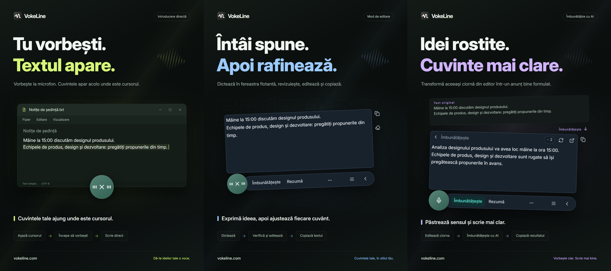

# VokeLine | Dictare și asistent AI pentru text pe computer

[English](README.md) | [Español](README.es.md) | [Português (Brasil)](README.pt-BR.md) | [Português (Portugal)](README.pt-PT.md) | [Français](README.fr.md) | [Deutsch](README.de.md) | [Italiano](README.it.md) | [Nederlands](README.nl.md)

[Русский](README.ru.md) | [Polski](README.pl.md) | [Türkçe](README.tr.md) | [Українська](README.uk.md) | [日本語](README.ja.md) | [한국어](README.ko.md) | [Bahasa Indonesia](README.id.md) | [Tiếng Việt](README.vi.md)

[ไทย](README.th.md) | [Bahasa Melayu](README.ms.md) | [हिन्दी](README.hi.md) | [বাংলা](README.bn.md) | [简体中文](README.zh-CN.md) | [繁體中文](README.zh-TW.md) | [Svenska](README.sv.md) | [Čeština](README.cs.md)

[Norsk bokmål](README.nb.md) | [Dansk](README.da.md) | [Suomi](README.fi.md) | [Română](README.ro.md) | [Ελληνικά](README.el.md) | [Magyar](README.hu.md)

[Site oficial](https://vokeline.com/) · [Descarcă](https://vokeline.com/ro/download) · [Ghiduri de utilizare](https://vokeline.com/ro/docs/start)

## Despre VokeLine

VokeLine este o aplicație pentru computer care oferă dictare și procesarea textului cu AI. Transformă vorbirea în timp real sau fișierele audio în text editabil. Tu alegi apoi acțiuni AI, copierea, căutarea sau organizarea înregistrărilor.

Butonul mereu vizibil și bara flotantă sunt pentru dictare în timp real și acțiuni rapide. În fereastra principală gestionezi fișierele audio, acțiunile AI, istoricul, notițele din cloud, modelele, utilizarea și setările.

Butonul mereu vizibil ține dictarea la îndemână fără să ocupe întregul ecran. Tu decizi când confirmi textul și ce faci în continuare.

**Începe să vorbești → Revizuiește la cursor → Alege următoarea acțiune**

_Ilustrarea interfeței, de la stânga la dreapta: modul Direct, modul de editare și îmbunătățirea textului cu AI. Textul și valorile creditelor sunt exemple. Verifică rezultatul; consumul real de credite urmează informațiile din aplicație._

## Cui i se adresează

- **Persoane care răspund la mesaje de serviciu**: Dictează un răspuns în timp ce citești o pagină web sau un document. Editează textul și copiază-l în aplicația curentă, fără să comuți mereu între aplicații.
- **Studenți și cercetători**: Dictează observații și concluzii în timp ce citești. Apoi folosește o acțiune AI pentru a rezuma sau reorganiza textul original.
- **Autori și creatori de conținut**: Dictează prima ciornă, mută cursorul pentru a adăuga detalii și îmbunătățește formularea finală.
- **Persoane care lucrează cu interviuri sau alte fișiere audio**: Adaugă mai multe fișiere audio în formate acceptate și urmărește progresul. Activează „Salvează istoricul local” pentru a păstra textul final și în istoric.

## Funcții principale

- **Text original editabil**: Mută cursorul, corectează formularea, fă o pauză și continuă să vorbești înainte de a copia, insera, căuta sau folosi AI.
- **Fișiere audio**: Adaugă mai multe fișiere audio în formate acceptate și urmărește progresul. Activează „Salvează istoricul local” pentru a păstra textul final și în istoric.
- **Model local de recunoaștere a vorbirii**: Descarcă și alege valori implicite separate pentru dictarea în timp real și transcrierea fișierelor audio.
- **Explicații AI, rafinare și acțiuni personalizate**: Folosește transcrierea curentă pentru a explica o idee, a extrage puncte cheie, a îmbunătăți formularea sau a rula o instrucțiune salvată. Creează și ordonează instrucțiuni reutilizabile, apoi alege ce acțiuni apar pe bara de instrumente plutitoare.
- **Caută sau copiază**: Copiază direct textul final sau trimite-l motorului de căutare ales și continuă în browserul sistemului.
- **Istoric local și notițe în cloud**: Istoricul este salvat separat pentru invitat și pentru fiecare cont pe acest dispozitiv. O înregistrare este încărcată numai când apeși „Salvează în cloud”.
- **Fereastră principală organizată**: Vezi utilizarea, transcrie fișiere audio, gestionează acțiunile AI, consultă istoricul local și notițele din cloud și configurează modelele locale.

Acțiunile AI depind de serviciile configurate, rețea, creditele disponibile și starea curentă de lansare a funcțiilor.

## Cum se folosește

### 1. Descarcă și instalează

[Descarcă](https://vokeline.com/ro/download)

Deschide pagina oficială de descărcare și alege programul de instalare pentru sistemul și procesorul tău. Urmează pașii de instalare, apoi deschide VokeLine. Păstrează conexiunea la internet pentru a descărca primul model vocal local.

VokeLine este conceput pentru Windows și macOS. Versiunea Linux este în dezvoltare. Consultă pagina de descărcare pentru versiunile disponibile, arhitecturi și cerințe de sistem.

### 2. Pregătește primul model

**Unde și ce îți trebuie:** Modele → Modele locale. Ai nevoie de internet și spațiu pe disc. Cardul arată dimensiunea, memoria estimată și funcțiile acceptate.

1. Alege un model pentru transcriere în timp real și verifică limbile și cerințele dispozitivului. Un model doar pentru fișiere nu poate transcrie înregistrări live.
2. Apasă Descarcă și așteaptă descărcarea, verificarea și instalarea. Poți întrerupe temporar descărcarea și o poți relua după reconectare.
3. Apasă Folosește și alege modelul implicit pentru înregistrări, fișiere sau ambele, în funcție de suport.
4. Verifică indicatorul de utilizare pentru înregistrări, apoi revino la pagina principală.

**Rezultat:** Înregistrările noi folosesc modelul selectat. Descărcarea nu îl activează automat: apasă și Folosește. Pentru erori, vezi [Modele și descărcări](https://vokeline.com/ro/docs/help#guide-model-downloads).

#### Verifică microfonul

**Unde:** Setări → Voce și scurtături → Dispozitiv de intrare. Microfonul trebuie conectat, cu sunetul activ și cu permisiunea sistemului acordată.

1. Alege dispozitivul implicit sau microfonul dorit. După deconectarea unuia extern, selectează un dispozitiv disponibil.
2. Pornește testul și spune câteva cuvinte. Se termină în cel mult 10 secunde și nu salvează această înregistrare.
3. Continuă după detectarea sunetului. Altfel, verifică butonul de dezactivare a sunetului, nivelul de intrare și distanța, apoi testează din nou.
4. Deschide permisiunile microfonului din linkul oferit sau manual din setările sistemului, dacă linkul nu funcționează.

**Rezultat:** Testul detectează sunet și dispozitivul este disponibil. Pentru [transcrierea fișierelor](https://vokeline.com/ro/docs/features#guide-audio-files) nu ai nevoie de microfon.

### 3. Voce în timp real

Ambele moduri cer model de înregistrare, microfon și permisiuni. Transcrierea locală nu cere cont sau credite. [Verifică microfonul](https://vokeline.com/ro/docs/start#guide-microphone) înainte.

| Mod    | Deschide                                                                  | Text           | Folosire           |
| ------ | ------------------------------------------------------------------------- | -------------- | ------------------ |
| Editor | Scurtătura modului, sau butonul microfonului când acest mod este implicit | Editor flotant | Verifică/AI/caută. |
| Direct | Scurtătura modului, sau butonul microfonului când acest mod este implicit | Câmp ales      | Aplicație țintă.   |

#### Editor

1. Folosește scurtătura Editorului sau setează-l ca implicit și apasă microfonul.
2. Dictează, oprește înregistrarea din control și așteaptă finalizarea.
3. Modifică și copiază originalul ori alege o acțiune AI sau o căutare.

**Rezultat:** Originalul rămâne în editor. Rezultatul AI apare separat și poate fi copiat separat. Transcrierea nu trimite automat o cerere AI.

#### Direct

**În plus:** Aplicația țintă trebuie să aibă un câmp editabil. Gestionează permisiunile modului Direct din setările pentru voce; pe macOS acordă și accesul pentru Accesibilitate când se cere.

1. Dă clic în câmpul țintă, poziționează cursorul și folosește scurtătura Direct.
2. Dacă se cere, selectează câmpul și așteaptă pornirea înregistrării.
3. Păstrează aceeași poziție cât vorbești; nu schimba fereastra sau câmpul.
4. Încheie din control sau cu scurtătura potrivită și verifică textul introdus.

**Rezultat:** Textul este introdus în câmpul fixat. Dacă nu reușește, verifică ținta și permisiunile sau copiază din Editor. Nu repeta fără o țintă clară.

### 4. Transcrie fișiere audio

**Unde și ce îți trebuie:** Transcriere fișiere din meniul lateral, cu un model local compatibil. Nu ai nevoie de microfon, autentificare sau credite AI.

| Limită             | Cerință                                                          |
| ------------------ | ---------------------------------------------------------------- |
| Formate            | WAV, MP3, FLAC, OGG, M4A, MP4.                                   |
| Mărime             | Nu gol, max 2 GB fiecare.                                        |
| Selecție           | 100 o dată.                                                      |
| Separare vorbitori | Nu este acceptată; este disponibilă doar opțiunea fără separare. |

1. Alege fișierele sau trage-le pe pagină; folosește adăugarea pentru mai multe.
2. Verifică lista și elimină fișierele cu format, dimensiune, nume sau citire nevalidă. Selectează din nou un fișier modificat extern.
3. Alege un model local. Dacă permite alegerea limbii audio, selectează limba cunoscută dintre opțiunile disponibile. Modelele care acceptă doar detectarea automată o identifică singure; verifică textul în ambele cazuri.
4. Pornește transcrierea și urmărește coada, citirea, transcrierea și finalizarea.
5. Deschide rezultatul final, verifică textul și copiază transcrierea.

**Rezultat:** Fiecare fișier are propria sarcină. Cu salvarea locală activă, textul ajunge în istoricul invitatului sau contului curent, nu automat în cloud.

### 5. Acțiuni AI

**Unde și ce îți trebuie:** Configurează acțiunile pe pagina Acțiuni AI și rulează-le din editor. Ai nevoie de autentificare, internet, un serviciu AI disponibil și suficiente credite. Verifică limba de ieșire și informațiile despre credite.

| Acțiune       | Scop      | Limbă     |
| ------------- | --------- | --------- |
| Explică       | Clarifică | Aleasă.   |
| Îmbunătățește | Expresie  | Original. |
| Rezumă        | Scurtează | Aleasă.   |
| Puncte cheie  | Important | Aleasă.   |
| Corectează    | Verifică  | Original. |

1. Alege limba de ieșire și salvează.
2. Pregătește textul din editor și verifică limita de intrare.
3. Alege acțiunea, verifică informațiile despre credite și așteaptă rezultatul.
4. Verifică și copiază rezultatul; revino la original dacă vrei să îl modifici.

**Rezultat:** Rezultatul apare în zona de rezultate. Textul este trimis serviciului AI online numai când pornești acțiunea.

„Aceeași limbă ca textul original” folosește limba textului original. Acțiunile „Îmbunătățește” și „Corectează” păstrează întotdeauna această limbă.

„Încearcă din nou” încearcă să recupereze aceeași operațiune. „Rulează din nou” pornește una nouă și poate consuma din nou credite. Dacă procesarea sau verificarea rezultatului continuă, așteaptă actualizarea stării înainte de a porni altă operațiune.

#### Acțiuni personalizate

1. Creează o acțiune nouă cu nume și instrucțiune, de exemplu un proces-verbal cu decizii și sarcini.
2. Configurează limba și afișarea, apoi salvează. Nu pune parole, chei sau date sensibile în instrucțiune.
3. Testează cu un text scurt și ajustează instrucțiunea. Poți crea cel mult 20 de acțiuni personalizate.

### 6. Istoric local și notițe în cloud

#### Istoric local și statistici de utilizare

**Unde și ce îți trebuie:** Istoric sau înregistrările recente de pe pagina principală. Vezi doar invitatul ori contul curent de pe acest dispozitiv, fără internet.

1. Caută înregistrarea cu filtrele Toate, Voce sau AI și deschide-o.
2. Vezi originalul vocal ori originalul și rezultatul AI, apoi copiază partea necesară.

#### Salvează în cloud

**Unde și ce îți trebuie:** Autentificare, apoi Istoric → înregistrare → Salvează în cloud. Ai nevoie de internet și spațiu în limita actuală.

1. Intră în contul care trebuie să dețină înregistrarea și deschide istoricul lui local.
2. Verifică originalul sau rezultatul AI pentru conținut nedorit, apoi alege salvarea în cloud.
3. Așteaptă succesul sau mesajul că există deja. La eșec, păstrează originalul, verifică rețeaua și limita, apoi reîncearcă.
4. Deschide înregistrările din cloud, actualizează și verifică textul salvat.

**Rezultat:** Textul este accesibil pe alte dispozitive conectate la același cont. Originalul local rămâne; ștergerea lui nu elimină copia din cloud.

## Întrebări frecvente

### Trebuie să mă conectez pentru a folosi VokeLine?

Dictarea locală, modelele locale, istoricul local și copierea pot fi folosite fără autentificare. Funcțiile AI, notițele din cloud și funcțiile contului necesită autentificare.

[Prețuri](https://vokeline.com/ro/pricing)

### Textul lipsește sau este incorect

Verifică dacă modelul acceptă limba vorbită și dacă microfonul ales funcționează. Redu zgomotul din jur și încearcă din nou. La înregistrare, limba este detectată automat; pentru fișiere o poți selecta dacă modelul permite. Limba interfeței nu schimbă recunoașterea. Pentru explicații, rezumate sau puncte cheie în altă limbă, alege acțiunea AI potrivită și limba rezultatului. Limba audio indică modelului ce limbă trebuie să recunoască.

### Modul Direct nu scrie sau cere un câmp

Dă clic într-un câmp editabil, pune cursorul și pornește Direct. Selectează ținta dacă se cere; nu schimba fereastra sau poziția cât vorbești.

Verifică permisiunile Direct și Accesibilitatea pe macOS. Dacă inserarea este respinsă, copiază întâi din [Editor](https://vokeline.com/ro/docs/features#guide-editor) și lipește manual, apoi investighează.

### Nu se poate adăuga fișierul sau porni transcrierea

Verifică WAV, MP3, FLAC, OGG, M4A sau MP4, fișier nevid de cel mult 2 GB și maximum 100 la o selecție. Elimină intrările nevalide și verifică modelul și limba.

Selectează fișierul din nou după mutare, redenumire, schimbare externă ori expirarea selecției. La decodare eșuată, verifică redarea, pista audio și deteriorarea.

## Date și confidențialitate

Sunetul microfonului este folosit doar pentru transcriere locală și nu este salvat ca notiță în cloud. Cererea AI corespunzătoare este trimisă prin internet numai când alegi acțiunea AI.

| Acțiune                                   | Unde ajunge conținutul                                                                                                                                        |
| ----------------------------------------- | ------------------------------------------------------------------------------------------------------------------------------------------------------------- |
| Dictare locală sau transcriere de fișiere | Conținutul este procesat pe acest dispozitiv, cu un model local. Nu este încărcat automat în cloud.                                                           |
| Salvarea istoricului local                | Textul rămâne pe dispozitiv, separat pentru invitat și fiecare cont. Înregistrările nu au criptare suplimentară. Protejează dispozitivul și contul de sistem. |
| Acțiuni AI pentru text                    | Textul necesar acțiunii este trimis către serviciul online ales.                                                                                              |
| Căutare pe web                            | Termenii de căutare sunt trimiși motorului de căutare ales.                                                                                                   |
| Salvare în cloud                          | Înregistrarea text selectată este trimisă prin rețea în contul tău din cloud.                                                                                 |

Dezactivarea „Salvează istoricul local” în Setări → Date și confidențialitate oprește salvarea textelor noi în istoric, fără să șteargă înregistrările existente. Pagina principală continuă să adune statistici pentru înregistrări și transcrierea fișierelor: numărul de sesiuni, durata audio și numărul de caractere produse. Aceste statistici nu conțin textul transcris.

Această opțiune controlează intrările noi din Istoric. Sarcinile de transcriere a fișierelor și rezultatele lor sunt păstrate separat pe dispozitiv. Folosește „Elimină sarcina din listă” în Transcriere fișiere când sarcina nu mai este necesară; textul deja salvat în istoric sau cloud rămâne.

Istoricul local este separat pentru invitat și pentru fiecare cont. Numai înregistrările pe care alegi să le salvezi sunt copiate în notițele din cloud ale contului.

[Cont și date](https://vokeline.com/ro/docs/account)

## Site oficial și ajutor

- [Site oficial: vokeline.com](https://vokeline.com/)
- [Primii pași](https://vokeline.com/ro/docs/start)
- [Funcții](https://vokeline.com/ro/docs/features)
- [Depanare](https://vokeline.com/ro/docs/help)

**Unde:** Deschide „Cont” din meniul „Cont” al aplicației desktop, apoi alege „Ajutor și feedback” pe site. Autentifică-te dacă este necesar.

1. Include versiunea, sistemul, funcția, pașii, rezultatul așteptat și cel real.
2. Include mesajul exact și modelul, formatul și dimensiunea fișierului sau momentul comenzii și al creditelor, după caz.
