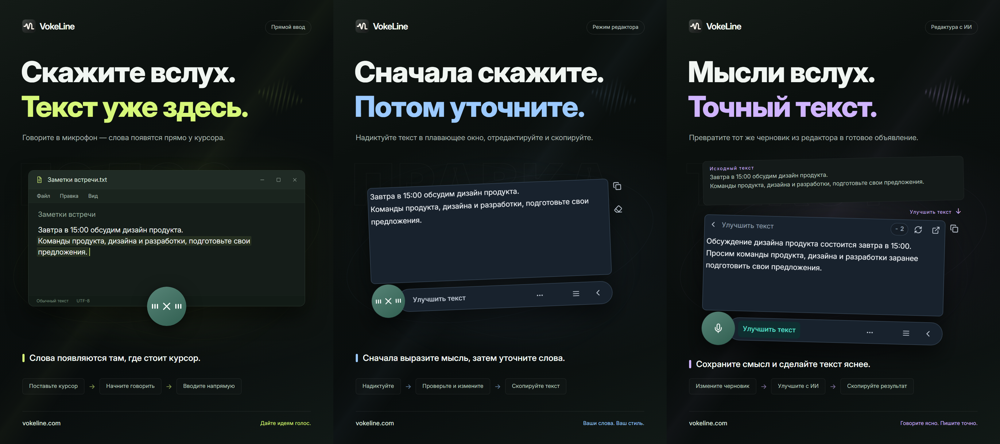

# VokeLine — голосовой ввод на компьютере и текстовый помощник с ИИ

[English](README.md) | [Español](README.es.md) | [Português (Brasil)](README.pt-BR.md) | [Português (Portugal)](README.pt-PT.md) | [Français](README.fr.md) | [Deutsch](README.de.md) | [Italiano](README.it.md) | [Nederlands](README.nl.md)

[Русский](README.ru.md) | [Polski](README.pl.md) | [Türkçe](README.tr.md) | [Українська](README.uk.md) | [日本語](README.ja.md) | [한국어](README.ko.md) | [Bahasa Indonesia](README.id.md) | [Tiếng Việt](README.vi.md)

[ไทย](README.th.md) | [Bahasa Melayu](README.ms.md) | [हिन्दी](README.hi.md) | [বাংলা](README.bn.md) | [简体中文](README.zh-CN.md) | [繁體中文](README.zh-TW.md) | [Svenska](README.sv.md) | [Čeština](README.cs.md)

[Norsk bokmål](README.nb.md) | [Dansk](README.da.md) | [Suomi](README.fi.md) | [Română](README.ro.md) | [Ελληνικά](README.el.md) | [Magyar](README.hu.md)

[Официальный сайт](https://vokeline.com/) · [Скачать](https://vokeline.com/ru/download) · [Руководства и новости](https://vokeline.com/ru/docs/start)

## О VokeLine

VokeLine — это настольный помощник для голосового ввода и работы с текстом с помощью ИИ. Он преобразует живую речь или аудиофайлы в редактируемый текст, после чего вы можете выбрать действия ИИ для обработки текста, копирование, поиск или организацию записей.

Постоянная кнопка и плавающая панель предназначены для диктовки и быстрых действий. В главном окне вы управляете аудиофайлами, действиями ИИ, историей, облачными заметками, моделями, статистикой и настройками.

Постоянный элемент управления держит голосовой ввод под рукой, не занимая весь экран. Вы решаете, когда текст готов и что делать дальше.

**Начните говорить → Проверьте у курсора → Выберите следующее действие**

_Иллюстрация интерфейса, слева направо: прямой ввод, режим редактирования и улучшение текста с ИИ. Текст и значения кредитов приведены для примера. Проверьте результат; фактический расход кредитов указан в приложении._

## Для кого подходит

- **Люди, отвечающие на рабочие сообщения**: Читая страницу или документ, надиктуйте ответ, отредактируйте его и скопируйте в текущее приложение.
- **Студенты и исследователи**: Во время чтения диктуйте наблюдения и выводы, затем обобщайте или упорядочивайте текст с помощью ИИ.
- **Авторы текстов и другого контента**: Надиктуйте первый черновик, переместите курсор, чтобы добавить детали, и улучшите итоговую формулировку.
- **Люди, работающие с интервью и другими аудиофайлами**: Добавляйте несколько поддерживаемых аудиофайлов и следите за обработкой. Чтобы готовый текст оставался и в истории, включите «Сохранять локальную историю».

## Основные возможности

- **Редактируемый текст**: Переместите курсор, исправьте формулировку, сделайте паузу и продолжайте говорить, прежде чем копировать, вставлять, искать или использовать ИИ.
- **Расшифровка аудиофайлов**: Добавляйте несколько поддерживаемых аудиофайлов и следите за обработкой. Чтобы готовый текст оставался и в истории, включите «Сохранять локальную историю».
- **Локальная модель распознавания речи**: Загружайте модели и выбирайте отдельные модели по умолчанию для диктовки в реальном времени и расшифровки аудиофайлов.
- **Пояснения ИИ, улучшение текста и свои действия**: Используйте текущий текст, чтобы объяснить идею, выделить ключевые моменты, улучшить формулировку или выполнить сохранённую инструкцию. Создавайте инструкции для повторного использования, меняйте их порядок и выбирайте действия для плавающей панели.
- **Найти или скопировать**: Скопируйте итоговый текст напрямую или отправьте его в предпочитаемую поисковую систему в системном браузере.
- **Локальная история и облачные заметки**: История хранится на устройстве отдельно для каждого гостя или аккаунта. Запись отправляется в облако только после нажатия «Сохранить в облако».
- **Понятное главное окно**: Просматривайте статистику использования, расшифровывайте аудиофайлы, управляйте действиями ИИ, просматривайте локальную историю и облачные заметки, а также настраивайте модели.

Действия ИИ зависят от настроенного сервиса, доступа к сети, доступных кредитов и текущего статуса выпуска.

## Как пользоваться

### 1. Загрузка и установка

[Скачать](https://vokeline.com/ru/download)

Откройте официальную страницу загрузки и выберите установщик для вашей системы и процессора. Следуйте указаниям по установке, затем откройте VokeLine. Для скачивания первой локальной модели распознавания речи нужен интернет.

VokeLine разработан для Windows и macOS. Версия для Linux находится в разработке. Доступные версии, архитектуры и системные требования указаны на странице загрузки.

### 2. Подготовка первой модели

**Где и что нужно:** Модели → Локальные модели. Нужны сеть и место; карточки показывают размер, оценку памяти и задачи.

1. Выберите модель для распознавания в реальном времени и проверьте языки и требования устройства. Модель только для файлов не подходит для живой записи.
2. Нажмите Скачать и дождитесь загрузки, проверки и установки. При необходимости приостановите и продолжите после подключения.
3. Нажмите Использовать и назначьте модель для записи, файлов или обоих типов задач согласно поддержке.
4. Проверьте отметку использования для записи и вернитесь на главную.

**После этого:** Новые записи используют модель. Загрузка сама её не выбирает — нужно Использовать. Ошибки, повреждения и нехватка памяти: [Модели](https://vokeline.com/ru/docs/help#guide-model-downloads).

#### Проверка микрофона

**Где:** Настройки → Голос и сочетания клавиш → Устройство ввода. Микрофон должен быть подключён, не выключен и разрешён системой.

1. Выберите системный микрофон или конкретное устройство. При отключении внешнего выберите доступное снова.
2. Запустите тест и скажите несколько слов. Он завершится за 10 секунд без сохранения тестовой записи.
3. Продолжите после обнаружения звука. Иначе проверьте, не отключён ли звук микрофона, громкость входного сигнала и расстояние до устройства, затем повторите.
4. Откройте разрешения микрофона по ссылке или вручную в системе, если ссылка не работает.

**После этого:** Обнаружен звук, нет недоступного устройства. Файлам микрофон не нужен: [Аудиофайлы](https://vokeline.com/ru/docs/features#guide-audio-files).

### 3. Голосовой ввод в реальном времени

Для обоих режимов нужны модель для записи, микрофон и системные разрешения. Локальное распознавание не требует входа в аккаунт или кредитов ИИ. Сначала [проверьте микрофон](https://vokeline.com/ru/docs/start#guide-microphone).

| Режим    | Запуск                                                | Текст              | Для чего                                   |
| -------- | ----------------------------------------------------- | ------------------ | ------------------------------------------ |
| Редактор | Своё сочетание или микрофон, если выбран по умолчанию | Плавающий редактор | Проверка, ИИ и поиск перед использованием. |
| Прямой   | Своё сочетание или микрофон, если выбран по умолчанию | Выбранное поле     | Запись в целевое приложение.               |

#### Редактор

1. Используйте сочетание редактора или назначьте его по умолчанию и нажмите микрофон.
2. Говорите, остановите запись её элементом управления и дождитесь завершения.
3. Исправьте и скопируйте оригинал либо выберите действие ИИ или поиск.

**Результат:** Оригинал остаётся, ИИ показан отдельно и копируется отдельно. Расшифровка не отправляет ИИ сама.

#### Прямой ввод

**Дополнительно:** Нужен редактируемый элемент. Управляйте правами прямого ввода в Голосе и клавишах; на macOS разрешите Универсальный доступ по запросу.

1. Нажмите целевое поле, установите курсор и используйте сочетание прямого ввода.
2. Выберите поле по запросу и дождитесь начала записи.
3. Сохраняйте место ввода во время речи; не меняйте окно или поле.
4. Остановите запись управлением или соответствующим сочетанием и проверьте текст.

**Результат:** Текст пишется в закреплённое поле. При ошибке проверьте поле и разрешения или скопируйте текст из редактора. Не повторяйте без ясной цели.

### 4. Расшифровка аудиофайлов

**Где и условия:** Файлы с установленной совместимой моделью. Микрофон, вход и кредиты не нужны.

| Ограничение          | Условие                                 |
| -------------------- | --------------------------------------- |
| Форматы              | WAV, MP3, FLAC, OGG, M4A, MP4.          |
| Размер               | Непустой, до 2 GB каждый.               |
| Выбор                | До 100 за раз.                          |
| Разделение говорящих | Пока недоступно, только без разделения. |

1. Выберите или перетащите файлы и добавьте ещё при необходимости.
2. Проверьте список и уберите неверные или нечитаемые файлы. После внешнего изменения выберите файл заново.
3. Выберите локальную модель. Если она позволяет задать язык аудио, укажите известный язык из доступных вариантов. Модели только с автоматическим определением выбирают язык сами; в любом случае проверьте текст.
4. Запустите расшифровку и следите за очередью, чтением, распознаванием и завершением.
5. Откройте готовый результат, проверьте и скопируйте текст.

**Результат:** Каждый файл получает свою задачу. При локальном сохранении текст попадает в историю текущего гостя или аккаунта, а не автоматически в облако.

### 5. Текстовые действия ИИ

**Где и условия:** Настройте в Действиях ИИ, запускайте из редактора. Нужны вход, сеть, доступная модель и кредиты. Сначала проверьте модель, язык и стоимость.

| Действие         | Назначение         | Язык          |
| ---------------- | ------------------ | ------------- |
| Объяснить        | Пояснить смысл     | Выбранный.    |
| Улучшить текст   | Улучшить выражение | Оригинальный. |
| Кратко изложить  | Сжать содержание   | Выбранный.    |
| Выделить главное | Выделить важное    | Выбранный.    |
| Исправить ошибки | Исправить текст    | Оригинальный. |

1. Выберите модель ИИ по умолчанию и язык вывода, затем сохраните.
2. Подготовьте текст и проверьте ограничение ввода.
3. Выберите действие, проверьте кредиты и дождитесь результата.
4. Проверьте и скопируйте результат или вернитесь к оригиналу для правок.

**Результат:** Результат показан отдельно. Текст отправляется онлайн только при явном запуске действия. Модели ИИ и модели распознавания речи настраиваются независимо.

Параметр «Следовать языку исходного текста» сохраняет язык исходного текста. Действия «Улучшить текст» и «Исправить ошибки» всегда используют язык оригинала.

«Повторить» пытается восстановить ту же операцию. «Выполнить снова» запускает новую и может снова израсходовать кредиты. Пока обработка или проверка результата не завершена, дождитесь обновления статуса, прежде чем запускать другую операцию.

#### Пользовательские действия

1. Создайте действие с названием и инструкцией, например протокол встречи с решениями и задачами.
2. Настройте модель, язык и показ и сохраните. Не включайте пароли, ключи и чувствительные сведения в инструкцию.
3. Проверьте короткий текст и уточните инструкцию. Можно создать до 20 своих действий.

### 6. Локальная история и облачные заметки

#### Локальная история и статистика

**Где и условия:** История или последние записи главной. Вы видите записи текущего аккаунта или гостя на этом устройстве. Для просмотра интернет не нужен.

1. Найдите и откройте запись фильтрами Все, Голос или ИИ.
2. Прочтите голосовой оригинал или оригинал и результат ИИ и скопируйте нужное.

#### Сохранить в облаке

**Где и условия:** После входа выберите запись истории и сохранение в облаке. Нужны сеть и место в пределах лимита.

1. Войдите в аккаунт будущего владельца текста и откройте его локальную историю.
2. Проверьте оригинал или результат на нежелательное содержимое и сохраните в облако.
3. Дождитесь успеха или сообщения о существующей записи. При ошибке сохраните оригинал, проверьте сеть и лимит и повторите.
4. Откройте облако, обновите и проверьте текст.

**Результат:** Текст доступен на других устройствах этого аккаунта. Оригинал остаётся; его последующее удаление не удалит облако.

## Частые вопросы

### Для работы с VokeLine нужен аккаунт?

Локальная диктовка, локальные модели, история и копирование доступны без входа в аккаунт. Для использования ИИ-возможностей, облачных заметок и функций аккаунта требуется вход.

[Тарифы](https://vokeline.com/ru/pricing)

### Текста нет или он неверен

Убедитесь, что модель поддерживает язык речи и выбранный микрофон работает. Уменьшите фоновый шум и попробуйте снова. При записи язык определяется автоматически; для файлов его можно указать, если выбранная модель это поддерживает. Язык интерфейса не меняет распознавание. Чтобы получить объяснение, краткое изложение или основные тезисы на другом языке, выберите соответствующее действие ИИ и язык результата. Язык аудио указывает модели, какую речь распознавать.

### Прямой ввод не пишет или просит поле

Выберите редактируемое поле и поставьте курсор перед сочетанием. При ожидании выбора укажите цель и не меняйте окно или место ввода во время записи.

Настройте права и Универсальный доступ macOS. При отказе сначала сохраните текст через [Редактор](https://vokeline.com/ru/docs/features#guide-editor), скопируйте и вставьте его, а затем ищите причину.

### Не добавить или не запустить

Поддерживаются WAV, MP3, FLAC, OGG, M4A и MP4: непустые файлы до 2 GB каждый и до 100 за один выбор. Уберите недопустимые и проверьте файловую модель и язык аудио.

Выберите заново после перемещения, переименования, внешних изменений или истечения срока действия списка выбранных файлов. Проверьте воспроизведение, звуковую дорожку и повреждения даже при правильном расширении.

## Данные и конфиденциальность

Звук с микрофона обрабатывается локально для перевода в текст. В облачных заметках он не сохраняется. Запрос к сервису ИИ отправляется только после выбора действия ИИ.

| Операция              | Назначение                                                                                                      |
| --------------------- | --------------------------------------------------------------------------------------------------------------- |
| Локальная расшифровка | Модель устройства, без автоматической отправки в облако.                                                        |
| История               | Область текущего аккаунта/гостя без дополнительного шифрования; защитите устройство и системную учётную запись. |
| ИИ                    | Нужный текст выбранному сервису.                                                                                |
| Поиск                 | Запрос выбранному поисковику.                                                                                   |
| Облако                | Выбранный текст по сети в аккаунт.                                                                              |

Отключение «Сохранять локальную историю» в разделе Настройки → «Данные и конфиденциальность» останавливает сохранение новых текстов, но не удаляет существующие записи. На главной странице продолжает накапливаться статистика записи с микрофона и расшифровки файлов: число сеансов, длительность аудио и количество полученных символов. Сам текст расшифровки в эту статистику не входит.

Этот переключатель управляет новыми записями на странице «История». Задачи расшифровки файлов и их результаты отдельно сохраняются на этом устройстве. Ненужную задачу можно убрать через «Удалить задачу» на странице «Расшифровка файлов»; текст, уже сохранённый в истории или облаке, не удалится.

История гостя и каждого аккаунта хранится отдельно на устройстве. В облачные заметки аккаунта копируются только записи, которые вы явно сохраняете.

[Аккаунт и данные](https://vokeline.com/ru/docs/account)

## Официальный сайт и помощь

- [Официальный сайт: vokeline.com](https://vokeline.com/)
- [Первые шаги](https://vokeline.com/ru/docs/start)
- [Функции](https://vokeline.com/ru/docs/features)
- [Решение проблем](https://vokeline.com/ru/docs/help)

**Где:** Откройте «Личный кабинет» в меню «Учётная запись» настольного приложения, затем выберите «Помощь и обратная связь» на сайте. При необходимости войдите в аккаунт.

1. Укажите версию, систему, функцию, действия, ожидаемый и фактический результат.
2. Добавьте точное сообщение и модель, формат и размер файла либо время заказа и кредитов по ситуации.
