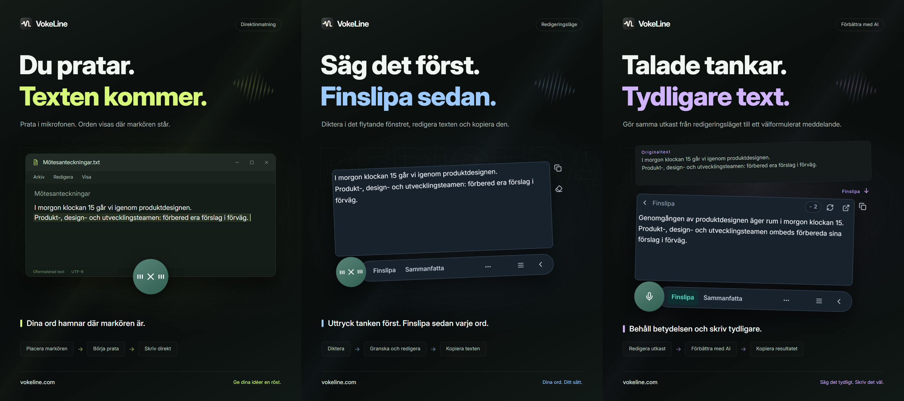

# VokeLine | Röstinmatning och AI-textassistent för datorn

[English](README.md) | [Español](README.es.md) | [Português (Brasil)](README.pt-BR.md) | [Português (Portugal)](README.pt-PT.md) | [Français](README.fr.md) | [Deutsch](README.de.md) | [Italiano](README.it.md) | [Nederlands](README.nl.md)

[Русский](README.ru.md) | [Polski](README.pl.md) | [Türkçe](README.tr.md) | [Українська](README.uk.md) | [日本語](README.ja.md) | [한국어](README.ko.md) | [Bahasa Indonesia](README.id.md) | [Tiếng Việt](README.vi.md)

[ไทย](README.th.md) | [Bahasa Melayu](README.ms.md) | [हिन्दी](README.hi.md) | [বাংলা](README.bn.md) | [简体中文](README.zh-CN.md) | [繁體中文](README.zh-TW.md) | [Svenska](README.sv.md) | [Čeština](README.cs.md)

[Norsk bokmål](README.nb.md) | [Dansk](README.da.md) | [Suomi](README.fi.md) | [Română](README.ro.md) | [Ελληνικά](README.el.md) | [Magyar](README.hu.md)

[Officiell webbplats](https://vokeline.com/) · [Ladda ned](https://vokeline.com/sv/download) · [Användarguider](https://vokeline.com/sv/docs/start)

## Om VokeLine

VokeLine är en datorapp för röstinmatning och AI-bearbetning av text. Den omvandlar tal i realtid eller ljudfiler till redigerbar text. Sedan väljer du om du vill använda AI, kopiera, söka eller ordna dina poster.

Kontrollen som alltid visas och det flytande verktygsfältet används för diktering i realtid och snabba åtgärder. I huvudfönstret hanterar du ljudfiler, AI-åtgärder, historik, anteckningar i molnet, modeller, användning och inställningar.

Kontrollen som alltid visas gör röstinmatningen lätt att nå utan att fylla skärmen. Du bestämmer när texten ska bekräftas och vad som ska hända sedan.

**Börja tala → Granska vid markören → Välj nästa åtgärd**

_Illustration av gränssnittet, från vänster till höger: direktläge, redigeringsläge och textförbättring med AI. Text och kreditvärden är exempel. Granska resultatet; den faktiska kreditanvändningen följer informationen i appen._

## Vem passar det för

- **Personer som svarar på meddelanden i arbetet**: Tala in ett svar medan du läser en webbsida eller ett dokument. Redigera och kopiera det till appen du använder utan att växla fram och tillbaka.
- **Studenter och forskare**: Tala in observationer och slutsatser medan du läser. Använd sedan en AI-åtgärd för att sammanfatta eller ordna om originaltexten.
- **Skribenter och innehållsskapare**: Diktera ett första utkast, flytta markören för att lägga till detaljer och förbättra den slutliga formuleringen.
- **Personer som arbetar med intervjuer eller andra ljudfiler**: Lägg till flera ljudfiler i format som stöds och följ förloppet. Aktivera ”Spara lokal historik” för att även behålla den färdiga texten i historiken.

## Viktiga funktioner

- **Redigerbar originaltext**: Flytta markören, korrigera texten, pausa och fortsätt tala innan du kopierar, infogar, söker eller använder AI.
- **Ljudfiler**: Lägg till flera ljudfiler i format som stöds och följ förloppet. Aktivera ”Spara lokal historik” för att även behålla den färdiga texten i historiken.
- **Lokal taligenkänningsmodell**: Ladda ner och välj separata standardmodeller för realtidsdiktering och ljudfilstranskribering.
- **AI-förklaring, förbättring och anpassade åtgärder**: Använd den aktuella transkriptionen för att förklara en idé, extrahera viktiga punkter, förbättra formuleringen eller köra en sparad instruktion. Skapa och sortera återanvändbara instruktioner och välj sedan vilka åtgärder som visas i det flytande verktygsfältet.
- **Sök eller kopiera**: Kopiera den färdiga texten direkt eller skicka den till sökmotorn du valt och fortsätt i systemets webbläsare.
- **Lokal historik och anteckningar i molnet**: Historiken sparas separat för gästen och för varje konto på den här enheten. En post laddas upp först när du klickar på ”Spara till molnet”.
- **Organiserat huvudfönster**: Se användningen, transkribera ljudfiler, hantera AI-åtgärder, läs lokal historik och anteckningar i molnet samt konfigurera lokala modeller.

AI-åtgärder är beroende av de konfigurerade tjänsterna, nätverket, tillgängliga krediter och funktionernas aktuella lanseringsstatus.

## Så använder du VokeLine

### 1. Hämta och installera

[Ladda ned](https://vokeline.com/sv/download)

Öppna den officiella nedladdningssidan och välj installationsfil för ditt operativsystem och din processor. Följ installationsstegen och öppna VokeLine. Behåll internetanslutningen för att hämta den första lokala talmodellen.

VokeLine är utvecklat för Windows och macOS. Linux-versionen är under utveckling. Se nedladdningssidan för tillgängliga versioner, arkitekturer och systemkrav.

### 2. Förbered den första modellen

**Var och vad som krävs:** Modeller → Lokala modeller. Du behöver internet och diskutrymme. Modellkortet visar storlek, uppskattat minnesbehov och funktioner som stöds.

1. Välj en modell för transkribering i realtid och kontrollera språk och hårdvarukrav. En modell bara för filer fungerar inte för liveinspelning.
2. Tryck Ladda ned och vänta på nedladdning, kontroll och installation. Pausa och fortsätt efter återanslutning vid behov.
3. Tryck Använd och välj standard för inspelningar, filer eller båda, när det stöds.
4. Kontrollera markeringen för inspelningsbruk och återgå till startsidan.

**Resultat:** Nya inspelningar använder modellen. Nedladdningen väljer den inte automatiskt; tryck även Använd. Se [Modellproblem](https://vokeline.com/sv/docs/help#guide-model-downloads).

#### Kontrollera mikrofonen

**Var:** Inställningar → Röst och kortkommandon → Inmatningsenhet. Mikrofonen ska vara ansluten, ha ljudet på och tillåtelse från systemet.

1. Välj systemets standardmikrofon eller en viss enhet. Välj en tillgänglig igen när en extern mikrofon kopplas bort.
2. Starta mikrofontestet och säg några ord. Det slutar inom 10 sekunder utan att spara testinspelningen.
3. Fortsätt när ljud upptäcks. Annars kontrollera att mikrofonen inte är avstängd samt inmatningsvolym och avstånd och testa igen.
4. Öppna mikrofontillstånd via länken eller manuellt i systeminställningarna om länken inte fungerar.

**Resultat:** Testet upptäcker ljud och enheten är tillgänglig. [Filtranskribering](https://vokeline.com/sv/docs/features#guide-audio-files) kräver ingen mikrofon.

### 3. Röstinmatning i realtid

Båda lägena behöver inspelningsmodell, mikrofon och tillstånd. Lokal transkribering kräver inget konto eller AI-krediter. [Kontrollera mikrofonen](https://vokeline.com/sv/docs/start#guide-microphone) först.

| Läge     | Öppna                                  | Text                | Användning             |
| -------- | -------------------------------------- | ------------------- | ---------------------- |
| Redigera | Egen genväg eller mikrofon om standard | Flytande redigerare | Kontroll, AI, sökning. |
| Direkt   | Egen genväg eller mikrofon om standard | Valt fält           | Målappens text.        |

#### Redigeringsläge

1. Använd redigeringslägets kortkommando eller välj det som standard och tryck mikrofonen.
2. Tala, stoppa med kontrollen och vänta på slutförandet.
3. Redigera och kopiera originalet eller välj AI-åtgärd eller sökning.

**Resultat:** Originalet finns kvar i editorn. AI-resultatet visas och kopieras separat. Transkribering skickar inte automatiskt en AI-begäran.

#### Direktläge

**Dessutom:** Målappen måste ha ett redigerbart textfält. Hantera direktlägets tillstånd i röstinställningarna och tillåt även Hjälpmedel på macOS när det efterfrågas.

1. Klicka i målfältet, placera markören och använd direktlägets kortkommando.
2. Välj fält när det efterfrågas och vänta på inspelningsstart.
3. Behåll samma fält medan du talar; byt inte fönster eller inmatningsplats.
4. Stoppa med kontrollen eller motsvarande kortkommando och kontrollera texten.

**Resultat:** Texten skrivs i det låsta målfältet. Vid fel kontrollerar du fält och tillstånd eller kopierar från editorn. Försök inte upprepade gånger utan tydligt mål.

### 4. Transkribera ljudfiler

**Var och vad som krävs:** Filtranskribering i sidomenyn med en lokal modell som stöder filer. Mikrofon, inloggning och AI-krediter behövs inte.

| Gräns           | Krav                           |
| --------------- | ------------------------------ |
| Format          | WAV, MP3, FLAC, OGG, M4A, MP4. |
| Storlek         | Inte tom, högst 2 GB var.      |
| Val             | 100 åt gången.                 |
| Talarseparation | Inte stödd, endast utan.       |

1. Välj eller dra in filer och lägg till fler vid behov.
2. Kontrollera listan och ta bort ogiltiga eller oläsbara filer. Välj en fil på nytt efter extern ändring.
3. Välj en lokal modell. Om den tillåter val av ljudspråk, välj det kända språket bland tillgängliga alternativ. Modeller med endast automatisk upptäckt väljer själva; kontrollera texten i båda fallen.
4. Starta transkribering och följ kö, läsning, transkribering och slutförande.
5. Öppna färdigt resultat, kontrollera och kopiera texten.

**Resultat:** Varje fil får en uppgift. Med lokal lagring på sparas texten under aktuell gäst eller konto, inte automatiskt i molnet.

### 5. AI-textåtgärder

**Var och vad som krävs:** Konfigurera på AI-sidan och kör från editorn. Inloggning, internet, tillgänglig modell och tillräckliga krediter behövs. Kontrollera modell, språk och kreditinformation innan du kör.

| Åtgärd               | Syfte                 | Språk     |
| -------------------- | --------------------- | --------- |
| Förklara             | Förtydliga            | Valt.     |
| Finslipa             | Förbättra formulering | Original. |
| Sammanfatta          | Korta innehåll        | Valt.     |
| Ta fram huvudpunkter | Viktigaste            | Valt.     |
| Korrekturläs         | Granska/rätta         | Original. |

1. Välj standardmodell för AI och utdataspråk och spara.
2. Förbered texten och kontrollera inmatningsgränsen.
3. Välj åtgärd, kontrollera krediter och vänta på resultatet.
4. Kontrollera och kopiera resultatet eller återgå till originalet för ändringar.

**Resultat:** Resultatet visas separat. Texten skickas först när du själv kör åtgärden. AI-modell och talmodell är olika inställningar.

”Samma språk som originaltexten” använder originaltextens språk. Åtgärderna ”Finslipa” och ”Korrekturläs” behåller alltid det språket.

”Försök igen” försöker återställa samma åtgärd. ”Kör igen” startar en ny och kan använda krediter igen. Vänta på en statusuppdatering om bearbetningen eller resultatkontrollen fortfarande pågår innan du startar en annan åtgärd.

#### Anpassade åtgärder

1. Skapa en åtgärd med namn och instruktion, exempelvis mötesanteckningar med beslut och uppgifter.
2. Välj modell, språk och visning och spara. Lägg inte lösenord, nycklar eller känslig information i instruktionen.
3. Testa med kort text och förbättra instruktionen. Du kan skapa högst 20 egna åtgärder.

### 6. Lokal historik och anteckningar i molnet

#### Lokal historik och statistik

**Var och vad som krävs:** Historik eller senaste poster på startsidan. Du ser aktuell gäst eller konto på den här enheten utan internet.

1. Hitta och öppna post med Alla-, Röst- eller AI-filter.
2. Läs röstoriginalet eller AI-original och resultat och kopiera det du behöver.

#### Spara i molnet

**Var och vad som krävs:** Logga in och välj Historik → post → Spara i molnet. Internet och utrymme inom aktuell gräns behövs.

1. Logga in på kontot som ska äga texten och öppna dess lokala historik.
2. Kontrollera originalet eller AI-resultatet för innehåll du inte vill ladda upp och välj molnlagring.
3. Vänta på bekräftelsen att posten har sparats eller redan finns. Behåll originalet vid fel, kontrollera nät och gräns och försök igen.
4. Öppna molnposter, uppdatera och kontrollera texten.

**Resultat:** Texten är tillgänglig på andra enheter med samma konto. Lokal originaltext finns kvar; radering av den tar inte bort molnkopian.

## Vanliga frågor

### Måste jag logga in för att använda VokeLine?

Lokal diktering, lokala modeller, lokal historik och kopiering kan användas utan inloggning. AI-funktioner, anteckningar i molnet och kontofunktioner kräver inloggning.

[Prissättning](https://vokeline.com/sv/pricing)

### Texten saknas eller innehåller fel

Kontrollera att modellen stöder det talade språket och att vald mikrofon fungerar. Minska bakgrundsljudet och försök igen. Språket upptäcks automatiskt vid inspelning; för filer kan du välja det om modellen stöder detta. Gränssnittsspråket ändrar inte taligenkänningen. Om du vill ha en förklaring, sammanfattning eller huvudpunkter på ett annat språk väljer du motsvarande AI-åtgärd och utdataspråk. Ljudspråket anger vilket språk modellen ska känna igen.

### Direktläget misslyckas eller ber om ett textfält

Klicka i redigerbart fält, placera markören och starta direktläge. Välj mål när det efterfrågas. Byt inte fönster eller fält medan du talar.

Kontrollera tillstånd och Hjälpmedel på macOS. Om infogning avvisas, kopiera först från [Editor](https://vokeline.com/sv/docs/features#guide-editor) och klistra in manuellt innan felsökning.

### Filen kan inte läggas till eller transkriberingen startar inte

Kontrollera WAV, MP3, FLAC, OGG, M4A eller MP4, en inte tom fil på högst 2 GB och högst 100 per val. Ta bort ogiltiga och kontrollera filmodell och språk.

Välj fil igen efter flytt, namnbyte, extern ändring eller utgånget val. Vid avkodningsfel kontrollera uppspelning, ljudspår och skador.

## Data och integritet

Mikrofonljudet används endast för lokal transkribering och sparas inte som anteckningar i molnet. En AI-begäran skickas över internet först när du väljer motsvarande AI-åtgärd.

| Åtgärd                                  | Vart innehållet går                                                                                                                    |
| --------------------------------------- | -------------------------------------------------------------------------------------------------------------------------------------- |
| Lokal diktering eller filtranskribering | Behandlas med en lokal modell på den här enheten. Innehållet laddas inte automatiskt upp till molnet.                                  |
| Spara lokal historik                    | Texten stannar på enheten, separat för gästen och varje konto. Historiken har ingen extra kryptering. Skydda enheten och systemkontot. |
| AI-textåtgärder                         | Texten som behövs för åtgärden skickas till den valda onlinetjänsten.                                                                  |
| Webbsökning                             | Sökorden skickas till den valda sökmotorn.                                                                                             |
| Spara i molnet                          | Den valda textposten skickas över nätet till kontots molnposter.                                                                       |

Om du stänger av ”Spara lokal historik” under Inställningar → Data och integritet sparas inga nya historiktexter, men befintliga poster finns kvar. Startsidan fortsätter att samla statistik för inspelningar och filtranskribering: antal sessioner, ljudlängd och antal skapade tecken. Statistiken innehåller inte själva transkripttexten.

Den här inställningen styr nya poster på sidan Historik. Filtranskriberingsuppgifter och deras resultat lagras separat på enheten. Använd ”Ta bort uppgiften från listan” under Filtranskribering när uppgiften inte behövs; text som redan sparats i historiken eller molnet finns kvar.

Lokal historik sparas separat för gästen och för varje konto. Endast poster som du väljer att spara kopieras till kontots anteckningar i molnet.

[Konto och data](https://vokeline.com/sv/docs/account)

## Officiell webbplats och hjälp

- [Officiell webbplats: vokeline.com](https://vokeline.com/)
- [Kom igång](https://vokeline.com/sv/docs/start)
- [Funktioner](https://vokeline.com/sv/docs/features)
- [Felsökning](https://vokeline.com/sv/docs/help)

**Var:** Öppna ”Konto” från skrivbordsappens meny ”Konto” och välj sedan ”Hjälp och feedback” på webbplatsen. Logga in vid behov.

1. Ange version, system, funktion, steg och förväntat och faktiskt resultat.
2. Bifoga exakt meddelande och modell, filformat och storlek eller beställnings- och kredittidpunkt vid behov.
