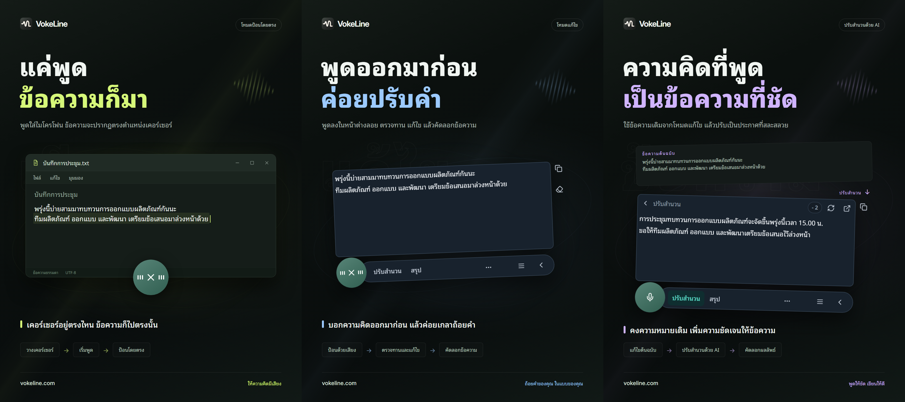

# VokeLine | ผู้ช่วยป้อนด้วยเสียงและข้อความ AI บนเดสก์ท็อป

[English](README.md) | [Español](README.es.md) | [Português (Brasil)](README.pt-BR.md) | [Português (Portugal)](README.pt-PT.md) | [Français](README.fr.md) | [Deutsch](README.de.md) | [Italiano](README.it.md) | [Nederlands](README.nl.md)

[Русский](README.ru.md) | [Polski](README.pl.md) | [Türkçe](README.tr.md) | [Українська](README.uk.md) | [日本語](README.ja.md) | [한국어](README.ko.md) | [Bahasa Indonesia](README.id.md) | [Tiếng Việt](README.vi.md)

[ไทย](README.th.md) | [Bahasa Melayu](README.ms.md) | [हिन्दी](README.hi.md) | [বাংলা](README.bn.md) | [简体中文](README.zh-CN.md) | [繁體中文](README.zh-TW.md) | [Svenska](README.sv.md) | [Čeština](README.cs.md)

[Norsk bokmål](README.nb.md) | [Dansk](README.da.md) | [Suomi](README.fi.md) | [Română](README.ro.md) | [Ελληνικά](README.el.md) | [Magyar](README.hu.md)

[เว็บไซต์ทางการ](https://vokeline.com/) · [ดาวน์โหลด](https://vokeline.com/th/download) · [คู่มือและข่าวสาร](https://vokeline.com/th/docs/start)

## เกี่ยวกับ VokeLine

VokeLine เป็นผู้ช่วยป้อนด้วยเสียงและข้อความ AI บนเดสก์ท็อป โดยแปลงเสียงพูดแบบเรียลไทม์หรือไฟล์เสียงเป็นข้อความที่แก้ไขได้ จากนั้นคุณเลือกใช้ AI กับข้อความ คัดลอก ค้นหา หรือจัดระเบียบบันทึกได้

ปุ่มที่แสดงตลอดเวลาและแถบเครื่องมือลอยใช้ป้อนด้วยเสียงแบบเรียลไทม์และเรียกคำสั่งทันที ส่วนหน้าต่างหลักใช้จัดการไฟล์เสียง คำสั่ง AI ประวัติ บันทึกบนคลาวด์ โมเดล สถิติการใช้งาน และการตั้งค่า

ปุ่มที่แสดงตลอดเวลาช่วยให้เรียกใช้การป้อนด้วยเสียงได้สะดวกโดยไม่กินพื้นที่เต็มหน้าจอ คุณตัดสินใจเองว่าจะยืนยันข้อความเมื่อใดและทำอะไรต่อ

**เริ่มพูด → ตรวจสอบที่ตำแหน่งเคอร์เซอร์ → เลือกการดำเนินการถัดไป**

_ภาพประกอบหน้าจอ จากซ้ายไปขวา: โหมดป้อนโดยตรง โหมดแก้ไข และการปรับสำนวนด้วย AI ข้อความและจำนวนเครดิตเป็นตัวอย่าง โปรดตรวจสอบผลลัพธ์ และดูจำนวนเครดิตที่ใช้จริงในแอป_

## เหมาะกับใคร

- **ผู้ที่ตอบข้อความในการทำงาน**: บอกคำตอบด้วยเสียงขณะอ่านหน้าเว็บหรือเอกสาร แก้ไขแล้วคัดลอกไปยังแอปปัจจุบัน โดยไม่ต้องสลับไปมา
- **นักเรียน นักศึกษา และนักวิจัย**: บอกข้อสังเกตและข้อสรุปด้วยเสียงขณะอ่าน แล้วใช้คำสั่ง AI เพื่อสรุปหรือจัดระเบียบข้อความต้นฉบับใหม่
- **นักเขียนและผู้สร้างเนื้อหา**: พูดเพื่อร่างข้อความก่อน จากนั้นเลื่อนเคอร์เซอร์เพื่อเติมรายละเอียด แล้วปรับสำนวนให้อ่านลื่นขึ้น
- **ผู้ที่จัดการบทสัมภาษณ์หรือไฟล์เสียงอื่น ๆ**: เพิ่มไฟล์เสียงที่รองรับหลายไฟล์พร้อมกันและติดตามความคืบหน้า เปิด “บันทึกประวัติในเครื่อง” หากต้องการเก็บข้อความที่ถอดเสียงเสร็จแล้วไว้ในประวัติด้วย

## คุณสมบัติหลัก

- **ข้อความต้นฉบับที่แก้ไขได้**: เลื่อนเคอร์เซอร์ แก้ไขข้อความ หยุดพักแล้วพูดต่อ ก่อนตัดสินใจคัดลอก แทรก ค้นหา หรือใช้ AI
- **ถอดเสียงไฟล์**: เพิ่มไฟล์เสียงที่รองรับหลายไฟล์พร้อมกันและติดตามความคืบหน้า เปิด “บันทึกประวัติในเครื่อง” หากต้องการเก็บข้อความที่ถอดเสียงเสร็จแล้วไว้ในประวัติด้วย
- **โมเดลรู้จำเสียงพูดในเครื่อง**: ดาวน์โหลดโมเดล แล้วเลือกโมเดลเริ่มต้นแยกกันสำหรับการป้อนด้วยเสียงแบบเรียลไทม์และการถอดเสียงจากไฟล์
- **อธิบาย ปรับสำนวน และใช้คำสั่งที่กำหนดเองด้วย AI**: ใช้ข้อความต้นฉบับปัจจุบันเพื่ออธิบายแนวคิด ดึงประเด็นสำคัญ ปรับสำนวน หรือเรียกใช้คำสั่งของตัวเองที่บันทึกไว้ สร้างและจัดลำดับคำสั่งที่ใช้ซ้ำได้ แล้วเลือกว่าคำสั่งใดจะแสดงบนแถบเครื่องมือลอย
- **ค้นหาหรือคัดลอก**: คัดลอกข้อความสุดท้ายโดยตรง หรือส่งไปยังเครื่องมือค้นหาที่คุณเลือกและเปิดต่อในเบราว์เซอร์ระบบ
- **ประวัติในเครื่องและบันทึกบนคลาวด์**: ประวัติถูกจัดเก็บแยกตามตัวตนบนอุปกรณ์ปัจจุบัน บันทึกแต่ละรายการจะถูกอัปโหลดเมื่อคุณคลิกบันทึกลงคลาวด์เท่านั้น
- **หน้าต่างหลักที่จัดระเบียบอย่างดี**: ดูการใช้งาน ถอดเสียงไฟล์เสียง จัดการคำสั่ง AI เรียกดูประวัติในเครื่องและบันทึกบนคลาวด์ และกำหนดค่าโมเดลในเครื่อง

คำสั่ง AI ขึ้นอยู่กับบริการที่กำหนดค่า การเชื่อมต่อเครือข่าย เครดิตที่เหลือ และสถานะการเผยแพร่ปัจจุบัน

## วิธีใช้งาน

### 1. ดาวน์โหลดและติดตั้ง

[ดาวน์โหลด](https://vokeline.com/th/download)

เปิดหน้าดาวน์โหลดทางการ แล้วเลือกตัวติดตั้งให้ตรงกับระบบปฏิบัติการและหน่วยประมวลผล ทำตามขั้นตอนติดตั้งแล้วเปิด VokeLine เชื่อมต่ออินเทอร์เน็ตไว้เพื่อดาวน์โหลดโมเดลเสียงในเครื่องตัวแรก

VokeLine ออกแบบมาสำหรับ Windows และ macOS ส่วนเวอร์ชัน Linux อยู่ระหว่างการพัฒนา ดูเวอร์ชันที่พร้อมดาวน์โหลด สถาปัตยกรรม และข้อกำหนดระบบได้ในหน้าดาวน์โหลด

### 2. เตรียมโมเดลแรก

**ตำแหน่งและเงื่อนไข:** โมเดล → โมเดลในเครื่อง ต้องมีอินเทอร์เน็ตและพื้นที่ดิสก์ การ์ดแสดงขนาด หน่วยความจำโดยประมาณ และงานที่รองรับ

1. เลือกโมเดลที่รองรับการถอดเสียงสด ตรวจภาษาและข้อกำหนดเครื่อง โมเดลสำหรับไฟล์เท่านั้นใช้บันทึกสดไม่ได้
2. เลือกดาวน์โหลด แล้วรอการดาวน์โหลด ตรวจไฟล์ และติดตั้ง สามารถพักและทำต่อเมื่อเชื่อมต่อใหม่ได้
3. เลือกใช้ แล้วตั้งค่าเริ่มต้นสำหรับการบันทึก ไฟล์ หรือทั้งคู่ตามที่รองรับ
4. ตรวจเครื่องหมายใช้กับการบันทึก แล้วกลับหน้าหลัก

**ผลลัพธ์:** การบันทึกครั้งใหม่ใช้โมเดลที่เลือก ดาวน์โหลดเสร็จยังไม่ตั้งค่าเริ่มต้น ต้องเลือกใช้ด้วย ดู [ปัญหาโมเดล](https://vokeline.com/th/docs/help#guide-model-downloads)

#### ตรวจไมโครโฟน

**ตำแหน่ง:** การตั้งค่า → เสียงและปุ่มลัด → อุปกรณ์รับเสียง ไมโครโฟนต้องเชื่อมต่อ ไม่ปิดเสียง และได้รับอนุญาตจากระบบ

1. เลือกไมโครโฟนเริ่มต้นของระบบหรืออุปกรณ์ที่ต้องการ หากถอดไมโครโฟนนอกให้เลือกตัวที่ยังใช้ได้ใหม่
2. เริ่มทดสอบและพูดสั้น ๆ การทดสอบจบภายใน 10 วินาทีและไม่เก็บเสียงทดสอบ
3. ทำต่อเมื่อพบเสียง หากไม่พบให้ตรวจว่าไมโครโฟนปิดเสียงอยู่หรือไม่ ระดับเสียงเข้า และระยะห่าง แล้วทดสอบใหม่
4. เปิดสิทธิ์ไมโครโฟนจากลิงก์ หากเปิดไม่ได้ให้เข้าไปตั้งค่าในระบบเอง

**ผลลัพธ์:** การทดสอบพบเสียงและอุปกรณ์พร้อมใช้ [การถอดเสียงไฟล์](https://vokeline.com/th/docs/features#guide-audio-files) ไม่ต้องมีไมโครโฟน

### 3. เสียงแบบเรียลไทม์

ทั้งสองโหมดต้องมีโมเดลบันทึก ไมโครโฟน และสิทธิ์ การถอดเสียงในเครื่องไม่ต้องมีบัญชีหรือเครดิต AI ให้ [ตรวจไมโครโฟน](https://vokeline.com/th/docs/start#guide-microphone) ก่อน

| โหมด  | เปิด                             | ข้อความ             | ใช้ทำอะไร        |
| ----- | -------------------------------- | ------------------- | ---------------- |
| แก้ไข | ปุ่มลัดเฉพาะ หรือไมค์ถ้าเริ่มต้น | หน้าต่างแก้ไขแบบลอย | ตรวจ AI และค้นหา |
| ตรง   | ปุ่มลัดเฉพาะ หรือไมค์ถ้าเริ่มต้น | ช่องที่เลือก        | เขียนแอปปลายทาง  |

#### โหมดแก้ไข

1. ใช้ปุ่มลัดโหมดแก้ไข หรือกำหนดเป็นค่าเริ่มต้นแล้วกดไมโครโฟน
2. พูด จบด้วยตัวควบคุม และรอเสร็จ
3. แก้และคัดลอกต้นฉบับ หรือเลือกงาน AI หรือค้นหา

**ผลลัพธ์:** ต้นฉบับยังอยู่ในกล่องแก้ไข ผล AI แสดงและคัดลอกแยกได้ การถอดเสียงไม่ส่งคำขอ AI อัตโนมัติ

#### โหมดป้อนตรง

**เงื่อนไขเพิ่ม:** แอปปลายทางต้องมีช่องข้อความที่แก้ได้ จัดการสิทธิ์โหมดป้อนตรงในการตั้งค่าเสียง และให้สิทธิ์ Accessibility บน macOS เมื่อระบบขอ

1. คลิกช่องปลายทาง วางเคอร์เซอร์ แล้วใช้ปุ่มลัดป้อนตรง
2. เลือกช่องเมื่อระบบขอ และรอเริ่มบันทึก
3. คงช่องเดิมระหว่างพูด อย่าเปลี่ยนหน้าต่างหรือตำแหน่งพิมพ์
4. จบด้วยตัวควบคุมหรือปุ่มลัดที่ตรง แล้วตรวจข้อความ

**ผลลัพธ์:** ข้อความเข้าไปในช่องที่ล็อกเป็นเป้าหมาย หากไม่สำเร็จให้ตรวจช่องและสิทธิ์ หรือคัดลอกจากโหมดแก้ไข อย่าลองซ้ำโดยยังไม่มีเป้าหมายชัดเจน

### 4. ถอดเสียงไฟล์

**ตำแหน่งและเงื่อนไข:** ถอดเสียงไฟล์ในเมนูด้านข้างพร้อมโมเดลในเครื่องที่รองรับ ไม่ต้องมีไมโครโฟน เข้าสู่ระบบ หรือเครดิต AI

| ข้อจำกัด  | เงื่อนไข                      |
| --------- | ----------------------------- |
| รูปแบบ    | WAV, MP3, FLAC, OGG, M4A, MP4 |
| ขนาด      | ไม่ว่าง สูงสุด 2 GB ต่อไฟล์   |
| การเลือก  | 100 ต่อครั้ง                  |
| แยกผู้พูด | ไม่รองรับ มีไม่แยกเท่านั้น    |

1. เลือกหรือลากไฟล์เข้ามา และเพิ่มได้ตามต้องการ
2. ตรวจรายการและเอาไฟล์ไม่ถูกต้องหรืออ่านไม่ได้ออก หากแก้นอกแอปให้เลือกใหม่
3. เลือกโมเดลในเครื่อง หากรองรับการระบุภาษาเสียง ให้เลือกภาษาที่ทราบจากตัวเลือกที่มี โมเดลที่รองรับเฉพาะการตรวจหาอัตโนมัติจะระบุภาษาเอง ไม่ว่าแบบใดให้ตรวจข้อความที่ได้
4. เริ่มถอดเสียงและดูสถานะคิว อ่าน ถอดเสียง และจัดให้เสร็จ
5. เปิดผลที่เสร็จ ตรวจ แล้วคัดลอกข้อความ

**ผลลัพธ์:** แต่ละไฟล์มีงานของตัวเอง หากเปิดบันทึกในเครื่อง ข้อความอยู่ใต้ผู้เยี่ยมชมหรือบัญชีปัจจุบัน ไม่ขึ้นคลาวด์เอง

### 5. ข้อความด้วย AI

**ตำแหน่งและเงื่อนไข:** ตั้งค่าในหน้า “คำสั่ง AI” แล้วเรียกใช้จากกล่องแก้ไข ต้องเข้าสู่ระบบ มีอินเทอร์เน็ต โมเดลที่พร้อม และเครดิตพอ ตรวจโมเดล ภาษา และข้อมูลเครดิตก่อน

| งาน             | จุดประสงค์  | ภาษา    |
| --------------- | ----------- | ------- |
| อธิบาย          | ชี้ความหมาย | เลือก   |
| ปรับสำนวน       | ทำให้อ่านดี | ต้นฉบับ |
| สรุป            | ย่อเนื้อหา  | เลือก   |
| ดึงประเด็นสำคัญ | เอาจุดสำคัญ | เลือก   |
| ตรวจแก้         | ตรวจข้อความ | ต้นฉบับ |

1. เลือกโมเดล AI เริ่มต้นและภาษาผล แล้วบันทึก
2. เตรียมข้อความและตรวจขีดจำกัดอินพุต
3. เลือกงาน ตรวจเครดิต และรอผล
4. ตรวจและคัดลอกผล หรือกลับต้นฉบับเพื่อแก้

**ผลลัพธ์:** ผลแสดงแยก ข้อความส่งเมื่อคุณเรียกใช้งานเท่านั้น โมเดล AI กับโมเดลเสียงเป็นคนละตัวเลือก

“ใช้ภาษาตามข้อความต้นฉบับ” ใช้ภาษาของข้อความต้นฉบับ คำสั่ง “ปรับสำนวน” และ “ตรวจแก้” จะใช้ภาษาต้นฉบับเสมอ

“ลองอีกครั้ง” พยายามกู้คืนงานเดิม ส่วน “ทำอีกครั้ง” เริ่มงานใหม่และอาจใช้เครดิตอีกครั้ง หากยังประมวลผลหรือตรวจสอบผลลัพธ์อยู่ ให้รอสถานะอัปเดตก่อนเริ่มงานอื่น

#### คำสั่งที่กำหนดเอง

1. สร้างงานด้วยชื่อและคำสั่ง เช่นบันทึกประชุมที่มีข้อสรุปและงานต้องทำ
2. ตั้งโมเดล ภาษา และการแสดง แล้วเก็บ อย่าใส่รหัสผ่าน คีย์ หรือข้อมูลอ่อนไหวในคำสั่ง
3. ทดสอบข้อความสั้นและปรับคำสั่ง สร้างงานกำหนดเองได้สูงสุด 20 งาน

### 6. ประวัติในเครื่องและบันทึกบนคลาวด์

#### ประวัติในเครื่องและสถิติ

**ตำแหน่งและเงื่อนไข:** ประวัติหรือรายการล่าสุดหน้าหลัก เห็นผู้เยี่ยมชมหรือบัญชีปัจจุบันบนเครื่องนี้โดยไม่ต้องมีอินเทอร์เน็ต

1. หาและเปิดรายการด้วยตัวกรองทั้งหมด เสียง หรือ AI
2. อ่านต้นฉบับเสียงหรือต้นฉบับกับผล AI แล้วคัดลอกส่วนที่ต้องการ

#### บันทึกไปคลาวด์

**ตำแหน่งและเงื่อนไข:** เข้าสู่ระบบแล้วเลือกประวัติ → รายการ → บันทึกคลาวด์ ต้องมีอินเทอร์เน็ตและพื้นที่ในขีดจำกัดปัจจุบัน

1. เข้าบัญชีที่ต้องการเป็นเจ้าของ แล้วเปิดประวัติในเครื่องของบัญชีนั้น
2. ตรวจต้นฉบับหรือผล AI ว่ามีสิ่งไม่อยากส่งหรือไม่ แล้วบันทึกคลาวด์
3. รอข้อความยืนยันว่าบันทึกสำเร็จหรือมีรายการนี้อยู่แล้ว หากผิดพลาดเก็บต้นฉบับ ตรวจเครือข่ายและขีดจำกัดแล้วลองใหม่
4. เปิดคลาวด์ รีเฟรช และตรวจข้อความ

**ผลลัพธ์:** อ่านบนอุปกรณ์อื่นในบัญชีเดียวกันได้ ต้นฉบับในเครื่องยังอยู่ ลบต้นฉบับไม่ลบคลาวด์

## คำถามที่พบบ่อย

### ต้องมีบัญชีจึงจะใช้ VokeLine ได้หรือไม่?

การป้อนด้วยเสียงในเครื่อง โมเดลในเครื่อง ประวัติในเครื่อง และการคัดลอกใช้ได้โดยไม่ต้องเข้าสู่ระบบ ส่วนสิทธิ์ AI บันทึกบนคลาวด์ และฟีเจอร์บัญชีต้องเข้าสู่ระบบ

[ราคา](https://vokeline.com/th/pricing)

### ไม่มีข้อความหรือรู้จำผิด

ตรวจสอบว่าโมเดลรองรับภาษาที่พูดและไมโครโฟนที่เลือกทำงานได้ จากนั้นลดเสียงรบกวนแล้วลองอีกครั้ง การบันทึกเสียงจะตรวจหาภาษาอัตโนมัติ ส่วนไฟล์จะเลือกภาษาได้เมื่อโมเดลรองรับเท่านั้น การเปลี่ยนภาษาหน้าจอไม่เปลี่ยนภาษาที่ระบบรู้จำ หากต้องการคำอธิบาย สรุป หรือประเด็นสำคัญเป็นภาษาอื่น ให้เลือกคำสั่ง AI ที่เหมาะสมและภาษาผลลัพธ์ ภาษาเสียงใช้ระบุภาษาที่โมเดลต้องรู้จำ

### ป้อนตรงไม่สำเร็จหรือขอให้เลือกช่องข้อความ

คลิกช่องที่แก้ได้ วางเคอร์เซอร์ แล้วเริ่มโหมดป้อนตรง เลือกเป้าหมายเมื่อถาม อย่าเปลี่ยนหน้าต่างหรือช่องระหว่างพูด

ตรวจสิทธิ์และ Accessibility บน macOS หากปลายทางไม่รับ ให้คัดลอกจาก [แก้ไข](https://vokeline.com/th/docs/features#guide-editor) และวางเองก่อนค่อยตรวจปัญหา

### เพิ่มไฟล์หรือเริ่มถอดเสียงไม่ได้

ตรวจ WAV, MP3, FLAC, OGG, M4A หรือ MP4 ไฟล์ไม่ว่างไม่เกิน 2 GB และเลือกไม่เกิน 100 เอาไฟล์ไม่ถูกต้องออกและตรวจโมเดลกับภาษา

เลือกใหม่หลังย้าย เปลี่ยนชื่อ แก้นอกแอป หรือการเลือกหมดอายุ หากถอดรหัสล้มเหลวตรวจเล่นได้ แทร็กเสียง และไฟล์เสีย

## ข้อมูลและความเป็นส่วนตัว

เสียงจากไมโครโฟนใช้สำหรับการถอดเสียงในเครื่องเท่านั้น และไม่ถูกบันทึกเป็นบันทึกบนคลาวด์ คำขอ AI จะเริ่มขึ้นหลังจากที่คุณเลือกคำสั่ง AI เท่านั้น

| งาน               | ปลายทาง                                                                   |
| ----------------- | ------------------------------------------------------------------------- |
| ถอดเสียงในเครื่อง | โมเดลในเครื่อง ไม่ส่งขึ้นเอง                                              |
| ประวัติ           | ส่วนบัญชี/ผู้เยี่ยมชม ไม่มีการเข้ารหัสเพิ่มเติม ปกป้องเครื่องและบัญชีระบบ |
| AI                | ข้อความที่จำเป็นไปบริการเลือก                                             |
| ค้นหา             | คำค้นไปเครื่องมือเลือก                                                    |
| คลาวด์            | ข้อความเลือกผ่านเครือข่ายไปบัญชี                                          |

การปิด “บันทึกประวัติในเครื่อง” ในการตั้งค่า → ข้อมูลและความเป็นส่วนตัว จะหยุดบันทึกข้อความใหม่ แต่ไม่ลบรายการเดิม หน้าแรกยังรวบรวมสถิติการถอดเสียงจากการบันทึกและไฟล์ ได้แก่ จำนวนครั้ง ระยะเวลาเสียง และจำนวนอักขระ สถิติเหล่านี้ไม่มีเนื้อหาข้อความที่ถอดเสียง

ตัวเลือกนี้ควบคุมรายการใหม่ในหน้าประวัติ งานถอดเสียงจากไฟล์และผลลัพธ์จะเก็บแยกไว้ในอุปกรณ์นี้ หากไม่ต้องการงานแล้ว ให้ใช้ “นำงานออกจากรายการ” ในหน้าถอดเสียงจากไฟล์ ข้อความที่บันทึกไว้ในประวัติหรือคลาวด์แล้วจะไม่ถูกลบ

ประวัติในเครื่องแยกเก็บตามผู้ใช้ที่ไม่ได้เข้าสู่ระบบหรือบัญชีแต่ละบัญชี เฉพาะบันทึกที่คุณเลือกบันทึกเองเท่านั้นจะถูกคัดลอกไปยังบันทึกบนคลาวด์ของบัญชี

[บัญชีและข้อมูล](https://vokeline.com/th/docs/account)

## เว็บไซต์ทางการและความช่วยเหลือ

- [เว็บไซต์ทางการ: vokeline.com](https://vokeline.com/)
- [เริ่มต้นใช้งาน](https://vokeline.com/th/docs/start)
- [ฟีเจอร์](https://vokeline.com/th/docs/features)
- [แก้ปัญหา](https://vokeline.com/th/docs/help)

**ตำแหน่ง:** เปิด “บัญชี” จากเมนู “บัญชี” ในแอปเดสก์ท็อป แล้วเลือก “ช่วยเหลือและข้อเสนอแนะ” บนเว็บไซต์ เข้าสู่ระบบหากจำเป็น

1. แจ้งเวอร์ชัน ระบบ ฟังก์ชัน ขั้นตอน สิ่งที่คาด และผลจริง
2. ให้ข้อความแจ้งที่ตรง รวมชื่อโมเดล รูปแบบและขนาดไฟล์ หรือเวลาคำสั่งซื้อและเครดิตตามปัญหา
