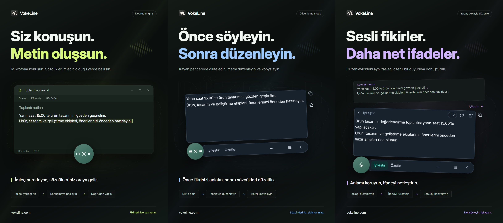

# VokeLine — masaüstünde sesle yazma ve AI metin asistanı

[English](README.md) | [Español](README.es.md) | [Português (Brasil)](README.pt-BR.md) | [Português (Portugal)](README.pt-PT.md) | [Français](README.fr.md) | [Deutsch](README.de.md) | [Italiano](README.it.md) | [Nederlands](README.nl.md)

[Русский](README.ru.md) | [Polski](README.pl.md) | [Türkçe](README.tr.md) | [Українська](README.uk.md) | [日本語](README.ja.md) | [한국어](README.ko.md) | [Bahasa Indonesia](README.id.md) | [Tiếng Việt](README.vi.md)

[ไทย](README.th.md) | [Bahasa Melayu](README.ms.md) | [हिन्दी](README.hi.md) | [বাংলা](README.bn.md) | [简体中文](README.zh-CN.md) | [繁體中文](README.zh-TW.md) | [Svenska](README.sv.md) | [Čeština](README.cs.md)

[Norsk bokmål](README.nb.md) | [Dansk](README.da.md) | [Suomi](README.fi.md) | [Română](README.ro.md) | [Ελληνικά](README.el.md) | [Magyar](README.hu.md)

[Resmî web sitesi](https://vokeline.com/) · [İndir](https://vokeline.com/tr/download) · [Kılavuzlar ve yenilikler](https://vokeline.com/tr/docs/start)

## VokeLine nedir

VokeLine, masaüstü ses girişi ve AI metin asistanıdır. Canlı konuşmayı veya ses dosyalarını düzenlenebilir metne dönüştürür; ardından AI metin işlemleri, kopyalama, arama veya kayıt düzenleme seçeneklerini siz seçersiniz.

Sabit düğme ve kayan araç çubuğu canlı dikteyi ve anlık işlemleri sağlar. Ana pencerede ses dosyaları, AI işlemleri, geçmiş, bulut notları, modeller, istatistikler ve ayarlar yönetilir.

Sabit düğmeyle sesle yazma elinizin altında olur ve ekranı kaplamaz. Metni ne zaman onaylayacağınızı ve sonra ne yapacağınızı siz seçersiniz.

**Konuşmaya başlayın → İmleçte gözden geçirin → Sonraki işlemi seçin**

_Arayüz gösterimi, soldan sağa: doğrudan giriş modu, düzenleme modu ve yapay zekâ ile metin iyileştirme. Metin ve kredi değerleri örnektir. Sonucu kontrol edin; gerçek kredi kullanımı için uygulamadaki bilgileri esas alın._

## Kimler için uygundur

- **İş mesajlarını yanıtlayanlar**: Bir sayfayı veya belgeyi okurken yanıtı dikte edin, düzenleyin ve geçerli uygulamaya kopyalayın.
- **Öğrenciler ve araştırmacılar**: Okurken gözlem ve sonuçlarınızı söyleyin; ardından metni AI işlemiyle özetleyin veya yeniden düzenleyin.
- **Yazarlar ve içerik üreticileri**: Önce taslağı dikte edin, imleci taşıyarak ayrıntı ekleyin ve son anlatımı iyileştirin.
- **Görüşmeler veya diğer ses dosyalarıyla çalışanlar**: Desteklenen ses dosyalarını topluca ekleyip ilerlemeyi takip edin. Tamamlanan metni geçmişte de saklamak için “Yerel geçmişi kaydet” seçeneğini açın.

## Temel özellikler

- **Düzenlenebilir döküm**: Kopyalamadan, eklemeden, aramadan veya AI kullanmadan önce imleci hareket ettirin, ifadeyi düzeltin, duraklayın ve konuşmaya devam edin.
- **Ses dosyalarını metne dönüştürme**: Desteklenen ses dosyalarını topluca ekleyip ilerlemeyi takip edin. Tamamlanan metni geçmişte de saklamak için “Yerel geçmişi kaydet” seçeneğini açın.
- **Yerel konuşma tanıma modeli**: Modelleri indirin ve gerçek zamanlı dikte ile ses dosyası yazıya dökme için ayrı varsayılanlar seçin.
- **AI ile açıklama, anlatımı iyileştirme ve özel işlemler**: Geçerli dökümü kullanarak bir fikri açıklayın, önemli noktaları çıkarın, ifadeyi geliştirin veya kayıtlı bir talimatı çalıştırın. Tekrar kullanılabilen talimatlar oluşturup sıralayın ve kayan araç çubuğunda hangi işlemlerin görüneceğini seçin.
- **Arayın veya kopyalayın**: Son dökümü doğrudan kopyalayın veya tercih ettiğiniz arama motoruna sistem tarayıcısında gönderin.
- **Yerel geçmiş ve bulut notları**: Geçmiş cihazda her misafir veya hesap için ayrı saklanır. Bir kayıt yalnızca “Buluta kaydet”i seçtiğinizde gönderilir.
- **Düzenli ana pencere**: Kullanım istatistiklerini görün, ses dosyalarını yazıya dökün, AI işlemlerini yönetin, yerel geçmiş ve bulut notlarını inceleyin, yerel modelleri ayarlayın.

AI işlemleri; yapılandırılmış hizmete, ağ bağlantısına, kullanılabilir kredilere ve özelliğin mevcut durumuna bağlıdır.

## Kullanım kılavuzu

### 1. İndirme ve kurulum

[İndir](https://vokeline.com/tr/download)

Resmî indirme sayfasını açın ve işletim sisteminize ve işlemcinize uygun kurulum dosyasını seçin. Kurulum adımlarını izleyip VokeLine’ı açın. İlk yerel konuşma modelini indirmek için internet bağlantısını açık tutun.

VokeLine, Windows ve macOS için tasarlanmıştır. Linux sürümü geliştirme aşamasındadır. Mevcut sürümler, mimariler ve sistem gereksinimleri için indirme sayfasına bakın.

### 2. İlk modeli hazırlama

**Konum ve koşullar:** Modeller → Yerel modeller. Bağlantı ve alan gerekir; kartlar boyut, tahmini bellek ve görevleri gösterir.

1. Canlı dönüştürmeyi destekleyen model seçip dil ve cihaz gereksinimlerini kontrol edin. Yalnızca dosya modeli canlı kayıtta kullanılamaz.
2. İndir’i seçip indirme, doğrulama ve kurulumu bekleyin. Gerekirse duraklatıp yeniden bağlanınca sürdürün.
3. Kullan’ı seçip desteklenen kayıt, dosya veya her iki iş için varsayılan yapın.
4. Kayıtta kullanım işaretini kontrol edip ana sayfaya dönün.

**Sonuç:** Yeni kayıtlar modeli kullanır. İndirme işlemi modeli otomatik olarak seçmez; Kullan düğmesini de seçmeniz gerekir. Hata, hasar ve bellek için [Modeller](https://vokeline.com/tr/docs/help#guide-model-downloads).

#### Mikrofonu kontrol etme

**Konum:** Ayarlar → Ses ve kısayollar → Giriş aygıtı. Bağlı, sessize alınmamış mikrofon ve sistem izni gerekir.

1. Sistem mikrofonunu veya belirli cihazı seçin. Harici mikrofon çıkarılırsa kullanılabilir cihazı yeniden seçin.
2. Testi başlatıp birkaç kelime söyleyin. 10 saniyede biter ve test kaydını saklamaz.
3. Ses algılanınca devam edin. Algılanmazsa sessiz durumunu, giriş sesini ve mesafeyi kontrol edip yeniden test edin.
4. Bağlantıdan mikrofon iznini açın; çalışmazsa sistem ayarlarını kendiniz açın.

**Sonuç:** Ses algılanır, aygıt uyarısı yoktur. Dosyalar mikrofon istemez: [Ses dosyaları](https://vokeline.com/tr/docs/features#guide-audio-files).

### 3. Gerçek zamanlı ses girişi

İki mod da model, mikrofon ve izin ister. Yerel işlem giriş yapmayı veya kredi kullanmayı gerektirmez. [Mikrofonu kontrol edin](https://vokeline.com/tr/docs/start#guide-microphone).

| Mod         | Açma                                      | Metin                     | Kullanım                      |
| ----------- | ----------------------------------------- | ------------------------- | ----------------------------- |
| Düzenleyici | Kendi kısayolu veya varsayılansa mikrofon | Düzenlenebilir yüzen alan | Kontrol, yapay zekâ ve arama. |
| Doğrudan    | Kendi kısayolu veya varsayılansa mikrofon | Seçilen alan              | Hedef uygulamaya yazma.       |

#### Düzenleyici modu

1. Düzenleme kısayolunu kullanın veya varsayılan yapıp mikrofonu tıklayın.
2. Konuşun, kontrolle kaydı durdurun ve tamamlanmayı bekleyin.
3. Orijinali düzenleyip kopyalayın veya yapay zekâ işlemi ya da arama seçin.

**Sonuç:** Orijinal kalır, yapay zekâ ayrı gösterilip kopyalanır. Dönüştürmek tek başına yapay zekâya göndermez.

#### Doğrudan giriş

**Ek koşul:** Düzenlenebilir hedef gerekir. Ses ve kısayollardaki izin yönetimini kullanın; macOS Erişilebilirlik iznini de verin.

1. Hedef alana tıklayın, imleci yerleştirin ve Doğrudan kısayolunu kullanın.
2. İstenirse alanı seçip kaydın başlamasını bekleyin.
3. Konuşurken aynı alanda kalın; pencereyi veya giriş konumunu değiştirmeyin.
4. Kontrolle veya ilgili kısayolla bitirip metni kontrol edin.

**Sonuç:** Metin sabit hedef alana yazılır. Hata olursa hedefi ve izinleri kontrol edin veya düzenleyiciden kopyalayın. Hedef belli değilken işlemi tekrarlamayın.

### 4. Ses dosyalarını metne dönüştürme

**Konum ve koşullar:** Uyumlu yerel modelle dosya sayfası. Giriş, mikrofon ve kredi gerekmez.

| Sınır            | Koşul                                     |
| ---------------- | ----------------------------------------- |
| Biçimler         | WAV, MP3, FLAC, OGG, M4A, MP4.            |
| Boyut            | Boş değil, her biri en fazla 2 GB.        |
| Seçim            | Tek seferde 100.                          |
| Konuşmacı ayrımı | Şu an desteklenmez, yalnız ayrım olmadan. |

1. Dosyaları seçin veya sürükleyin ve gerektiğinde daha fazla ekleyin.
2. Listeyi kontrol edip geçersiz veya okunamayan dosyaları kaldırın. Dışarıda değişen dosyayı yeniden seçin.
3. Yerel bir model seçin. Ses dilini belirlemeye izin veriyorsa mevcut seçeneklerden bilinen dili seçin. Yalnızca otomatik algılamayı destekleyen modeller dili kendileri belirler; her iki durumda da metni kontrol edin.
4. Dönüştürmeyi başlatıp kuyruk, okuma, dönüştürme ve tamamlama durumlarını izleyin.
5. Hazır sonucu açın, kontrol edin ve metni kopyalayın.

**Sonuç:** Her dosyanın ayrı işi olur. Yerel kaydetme açıksa metin mevcut hesabın veya misafirin geçmişine yazılır; buluta otomatik kaydedilmez.

### 5. Yapay zekâ metin işlemleri

**Konum ve koşullar:** Yapay zekâ sayfasında ayarlayın, düzenleyicide çalıştırın. Giriş, internet, model ve kredi gerekir. Çalıştırmadan önce modeli, çıktı dilini ve kredi bilgisini kontrol edin.

| İşlem                  | Amaç                   | Dil       |
| ---------------------- | ---------------------- | --------- |
| Açıkla                 | Anlamı açıklama        | Seçilen.  |
| İyileştir              | İfadeyi geliştirme     | Orijinal. |
| Özetle                 | İçeriği kısaltma       | Seçilen.  |
| Önemli noktaları çıkar | Önemli bilgiyi çıkarma | Seçilen.  |
| Düzelt                 | Metni denetleme        | Orijinal. |

1. Varsayılan yapay zekâ modeli ve çıktı dilini seçip kaydedin.
2. Metni hazırlayıp giriş sınırını kontrol edin.
3. İşlemi seçin, kredileri kontrol edin ve sonucu bekleyin.
4. Sonucu kontrol edip kopyalayın veya değişiklik için orijinale dönün.

**Sonuç:** Çıktı ayrıdır. Metin yalnızca işlemi siz başlattığınızda çevrimiçi hizmete gönderilir. Ses ve yapay zekâ modelleri ayrıdır.

“Kaynak metnin dilini takip et” özgün metnin dilini kullanır. “İyileştir” ve “Düzelt” işlemleri bu dili her zaman korur.

“Tekrar dene” aynı işlemi kurtarmayı dener. “Yeniden çalıştır” yeni bir işlem başlatır ve tekrar kredi harcayabilir. İşlem veya sonuç kontrolü devam ediyorsa başka bir işlem başlatmadan önce durumun güncellenmesini bekleyin.

#### Özel eylemler

1. Ad ve talimatla işlem oluşturun; örneğin kararlar ve görevler içeren toplantı notları isteyin.
2. Modeli, dili ve görünürlüğü ayarlayıp kaydedin. Talimata parola, anahtar veya hassas veri koymayın.
3. Kısa metinle test edip talimatı iyileştirin. En fazla 20 özel işlem oluşturabilirsiniz.

### 6. Yerel geçmiş ve bulut notları

#### Yerel geçmiş ve istatistikler

**Konum ve koşullar:** Geçmiş veya ana sayfanın son kayıtları. Bu cihazdaki aktif hesabın ya da misafirin kayıtlarını internetsiz görebilirsiniz.

1. Tümü, Ses veya Yapay zekâ filtresiyle kaydı bulup açın.
2. Ses orijinalini veya yapay zekâ orijinalini ve sonucunu okuyup gereken kısmı kopyalayın.

#### Buluta kaydetme

**Konum ve koşullar:** Girişten sonra geçmiş kaydını buluta kaydedin. Ağ ve sınır içinde alan gerekir.

1. Metnin sahibi olacak hesapla giriş yapıp yerel geçmişini açın.
2. Orijinalde veya sonuçta gönderilmemesi gereken içerik olup olmadığını kontrol edip buluta kaydedin.
3. Kaydetme onayını veya kaydın zaten var olduğunu belirten mesajı bekleyin. Hatada orijinali tutup ağı ve sınırı kontrol ederek deneyin.
4. Bulutu açın, yenileyin ve metni kontrol edin.

**Sonuç:** Aynı hesabın başka cihazlarında görülür. Orijinal kalır; onu sonradan silmek bulutu silmez.

## Sık sorulan sorular

### VokeLine'ı kullanmak için hesap gerekir mi?

Yerel dikte, yerel modeller, geçmiş ve kopyalama hesap olmadan kullanılabilir; AI hakları, bulut notları ve hesap özellikleri oturum açmayı gerektirir.

[Fiyatlar](https://vokeline.com/tr/pricing)

### Metin yok veya yanlış

Modelin konuşulan dili desteklediğini ve seçili mikrofonun çalıştığını kontrol edin. Arka plan gürültüsünü azaltıp yeniden deneyin. Kayıt sırasında dil otomatik algılanır; dosyalarda, model destekliyorsa dili seçebilirsiniz. Arayüz dilini değiştirmek konuşma tanımayı değiştirmez. Açıklamayı, özeti veya önemli noktaları başka bir dilde almak için ilgili AI işlemini ve çıktı dilini seçin. Ses dili, modelin hangi dili tanıyacağını belirtir.

### Yazmıyor veya alan istiyor

Düzenlenebilir alanı tıklayıp imleci koyun. Seçim bekliyorsa hedefi gösterin, kayıt sırasında pencereyi veya giriş konumunu değiştirmeyin.

Doğrudan izinleri ve macOS Erişilebilirliği ayarlayın. Reddedilirse önce [Düzenleyici](https://vokeline.com/tr/docs/features#guide-editor) ile metni koruyup kopyalayın, sonra inceleyin.

### Eklenmiyor veya başlamıyor

WAV, MP3, FLAC, OGG, M4A veya MP4; boş olmayan, en fazla 2 GB dosyalar ve seçim başına en fazla 100 şartlarını kontrol edin. Geçersizleri kaldırıp dosya modeli ve ses dilini doğrulayın.

Dosya taşınır, yeniden adlandırılır, uygulama dışında değiştirilir veya seçim süresi dolarsa yeniden seçin. Uygun uzantıda bile oynatma, ses kanalı ve hasarı kontrol edin.

## Veriler ve gizlilik

Mikrofon sesi cihazda işlenerek metne dönüştürülür; bulut notlarına kaydedilmez. AI hizmetine istek yalnızca AI işlemini seçtiğinizde gönderilir.

| İşlem            | Hedef                                                                    |
| ---------------- | ------------------------------------------------------------------------ |
| Yerel dönüştürme | Cihaz modeli, otomatik bulut yüklemesi yok.                              |
| Geçmiş           | Hesap/misafir alanı; ek şifreleme yok, cihaz ve sistem hesabını koruyun. |
| Yapay zekâ       | Gerekli metin seçili hizmete.                                            |
| Arama            | Sorgu seçili motora.                                                     |
| Bulut            | Seçili metin ağdan hesaba.                                               |

Ayarlar → “Veri ve gizlilik” bölümünde “Yerel geçmişi kaydet” seçeneğini kapatmak yeni metinlerin kaydedilmesini durdurur; mevcut kayıtları silmez. Ana sayfa, mikrofon kayıtları ve dosya dökümleri için oturum sayısı, ses süresi ve üretilen karakter sayısını toplamaya devam eder. Bu istatistikler döküm metnini içermez.

Bu seçenek Geçmiş sayfasındaki yeni kayıtları kontrol eder. Dosya dökümü görevleri ve sonuçları bu cihazda ayrı tutulur. Bir göreve artık ihtiyacınız yoksa Dosyaları yazıya dök sayfasında “Görevi kaldır” seçeneğini kullanın; geçmişe veya buluta önceden kaydedilmiş metin silinmez.

Yerel geçmiş, misafir veya hesap kimliğine göre ayrılır; yalnızca açıkça kaydettiğiniz kayıtlar hesabınızın bulut notlarına kopyalanır.

[Hesap ve veriler](https://vokeline.com/tr/docs/account)

## Resmî site ve destek

- [Resmî web sitesi: vokeline.com](https://vokeline.com/)
- [Başlarken](https://vokeline.com/tr/docs/start)
- [Özellikler](https://vokeline.com/tr/docs/features)
- [Sorun giderme](https://vokeline.com/tr/docs/help)

**Konum:** Masaüstü uygulamasının “Hesap” menüsünden “Hesap” seçeneğini açın, ardından web sitesinde “Yardım ve geri bildirim” bölümüne gidin. Gerekirse giriş yapın.

1. Sürüm, sistem, işlev, adımlar, beklenen ve gerçekleşen sonucu yazın.
2. Tam mesajı ve gerekirse model, dosya türü ve boyutu ya da sipariş ve kredi zamanını ekleyin.
