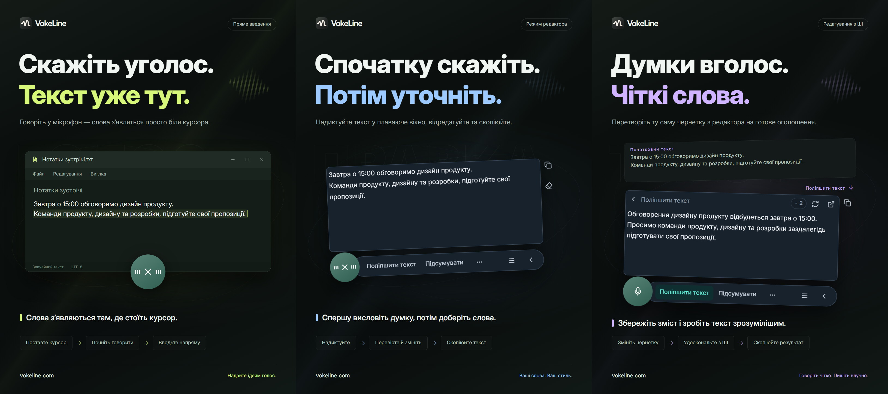

# VokeLine — голосове введення на комп’ютері й текстовий помічник зі ШІ

[English](README.md) | [Español](README.es.md) | [Português (Brasil)](README.pt-BR.md) | [Português (Portugal)](README.pt-PT.md) | [Français](README.fr.md) | [Deutsch](README.de.md) | [Italiano](README.it.md) | [Nederlands](README.nl.md)

[Русский](README.ru.md) | [Polski](README.pl.md) | [Türkçe](README.tr.md) | [Українська](README.uk.md) | [日本語](README.ja.md) | [한국어](README.ko.md) | [Bahasa Indonesia](README.id.md) | [Tiếng Việt](README.vi.md)

[ไทย](README.th.md) | [Bahasa Melayu](README.ms.md) | [हिन्दी](README.hi.md) | [বাংলা](README.bn.md) | [简体中文](README.zh-CN.md) | [繁體中文](README.zh-TW.md) | [Svenska](README.sv.md) | [Čeština](README.cs.md)

[Norsk bokmål](README.nb.md) | [Dansk](README.da.md) | [Suomi](README.fi.md) | [Română](README.ro.md) | [Ελληνικά](README.el.md) | [Magyar](README.hu.md)

[Офіційний сайт](https://vokeline.com/) · [Завантажити](https://vokeline.com/uk/download) · [Посібники й новини](https://vokeline.com/uk/docs/start)

## Про VokeLine

VokeLine — настільний застосунок для голосового введення й роботи з текстом за допомогою ШІ. Він перетворює мовлення в реальному часі або аудіофайли на редагований текст. Ви вибираєте, обробити його за допомогою ШІ, скопіювати, знайти чи впорядкувати в нотатках.

Постійна кнопка й плаваюча панель потрібні для диктування та швидких дій. У головному вікні ви керуєте аудіофайлами, діями ШІ, історією, хмарними нотатками, моделями, статистикою та налаштуваннями.

Постійна кнопка дає змогу швидко почати голосове введення, не займаючи весь екран. Ви вирішуєте, коли підтвердити текст і що робити далі.

**Почніть говорити → Перевірте біля курсора → Виберіть наступну дію**

_Ілюстрація інтерфейсу, зліва направо: пряме введення, режим редагування й поліпшення тексту за допомогою ШІ. Текст і значення кредитів є прикладами. Перевірте результат; фактичні витрати кредитів указано в застосунку._

## Кому підходить

- **Люди, які відповідають на робочі повідомлення**: Надиктуйте відповідь під час читання сторінки або документа, відредагуйте її, а потім скопіюйте в поточний застосунок.
- **Студенти й дослідники**: Під час читання диктуйте спостереження й висновки, а потім підсумовуйте або впорядковуйте текст за допомогою ШІ.
- **Автори текстів та іншого вмісту**: Надиктуйте першу чернетку, перемістіть курсор, щоб додати деталі, і вдоскональте остаточне формулювання.
- **Люди, які працюють з інтерв’ю та іншими аудіофайлами**: Додавайте кілька підтримуваних аудіофайлів і стежте за обробкою. Щоб готовий текст залишався й в історії, увімкніть «Зберігати локальну історію».

## Основні можливості

- **Початковий текст для редагування**: Перемістіть курсор, виправте формулювання, зробіть паузу та продовжуйте говорити перед копіюванням, вставленням, пошуком або використанням ШІ.
- **Розпізнавання аудіофайлів**: Додавайте кілька підтримуваних аудіофайлів і стежте за обробкою. Щоб готовий текст залишався й в історії, увімкніть «Зберігати локальну історію».
- **Локальна модель розпізнавання мовлення**: Завантажте та виберіть окремі моделі за замовчуванням для диктування в реальному часі та транскрибування аудіофайлів.
- **Пояснення ШІ, вдосконалення та власні дії**: Використовуйте поточний текст для пояснення понять, виділення головного, покращення формулювань або виконання збережених інструкцій. Створюйте інструкції для повторного використання, змінюйте їхній порядок і вибирайте дії для плаваючої панелі.
- **Знайдіть або скопіюйте**: Скопіюйте остаточний текст або передайте його вибраному пошуковику та продовжте пошук у системному браузері.
- **Локальна історія та хмарні нотатки**: Історія зберігається на пристрої окремо для кожного гостя чи облікового запису. Запис надсилається в хмару лише після натискання «Зберегти в хмарі».
- **Зрозуміле головне вікно**: Переглядайте використання, транскрибуйте аудіофайли, керуйте діями ШІ, переглядайте локальну історію та хмарні нотатки, а також налаштовуйте моделі.

Дії ШІ залежать від налаштованої служби, доступу до мережі, доступних кредитів і поточного статусу випуску.

## Як користуватися

### 1. Завантаження й встановлення

[Завантажити](https://vokeline.com/uk/download)

Відкрийте офіційну сторінку завантаження та виберіть інсталятор для своєї системи й процесора. Виконайте кроки встановлення, а потім відкрийте VokeLine. Для завантаження першої локальної моделі розпізнавання мовлення потрібен інтернет.

VokeLine створено для Windows і macOS. Версія для Linux перебуває в розробці. Доступні версії, архітектури та системні вимоги наведено на сторінці завантаження.

### 2. Перша модель

**Де та що потрібно:** Моделі → Локальні моделі. Потрібні інтернет і місце на диску. Картка показує розмір, орієнтовну пам’ять і підтримувані завдання.

1. Виберіть модель для розпізнавання наживо й перевірте мови та вимоги. Модель лише для файлів не працює з живим записом.
2. Натисніть Завантажити й дочекайтеся завантаження, перевірки та встановлення. За потреби призупиніть і продовжте після підключення.
3. Натисніть Використати й задайте типову модель для запису, файлів або обох завдань за підтримкою.
4. Перевірте позначку використання для запису й поверніться на головну.

**Результат:** Новий запис використовує вибрану модель. Завантаження не задає типову модель автоматично: натисніть Використати. [Проблеми з моделями](https://vokeline.com/uk/docs/help#guide-model-downloads).

#### Перевірка мікрофона

**Де:** Налаштування → Голос і комбінації клавіш → Пристрій введення. Мікрофон має бути під’єднаний, не вимкнений і дозволений системою.

1. Виберіть типовий мікрофон системи або конкретний. Після від’єднання зовнішнього знову виберіть доступний пристрій.
2. Запустіть тест і скажіть кілька слів. Він завершується за 10 секунд і не зберігає тестовий запис.
3. Продовжте, коли звук виявлено. Інакше перевірте, чи не вимкнено звук мікрофона, вхідну гучність і відстань до нього та повторіть тест.
4. Відкрийте дозволи мікрофона посиланням або вручну в системі, якщо посилання не працює.

**Результат:** Тест виявляє звук, а пристрій доступний. [Розпізнавання файлів](https://vokeline.com/uk/docs/features#guide-audio-files) не потребує мікрофона.

### 3. Голос у реальному часі

Обидва режими потребують моделі запису, мікрофона й дозволів. Локальне розпізнавання не вимагає облікового запису чи кредитів ШІ. Спочатку [перевірте мікрофон](https://vokeline.com/uk/docs/start#guide-microphone).

| Режим    | Запуск                                  | Місце тексту       | Призначення                 |
| -------- | --------------------------------------- | ------------------ | --------------------------- |
| Редактор | Свої клавіші або мікрофон, коли типовий | Плаваючий редактор | Перевірка, ШІ, пошук.       |
| Прямий   | Свої клавіші або мікрофон, коли типовий | Обране поле        | Вписати в цільову програму. |

#### Редактор

1. Скористайтеся комбінацією редактора або задайте його типовим і натисніть мікрофон.
2. Говоріть, зупиніть елементом керування й дочекайтеся завершення.
3. Виправте та скопіюйте оригінал або виберіть дію ШІ чи пошук.

**Результат:** Оригінал залишається в редакторі. Результат ШІ відображається й копіюється окремо. Розпізнавання не надсилає запит ШІ автоматично.

#### Пряме введення

**Додатково:** У цільовій програмі має бути поле для редагування. Керуйте дозволами прямого режиму в голосових налаштуваннях; у macOS також надайте Доступність за запитом.

1. Клацніть цільове поле, поставте курсор і використайте пряму комбінацію.
2. Виберіть поле за запитом і дочекайтеся запису.
3. Не змінюйте поле під час мовлення; не переходьте в інше вікно чи місце введення.
4. Зупиніть керуванням або відповідною комбінацією й перевірте текст.

**Результат:** Текст вводиться в зафіксоване поле. За помилки перевірте поле й дозволи або скопіюйте з редактора. Не повторюйте без чіткої цілі.

### 4. Розпізнавання аудіофайлів

**Де та що потрібно:** Розпізнавання файлів у бічному меню з відповідною локальною моделлю. Мікрофон, вхід і кредити ШІ не потрібні.

| Межа         | Умова                                 |
| ------------ | ------------------------------------- |
| Формати      | WAV, MP3, FLAC, OGG, M4A, MP4.        |
| Розмір       | Непорожні, до 2 GB кожен.             |
| Вибір        | До 100 одночасно.                     |
| Поділ мовців | Зараз без підтримки, лише без поділу. |

1. Виберіть або перетягніть файли й додайте ще за потреби.
2. Перевірте список і вилучіть невалідні чи нечитабельні файли. Після зовнішньої зміни виберіть знову.
3. Виберіть локальну модель. Якщо вона дозволяє задати мову аудіо, виберіть відому мову з доступних варіантів. Моделі лише з автоматичним визначенням вибирають мову самі; в обох випадках перевірте текст.
4. Запустіть розпізнавання й стежте за чергою, читанням, розпізнаванням і завершенням.
5. Відкрийте готовий результат, перевірте та скопіюйте текст.

**Результат:** Кожен файл отримує завдання. При локальному збереженні текст потрапляє до поточного гостя або облікового запису, не автоматично до хмари.

### 5. Текстові дії ШІ

**Де та що потрібно:** Налаштуйте на сторінці ШІ й запускайте з редактора. Потрібні вхід, інтернет, доступна модель і достатньо кредитів. Перед запуском перевірте модель, мову й кредитні відомості.

| Дія               | Мета                   | Мова       |
| ----------------- | ---------------------- | ---------- |
| Пояснити          | Пояснити значення      | Обрана.    |
| Поліпшити текст   | Удосконалити вислів    | Оригіналу. |
| Підсумувати       | Стиснути зміст         | Обрана.    |
| Виділити головне  | Важливе                | Обрана.    |
| Виправити помилки | Перевірити й виправити | Оригіналу. |

1. Виберіть типову модель ШІ й мову виводу та збережіть.
2. Підготуйте текст і перевірте обмеження вводу.
3. Виберіть дію, перевірте кредити й зачекайте результат.
4. Перевірте та скопіюйте результат або поверніться до оригіналу для змін.

**Результат:** Результат відображається окремо. Текст надсилається онлайн лише після запуску дії. Модель ШІ та модель розпізнавання мовлення налаштовуються незалежно.

Параметр «Дотримуватися мови початкового тексту» використовує мову початкового тексту. Дії «Поліпшити текст» та «Виправити помилки» завжди зберігають цю мову.

«Спробувати ще раз» намагається відновити ту саму операцію. «Виконати ще раз» запускає нову й може знову витратити кредити. Якщо обробка або перевірка результату ще триває, дочекайтеся оновлення стану, перш ніж починати іншу операцію.

#### Власні дії

1. Створіть дію з назвою й інструкцією, наприклад протокол зустрічі з рішеннями та завданнями.
2. Задайте модель, мову й показ та збережіть. Не додавайте паролі, ключі чи чутливі дані до інструкції.
3. Перевірте короткий текст і уточніть інструкцію. Можна мати до 20 власних дій.

### 6. Локальна історія та хмарні нотатки

#### Локальна історія та статистика

**Де та що потрібно:** Історія або останні записи головної. Бачите поточного гостя чи акаунт на цьому пристрої без інтернету.

1. Знайдіть і відкрийте запис фільтрами Усі, Голос або ШІ.
2. Читайте голосовий оригінал або оригінал і результат ШІ та копіюйте потрібне.

#### Зберегти у хмарі

**Де та що потрібно:** Увійдіть і виберіть Історія → запис → Зберегти в хмарі. Потрібні мережа й місце в поточному ліміті.

1. Увійдіть до акаунта, якому належатиме текст, і відкрийте його локальну історію.
2. Перевірте оригінал чи результат на небажаний зміст, потім збережіть у хмарі.
3. Дочекайтеся підтвердження збереження або повідомлення, що запис уже існує. За помилки збережіть оригінал, перевірте мережу й ліміт та повторіть.
4. Відкрийте хмару, оновіть і перевірте текст.

**Результат:** Текст доступний на інших пристроях того ж акаунта. Оригінал залишається локально; його видалення не прибирає хмарну копію.

## Поширені запитання

### Чи потрібен обліковий запис для роботи з VokeLine?

Локальне диктування, моделі мовлення, історія й копіювання працюють без входу. Для можливостей ШІ, хмарних нотаток і функцій облікового запису потрібен вхід.

[Ціни](https://vokeline.com/uk/pricing)

### Текст відсутній чи неправильний

Перевірте, чи модель підтримує мову запису й чи працює вибраний мікрофон. Зменште фоновий шум і спробуйте знову. Під час запису мова визначається автоматично; для файлів її можна вказати, якщо модель це підтримує. Мова інтерфейсу не змінює розпізнавання. Щоб отримати пояснення, підсумок або головні тези іншою мовою, виберіть відповідну дію ШІ та мову результату. Мова аудіо вказує моделі, яке мовлення розпізнавати.

### Не пише чи просить поле

Клацніть поле для редагування, поставте курсор і запустіть прямий режим. Виберіть ціль за запитом, не змінюйте вікно чи поле при мовленні.

Перевірте дозволи й Доступність у macOS. Якщо введення відхилено, спершу скопіюйте з [Редактора](https://vokeline.com/uk/docs/features#guide-editor) й вставте вручну, потім шукайте причину.

### Не додається чи не починається

Перевірте WAV, MP3, FLAC, OGG, M4A або MP4, непорожній файл до 2 GB і до 100 за вибір. Вилучіть невалідні та перевірте файлову модель і мову.

Виберіть знову після переміщення, перейменування, зовнішньої зміни чи завершення строку дії списку вибраних файлів. При декодуванні перевірте відтворення, аудіодоріжку й пошкодження.

## Дані та конфіденційність

Звук мікрофона обробляється локально для перетворення на текст. У хмарних нотатках він не зберігається. Запит до сервісу ШІ надсилається лише після вибору дії ШІ.

| Дія                    | Ціль                                                                                             |
| ---------------------- | ------------------------------------------------------------------------------------------------ |
| Локальне розпізнавання | Модель пристрою, без автоматичного завантаження.                                                 |
| Історія                | Область запису/гостя без додаткового шифрування; захищайте пристрій і системний обліковий запис. |
| ШІ                     | Потрібний текст у обрану службу.                                                                 |
| Пошук                  | Запит обраному сервісу.                                                                          |
| Хмара                  | Обраний текст через мережу.                                                                      |

Вимкнення «Зберігати локальну історію» у Налаштування → «Дані та конфіденційність» зупиняє збереження нових текстів, але не видаляє наявні записи. Головна сторінка й далі накопичує статистику запису з мікрофона та розшифрування файлів: кількість сеансів, тривалість аудіо та кількість отриманих символів. Самого тексту розшифровки у цих даних немає.

Цей перемикач керує новими записами на сторінці «Історія». Завдання транскрибування файлів та їхні результати окремо зберігаються на цьому пристрої. Непотрібне завдання можна прибрати через «Видалити завдання» на сторінці «Транскрибування файлів»; текст, уже збережений в історії чи хмарі, залишиться.

Історія гостя та кожного облікового запису зберігається окремо на пристрої. У хмарні нотатки копіюються тільки записи, які ви явно зберігаєте.

[Обліковий запис і дані](https://vokeline.com/uk/docs/account)

## Офіційний сайт і допомога

- [Офіційний сайт: vokeline.com](https://vokeline.com/)
- [Перші кроки](https://vokeline.com/uk/docs/start)
- [Функції](https://vokeline.com/uk/docs/features)
- [Вирішення проблем](https://vokeline.com/uk/docs/help)

**Де:** Відкрийте «Обліковий запис» у меню «Обліковий запис» настільного застосунку, а потім «Допомога та відгуки» на сайті. За потреби ввійдіть в обліковий запис.

1. Укажіть версію, систему, функцію, кроки та очікуваний і фактичний результат.
2. Додайте точне повідомлення й модель, формат і розмір файлу чи час замовлення й кредитів за випадком.
