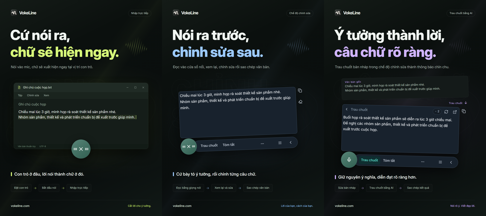

# VokeLine — nhập giọng nói và trợ lý văn bản AI trên máy tính

[English](README.md) | [Español](README.es.md) | [Português (Brasil)](README.pt-BR.md) | [Português (Portugal)](README.pt-PT.md) | [Français](README.fr.md) | [Deutsch](README.de.md) | [Italiano](README.it.md) | [Nederlands](README.nl.md)

[Русский](README.ru.md) | [Polski](README.pl.md) | [Türkçe](README.tr.md) | [Українська](README.uk.md) | [日本語](README.ja.md) | [한국어](README.ko.md) | [Bahasa Indonesia](README.id.md) | [Tiếng Việt](README.vi.md)

[ไทย](README.th.md) | [Bahasa Melayu](README.ms.md) | [हिन्दी](README.hi.md) | [বাংলা](README.bn.md) | [简体中文](README.zh-CN.md) | [繁體中文](README.zh-TW.md) | [Svenska](README.sv.md) | [Čeština](README.cs.md)

[Norsk bokmål](README.nb.md) | [Dansk](README.da.md) | [Suomi](README.fi.md) | [Română](README.ro.md) | [Ελληνικά](README.el.md) | [Magyar](README.hu.md)

[Trang web chính thức](https://vokeline.com/) · [Tải xuống](https://vokeline.com/vi/download) · [Hướng dẫn và cập nhật](https://vokeline.com/vi/docs/start)

## VokeLine là gì

VokeLine là trợ lý nhập giọng nói và văn bản AI trên máy tính. Ứng dụng đổi giọng nói theo thời gian thực hoặc tệp âm thanh thành văn bản chỉnh sửa được. Bạn chọn dùng AI, sao chép, tìm kiếm hay sắp xếp ghi chú.

Nút cố định và thanh nổi phục vụ nhập giọng nói theo thời gian thực cùng các tác vụ nhanh. Cửa sổ chính quản lý tệp âm thanh, tác vụ AI, lịch sử, ghi chú đám mây, mô hình, thống kê và cài đặt.

Nút cố định giúp nhập giọng nói luôn sẵn sàng mà không chiếm cả màn hình. Bạn quyết định khi nào xác nhận và làm gì tiếp theo.

**Bắt đầu nói → Kiểm tra tại vị trí con trỏ → Chọn thao tác tiếp theo**

_Minh họa giao diện, từ trái sang phải: nhập trực tiếp, chế độ soạn thảo và chỉnh sửa văn bản bằng AI. Nội dung và số điểm là ví dụ. Hãy kiểm tra kết quả; số điểm thực tế sử dụng theo thông tin hiển thị trong ứng dụng._

## Dành cho ai

- **Người trả lời tin nhắn công việc**: Đọc trang web hoặc tài liệu, nói câu trả lời, chỉnh sửa rồi sao chép sang ứng dụng hiện tại mà không cần chuyển qua lại.
- **Học sinh, sinh viên và nhà nghiên cứu**: Nói các quan sát và kết luận khi đọc, rồi dùng AI để tóm tắt hoặc sắp xếp lại văn bản.
- **Người viết và người sáng tạo nội dung**: Nói bản nháp trước, di chuyển con trỏ để thêm chi tiết rồi trau chuốt cách diễn đạt.
- **Người xử lý phỏng vấn hoặc các tệp âm thanh khác**: Thêm nhiều tệp âm thanh được hỗ trợ và theo dõi tiến độ. Bật “Lưu lịch sử trên thiết bị” để giữ văn bản đã hoàn tất trong lịch sử.

## Tính năng chính

- **Văn bản gốc có thể chỉnh sửa**: Di chuyển con trỏ, sửa văn bản, tạm dừng rồi nói tiếp, sau đó quyết định sao chép, ghi, tìm kiếm hoặc sử dụng AI.
- **Chuyển tệp âm thanh thành chữ**: Thêm nhiều tệp âm thanh được hỗ trợ và theo dõi tiến độ. Bật “Lưu lịch sử trên thiết bị” để giữ văn bản đã hoàn tất trong lịch sử.
- **Mô hình nhận dạng giọng nói trên thiết bị**: Tải mô hình và chọn mặc định riêng cho nhập giọng nói theo thời gian thực cùng tệp âm thanh.
- **Giải thích, trau chuốt và tác vụ tùy chỉnh bằng AI**: Dùng văn bản hiện tại để giải thích khái niệm, rút ý chính, cải thiện cách diễn đạt hoặc chạy hướng dẫn đã lưu. Tạo hướng dẫn dùng lại, sắp xếp thứ tự và chọn tác vụ xuất hiện trên thanh công cụ nổi.
- **Tìm kiếm hoặc sao chép**: Sao chép trực tiếp văn bản cuối cùng, hoặc giao cho công cụ tìm kiếm bạn chọn và tiếp tục khám phá trong trình duyệt hệ thống.
- **Lịch sử trên thiết bị và ghi chú đám mây**: Lịch sử được lưu trên thiết bị, tách riêng theo khách hoặc tài khoản. Chỉ mục bạn chọn “Lưu lên đám mây” mới được tải lên.
- **Cửa sổ chính được sắp xếp rõ ràng**: Xem thống kê, chuyển tệp âm thanh thành văn bản, quản lý tác vụ AI, xem lịch sử và ghi chú đám mây, rồi thiết lập mô hình trên thiết bị.

Thao tác AI phụ thuộc vào dịch vụ đã cấu hình, mạng, điểm khả dụng và trạng thái phát hành hiện tại.

## Hướng dẫn sử dụng

### 1. Tải và cài

[Tải xuống](https://vokeline.com/vi/download)

Mở trang tải xuống chính thức và chọn bộ cài phù hợp với hệ điều hành và bộ xử lý. Làm theo hướng dẫn cài đặt rồi mở VokeLine. Giữ kết nối mạng để tải mô hình giọng nói cục bộ đầu tiên.

VokeLine được thiết kế cho Windows và macOS. Phiên bản Linux đang được phát triển. Xem trang tải xuống để biết các phiên bản hiện có, kiến trúc và yêu cầu hệ thống.

### 2. Chuẩn bị mô hình đầu tiên

**Vị trí và điều kiện:** Mô hình → Mô hình cục bộ. Bạn cần Internet và dung lượng ổ đĩa. Thẻ hiển thị kích thước, bộ nhớ ước tính và tác vụ hỗ trợ.

1. Chọn mô hình hỗ trợ nhận dạng giọng nói theo thời gian thực, rồi kiểm tra ngôn ngữ và yêu cầu thiết bị. Mô hình chỉ hỗ trợ tệp không dùng cho ghi âm trực tiếp.
2. Chọn Tải xuống và chờ tải, kiểm tra, cài đặt xong. Có thể tạm dừng và tiếp tục sau khi kết nối lại.
3. Chọn Sử dụng và đặt mặc định cho ghi âm, tệp hoặc cả hai tùy hỗ trợ.
4. Kiểm tra dấu đang dùng cho ghi âm rồi quay về Trang chủ.

**Kết quả:** Bản ghi mới dùng mô hình đã chọn. Tải xong chưa tự đặt mặc định; bạn còn cần chọn Sử dụng. Xem [Lỗi mô hình](https://vokeline.com/vi/docs/help#guide-model-downloads).

#### Kiểm tra mic

**Vị trí:** Cài đặt → Giọng nói và phím tắt → Thiết bị đầu vào. Micrô phải được kết nối, không tắt tiếng và có quyền của hệ thống.

1. Chọn micrô mặc định hệ thống hoặc thiết bị cụ thể. Khi tháo micrô ngoài, chọn lại thiết bị còn khả dụng.
2. Bắt đầu kiểm tra và nói vài từ. Kiểm tra kết thúc trong 10 giây, không lưu bản ghi thử.
3. Tiếp tục khi phát hiện âm thanh. Nếu chưa, kiểm tra tắt tiếng, âm lượng đầu vào và khoảng cách rồi thử lại.
4. Mở quyền micrô bằng liên kết, hoặc tự vào cài đặt hệ thống nếu liên kết không mở được.

**Kết quả:** Kiểm tra phát hiện âm thanh và thiết bị khả dụng. [Chuyển tệp thành văn bản](https://vokeline.com/vi/docs/features#guide-audio-files) không cần micrô.

### 3. Nhập giọng nói trực tiếp

Cả hai chế độ cần mô hình ghi âm, micrô và quyền. Phiên âm cục bộ không cần tài khoản hoặc điểm AI. Hãy [kiểm tra micrô](https://vokeline.com/vi/docs/start#guide-microphone) trước.

| Chế độ    | Mở                               | Văn bản                | Dùng cho           |
| --------- | -------------------------------- | ---------------------- | ------------------ |
| Soạn thảo | Phím riêng hoặc mic khi mặc định | Soạn thảo nổi sửa được | Kiểm tra, AI, tìm. |
| Trực tiếp | Phím riêng hoặc mic khi mặc định | Ô được chọn            | Ghi ứng dụng đích. |

#### Soạn thảo

1. Dùng phím tắt Soạn thảo hoặc đặt làm mặc định rồi nhấn micrô.
2. Nói, dừng bằng điều khiển và chờ hoàn tất.
3. Sửa và sao chép bản gốc hoặc chọn thao tác AI hay tìm kiếm.

**Kết quả:** Bản gốc còn trong trình soạn thảo. Kết quả AI hiển thị và sao chép riêng. Phiên âm không tự gửi yêu cầu AI.

#### Nhập trực tiếp

**Điều kiện bổ sung:** Ứng dụng đích phải có ô văn bản chỉnh sửa được. Quản lý quyền Trực tiếp trong cài đặt giọng nói; cấp Accessibility trên macOS khi được yêu cầu.

1. Nhấp ô đích, đặt con trỏ và dùng phím tắt Trực tiếp.
2. Chọn ô khi được yêu cầu và chờ ghi âm bắt đầu.
3. Giữ cùng ô khi nói; đừng chuyển cửa sổ hoặc vị trí nhập.
4. Dừng bằng điều khiển hoặc phím tắt tương ứng rồi kiểm tra văn bản.

**Kết quả:** Văn bản vào ô đích đã cố định. Nếu thất bại, kiểm tra ô và quyền hoặc sao chép từ Soạn thảo. Đừng thử liên tục khi chưa có đích rõ ràng.

### 4. Chuyển tệp âm thanh thành chữ

**Vị trí và điều kiện:** Chuyển tệp thành văn bản ở menu bên, với mô hình cục bộ phù hợp. Không cần micrô, đăng nhập hay điểm AI.

| Giới hạn            | Điều kiện                         |
| ------------------- | --------------------------------- |
| Định dạng           | WAV, MP3, FLAC, OGG, M4A, MP4.    |
| Kích thước          | Không rỗng, mỗi tệp tối đa 2 GB.  |
| Lựa chọn            | 100 một lần.                      |
| Phân biệt người nói | Chưa hỗ trợ, chỉ không phân biệt. |

1. Chọn hoặc kéo tệp vào, rồi thêm tệp nếu cần.
2. Kiểm tra danh sách và bỏ tệp không hợp lệ hoặc không đọc được. Chọn lại sau thay đổi bên ngoài.
3. Chọn mô hình cục bộ. Nếu mô hình cho phép chỉ định ngôn ngữ âm thanh, chọn ngôn ngữ đã biết trong các lựa chọn hiện có. Mô hình chỉ hỗ trợ tự động sẽ tự nhận dạng ngôn ngữ; hãy kiểm tra văn bản trong cả hai trường hợp.
4. Bắt đầu chuyển âm thanh thành văn bản và theo dõi chờ, đọc, chuyển âm thanh thành văn bản và hoàn tất.
5. Mở kết quả xong, kiểm tra và sao chép văn bản.

**Kết quả:** Mỗi tệp có tác vụ riêng. Nếu bật lưu cục bộ, văn bản lưu cho khách hoặc tài khoản hiện tại, không tự lên đám mây.

### 5. Thao tác văn bản AI

**Vị trí và điều kiện:** Cấu hình trên trang Tác vụ AI và chạy từ trình soạn thảo. Cần đăng nhập, Internet, mô hình khả dụng và đủ điểm. Kiểm tra mô hình, ngôn ngữ và điểm trước khi chạy.

| Thao tác       | Mục đích                 | Ngôn ngữ |
| -------------- | ------------------------ | -------- |
| Giải thích     | Làm rõ ý                 | Chọn.    |
| Trau chuốt     | Cải thiện diễn đạt       | Gốc.     |
| Tóm tắt        | Rút gọn                  | Chọn.    |
| Rút ra ý chính | Lấy thông tin quan trọng | Chọn.    |
| Soát lỗi       | Kiểm tra/sửa             | Gốc.     |

1. Chọn mô hình AI mặc định và ngôn ngữ đầu ra, rồi lưu.
2. Chuẩn bị văn bản và kiểm tra giới hạn đầu vào.
3. Chọn thao tác, kiểm tra điểm và chờ kết quả.
4. Kiểm tra và sao chép kết quả hoặc về bản gốc để sửa.

**Kết quả:** Kết quả xuất hiện riêng. Văn bản chỉ được gửi khi bạn chủ động chạy. Mô hình AI và giọng nói là lựa chọn riêng.

“Theo ngôn ngữ văn bản gốc” dùng ngôn ngữ của văn bản gốc. Các tác vụ “Trau chuốt” và “Soát lỗi” luôn giữ ngôn ngữ này.

“Thử lại” cố gắng khôi phục tác vụ hiện tại. “Chạy lại” bắt đầu một tác vụ mới và có thể dùng điểm lần nữa. Nếu việc xử lý hoặc kiểm tra kết quả chưa xong, hãy đợi trạng thái cập nhật trước khi chạy tác vụ khác.

#### Tác vụ tùy chỉnh

1. Tạo thao tác với tên và chỉ dẫn, chẳng hạn biên bản họp gồm quyết định và việc cần làm.
2. Đặt mô hình, ngôn ngữ và hiển thị rồi lưu. Đừng đưa mật khẩu, khóa hoặc thông tin nhạy cảm vào chỉ dẫn.
3. Thử với văn bản ngắn và chỉnh chỉ dẫn. Có thể tạo tối đa 20 thao tác tùy chỉnh.

### 6. Lịch sử trên thiết bị và ghi chú đám mây

#### Lịch sử và thống kê cục bộ

**Vị trí và điều kiện:** Lịch sử hoặc bản ghi gần đây trên Trang chủ. Xem khách hoặc tài khoản hiện tại trên thiết bị này mà không cần Internet.

1. Tìm và mở bản ghi bằng bộ lọc Tất cả, Giọng nói hoặc AI.
2. Đọc bản gốc giọng nói hoặc bản gốc và kết quả AI, rồi sao chép phần cần.

#### Lưu đám mây

**Vị trí và điều kiện:** Đăng nhập rồi chọn Lịch sử → bản ghi → Lưu lên đám mây. Cần Internet và dung lượng trong giới hạn hiện tại.

1. Đăng nhập tài khoản sẽ sở hữu văn bản và mở lịch sử của nó.
2. Kiểm tra bản gốc hoặc AI có nội dung không muốn gửi rồi lưu lên đám mây.
3. Chờ thông báo xác nhận đã lưu hoặc bản ghi đã tồn tại. Giữ bản gốc khi lỗi, kiểm tra mạng và giới hạn rồi thử lại.
4. Mở đám mây, làm mới và kiểm tra văn bản.

**Kết quả:** Văn bản có trên thiết bị khác cùng tài khoản. Bản gốc cục bộ vẫn còn; xóa nó không xóa bản sao đám mây.

## Câu hỏi thường gặp

### Tôi có cần tài khoản để dùng VokeLine không?

Nhập giọng nói, mô hình trên thiết bị, lịch sử và sao chép hoạt động không cần đăng nhập. Tính năng AI, ghi chú đám mây và tài khoản cần đăng nhập.

[Bảng giá](https://vokeline.com/vi/pricing)

### Thiếu văn bản hoặc nhận diện sai

Kiểm tra mô hình có hỗ trợ ngôn ngữ bạn nói và micrô đã chọn có hoạt động không, rồi giảm tiếng ồn và thử lại. Khi ghi âm, ngôn ngữ được nhận dạng tự động; với tệp, bạn chỉ có thể chỉ định ngôn ngữ nếu mô hình hỗ trợ. Đổi ngôn ngữ giao diện không đổi ngôn ngữ nhận dạng. Muốn giải thích, tóm tắt hoặc rút ra ý chính bằng ngôn ngữ khác, hãy chọn tác vụ AI tương ứng và ngôn ngữ đầu ra. Ngôn ngữ âm thanh cho mô hình biết cần nhận dạng ngôn ngữ nào.

### Nhập trực tiếp lỗi hoặc yêu cầu ô văn bản

Nhấp ô chỉnh sửa được, đặt con trỏ rồi mở Trực tiếp. Chọn đích khi được hỏi; đừng đổi cửa sổ hoặc ô lúc nói.

Kiểm tra quyền và Accessibility macOS. Nếu chèn bị từ chối, sao chép từ [Soạn thảo](https://vokeline.com/vi/docs/features#guide-editor) và dán thủ công trước, rồi xử lý lỗi.

### Không thêm được tệp hoặc không bắt đầu chuyển âm thanh thành văn bản

Kiểm tra WAV, MP3, FLAC, OGG, M4A hoặc MP4, tệp không rỗng tối đa 2 GB và tối đa 100 mỗi lần. Bỏ bản không hợp lệ và kiểm tra mô hình, ngôn ngữ.

Chọn lại sau di chuyển, đổi tên, sửa ngoài hoặc hết hạn chọn. Kiểm tra phát, đường âm thanh và hỏng nếu giải mã lỗi.

## Dữ liệu và quyền riêng tư

Âm thanh micro được xử lý trên thiết bị để tạo văn bản, không được lưu trong ghi chú đám mây. Yêu cầu đến dịch vụ AI chỉ được gửi khi bạn chọn tác vụ AI.

| Hành động | Đích                                                                   |
| --------- | ---------------------------------------------------------------------- |
| Cục bộ    | Mô hình máy, không tự tải lên.                                         |
| Lịch sử   | Vùng tài khoản/khách không mã hóa thêm; bảo vệ máy/tài khoản hệ thống. |
| AI        | Văn bản cần đến dịch vụ chọn.                                          |
| Tìm       | Từ khóa đến công cụ chọn.                                              |
| Đám mây   | Văn bản chọn qua mạng.                                                 |

Tắt “Lưu lịch sử trên thiết bị” trong Cài đặt → Dữ liệu và quyền riêng tư chỉ ngừng lưu văn bản mới, không xóa các bản ghi hiện có. Trang chủ vẫn thống kê các lượt chuyển giọng nói và tệp âm thanh thành văn bản, thời lượng âm thanh và số ký tự đầu ra. Thống kê này không chứa nội dung văn bản đã nhận dạng.

Công tắc này kiểm soát việc lưu mục mới trong Lịch sử. Tác vụ chuyển tệp thành văn bản và kết quả được lưu riêng trên thiết bị này. Khi không cần tác vụ nữa, dùng “Bỏ tác vụ khỏi danh sách” trong Chuyển tệp thành văn bản; văn bản đã lưu vào lịch sử hoặc đám mây vẫn còn.

Lịch sử của khách và từng tài khoản được lưu riêng trên thiết bị. Chỉ các mục bạn chủ động lưu mới được sao chép lên ghi chú đám mây của tài khoản.

[Tài khoản và dữ liệu](https://vokeline.com/vi/docs/account)

## Trang web chính thức và hỗ trợ

- [Trang web chính thức: vokeline.com](https://vokeline.com/)
- [Bắt đầu sử dụng](https://vokeline.com/vi/docs/start)
- [Tính năng](https://vokeline.com/vi/docs/features)
- [Khắc phục sự cố](https://vokeline.com/vi/docs/help)

**Vị trí:** Mở “Tài khoản” từ menu “Tài khoản” của ứng dụng máy tính, rồi chọn “Trợ giúp và phản hồi” trên trang web. Đăng nhập nếu cần.

1. Ghi phiên bản, hệ thống, tính năng, bước, kỳ vọng và kết quả thực tế.
2. Thêm thông báo chính xác và mô hình, định dạng và kích thước tệp, hoặc thời gian đơn và điểm tùy vấn đề.
