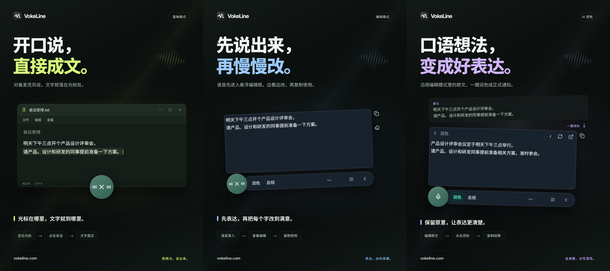

# VokeLine｜桌面语音输入与 AI 文本助手

[English](README.md) | [Español](README.es.md) | [Português (Brasil)](README.pt-BR.md) | [Português (Portugal)](README.pt-PT.md) | [Français](README.fr.md) | [Deutsch](README.de.md) | [Italiano](README.it.md) | [Nederlands](README.nl.md)

[Русский](README.ru.md) | [Polski](README.pl.md) | [Türkçe](README.tr.md) | [Українська](README.uk.md) | [日本語](README.ja.md) | [한국어](README.ko.md) | [Bahasa Indonesia](README.id.md) | [Tiếng Việt](README.vi.md)

[ไทย](README.th.md) | [Bahasa Melayu](README.ms.md) | [हिन्दी](README.hi.md) | [বাংলা](README.bn.md) | [简体中文](README.zh-CN.md) | [繁體中文](README.zh-TW.md) | [Svenska](README.sv.md) | [Čeština](README.cs.md)

[Norsk bokmål](README.nb.md) | [Dansk](README.da.md) | [Suomi](README.fi.md) | [Română](README.ro.md) | [Ελληνικά](README.el.md) | [Magyar](README.hu.md)

[官方网站](https://vokeline.com/) · [下载](https://vokeline.com/zh-CN/download) · [使用指南](https://vokeline.com/zh-CN/docs/start)

## 产品介绍

VokeLine 是一款桌面语音输入与 AI 文本助手。它把实时语音或音频文件转成可编辑文字，再由你选择 AI 文本处理、复制、搜索或记录整理。

常驻控件和浮动工具条负责实时听写与即时操作；主界面用于管理音频文件、AI 操作、历史、云端记录、模型、使用情况和设置。

点击麦克风按钮或按快捷键，开始说话、检查文字，再选择复制、写入或 AI 操作。每一步都由你决定。

**开始说话 → 在光标处检查 → 选择下一步**

_功能示意，从左到右为直输模式、编辑模式和 AI 润色。图中文字与积分数值为示例。请核对结果，实际积分用量以应用显示为准。_

## 适用人群

- **需要回复消息的办公用户**：阅读网页或文档时口述回复，修改后复制到当前应用，不必来回切换。
- **学生与研究人员**：阅读时口述观察和结论，再用 AI 操作总结或重新整理原文。
- **写作者与内容创作者**：先口述初稿，再移动光标补充细节，并对最终表达进行润色。
- **整理访谈或其他音频的人**：批量添加支持的音频文件、查看处理进度；开启“保存本机记录”后，完成的文本会自动保存到本机记录。

## 核心功能

- **可编辑原文**：移动光标、修改文字、暂停后继续说，再决定复制、写入、搜索或使用 AI。
- **音频文件转写**：批量添加支持的音频文件、查看处理进度；开启“保存本机记录”后，完成的文本会自动保存到本机记录。
- **本地语音模型**：下载模型，并分别选择实时听写和音频文件转写的默认模型。
- **AI 解释、润色与自定义操作**：使用当前原文解释概念、提取要点、改进表达，或执行保存的自定义指令。创建并排序可复用指令，并选择哪些操作显示在浮动工具条中。
- **搜索与复制**：直接复制最终文字，或交给你选择的搜索引擎并在系统浏览器中继续探索。
- **本机历史与云端记录**：历史按身份保存在当前设备；只有点击保存到云端时，单条记录才会上传。
- **一目了然的主界面**：查看使用情况、转写音频文件、管理 AI 操作、浏览本机历史与云端记录，并配置本地模型。

AI 操作取决于已配置的服务、网络、可用积分与当前发布状态。

## 操作指南

### 1. 下载与安装

[下载](https://vokeline.com/zh-CN/download)

打开官方下载页，选择符合操作系统和处理器架构的安装包。按系统提示完成安装，再启动 VokeLine。首次使用时保留网络连接，用来下载本地语音模型。

VokeLine 面向 Windows 和 macOS，Linux 版正在开发中。具体可下载的版本、架构和系统要求，请查看下载页。

### 2. 首次模型准备

**入口与条件：** 左侧“模型” → “本地模型”。下载需要网络和足够磁盘空间；模型卡片会显示下载大小、预计内存及支持的功能。

1. 找到带“录音转写”能力的模型，核对语言和设备要求。仅支持文件转写的模型不能用于实时录音。
2. 点击“下载”，等待下载、检查文件和安装完成。需要暂时中断网络时可“暂停下载”，恢复联网后“继续下载”。
3. 点击已下载模型的“使用”。若模型支持两种任务，按需要将其设为录音、文件转写或两者的默认模型。
4. 确认卡片显示“录音使用中”或对应的正在使用状态，再返回首页。

**结果：** 后续录音使用所选本地模型。下载完成不等于已经设为默认；首次下载后仍需点击“使用”。模型损坏、内存不足或下载失败时，见[模型问题](https://vokeline.com/zh-CN/docs/help#guide-model-downloads)。

#### 检查麦克风

**入口：** 左侧“设置” → “语音与快捷键” → “输入设备”。录音需要一个已连接、未静音且获得系统麦克风权限的设备。

1. 选择“系统默认设备”，或明确选择需要使用的麦克风。外接设备断开后，重新选择可用输入设备。
2. 点击“测试麦克风”，说几句话。测试会在 10 秒内自动完成，不保存这次测试录音。
3. 看到“已检测到声音”后继续；若没有检测到声音，检查设备静音、系统输入音量及距离，点击“重新测试”。
4. 如提示权限不足，点击界面的麦克风权限设置入口；不能自动打开时，手动进入系统设置。

**结果：** 麦克风测试检测到声音，输入设备没有不可用提示。只准备文件转写时不需要麦克风，直接使用[文件转写流程](https://vokeline.com/zh-CN/docs/features#guide-audio-files)。

### 3. 实时语音输入

两种模式都需要可用录音模型、麦克风和系统权限，本地转写不要求登录、不扣 AI 积分。先[完成麦克风检查](https://vokeline.com/zh-CN/docs/start#guide-microphone)。

| 模式     | 入口                                                     | 文字显示在哪里           | 适合的任务                             |
| -------- | -------------------------------------------------------- | ------------------------ | -------------------------------------- |
| 编辑模式 | 编辑模式快捷键；默认模式为编辑时点击首页或悬浮麦克风按钮 | 悬浮编辑框，可修改和复制 | 检查文字、执行 AI 操作或搜索后再使用。 |
| 直输模式 | 直输模式快捷键；默认模式为直输时点击麦克风按钮           | 已选中的目标输入框       | 将语音直接写入正在编辑的应用。         |

#### 编辑模式

1. 使用“编辑模式”的快捷键，或将它设为默认后点击麦克风按钮。
2. 开始说话；完成后再操作录音控件结束录音，等待文字整理完成。
3. 在编辑框中修改原文，然后复制；需要进一步处理时选择 AI 操作或搜索。

**结果：** 原文保留在悬浮编辑框中。AI 结果与原文分开显示，可以分别复制；普通转写本身不会自动提交 AI 请求。

#### 直输模式

**额外条件：** 目标应用需要有可编辑的输入框。系统若要求直输权限，先从“设置” → “语音与快捷键”中的“管理直输系统权限”处理；macOS 还需按提示允许辅助功能访问。

1. 先点击目标输入框，放好光标，使用“直输模式”的快捷键。
2. 如出现“先点击输入框”，按提示选定目标，再等待进入录音。
3. 说话期间保持目标输入位置，不切换到其他窗口或输入框。
4. 通过录音控件或对应快捷键结束输入，检查目标应用中的文字。

**结果：** 文字写入已锁定的目标输入位置。输入失败时先检查目标和系统权限，必要时改用编辑模式复制粘贴；不要在目标不明确时连续重试。

### 4. 音频文件转写

**入口与条件：** 左侧“文件转写”。先下载支持“文件转写”的本地模型；不要求登录，不扣 AI 积分，也不需要麦克风。

| 限制       | 当前要求                               |
| ---------- | -------------------------------------- |
| 可添加格式 | WAV、MP3、FLAC、OGG、M4A、MP4。        |
| 单文件大小 | 文件不能是空文件，最大 2 GB。          |
| 每次添加   | 最多 100 个文件。                      |
| 说话人区分 | 当前不可用，页面只提供“不区分说话人”。 |

1. 点击“选择文件”，或把文件拖入页面。需要补充时点击“继续添加”。
2. 在“准备转写”中检查文件列表。移除格式、大小、名称或读取状态不符合要求的文件；若文件被外部修改，重新选择。
3. 选择本地语音模型。如果模型支持指定“音频语言”，从可用选项中选择已知语言；只支持自动识别的模型会自行判断语言。两种情况下都应核对转写结果。
4. 点击“开始转写”，在转写列表查看等待、读取音频、转写和整理文字的状态。
5. 完成后点击“查看结果”，检查正文并点击“复制正文”。

**结果：** 每个文件形成独立任务；开启“保存本机记录”后，完成的文字会保存到当前身份的本机记录。不会自动生成云端记录。

### 5. AI 文本操作

**入口与条件：** 左侧“AI 操作”用于配置；悬浮编辑工具条用于执行。执行时需要登录、联网、AI 服务可用及足够积分。请核对输出语言和积分提示。

| 操作     | 用途             | 输出语言           |
| -------- | ---------------- | ------------------ |
| 解释     | 说明原文中的含义 | 使用所选输出语言。 |
| 润色     | 改善表达         | 跟随原文语言。     |
| 总结     | 提炼主要内容     | 使用所选输出语言。 |
| 提取要点 | 整理重点         | 使用所选输出语言。 |
| 纠错     | 检查并修正文字   | 跟随原文语言。     |

1. 在“AI 操作”页面选择需要的输出语言，并保存配置。
2. 在悬浮编辑框中准备好要处理的文字，检查是否超过当前输入限制。
3. 选择需要的 AI 操作，确认当前积分提示，等待处理完成。
4. 检查结果，点击结果区域的复制入口；需要修改原文时返回原文编辑。

**结果：** AI 处理结果显示在结果区域。只有主动执行操作后，相应文字才会发送到在线 AI 服务。

选择“跟随原文语言”时，结果使用原文语言。“润色”和“纠错”固定使用原文语言。

“重试”尝试恢复同一次操作；“重新执行”会创建新的处理操作，可能再次扣除积分。当前操作仍在处理或核对结果时，先查看状态并等待，再决定是否发起新操作。

#### 自定义操作

1. 在“AI 操作”页面点击“新建操作”，填写名称和提示词，例如“将原文整理成会议纪要，列出结论和待办事项”。
2. 设置语言及是否显示在工具条，然后点击“保存”。不要把密码、密钥或其他敏感信息写入提示词。
3. 用一段短文字测试结果，再根据需要修改提示词。自定义操作最多 20 个。

### 6. 本机历史与云端记录

#### 本机历史与使用统计

**入口与条件：** 左侧“历史记录”；首页的“最近记录”也可进入对应记录。仅显示当前访客或当前账户在这台设备上的记录，查看本机内容不需要网络。

1. 通过“全部”、语音或 AI 筛选找到需要的记录，选择后查看详情。
2. 语音记录查看原文；AI 记录查看原文及处理结果，按需要复制对应部分。

#### 保存到云端

**入口与条件：** 已登录账户的“历史记录” → 所选记录 → “保存到云端”。需要网络，且云端记录数量不能超过当前上限。

1. 先登录需要保存记录的账户，再打开该账户的本机历史。
2. 选择记录，确认原文或 AI 结果中没有不希望上传的内容，点击“保存到云端”。
3. 等待成功或已存在提示。出现失败时，保留本机原文，检查网络和上限后再试。
4. 进入左侧“云端记录”，刷新并检查刚保存的内容。

**结果：** 所选文字成为该账户的云端记录，可以在其他设备登录同一账户后查看。本机原记录仍保留，后续本机删除不会同步删除云端副本。

## 常见问题

### 必须登录才能使用吗？

本地听写、本地模型、本机历史和复制可以不登录使用；AI 权益、云端记录和账号功能需要登录。

[价格](https://vokeline.com/zh-CN/pricing)

### 没有识别到文字或识别错误

确认录音模型支持所说语言，检查麦克风选择，减少环境噪声后再试。实时录音由所选模型自动识别；文件转写仅在模型支持时可指定音频语言。只切换软件界面语言不会改变识别语言；需要用另一种语言解释、总结或提取要点时，选择对应的 AI 操作并设置输出语言；音频语言只用于识别原音频中的语言。

### 直输没有写入，或提示先点击输入框

先点击一个可编辑的目标输入框并放好光标，再使用直输快捷键。若应用已进入等待选择目标的状态，按提示选定输入框。录音期间保持该目标，不切换窗口或光标位置。

系统权限不足时，使用“管理直输系统权限”并完成当前系统要求；macOS 按提示检查辅助功能访问。目标应用不接受写入时，先改用[编辑模式](https://vokeline.com/zh-CN/docs/features#guide-editor)检查文字并复制粘贴，保留内容后再排查直输。

### 文件无法添加或无法开始

检查文件是否属于 WAV、MP3、FLAC、OGG、M4A、MP4，是否非空且不超过 2 GB，每次是否超过 100 个文件。移除不符合要求的文件，再确认已选择支持文件转写的本地模型和音频语言。

文件改名、移动、外部修改或待选列表失效后，重新选择文件。文件扩展名符合要求但仍无法读取时，检查它能否正常播放、是否包含音轨，以及是否受损。

## 数据与隐私

麦克风音频只用于本地转写，不会保存为云端记录；只有你选择 AI 操作后，才会发起对应的 AI 联网请求。

| 操作               | 内容去向                                                                             |
| ------------------ | ------------------------------------------------------------------------------------ |
| 本地录音或文件转写 | 在本设备使用本地模型处理，不会自动上传为云端记录。                                   |
| 保存本机记录       | 文字保存在本设备上，并按访客与账户分开；本机记录没有额外加密，应保护设备和系统账户。 |
| AI 文本操作        | 本次需要处理的文字发送到所选在线服务。                                               |
| 网页搜索           | 搜索关键词发送给所选搜索引擎。                                                       |
| 保存到云端         | 所选文字记录通过网络保存到账户的云端记录。                                           |

在“设置” → “数据与隐私”中关闭“保存本机记录”，只会停止保存之后产生的新记录，已有记录保留。首页仍会累计录音和文件转写的次数、音频时长及输出字符数；这些统计不包含文字正文。

此开关控制是否向“历史记录”新增记录。文件转写的任务及结果会另行保存在本设备上；不再需要时，在“文件转写”中使用“移除任务”。移除任务不会删除已保存的本机历史或云端副本。

本机历史按访客或账号身份隔离；只有你明确保存的记录才会复制到账号的云端记录。

[账户与数据](https://vokeline.com/zh-CN/docs/account)

## 官网与帮助

- [官方网站：vokeline.com](https://vokeline.com/)
- [快速开始](https://vokeline.com/zh-CN/docs/start)
- [功能使用](https://vokeline.com/zh-CN/docs/features)
- [常见问题](https://vokeline.com/zh-CN/docs/help)
- 微信联系：`zhk188999`

**入口：** 从桌面“账号”菜单打开“个人中心”，再进入网站的“帮助与反馈”；需要时先登录。

1. 写明软件版本、操作系统、所用功能，以及你执行了什么、预期看到什么、实际发生了什么。
2. 附上准确的提示文字；模型问题补充模型名称，文件问题补充格式和大小，积分问题补充对应订单或积分记录时间。
