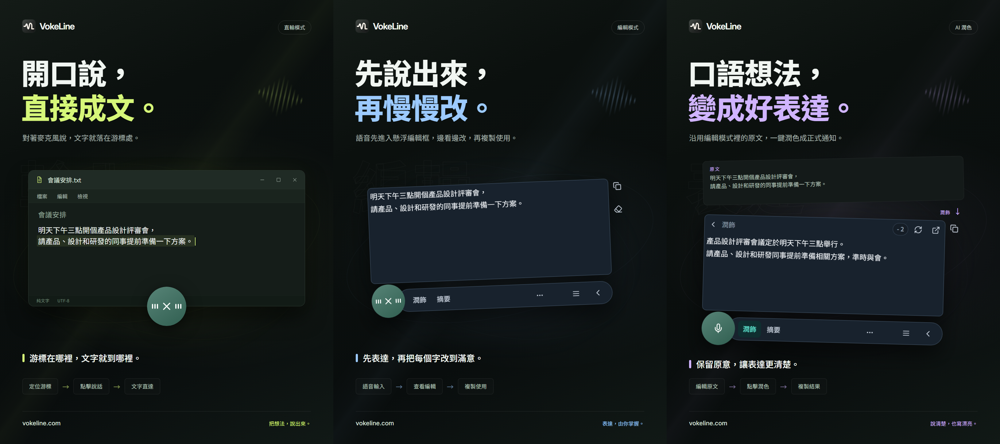

# VokeLine｜桌面語音輸入與 AI 文字助理

[English](README.md) | [Español](README.es.md) | [Português (Brasil)](README.pt-BR.md) | [Português (Portugal)](README.pt-PT.md) | [Français](README.fr.md) | [Deutsch](README.de.md) | [Italiano](README.it.md) | [Nederlands](README.nl.md)

[Русский](README.ru.md) | [Polski](README.pl.md) | [Türkçe](README.tr.md) | [Українська](README.uk.md) | [日本語](README.ja.md) | [한국어](README.ko.md) | [Bahasa Indonesia](README.id.md) | [Tiếng Việt](README.vi.md)

[ไทย](README.th.md) | [Bahasa Melayu](README.ms.md) | [हिन्दी](README.hi.md) | [বাংলা](README.bn.md) | [简体中文](README.zh-CN.md) | [繁體中文](README.zh-TW.md) | [Svenska](README.sv.md) | [Čeština](README.cs.md)

[Norsk bokmål](README.nb.md) | [Dansk](README.da.md) | [Suomi](README.fi.md) | [Română](README.ro.md) | [Ελληνικά](README.el.md) | [Magyar](README.hu.md)

[官方網站](https://vokeline.com/) · [下載](https://vokeline.com/zh-TW/download) · [使用指南](https://vokeline.com/zh-TW/docs/start)

## 產品介紹

VokeLine 是一款桌面語音輸入與 AI 文字助理。它把即時語音或音訊檔轉成可編輯文字，再由你選擇 AI 文字處理、複製、搜尋或紀錄整理。

常駐控制項和浮動工具列負責即時聽寫與立即操作；主介面用於管理音訊檔、AI 操作、歷史、雲端筆記、模型、使用情況和設定。

點擊麥克風按鈕或按快捷鍵，開始說話、檢查文字，再選擇複製、輸入或 AI 操作。每一步都由你決定。

**開始說話 → 在游標位置檢查文字 → 選擇下一步**

_功能示意，從左到右為直輸模式、編輯模式與 AI 潤飾。圖中文字與點數為範例。請核對結果，實際點數用量以應用程式顯示為準。_

## 適用對象

- **需要回覆工作訊息的使用者**：閱讀網頁或文件時口述回覆，修改後複製到目前應用程式，不必來回切換。
- **學生與研究人員**：閱讀時口述觀察與結論，再用 AI 為原文產生摘要或重新整理。
- **寫作者與內容創作者**：先口述初稿，再移動游標補充細節，並對最終表達進行潤飾。
- **整理訪談或其他音訊的人**：一次加入多個支援的音訊檔案並查看處理進度；開啟「儲存本機紀錄」後，完成的文字會自動儲存到本機紀錄。

## 核心功能

- **可編輯原文**：移動游標、修改文字、暫停後繼續說，再決定複製、寫入、搜尋或使用 AI。
- **音訊檔案轉錄**：一次加入多個支援的音訊檔案並查看處理進度；開啟「儲存本機紀錄」後，完成的文字會自動儲存到本機紀錄。
- **本機語音模型**：下載模型，並分別選擇即時聽寫和音訊檔案轉錄的預設模型。
- **AI 解釋、潤飾與自訂操作**：使用目前原文解釋概念、提取要點、改進表達，或執行儲存的自訂指令。建立並排序可重複使用的指令，並選擇哪些操作顯示在浮動工具列中。
- **搜尋與複製**：直接複製最終文字，或交給你選擇的搜尋引擎並在系統瀏覽器中繼續探索。
- **本機紀錄與雲端筆記**：歷史紀錄依身分儲存在目前裝置；只有點選「儲存到雲端」時，該筆紀錄才會上傳。
- **一目了然的主介面**：查看使用情況、轉錄音訊檔案、管理 AI 操作、瀏覽本機紀錄與雲端筆記，並設定本機模型。

AI 操作取決於已設定的服務、網路、可用點數與目前發布狀態。

## 操作指南

### 1. 下載與安裝

[下載](https://vokeline.com/zh-TW/download)

開啟官方下載頁面，選擇符合作業系統與處理器架構的安裝程式。依照系統提示完成安裝，再啟動 VokeLine。首次使用時保持網路連線，以便下載本機語音模型。

VokeLine 面向 Windows 和 macOS，Linux 版正在開發中。可下載的版本、架構和系統需求，請查看下載頁。

### 2. 準備第一個模型

**入口與條件：** 左側「模型」→「本機模型」。下載需要網路與足夠的磁碟空間；模型卡片會列出下載大小、預估記憶體需求和支援的工作。

1. 挑選支援「錄音轉錄」的模型，確認語言和裝置需求。只支援檔案轉錄的模型無法用於即時錄音。
2. 點選「下載」，等候下載、檔案檢查及安裝完成。需要暫時離線時，可「暫停下載」，恢復連線後再「繼續下載」。
3. 在已下載的模型上點選「使用」。若支援兩種工作，可依介面選項設為錄音預設、檔案預設，或同時套用。
4. 確認卡片顯示錄音正在使用的標記，再回到首頁。

**完成後：** 新錄音會使用所選本機模型。下載完成不代表已選用，仍要點選「使用」。檔案損壞、記憶體不足或下載失敗時，請參閱[模型問題](https://vokeline.com/zh-TW/docs/help#guide-model-downloads)。

#### 檢查麥克風

**入口：** 「設定」→「語音與快捷鍵」→「輸入裝置」。錄音需要已連接、未靜音且獲得系統權限的麥克風。

1. 選擇系統預設裝置，或指定要使用的麥克風。外接裝置拔除後，請重新選擇可用輸入裝置。
2. 點選「測試麥克風」，說幾句話。測試會在 10 秒內自動結束，不儲存這次測試錄音。
3. 偵測到聲音後即可繼續。若沒有聲音，請檢查靜音、系統輸入音量與距離，再重新測試。
4. 提示權限不足時，使用麥克風權限設定入口；若無法自動開啟，請手動進入系統設定。

**完成後：** 測試能偵測到聲音，輸入裝置也沒有無法使用的提示。檔案轉錄不需要麥克風，可直接參閱[音訊檔案轉錄](https://vokeline.com/zh-TW/docs/features#guide-audio-files)。

### 3. 即時語音輸入

兩種模式都需要可用的錄音模型、麥克風與系統權限；本機轉錄不要求登入，也不扣 AI 點數。先[檢查麥克風](https://vokeline.com/zh-TW/docs/start#guide-microphone)。

| 模式     | 開啟方式                                     | 文字位置                 | 適合用途                           |
| -------- | -------------------------------------------- | ------------------------ | ---------------------------------- |
| 編輯模式 | 對應快捷鍵；預設為編輯時可點首頁或浮動麥克風 | 可修改與複製的浮動編輯框 | 檢查文字、執行 AI 或搜尋後再使用。 |
| 直輸模式 | 對應快捷鍵；預設為直輸時可點麥克風           | 已選定的目標輸入欄位     | 直接寫入正在編輯的程式。           |

#### 編輯模式

1. 使用編輯模式快捷鍵，或設為預設後點選麥克風。
2. 開始說話；完成後使用錄音控制結束，等候文字整理。
3. 修改原文並複製，或選擇 AI 操作與搜尋。

**完成後：** 原文留在浮動編輯框，AI 結果另行顯示，可分別複製。完成一般轉錄不會自動送出 AI 請求。

#### 直輸模式

**額外條件：** 目標程式必須有可編輯欄位。需要系統權限時，到「設定」→「語音與快捷鍵」使用直輸系統權限管理入口；macOS 另依提示允許輔助使用權限。

1. 先點選目標輸入欄位，放好游標，再使用直輸快捷鍵。
2. 出現選擇輸入欄位的提示時，選定目標並等候錄音開始。
3. 說話期間保持該輸入位置，不要切換視窗或欄位。
4. 使用錄音控制或對應快捷鍵結束，檢查目標程式中的文字。

**完成後：** 文字寫入已鎖定的目標位置。寫入失敗時先檢查欄位與權限；必要時改用編輯模式複製貼上，避免在目標不明時反覆重試。

### 4. 音訊檔案轉錄

**入口與條件：** 左側「檔案轉錄」。先安裝支援檔案轉錄的本機模型；不需要登入、麥克風，也不扣 AI 點數。

| 限制       | 目前要求                         |
| ---------- | -------------------------------- |
| 格式       | WAV、MP3、FLAC、OGG、M4A、MP4。  |
| 檔案大小   | 不可為空檔，每個檔案最多 2 GB。  |
| 單次加入   | 最多 100 個檔案。                |
| 說話者區分 | 目前不支援，只提供不區分說話者。 |

1. 點選「選擇檔案」，或將檔案拖入頁面；需要補充時使用繼續加入的入口。
2. 在準備轉錄畫面檢查清單，移除格式、大小、名稱或讀取狀態不合要求的檔案。檔案被其他程式修改後要重新選擇。
3. 選擇本機模型。若模型支援指定「音訊語言」，請從可用選項中選擇已知語言；只支援自動辨識的模型會自行判斷。兩種情況都應檢查轉錄結果。
4. 開始轉錄，在清單查看等待、讀取音訊、轉錄與整理文字的狀態。
5. 完成後開啟結果，檢查正文並複製。

**完成後：** 每個檔案是獨立工作。開啟儲存本機紀錄時，完成文字會存入目前身分的本機歷史，不會自動存到雲端。

### 5. AI 文字操作

**入口與條件：** 在「AI 操作」頁面設定，從浮動編輯工具列執行。執行時需要登入、網路、可用的 AI 模型及足夠點數；先查看目前模型、輸出語言與點數條件。

| 操作     | 用途           | 輸出語言       |
| -------- | -------------- | -------------- |
| 解釋     | 說明原文含義   | 所選輸出語言。 |
| 潤飾     | 改善表達       | 跟隨原文。     |
| 摘要     | 整理主要內容   | 所選輸出語言。 |
| 擷取要點 | 擷取重要內容   | 所選輸出語言。 |
| 校對     | 檢查與修正文字 | 跟隨原文。     |

1. 在 AI 操作頁面選擇預設模型及輸出語言，儲存設定。
2. 在浮動編輯框準備文字，確認沒有超過輸入限制。
3. 選擇操作，核對點數提示，等候完成。
4. 檢查並複製結果；需要修改原文時，返回原文編輯。

**完成後：** 結果顯示在獨立區域。只有主動執行操作，文字才會送到所選線上服務。AI 模型設定和本機語音模型設定互不替代。

選擇「跟隨原文語言」時，結果使用原文語言。「潤飾」和「校對」固定使用原文語言。

「重試」會嘗試恢復同一次操作；「重新執行」則會開始新的處理，可能再次使用點數。若目前的操作仍在處理或確認結果，請先查看狀態並等待，再決定是否開始新操作。

#### 自訂操作

1. 點選新建操作，填寫名稱與提示詞，例如「把原文整理成會議紀錄，列出結論及待辦事項」。
2. 設定模型、語言與工具列顯示狀態後儲存。不要在提示詞填入密碼、金鑰或其他敏感資料。
3. 用短文字測試結果，再調整提示詞；自訂操作最多 20 個。

### 6. 本機紀錄與雲端筆記

#### 本機歷史與使用統計

**入口與條件：** 左側歷史紀錄，或首頁最近紀錄。只顯示目前訪客或帳戶在此裝置的紀錄，查看不需網路。

1. 以全部、語音或 AI 篩選找到紀錄，選擇後查看詳情。
2. 語音紀錄查看原文；AI 紀錄查看原文和結果，複製所需部分。

#### 儲存到雲端

**入口與條件：** 登入後，在該帳戶的歷史紀錄選擇項目，再儲存到雲端。需要網路，且雲端筆記尚未達上限。

1. 先登入要擁有紀錄的帳戶，再開啟該帳戶的本機歷史。
2. 選擇紀錄，確認原文或 AI 結果沒有不想上傳的內容，再儲存到雲端。
3. 等候成功或已存在提示。失敗時保留本機原文，檢查連線與上限後重試。
4. 進入雲端筆記，重新整理並檢查內容。

**完成後：** 所選文字成為該帳戶的雲端筆記，可在其他裝置登入同帳戶查看。本機原紀錄保留，之後刪除本機項目不會同步刪除雲端。

## 常見問題

### 一定要登入才能使用嗎？

本機聽寫、本機模型、本機紀錄和複製可以不登入使用；AI 權益、雲端筆記和帳號功能需要登入。

[價格](https://vokeline.com/zh-TW/pricing)

### 沒有文字或辨識錯誤

確認模型支援你使用的語言、選取的麥克風可正常運作，並減少環境噪音後再試一次。錄音會自動辨識語言；檔案轉錄則僅在模型支援時，才能指定音訊語言。變更介面語言不會改變辨識語言。若要用其他語言解釋、摘要或擷取要點，請選擇對應的 AI 操作並設定輸出語言。音訊語言只用來告訴模型要辨識哪一種語言。

### 直輸沒有寫入或要求先選欄位

先點選可編輯的目標欄位並放好游標，再使用直輸快捷鍵。程式等待選擇目標時，依提示點選；錄音期間保持該位置，不切換視窗或欄位。

需要權限時使用直輸系統權限管理；macOS 檢查輔助使用權限。目標程式不接受寫入時，先用[編輯模式](https://vokeline.com/zh-TW/docs/features#guide-editor)檢查並複製貼上，保留文字後再排查。

### 無法加入檔案或開始轉錄

確認格式為 WAV、MP3、FLAC、OGG、M4A、MP4，檔案不為空且不超過 2 GB，每次不超過 100 個。移除不合要求的檔案，確認已選擇可用檔案模型及音訊語言。

檔案重新命名、移動、被外部修改或待選清單失效後，要重新選擇。副檔名符合卻無法讀取時，確認能否播放、是否有音軌，以及是否損壞。

## 資料與隱私

麥克風音訊只用於本機轉錄，不會儲存成雲端筆記。只有選擇 AI 操作後，才會送出對應的 AI 連網請求。

| 操作               | 內容去向                                                                             |
| ------------------ | ------------------------------------------------------------------------------------ |
| 本機錄音或檔案轉錄 | 在此裝置由本機模型處理，不自動上傳為雲端筆記。                                       |
| 儲存本機紀錄       | 文字儲存在此裝置上，訪客與各帳戶的紀錄分開存放；沒有額外加密，請保護裝置與系統帳戶。 |
| AI 文字操作        | 該操作所需文字送到選定線上服務。                                                     |
| 網頁搜尋           | 搜尋字詞送到選定引擎。                                                               |
| 儲存到雲端         | 所選文字透過網路存入帳戶雲端筆記。                                                   |

在「設定」→「資料與隱私」關閉「儲存本機紀錄」，只會停止儲存之後產生的新文字，既有紀錄仍會保留。首頁仍會累計錄音和檔案轉錄的次數、音訊長度與輸出字元數；這些統計不包含文字內容。

此開關控制是否在「歷史紀錄」新增紀錄。檔案轉錄的工作與結果會另行保存在此裝置上；不再需要時，請在「檔案轉錄」使用「移除任務」。移除工作不會刪除已儲存的本機歷史或雲端筆記。

本機紀錄按訪客或帳號身分區隔；只有你明確儲存的紀錄才會複製到帳號的雲端筆記。

[帳戶與資料](https://vokeline.com/zh-TW/docs/account)

## 官方網站與協助

- [官方網站：vokeline.com](https://vokeline.com/)
- [快速開始](https://vokeline.com/zh-TW/docs/start)
- [功能操作](https://vokeline.com/zh-TW/docs/features)
- [常見問題](https://vokeline.com/zh-TW/docs/help)

**入口：** 從桌面的「帳號」選單開啟「個人中心」，再進入網站的「協助與意見回饋」；需要時先登入。

1. 說明程式版本、作業系統、功能、操作方式、預期結果與實際情況。
2. 附上完整提示；模型問題補充模型名稱，檔案問題補充格式與大小，點數問題補充訂單或明細時間。
